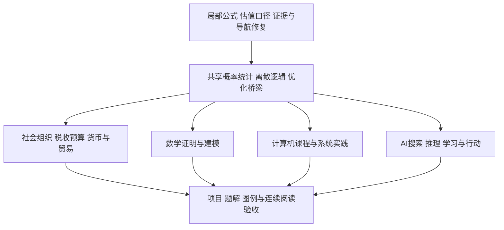

# 下一步建设规划

目标是把已有笔记接成可连续学习的课程：能找到前提、看懂推导、复算例子、知道边界，再用练习或项目检验理解。具体课程任务、依赖与验收保留在下方 27 项任务束；本页不把候选、已派发工作或历史批次改写为当前已完成。`input_baseline` 保留原建设规划所依据的历史输入，当前发布版本由实际结果记录确定。

## 活动入口

### 正在做

- 当前按具体错误与读者问题推进：先修已确认的知识、公式、代码或阅读断点，再补跨层解释。入口为 [[00-工作台/基础理论学习路线|基础补桥与本科快进路线]] 与 [[00-工作台/按问题找知识|按问题入口]]，汇入已有主解释、答案与实践；任务是否已修须对照目标最新版本和验收。2026-10-04 已交付的六个教学案例及非 CFA 局部修正，保留在 [[Logs/2026-10-04_跨层理解方案实施|该批实际结果]]。
- 当前社会部分以科普和认知建构为主，沿 [[社会科学/00-开始/01-社会认知学习路线与32个问题|组织、制度、税收预算、货币金融与国内外循环]] 复用已有主文。CFA 目录中的有效会计/金融解释可按问题选读；F1–F5 年度 LOS 路线保留为可选历史专业计划，不决定本轮排期。2026-10-04 批次排除 CFA 专项是当时范围，不延续为本轮阅读或引用禁区。各域独立路线、原稿和个人记录保留；AItextbook V19 仍只按 [[00-工作台/AItextbook参照与采用边界|已注明的采用边界]] 使用。
- 本轮内容、执行、图像、客户端与真人学习分别验收；具体发布与剩余限制以实际结果记录为准。下方 27 项长期任务及其原验收保留，不因本轮案例完成而自动通过。

### 已完成且有证据

已发布范围以 [[CHANGES|CHANGES.md]] 和各批实际结果为准：[[Logs/2026-09-17_审计后首批课程建设与维护|首批]]、[[Logs/2026-09-17_第二批课程建设与阅读验收|第二批]]、[[Logs/2026-09-17_第三批课程深化与真实项目验收|第三批]]、[[Logs/2026-09-20_第四批证明链与真实实验|第四批]]、[[Logs/2026-09-20_第五批机制证明与政策账本|第五批]]、[[Logs/2026-09-20_第六批证明实验与覆盖复审|第六批]]、[[Logs/2026-09-20_第七批非CFA课程与阅读收尾|第七批历史结果]]。它们各自记录版本、恢复位置、失败和未运行层，不自动证明完整路线、课程、LOS 或人的理解。第七批及2026-10-04跨层理解批次“跳过 CFA”都是各自的历史范围，不自动约束当前问题选择。

### 暂缓与未完成边界

- 下方 R、S、F、M、C、A、E 的 27 项是长期建设清单，不是本轮默认写集合。未选定范围前，不把阅读、候选或静态检查称为整个任务已完成。
- 只有明确选择考试或职业路线时，CFA 的 LOS、年度映射、路径和正式课程边界才按 F1–F5 的原条件处理；非考试社会认知不以它们为先修。数学、计算机、AI 和社会科学同样按实际证据说明范围。
- 发布按完整小组核对正文、来源、例题、适用的代码／镜像、结构、独立内容复核及客户端证据；未运行、失败或人的理解不能由其他层代替。保存、同步和写入协调的临时状态留在本轮库外记录。

## 当前进度与仍待补的范围

下方 27 束保留历史课程目标、先修和验收供按需选择，不作为本轮自动任务。[[00-工作台/审计/2026-09-17/README|原四条路线审计]]与[[00-工作台/审计/2026-09-20/四轨覆盖与阅读复审|四轨覆盖与阅读复审]]保留当时证据；不把历史“未定位”直接当作今天缺课。尚待进一步建设或验证的具体残余包括：

- **金融与统计**：F1 的复杂可变对价、合同修改、主代理、法域／US GAAP、真实行业和完整报表；F2/F3 的 FCFF/FCFE、剩余收益、P/B、EV 等多模型链、真实公司／指数方法与未逐条验收的 LOS；F4 的完整资产预期、股债／另类组合、执行成本、期权／互换、固定收益／风险归因、Asset Manager Code 和三条路径；F5 的原创情景与评分、年度 LES 状态。S01 的非独立样本、金融时间序列和更深统计推断继续保留，Lévy 定理是明确外部依赖；S02/S03 仍需更深语言语义、类型与复杂度、一般优化建模和迁移题，有限搜索或单例证书不替代一般结论。
- **数学**：万有覆盖存在与覆盖分类、曲面／流形及变条件迁移题仍待补深，穿孔平面骨架保留明确几何前提；Minkowski、Dedekind 与可逆理想等已调用外部定理不能由有限枚举代替。M3 的系统证明训练与数值题解继续，浮点实验不认证一般严格区间计算；M4 的自主建模、报告修订和讲解仍需真实学习过程。具名培养方案中的核心、方向选修与个人选择继续分开。
- **计算机系统**：在已发布的单 hart 中断／切换与 Sv39 实验之后，继续一般调度、文件系统、COW/ASID、多核及生产隔离；旧实验的 `satp=0`、后续实验宽松 PMP／S 态 RWX 均不证明完整 OS 安全。更广协议、TLS 与受控链路仍待验收，旧 loopback 结果不覆盖它们。
- **计算机与 AI 的实践边界**：团队／HCI／读屏组合、语言理论、完整 Raft、移动／嵌入式平台、GPU 与完整 PBR/MSAA 尚不由既有样本认证。AI 继续更广真实语料与模型、机器人校准、增广积分控制、估计误差／扰动／时延下硬约束、饱和全局稳定和连续真轨迹碰撞认证；固定种子不等于 Monte Carlo 覆盖。已有校准实验不能替代可审计的上游特征处理链、更广实体样本、漂移及受授权的人类反馈／真实项目；已观察测试集不再用于选模型。
- **社会科学**：RD 的稳健偏差修正、自动带宽、正式密度检验、聚类标准误，以及另一制度、长期反馈、溢出、异质性和分配机制，按既有课程与实际结果中的未完边界继续保留。已有密度／协变量／规格诊断的教学实现不等于这些更强推断；单一 NJ/PA 例子和财政恒等式均不能推出一般政策结论。
- **阅读与客户端**：历史 425px 栏的未结案记录包括拓扑03约457px、LQR01约447px、LQG MOC约638px、最低工资01图约791px、Sv39长式约461px；PID01/03、LQG01/02和最低工资复算的长式，以及旧 CFA／控制／政策整页、全部内核图与相应点击补验，也须按实际客户端逐页复核。某次图像打开、公式解析或新页预览不追认所有旧项通过；人的理解另由练习与迁移检验。

## 本轮之后如何选择下一组

先处理已确认错误，再补阻断当前案例的先修缺口、重复出现的解释断点、已选学科主干缺口，最后研究选修。各域覆盖表记录“已有／部分／未定位／不适用”，核验状态另记；页数与链接数不换算为学科完成率。

| 由本轮案例暴露的边界 | 下一组可独立验收的单元 | 验收产物 |
| --- | --- | --- |
| 单次目标更新不能证明内容依赖机制 | 同一任务下位置模型与内容模型的区分 | 先预测，再改变位置、角色与输入；比较失败并说明可支持范围 |
| 地址合同不等于实际 GPU 执行或性能 | 非连续张量到真实执行的受控验证 | 固定 shape/dtype/stride、参考输出、尾部与误差；设备与完整成本单独记录 |
| 条件 Gaussian 不能消除偏置或延迟 | 带时点的观测、模型与可观测性 | 明确状态时刻、残差、偏置反例；未知动力学时停止推断 |
| 引用与回执不足以证明支持或交付 | 请求身份、证据版本与执行不变量 | 无答案／冲突／撤销与重试；身份相同及变化时分别验证效果 |
| 历史材料缺参加者、落榜者与入仕去向 | P-04 的分期材料与微观关口比较 | 一组可核来源、缺失表、竞争解释与不确定结论；不填未核比例 |
| 局部结果不能直接外推扩容 | 政策异质性、容量与规范选择 | 明确比较总体、时窗、溢出；联合改变人群与制度后重建判断 |

这张表是已有案例边界导出的建设顺序，不创建空标题课程，也不改变下方长期学科目标。

## 优先顺序

专项报告中的P0/P1/P2是各自任务优先级，含义并不完全相同：例如CFA的P0也包含阻止“全课程覆盖”宣称的大块缺课。这里统一按实际执行目的排队，避免把“缺课程”与“已有公式错误”混为一谈。

| 顺序 | 要交付什么 | 依赖与停止条件 |
| --- | --- | --- |
| 先修复现有问题 | R01–R04：两个局部解释问题、证据/迁移断链、重点阅读出口 | 每个小组独立审阅即可发布；不等待全部课程补齐 |
| 建共享基础 | S01–S03：概率统计、离散证明、线代/优化到应用的桥 | 每组至少有完整推演、例子、反例和练习；不能只建目录 |
| 接通当前主干 | 数学、计算机、AI与社会认知按独立读者问题并行 | 社会部分先接组织/制度、税与预算、货币金融、汇率贸易；已有主文按需复用，F1–F5仅在选择考试/职业目标时启用 |
| 深化实验与阅读 | E1–E3：真实数据/系统项目、图例、学习路径验收 | 内容正确、实验执行、客户端呈现和人的理解分别记录 |

箭头表示学习或内容依赖，不要求所有前置工作一次性齐备；每次发布应是一组能够独立读完的小课。

## 第一批：修复与阅读路径

| 编号 | 精确范围与动作 | 完成验收 |
| --- | --- | --- |
| R01 | [[数学/15-微积分/07-积分应用与数值积分几何物理和误差\|Simpson求积页]]第48–50行：恢复奇偶索引及上下界，保留正偶数n与步长条件 | n=2权重1/4/1、n=4权重1/4/2/4/1；1、x、x²、x³精确积分；源文本与实际公式显示同时可读 |
| R02 | [[社会科学/30-金融市场与风险/03-股票所有权现金流与估值\|股票估值页]]第33–35行：明确经营EV、现金、其他非经营资产、总债务/净债务集合 | EV=1000、现金=100、债务=300时两种合法写法均得800；给重复计入得900的反例；增加一张估值桥，标清每项进入哪一次 |
| R03 | 按[[00-工作台/审计/2026-09-17/链接与阅读质量审计\|断链清单]]修18次迁移路径；核查数学历史公式解析证据 | 18个目标/版本用途逐项兑现；证据若找不到，明确历史声明而不伪造JSON；保留2条教学断链和教学孤岛。3条日志断链另按历史用途核对，私有笔记问题不纳入公开正文修复 |
| R04 | 先补SVD→AI PCA、银行→货币、AR/PPL→评测出口；再处理概率→泛化→金融风险与集合逻辑→算法 | 每条链接说明“去读什么/为什么”；打开目标确认主解释及符号一致；允许回到MOC的明确路径，不强制所有页面互链 |

**环境旁项**：当前 `make-md/main.js` 缺失、7项属性类型冲突、5项链接歧义和31项附件片段待检查单列维护；先核对当前插件安装状态及实际使用，再确定最小恢复，不靠关闭检查变绿。属性冲突只改实际错误字段，不批量清洗旧属性或代填掌握度。

## 第二批：三组共享基础

### S01 概率统计：接通数学、CFA与ML

从已有条件概率/协方差/估计页出发，补随机变量变换和常见分布、Chebyshev→弱大数、CLT的明确证明路线、抽样分布、检验与功效、回归统计推断。先解释对象与抽样单位，再给公式。将“完整证明”“证明路线”“外部定理依赖”明确区分。

验收使用一组Bernoulli与一组收益样本：手算均值方差和误差界、区间/检验、功效与选择性报告反例；给样本量变化分布图、Ⅰ/Ⅱ类错误图、完整题解。金融时间序列与非独立样本随后接入，不能把iid结论直接搬过去。概率应用页分别链接概率主解释、测度先修与谱分解应用。

### S02 离散数学、逻辑与证明：同时服务CS和AI

串起集合/关系/量词、命题和谓词逻辑、归纳/不变量、计数/容斥/鸽巢/递推、图、可计算性与归约。保留已有算法证明，将必要前提接回数学；不另复制全部图算法。

验收含一个完整计数推导、递推求解、量词反例、图模型与最小枚举检查，以及有清楚计算模型前提的停机对角化。应用出口分别接类型、数据库约束、复杂度、CSP和知识表示；“知道术语”不能验收为完成。

### S03 线代、优化与建模桥梁

复用SVD/最小二乘/凸优化，补SVM原始约束→对偶→核预测的最少必要推演，补算法原始对偶成本链（tight点、每条边至多计两次、弱对偶）。给同一小矩阵/小图的手算、几何图、数值核验与失败条件。

验收不仅检查三角形或一个Gram矩阵数值正确，还检查一般论证中的每个条件；将线代、算法、ML三处的符号及shape逐项对齐。

## 第三批：四条课程主干

### F：CFA全课程路线

以下保留2026-09-23规划中的专业/考试目标。只有选择这条路线时，才以[[00-工作台/审计/2026-09-17/CFA课程覆盖审计|25项矩阵]]核对具名年度、级别、模块或LOS，并重新检查当前版本；它不决定本轮社会认知的建设顺序。非考试读者从[[社会科学/00-开始/01-社会认知学习路线与32个问题|社会认知32问]]或[[社会科学/50-CFA课程/00-CFA课程-MOC#不以考试为前提的选读|会计与金融问题入口]]进入，不必补齐F1–F5。

- **F1 伦理＋财报＋公司财务**：职业标准/GIPS案例；三表关系、会计调整、财务比率与质量；资本预算、WACC、资本结构、分派及治理。用一家公司和一组职业情境贯穿案例，所有金额/时点可勾稽，区分经济解释与准则条件。
- **F2 一级资产与数量方法补齐**：微观厂商/市场结构、贸易与汇率、金融统计与回归；股票/债券/衍生品/另类的基础题；有效前沿、目标约束与行为偏差。补TWR/MWR、凸性/key-rate、存续合约价值、费用净回报等现有讲义缺项。
- **F3 二级分析链**：金融时间序列、复杂报表、公司/股票估值、信用和含权债、互换及多步期权、另类与组合分析；用多信息条件的案例组串接输入、模型选择、估值与限制，配逐步解答。
- **F4 三级共同核心与三条路径**：先资产配置、组合构建、绩效与归因、衍生品风险管理及伦理，再分别建设Portfolio Management、Private Markets、Private Wealth。三条路径为材料宽度目标，考生按实际所选路径学习，不能说考试要求三条都选。
- **F5 PSM与考试能力边界**：本库提供财务建模/Python等实践桥梁；官方PSM完成状态仍由对应年度LES确认。本库练习不代替官方完成记录。建立原创情景题和评分要点，未逐条核对的LOS继续标待核。

在这条可选专业路线中，F1可作为独立小组，完整CFA宣称仍需F2–F5和全LOS映射逐项验收。优先复用已有金融八讲，不将新路线变成八讲的平行副本。

### M：数学本科路线

- **M1 概率统计与课程定位**：消费S01，将“六科主线”明确为现有范围；把具名培养参照中的概率、几何学、抽象代数核心与方向选修分开。
- **M2 抽象代数、几何、拓扑**：从群作用/商结构继续有限群与因子分解；从曲线曲面补完整推导、坐标与测地线；从度量空间通向一般拓扑、积/商、分离、紧致、同伦与基本群。几何图要同正文参数一致，拓扑图要说明被识别的点及哪些性质不由画法决定。
- **M3 证明补深与数值分析**：按数学报告逐个补紧致等价、逆映射构造、Cauchy全局推广、Smith结构依赖；建立求根→插值逼近→数值ODE→迭代线代路线。每算法写停止条件、误差/稳定条件和失败例，画收敛阶或稳定域。
- **M4 建模与表达**：一个可复现项目包含量纲/假设、两个模型比较、参数辨识、敏感性、验证、完整报告及修订、讲解提纲。固定题库不能替代自主建模；材料齐备与用户完成分别记录。

具体页面、定理及练习验收沿用[[00-工作台/审计/2026-09-17/数学本科覆盖审计|数学专项任务]]，高年级方向按所选方案加深，不把研究级内容都列为本科共同必修。

### C：计算机本科路线

- **C1 HCI、SE、职业伦理**：给用户任务/原型/可用性与无障碍方法；从需求到接口、架构、测试、兼容与维护；补利益相关者与伦理冲突案例。现有测试和MiniLang是起点，不能充当需求工程或团队沟通全部证据。
- **C2 离散与语言理论**：消费S02；补计算模型、不可判定性与语言语义/类型证明的明确边界。每个抽象定义接一个实际程序或图例。
- **C3 分布式、图形、平台**：共识/复制/故障模型与逻辑时钟成链；图形从变换、投影、可见性到最小渲染器；平台先选一条Web/移动/嵌入式路线，其他方向保持待补状态。CUDA通信不代替分布式共识。
- **C4 系统实验深度**：围绕已有OS/网络/数据库/安全课，分小组做教学内核、真实协议测量、PostgreSQL并发与恢复、隔离安全实验。每组写环境、故障假设、预期与实际输出；模型/模拟通过与真实系统行为分别验收。

检查[[00-工作台/审计/2026-09-17/计算机本科覆盖审计|17知识领域矩阵]]中未覆盖单元，不用某个优秀系统样本把整域勾成完成。

### A：AI本科路线

- **A1 符号AI与行动**：同一问题串起状态空间、BFS/UCS/A*、对抗搜索、CSP、逻辑事实/规则/查询、规划前提/效果。保留现有A*一句条件和回溯/CSP片段，补可跟算轨迹而非从零另写同类算法。
- **A2 机器人与传统语言**：传感→状态估计→运动学→规划/控制闭环，先模拟小项目；传统NLP的序列模型、Viterbi和结构化任务接回已有CTC/神经语言模型。LLM调用工具不能直接验收为自动规划。
- **A3 已有ML例子补深**：PGM联合表与消元中间因子，CTC初始化/转移/终值表，2真框×3候选匹配与AP序列，有限MDP的MC/TD/Q-learning学习轨迹；图、公式与实验必须使用同一数值例。
- **A4 公平/HCI与真实数据项目**：比较相互冲突的公平指标，说明社会目标不能由一个分数代替；真实数据固定实体/时间拆分，比较简单基线、校准/代价/分组失败、版本血缘、发布/回滚与漂移演练。真实访谈和人类测试另按实际参与授权开展，不虚构反馈。

详见[[00-工作台/审计/2026-09-17/AI本科覆盖审计|32项矩阵与8项理解障碍]]。端到端项目证据齐备后，仍不由合成单测推断真实泛化、GPU/DDP或生产可靠性。

## 每一批都要交付的阅读与验收

以下E1–E3用于完整教学单元的建设；普通标点、措辞和图注小修按[[AGENTS|协作约定]]局部自查，不因此补题、重画图、重跑全库测试或另造交接记录。重要论证与行为的变化只核本次影响和必要上下文。

**E1 连续解释**：开头给读者问题和已有前提；定义对象/符号/单位/shape；机制或证明不能省掉承担结论的步骤；至少一个可以跟算的例子和一个改变条件的反例。短课不靠机械增字达标，长课可以按问题拆分。

**E2 图与例题**：优先补对象图、几何图、状态表、账本、分布/误差曲线；图例、单位、条件与正文同一案例一致。每核心主题配完整解答和迁移题，独立阅读者能指出“下一步为什么这样做”。Mermaid或SVG存在只证明文件存在，实际显示和理解需另验。

**E3 链接与版本**：先修/主解释/应用/反例四种用途写清，正文就近连接实验命令、函数和预期值。新链接检查具体目标和锚点；改变关键先修或主解释责任时独立复核阅读承诺，实际Obsidian点击/回退按受影响范围另记。保留人的批注；输入或目标出现第三种新内容时停止覆盖，做局部合并后再验收。

**发布条件**：以一个可独立阅读的小组为单位，按实际影响核对正文、来源、例题、代码/镜像和结构；重要论证或行为变化独立复核，适用客户端结果与未运行范围单列。未运行写未运行，缺课写待补，学会与否留给真实学习过程。任务完成时更新专项覆盖行与实际结果；不通过堆链接、空占位页或自动填写“已掌握”制造进度。

## 本次G1–G6如何回查实际产物

[[00-工作台/审计/2026-10-04/非CFA全库深审与贯通改进方案#9. 分批方案与可验收的完成边界|G1–G6审计方案]]是修订范围，不是完成回执。具名问题族已经接入原有数学、AI、计算机矩阵和社会科学首页，分别记录覆盖定位与本次核验；矩阵中的“已有”仍不等于全课程、实机、客户端或真人理解通过。

| 接下来要判断什么 | 查哪个现有入口 | 接受下一组的条件 |
| --- | --- | --- |
| 数学提升与分类、同调的界线 | [[数学/90-资源/05-六科覆盖矩阵与学习验收\|数学矩阵]] | 查清范围；新增时交完整论证与改变条件的任务，有限枚举不代替一般证明 |
| AI图对象、推荐反馈、视频时序或复杂机器人 | [[AI/00-开始/07-学科覆盖矩阵与分层学习清单\|AI矩阵]] | 固定任务、对象、拆分和预算；邻近课程可以复用，但不以提及认证完整单元 |
| HCI真实参与、PBR/MSAA、移动/嵌入式平台 | [[计算机知识/00-开始/全局导航/05-知识覆盖与逐科查漏\|计算机矩阵]] | 分开教学机制、实现和人的/平台的验证；不重写已兑现的订单与CS:APP回路 |
| 社科局部效应与更强推断 | [[社会科学/00-开始/00-社会科学-首页\|非CFA问题族]] | 统一主解释与规格；新制度/长期反馈/聚类或偏差修正按具体产物验收 |

本轮实际发布与组合验收查相应实际结果记录；具名教学单元可读和单组签收不替代整域、客户端或真人掌握的验收。该G1–G6历史批次未包含CFA专项与AItextbook写入；当前任务范围另按用户目标及具体授权确定。

已可接入的具体阅读产物包括 [[哲学与文化/10-主题/01-文化政治与组织结构/00-文化政治与组织结构-MOC#两种入口，同一份证据说明|G1组织证据双入口]]、[[数学/01-数学学习路线#先完成一张卡：三条可以立即走的路径|G2数学首步]]、[[编程知识/10-基础/01-正则表达式/00-正则表达式-MOC#从匹配到解析：同一输入的四份产物|G2文本四份产物]]和[[数学/15-微积分/15-曲面积分与通量法向和面积元#同一小例：二维参数域到三维曲面片|参数域到曲面图例]]。从根问题入口携带同一对象前往，回来分别交收紧的主张、首步产物、文本层级区别或取向判断。内容签收不代替全部客户端点击、真实研究参与或人的迁移结果；图例离线检查也不替代这些层。

基础目标/拆分/指标的连续返回任务见 [[AI/10-机器学习与深度学习基础/23-从数据到评测与行动|数据到评测与行动]]；曲率到连续/离散/浮点的同例见 [[数学/60-数值计算与量化/83-同一二次目标从梯度流到浮点停滞|数值四层账本]]；社会政策的事实真源和外推/规范责任见 [[社会科学/40-公共政策与社会学/08-局部有效政策与累积优势的判断|政策主张卡]]；认识论、伦理政治与科学解释各自从 [[哲学与文化/20-论证知识与规范/00-论证知识与规范-MOC|三个独立哲学问题]] 开始。带着当前主张去相应节，回来交分母与行动边界、误差与阈值判断、分层政策句子或哲学论证及反对意见之一，再选择下一组。上述具体教学切片已形成可核读入口，真实项目、客户端及人的迁移表现仍按实际结果分别记录。

## 八域分层范围与首组入口

八域范围是整体广度要求，个人可以选共同基础及一两个方向。电子/信号首组五课及U1/U2实践已经接入；内容审阅、CPU复算、仿真、真实设备、生产、客户端和真人表现分别记录，不能由首页或MOC存在推课程建成。

[[电子电路/00-开始/01-电子电路课程地图与覆盖边界|电子E01–E12]]保留器件/模拟/数模/数字/RF/供电/板级/制造，[[信号与系统/00-开始/01-信号系统课程地图与覆盖边界|信号S01–S14及独立控制C01–C08]]保留随机、检测、辨识、多速率、逆问题、通信、应用与实时方向。先按首组单位/KCL/RC、信号对象/卷积/ROC/采样交返回产物，后续方向按具体问题完整交课，不链接只有名字的空课。

来源准入已有局部推进：E08第二独立培养参照、S13八分支有限范围双参照及未执行真值方案已接受；C06指定原著的身份、章节定位与所列条件已核。C06版次、公式视觉、全部相关证明和课程准入仍部分未验；各方向主课、执行和现实真值另须交付，不能宣称P0整体退出。首组最小采样/仪表输入阻抗不依赖P2完整ADC驱动/板级课，其通过也不证明这些后续课或实测。数学Hilbert/条件期望深化桥按已接受的具体版本接入；社科已有测量/调查与访谈/过程追踪两课，继续承担自己的方法责任；旧纯理论与人文路线仍可独立阅读。

## 已接入的共同核心与独立人文单元

器件模拟基础已有 [[电子电路/20-器件与模拟/01-PN结与二极管工作点|PN工作点]]、[[电子电路/20-器件与模拟/02-MOS与BJT从工作区到小信号|MOS/BJT工作区]]、[[电子电路/20-器件与模拟/03-偏置增益与负载的连续设计|偏置/加载/摆幅]]、[[电子电路/20-器件与模拟/04-运放反馈摆幅与动态边界|运放边界]]及复算镜像；带Q、负载与波形，回来交残差、工作区与各项误差预算，完整E03–E05仍未完成。

U3沿 [[信号与系统/20-数字信号处理/01-FIR滤波设计与频率规格|FIR规格]]、[[信号与系统/20-数字信号处理/02-多速率与流式重采样|重采样状态]]、[[信号与系统/20-数字信号处理/03-有限字长块状态与实时合同|位宽与实时合同]]到 [[信号与系统/80-实践/02-流式音频重采样/README|CPU实验]]，带频带/延迟/相位/位契约，回来交规格与状态/时间证据。U6沿 [[信号与系统/30-随机信号与推断/01-随机过程相关与功率谱|随机谱]]、[[信号与系统/30-随机信号与推断/02-匹配滤波检测与未知到达时间|匹配检测]]到 [[信号与系统/80-实践/03-噪声中的脉冲检测/README|固定训练/测试]]，带总体/噪声/搜索范围/误报单位，回来分开均方、阈值和到达误差。内容与局部CPU证据已签收，不等于S06–S08/S10/S14全完成或设备实时/现实真值通过。

[[哲学与文化/20-论证知识与规范/04-量词有效性与反模型#基础入口：先预测，再画四个格子|量词反模型]]与[[哲学与文化/20-论证知识与规范/05-证言依赖与知识的理由#基础入口：先给一句预测，再查一项材料|证言来源链]]是已接入的独立人文单元；带人员关系或材料链，回来交有效性反例、收紧的证言判断及异议，基础与快进入口汇入同一正文，不以工程课为共同门槛。后续依赖样板及方向深化仍按实际接受的小组滚动接入；本页没有为未接受课程制造入口。

## 已兑现的预算、数字与状态入口

继续保留已兑现的69组任务入口及各自证据。U4新增 [[电子电路/40-反馈噪声与混合信号/01-反馈环路与稳定边界#一个、两个、三个极点|一到三极点环路]]、[[电子电路/40-反馈噪声与混合信号/02-热噪声输入等效与积分预算#相关交叉项与多级输入等效|相关噪声与输入等效]]、[[电子电路/40-反馈噪声与混合信号/03-ADC驱动建立与弱信号预算#驱动电阻与采集电容的建立|ADC采集建立]] 到 [[电子电路/80-实践/02-弱信号前端预算/README#输出与判读|U4预算实验]]，带规格/源负载/相关谱/采集时间，回来交失败预算、重设计与逐项误差；四端Ib、Vos、源/基准DC与随机RMS分别负责，常值半LSB建立不冒充连续tracking。U5新增 [[电子电路/30-数字电路与实现/01-状态机寄存器与时序合同#先固定沿前与沿后|一格FSM的沿前/沿后]]、[[电子电路/30-数字电路与实现/02-RTL性质复位与跨时钟边界#异步assert和同步release是两件事|复位与验证边界]] 到 [[电子电路/80-实践/03-FSM到RTL/README#真源与实际证据|U5源码与证据]]，带沿前时点/输入保持/reset epoch，回来交安全不变量、队列反例及未运行层。Python与源码已核；RTL/TB/SVA编译仿真、综合/形式、STA/CDC/RDC与FPGA仍未运行。

S05/C01新增 [[信号与系统/40-状态控制与辨识/01-状态实现可控可观与最小性#两状态手算：同一个端口漏掉了什么|状态实现的两状态手算]]、[[信号与系统/40-状态控制与辨识/01-状态实现可控可观与最小性#Gramian把同一条件变成连续时间能量|有限正时间Gramian]]、[[信号与系统/40-状态控制与辨识/02-内部稳定与输入输出稳定#两个稳定问题的量词|内部稳定与零状态BIBO]] 到 [[信号与系统/80-实践/04-状态实现与隐藏模态/README#撤去方法提示的迁移交付|状态实现实验迁移]]，带A/B/C/D、IC、端口及正窗口，回来交rank/Gramian与隐藏模态反例；理论n*=0纯直通与脚本n≥1、局部可积时域与Laplace绝对域、精确结构与现场辨识分别列条件。继续复用原LQR/LQG桥，不重复其主解释。这些主课及局部CPU/源码证据已签收，各方向和生产实践仍partial；下一组按具体缺口推进，不把链接数量作为固定范围完成证据。
