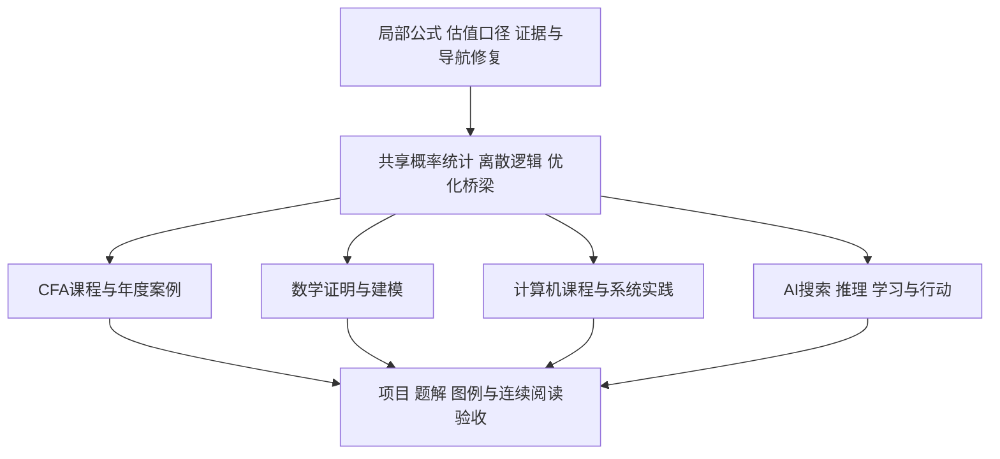

# 下一步建设规划

目标是把已有笔记接成可连续学习的课程：能找到前提、看懂推导、复算例子、知道边界，再用练习或项目检验理解。依据是 [[00-工作台/审计/2026-09-17/README|本次四条课程路线审计]]。审计后的前六批正文已提交；第七批按用户要求跳过CFA，完成下列四组非CFA课程与阅读收尾。具体出版范围与验证边界见各批实际结果；完整课程目标及其余任务继续保留。

保留现有学科目录和成熟解释，新增内容放进现有层级；先检索同义内容再确定文件名。共享的概率、统计、逻辑、优化只设一处主解释，CFA、CS和AI应用页保留必要回顾与用途链接。某校选修、某条CFA三级路径不能写成所有人的必修。

## 第七批收尾与当前优先事项

按用户最新要求，**本轮跳过CFA，结束当前非CFA批次并提交**。CFA候选留在库外，既有CFA正文和历史缺口保持；跳过不等于完成，也不要求继续等待CFA审阅。数学、计算机、AI三条本科路线仍只能判断为部分覆盖。

| 路线 | 本批已补内容 | 仍待补、不能外推的部分 |
| --- | --- | --- |
| [[数学/36-拓扑学/10-覆盖空间与van-Kampen/00-覆盖空间与van-Kampen-MOC\|覆盖空间与van Kampen]] | 路径/同伦提升、映射提升判别、拼接机制；楔圆、穿孔平面、环面和RP²算例，2张SVG与群字复算 | 万有覆盖存在与覆盖分类未完整证明；穿孔平面骨架为明确几何前提；有限枚举不认证一般定理 |
| [[计算机知识/80-实践/06-计算机系统/11-定时器中断与抢占调度/README\|定时器中断与抢占]] | 单hart RV64的Sstc、trapframe、两个不主动让出的U态循环；实际QEMU六次中断/切换与两个独立退出 | 非完整调度器、进程隔离、多核或真实硬件时序；文件系统、COW/ASID与一般调度仍待补 |
| [[AI/65-可信AI与真实数据实践/10-实体拆分与概率校准/00-实体拆分与概率校准-MOC\|实体拆分与概率校准]] | UCI 30人、10299行、561特征与六分类；按人固定18/4/4/4四集，温度缩放、可靠性图、NLL/Brier/ECE及实体切片 | 上游特征处理早于本次拆分，不能声称整条数据链无泄漏；四名测试受试者不保证新人总体表现；已观察测试集不能继续选模型 |
| [[社会科学/40-公共政策与社会学/30-断点设计与制度阈值/00-断点设计与制度阈值-MOC\|断点设计与制度阈值]] | Lee众议院真实归档的局部线性、带宽敏感性、识别条件和Fuzzy RD教学例；2张同源SVG | 未实现稳健偏差修正、自动带宽、密度检验或聚类标准误；局部历史效应不等于所有政策、长期效应或政策价值判断 |

本轮新补23篇课程/实验/数据说明Markdown、7张SVG和配套源码，接回7个父页与4条问题导航；另修15个旧页的图和长公式。下一轮按以下有界问题推进，不扩大本轮提交范围：

1. **阅读与连接**：拓扑03在425px栏中页面宽457px，LQR01宽447px，继续按数学等价步骤分行并验收；抽查旧课的“先修→主解释→例题→应用”承诺，不为可达率机械互链。
2. **数学M2/M3**：补万有覆盖存在与覆盖分类所需条件、曲面/流形方向和变条件迁移题；按培养方向处理Minkowski、Lévy等明确外部定理。
3. **系统C4及C1–C3**：从两上下文实验继续一般调度、文件系统、COW/ASID、多核；团队/HCI、语言理论、图形/分布式和其他平台的既有余项保留。
4. **AI A2/A4**：在现有实体隔离与校准基础上补上游特征处理可审计的数据链、更广真实数据与漂移；估计误差/时延下约束和受授权的人类实践继续，不能由这次测试替代。
5. **社会科学**：补RD密度/协变量/规格诊断的实际实现与适用假设，研究另一制度、长期反馈、异质性与分配机制；保持事实、因果识别与价值选择分开。

公开知识1376篇中1374篇从首页可达，23个新增页全部可达、最远4跳；两篇既有非课程孤岛保留。可达不等于先修充分或人的理解。最新复审见[[00-工作台/审计/2026-09-20/四轨覆盖与阅读复审|覆盖与阅读复审]]，验证范围与恢复位置见[[Logs/2026-09-20_第七批非CFA课程与阅读收尾|第七批实际结果]]。原27项任务束和全部验收要求继续保留，CFA不列入当前执行优先项。

## 当前进度与仍待补的范围

本节累计记录审计后的六批建设；原审计的行号、数字和结论保留为历史输入。实际改动、复核范围与恢复位置分别见 [[Logs/2026-09-17_审计后首批课程建设与维护|首批结果]]、[[Logs/2026-09-17_第二批课程建设与阅读验收|第二批结果]] 、[[Logs/2026-09-17_第三批课程深化与真实项目验收|第三批结果]] 、[[Logs/2026-09-20_第四批证明链与真实实验|第四批结果]]、[[Logs/2026-09-20_第五批机制证明与政策账本|第五批结果]]和[[Logs/2026-09-20_第六批证明实验与覆盖复审|第六批结果]]。**四条路线仍不能声称完整覆盖**；“一组已发布”或“本批审阅通过”只表示下表列出的课程切片，不能代表整个编号任务、学位要求或全部 CFA LOS 完成。

| 编号 | 本批已经发布 | 下一步仍要做 |
| --- | --- | --- |
| R01–R04 | Simpson索引、估值现金桥、迁移/历史断链、重点跨学科阅读出口已修；局部公式、图和点击有客户端证据 | 随内容增长检查新出口与引用承诺；存量环境诊断单列处理 |
| S01 | 分布变换→弱大数→CLT路线→抽样分布→检验功效→回归推断，含Bernoulli、独立正态教学收益样本、4张SVG及复算 | 金融时间序列、非独立样本和更深入的统计推断；CLT所用Lévy定理仍为明确外部依赖 |
| S02 | 逻辑/证明、计数递推、图模型、可计算性与归约第一组，含反例与枚举检查；第三批补STLC求值、替换/进展保持和Hoare循环不变量 | 与语言语义、类型证明、复杂度课程进一步衔接；不将停机证明或有限搜索代替全部计算理论 |
| S03 | SVD→PCA出口、SVM原始/对偶证书、顶点覆盖原始对偶成本链；应用页和实验同数值 | 继续检查跨课程符号、shape和建模假设，补迁移题与更一般的优化建模实践 |
| F1 | 职业准则/GIPS、三表与调整、现金流质量、资本预算、WACC/治理第一组；04按2026/2027一级公开模块逐组映射；第三批补EPS、租赁、养老金/股份报酬、长期资产终止确认、税率调节、现金覆盖与pro forma；第五批补组织/融资、两种商业模式、ROIC/ROIIC与两类IFRS 15合同及126收入/70回款桥 | 更多行业/法域与真实公司证据、复杂可变对价/合同修改/主代理、US GAAP完整对照、会计政策及综合报表，及逐年度具体余项；公开映射不替代正式课程全文或完整LOS |
| F2 | 新30–32收益/回归/有效前沿、40–42债券/存续合约/另类费用、50–51厂商/贸易汇率；82–84复算与年度定位，复用金融八讲主解释；第六批增加订单/交易成本、三种指数权重与拆股除数、价格/总回报、行业到FCFE预测、DDM与相对估值，含同例图和年度公开模块边界 | 继续余下一级资产/经济模块、完整IPS/行为场景；完整FCFF/FCFE、剩余收益、P/B与EV等多模型链、真实公司/指数方法及全LOS尚未逐条验收 |
| F3 | 第三批补时间序列平稳性/预测诊断、公司多信息估值、信用与含权债及案例复算 | 继续补二级分析链，不能以当前案例代替完整二级覆盖 |
| F4 | 第四批补私人客户/养老金IPS、资产/负债/目标导向配置、beta与货币覆盖、Brinson归因、风险调整指标、基准与经理选择 | 共同核心仍缺完整资产预期、股债/另类组合、执行成本、期权/互换策略、固定收益/风险归因、Asset Manager Code；三条路径Portfolio Management、Private Markets、Private Wealth继续分别建设 |
| F5 | 官方PSM与原创情景评分仍保留为后续目标 | 原创情景和评分要点；官方PSM状态由年度LES确认 |
| M1 | 概率主干补入；数学首页、路线与覆盖说明区分现有六科和具名培养参照 | 更新逐课程深度与练习验收；保持核心、方向选修与个人培养选择的区别 |
| M2 | Cauchy/Sylow、Euclidean→PID→UFD、群环域综合题；微分几何从Frenet到坐标/测地线；一般拓扑到圆周基本群完整首组；第四批补有限Galois的嵌入/固定域/双向对应、双二次与S3全格及根式条件，配图、反例与复算；第五批补定向带边界Gauss–Bonnet的局部结构方程、Stokes与剖分消边、四例及失效反例；第六批补负十九整数环经Minkowski界排除范数2理想、推出PID，再排除任何Euclidean函数；配负十一/负五反例与理想算例 | 一般覆盖空间/van Kampen及曲面/流形方向继续补深；Minkowski与Dedekind/可逆理想等明确为外部定理，有限枚举不能认证一般定理 |
| M3 | 五篇证明补深；求根、插值、数值ODE、迭代线代四课及4张误差/稳定图 | 更系统的证明训练、数值分析题解与迁移；浮点实验通过不等于一般严格区间计算 |
| M4 | 第三批补NOAA 67年CO₂年均数据的双模型、参数辨识、敏感性、验证与报告修订 | 自主建模问题、真实学习者的报告完成和讲解仍由学习过程产生 |
| C1 | 预约案例贯穿需求/接口/测试/HCI/伦理；原型在隔离Chrome完成11项键盘、错误恢复和窄屏检查 | 真实参与者/团队过程、读屏技术组合，浏览器自动检查不等于用户研究 |
| C2 | 共享离散提供前提；第三批补STLC语义、类型安全与Hoare逻辑 | 语言语义、类型证明与不可判定性继续补深 |
| C3 | 分布式确定性模拟；图形/Web平台首组及浏览器检查 | 移动/嵌入式其他路线；GPU、完整PBR/MSAA、生产平台与完整Raft不在本批范围 |
| C4 | 第三批补PostgreSQL 15.11并发/恢复；第四批补真实loopback HTTP/1.1字节定界、持续连接、EOF/截断/总deadline及独立客户端对照；第五批补Clang/LLD实际构建与QEMU执行的单hart RV64 M→S→U、ecall/trap/sret、未知调用和非法CSR对照；第六批加入实际Clang/LLD构建、单hart QEMU执行的Sv39非恒等翻译、U态访问和store/load/instruction三类页故障，寄存器与反汇编交叉核对 | 继续调度、中断、文件系统、COW/ASID/多核及生产隔离；更广协议/TLS与受控链路测量。旧09实验仍satp=0，新10实验启用分页但PMP广泛放行、S态RWX，不证明宿主或完整OS安全 |
| A1 | 搜索、A*重开、对抗搜索、CSP、逻辑推理、规划第一组及复现实验 | 继续与算法、概率和控制路线衔接，并用变化条件的任务检验迁移 |
| A2 | 传统NLP词级/n-gram、HMM前后向与Viterbi、CRF/BIO实体评测、CFG/CKY；固定朝向二维机器人闭环；第四批补UD English EWT r2.16教学子集HMM训练、基线、冻结测试、OOV/标签/句长与重复文本分析；第五批补Bellman/Riccati、稳定化解与极点、clip非最优反例、盒约束QP与终端等式MPC移位见证；第六批补Gaussian条件化、Kalman三步手算与批量条件化对照、可检测性、LQG分离及偏置/噪声设错/饱和诊断 | 更广真实语料/句法与模型、真实机器人校准、增广积分控制、估计误差/扰动/时延下硬约束、饱和全局稳定及连续真轨迹碰撞认证；固定种子不等于Monte Carlo覆盖 |
| A3 | SVM、PGM、CTC、检测匹配/AP、有限MDP五组完整算例；2张SVG与同源实验 | 更一般模型、真实数据及误差分析；教学AP不冒充COCO，有限轨迹不证明算法收敛 |
| A4 | 第三批补公平指标冲突、UCI 17379小时数据时间拆分、区间成本/分组失败、发布/回滚与漂移演练 | 校准、固定实体拆分、受授权真实项目、人类反馈和生产可靠性不得由教学数据推出 |
| E1–E3 | 五批持续补解释/反例/题解、图与源码镜像；第五批把五条小课接回11个既有导航/解释页，正文、图、计算与客户端各自验证；第六批增加30篇课程/实验/数据说明Markdown、10张同源SVG及页表流程图，恢复六页32处旧表格链接并接入父页和问题路线 | 继续代表性阅读、跨页迁移题与真实数据/系统项目；宽窄屏、点击和图示按实测逐页验收，人的理解、练习完成和掌握度仍由真实学习产生 |

以下是第六批时点的排序，最新执行顺序以上方第七批为准，CFA本轮跳过：原定优先处理 F1/F2 剩余年度具体项与F3分析链；F4按共同核心余项和三条专门路径分组推进，F5补原创技能任务及评分要点。系统实验继续调度、中断、文件系统与隔离；数学继续覆盖空间/van Kampen、代数证明及跨题迁移；AI继续更广真实语料、估计误差/扰动下控制和受授权的人类实践。每组先找已有主解释，补关键步骤、同数值图例及完整答案，再验证新增出口。所有27个任务束的剩余验收保留，本批不代表四条路线完整覆盖。

## 第六批覆盖与阅读复审

最新结论和具体不足见[[00-工作台/审计/2026-09-20/四轨覆盖与阅读复审|四轨覆盖与阅读复审]]。四条路线仍是部分覆盖；具名培养参照、年度LOS、内容可用和人的能力分别记录。2026-09-17的专项矩阵保留原始证据，不能把其中历史“未定位”当作今天仍然缺课，也不能从本批进展反推原审计失实。

社会科学新增[[社会科学/40-公共政策与社会学/20-最低工资与就业证据/00-最低工资与就业证据-MOC|NJ/PA最低工资案例]]：410条公开记录、不同样本DID、三种标准误口径、电话/工资单争论及识别边界。下一步仍需具名制度与时段的异质性、长期反馈、溢出，以及另一种可信设计；不把一例推广为所有最低工资政策的效果，也不把财政恒等式推出因果关系。

### 下一批优先交付的具体缺口

| 顺序 | 读者会卡住的问题 | 交付与验收 |
| --- | --- | --- |
| 1 | 不同估值模型为何给出不同价格？ | F2/F3沿同一公司，从完整报表走到FCFF/FCFE、剩余收益与倍数；对齐口径、资本结构、终值与敏感性，给改变假设的题解及现金桥图。F1复杂合同、真实行业/法域和完整报表仍保留。 |
| 2 | 局部覆盖怎样决定全局路径和基本群？ | M2补覆盖空间、路径提升与van Kampen的明确条件、逐步证明、可跟画的例子与失败反例；一般定理外部依赖不藏在链接后面。M1/M3/M4继续题解和自主建模验收。 |
| 3 | CPU怎样在多个执行流间切换，还保留正确状态？ | C4下一个独立小实验是中断/上下文切换或调度；预期、实际寄存器/输出与失败路径同时给出。文件系统、COW/ASID和隔离另成可独立验收的小组。 |
| 4 | 估计误差与时延出现后，约束还成立吗？ | A2从已验LQG继续偏置增广或延迟模型，再明确鲁棒/概率约束的前提；同一数值例、失效图和迁移题；不把clip或有限仿真当安全证明。 |
| 5 | 一份真实数据能回答哪些社会问题？ | 比较另一具名政策/制度与反事实设计，分别处理测量、分配异质性和长期反馈；给原始来源、可复算图与相反机制。 |

这些是下一批的优先小组，**不删除其余任务**：F4三级共同核心和三条路径、F5原创技能情景与官方PSM边界；C1–C3团队/HCI、语言、分布式/图形/平台；A1/A3/A4迁移、校准、人类反馈及真实项目；R/S/E持续连接、练习与阅读验收。下方27项任务束及原验收要求继续完整保留。

第五批的隐藏窗口/旧截图记录仍是当时事实。第六批已恢复真实可见窗口中的表格预览与六次点链/回退；其余整页、窄栏和上一批图例补验，以本批实际结果逐页记录，不能用一次渲染代替全库视觉验收。

### 真实客户端仍需完成的阅读修复

第六批已测的425px内容栏中，LQG MOC流程图约638px、最低工资01图约791px仍横滚；Sv39地址翻译01图约270px，但页面长式仍使滚动宽达到461px。纵向改排已减少宽度，三页仍不能记为窄栏通过。下一步将大图拆成可独立理解的小图、缩短可见标签并保留术语表；长公式按等价步骤分行，独立复核后再看实际字号、单位与下标。PID01/03、LQG01/02和最低工资复算的长式也列入此项。

第五批未完的CFA/控制/政策整页与窄栏、全部内核图及对应点击补验仍保留；本批30页预览不追认这些旧项。150展示公式解析无错误、图文件能生成和人能读懂是三个不同结论。

## 优先顺序

专项报告中的P0/P1/P2是各自任务优先级，含义并不完全相同：例如CFA的P0也包含阻止“全课程覆盖”宣称的大块缺课。这里统一按实际执行目的排队，避免把“缺课程”与“已有公式错误”混为一谈。

| 顺序 | 要交付什么 | 依赖与停止条件 |
| --- | --- | --- |
| 先修复现有问题 | R01–R04：两个局部解释问题、证据/迁移断链、重点阅读出口 | 每个小组独立审阅即可发布；不等待全部课程补齐 |
| 建共享基础 | S01–S03：概率统计、离散证明、线代/优化到应用的桥 | 每组至少有完整推演、例子、反例和练习；不能只建目录 |
| 补四条主干 | F、M、C、A四轨并行，按依赖消费已接受的具体页面 | 首轮优先F1、M1、C1、A1；其余仍保留为明确待办，不偷偷缩小“本科/CFA全覆盖”目标 |
| 深化实验与阅读 | E1–E3：真实数据/系统项目、图例、学习路径验收 | 内容正确、实验执行、客户端呈现和人的理解分别记录 |

箭头表示学习或内容依赖，不要求所有前置工作一次性齐备；每次发布应是一组能够独立读完的小课。

## 第一批：修复与阅读路径

| 编号 | 精确范围与动作 | 完成验收 |
| --- | --- | --- |
| R01 | [[数学/15-微积分/07-积分应用与数值积分几何物理和误差\|Simpson求积页]]第48–50行：恢复奇偶索引及上下界，保留正偶数n与步长条件 | n=2权重1/4/1、n=4权重1/4/2/4/1；1、x、x²、x³精确积分；源文本与实际公式显示同时可读 |
| R02 | [[社会科学/30-金融市场与风险/03-股票所有权现金流与估值\|股票估值页]]第33–35行：明确经营EV、现金、其他非经营资产、总债务/净债务集合 | EV=1000、现金=100、债务=300时两种合法写法均得800；给重复计入得900的反例；增加一张估值桥，标清每项进入哪一次 |
| R03 | 按[[00-工作台/审计/2026-09-17/链接与阅读质量审计\|断链清单]]修18次迁移路径；核查数学历史公式解析证据 | 18个目标/版本用途逐项兑现；证据若找不到，明确历史声明而不伪造JSON；保留2条教学断链和教学孤岛。3条日志断链另按历史用途核对，私有笔记问题不纳入公开正文修复 |
| R04 | 先补SVD→AI PCA、银行→货币、AR/PPL→评测出口；再处理概率→泛化→金融风险与集合逻辑→算法 | 每条链接说明“去读什么/为什么”；打开目标确认主解释及符号一致；允许回到MOC的明确路径，不强制所有页面互链 |

**环境旁项**：当前 `make-md/main.js` 缺失、7项属性类型冲突、5项链接歧义和31项附件片段待检查单列维护；先核对当前插件安装状态及实际使用，再确定最小恢复，不靠关闭检查变绿。属性冲突只改实际错误字段，不批量清洗旧属性或代填掌握度。

## 第二批：三组共享基础

### S01 概率统计：接通数学、CFA与ML

从已有条件概率/协方差/估计页出发，补随机变量变换和常见分布、Chebyshev→弱大数、CLT的明确证明路线、抽样分布、检验与功效、回归统计推断。先解释对象与抽样单位，再给公式。将“完整证明”“证明路线”“外部定理依赖”明确区分。

验收使用一组Bernoulli与一组收益样本：手算均值方差和误差界、区间/检验、功效与选择性报告反例；给样本量变化分布图、Ⅰ/Ⅱ类错误图、完整题解。金融时间序列与非独立样本随后接入，不能把iid结论直接搬过去。概率应用页分别链接概率主解释、测度先修与谱分解应用。

### S02 离散数学、逻辑与证明：同时服务CS和AI

串起集合/关系/量词、命题和谓词逻辑、归纳/不变量、计数/容斥/鸽巢/递推、图、可计算性与归约。保留已有算法证明，将必要前提接回数学；不另复制全部图算法。

验收含一个完整计数推导、递推求解、量词反例、图模型与最小枚举检查，以及有清楚计算模型前提的停机对角化。应用出口分别接类型、数据库约束、复杂度、CSP和知识表示；“知道术语”不能验收为完成。

### S03 线代、优化与建模桥梁

复用SVD/最小二乘/凸优化，补SVM原始约束→对偶→核预测的最少必要推演，补算法原始对偶成本链（tight点、每条边至多计两次、弱对偶）。给同一小矩阵/小图的手算、几何图、数值核验与失败条件。

验收不仅检查三角形或一个Gram矩阵数值正确，还检查一般论证中的每个条件；将线代、算法、ML三处的符号及shape逐项对齐。

## 第三批：四条课程主干

### F：CFA全课程路线

以[[00-工作台/审计/2026-09-17/CFA课程覆盖审计|25项矩阵]]为缺口清单，按2026主基线与2027变化维护年度对照。下面各组都要映射到具名级别/年度/模块或LOS，不以通用金融词汇代替考纲。

- **F1 伦理＋财报＋公司财务**：职业标准/GIPS案例；三表关系、会计调整、财务比率与质量；资本预算、WACC、资本结构、分派及治理。用一家公司和一组职业情境贯穿案例，所有金额/时点可勾稽，区分经济解释与准则条件。
- **F2 一级资产与数量方法补齐**：微观厂商/市场结构、贸易与汇率、金融统计与回归；股票/债券/衍生品/另类的基础题；有效前沿、目标约束与行为偏差。补TWR/MWR、凸性/key-rate、存续合约价值、费用净回报等现有讲义缺项。
- **F3 二级分析链**：金融时间序列、复杂报表、公司/股票估值、信用和含权债、互换及多步期权、另类与组合分析；用多信息条件的案例组串接输入、模型选择、估值与限制，配逐步解答。
- **F4 三级共同核心与三条路径**：先资产配置、组合构建、绩效与归因、衍生品风险管理及伦理，再分别建设Portfolio Management、Private Markets、Private Wealth。三条路径为材料宽度目标，考生按实际所选路径学习，不能说考试要求三条都选。
- **F5 PSM与考试能力边界**：本库提供财务建模/Python等实践桥梁；官方PSM完成状态仍由对应年度LES确认。本库练习不代替官方完成记录。建立原创情景题和评分要点，未逐条核对的LOS继续标待核。

F1之后就可独立发布第一组可信课程；完整CFA宣称仍需F2–F5和全LOS映射逐项验收。优先复用已有金融八讲，不将新路线变成八讲的平行副本。

### M：数学本科路线

- **M1 概率统计与课程定位**：消费S01，将“六科主线”明确为现有范围；把具名培养参照中的概率、几何学、抽象代数核心与方向选修分开。
- **M2 抽象代数、几何、拓扑**：从群作用/商结构继续有限群与因子分解；从曲线曲面补完整推导、坐标与测地线；从度量空间通向一般拓扑、积/商、分离、紧致、同伦与基本群。几何图要同正文参数一致，拓扑图要说明被识别的点及哪些性质不由画法决定。
- **M3 证明补深与数值分析**：按数学报告逐个补紧致等价、逆映射构造、Cauchy全局推广、Smith结构依赖；建立求根→插值逼近→数值ODE→迭代线代路线。每算法写停止条件、误差/稳定条件和失败例，画收敛阶或稳定域。
- **M4 建模与表达**：一个可复现项目包含量纲/假设、两个模型比较、参数辨识、敏感性、验证、完整报告及修订、讲解提纲。固定题库不能替代自主建模；材料齐备与用户完成分别记录。

具体页面、定理及练习验收沿用[[00-工作台/审计/2026-09-17/数学本科覆盖审计|数学专项任务]]，高年级方向按所选方案加深，不把研究级内容都列为本科共同必修。

### C：计算机本科路线

- **C1 HCI、SE、职业伦理**：给用户任务/原型/可用性与无障碍方法；从需求到接口、架构、测试、兼容与维护；补利益相关者与伦理冲突案例。现有测试和MiniLang是起点，不能充当需求工程或团队沟通全部证据。
- **C2 离散与语言理论**：消费S02；补计算模型、不可判定性与语言语义/类型证明的明确边界。每个抽象定义接一个实际程序或图例。
- **C3 分布式、图形、平台**：共识/复制/故障模型与逻辑时钟成链；图形从变换、投影、可见性到最小渲染器；平台先选一条Web/移动/嵌入式路线，其他方向保持待补状态。CUDA通信不代替分布式共识。
- **C4 系统实验深度**：围绕已有OS/网络/数据库/安全课，分小组做教学内核、真实协议测量、PostgreSQL并发与恢复、隔离安全实验。每组写环境、故障假设、预期与实际输出；模型/模拟通过与真实系统行为分别验收。

检查[[00-工作台/审计/2026-09-17/计算机本科覆盖审计|17知识领域矩阵]]中未覆盖单元，不用某个优秀系统样本把整域勾成完成。

### A：AI本科路线

- **A1 符号AI与行动**：同一问题串起状态空间、BFS/UCS/A*、对抗搜索、CSP、逻辑事实/规则/查询、规划前提/效果。保留现有A*一句条件和回溯/CSP片段，补可跟算轨迹而非从零另写同类算法。
- **A2 机器人与传统语言**：传感→状态估计→运动学→规划/控制闭环，先模拟小项目；传统NLP的序列模型、Viterbi和结构化任务接回已有CTC/神经语言模型。LLM调用工具不能直接验收为自动规划。
- **A3 已有ML例子补深**：PGM联合表与消元中间因子，CTC初始化/转移/终值表，2真框×3候选匹配与AP序列，有限MDP的MC/TD/Q-learning学习轨迹；图、公式与实验必须使用同一数值例。
- **A4 公平/HCI与真实数据项目**：比较相互冲突的公平指标，说明社会目标不能由一个分数代替；真实数据固定实体/时间拆分，比较简单基线、校准/代价/分组失败、版本血缘、发布/回滚与漂移演练。真实访谈和人类测试另按实际参与授权开展，不虚构反馈。

详见[[00-工作台/审计/2026-09-17/AI本科覆盖审计|32项矩阵与8项理解障碍]]。端到端项目证据齐备后，仍不由合成单测推断真实泛化、GPU/DDP或生产可靠性。

## 每一批都要交付的阅读与验收

**E1 连续解释**：开头给读者问题和已有前提；定义对象/符号/单位/shape；机制或证明不能省掉承担结论的步骤；至少一个可以跟算的例子和一个改变条件的反例。短课不靠机械增字达标，长课可以按问题拆分。

**E2 图与例题**：优先补对象图、几何图、状态表、账本、分布/误差曲线；图例、单位、条件与正文同一案例一致。每核心主题配完整解答和迁移题，独立阅读者能指出“下一步为什么这样做”。Mermaid或SVG存在只证明文件存在，实际显示和理解需另验。

**E3 链接与版本**：先修/主解释/应用/反例四种用途写清，正文就近连接实验命令、函数和预期值。新链接逐个检查目标和锚点、独立复核阅读承诺，实际Obsidian点击/回退单列记录。保留人的批注；输入或目标出现第三种新内容时停止覆盖，做局部合并后再验收。

**发布条件**：以一个完整小组为单位，正文、来源、例题、代码/镜像、相关结构检查、独立内容复核和适用客户端结果分别签收。未运行写未运行，缺课写待补，学会与否留给真实学习过程。任务完成时更新专项覆盖行与实际结果；不通过堆链接、空占位页或自动填写“已掌握”制造进度。
