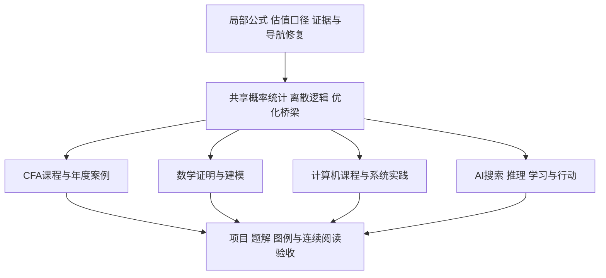

# 下一步建设规划

目标是把已有笔记接成可连续学习的课程：能找到前提、看懂推导、复算例子、知道边界，再用练习或项目检验理解。具体课程任务、依赖与验收保留在下方 27 项任务束；本页不把候选、已派发工作或历史批次改写为当前已完成。`input_baseline` 保留原建设规划所依据的历史输入，当前发布版本由实际结果记录确定。

## 活动入口

### 正在做

- 按读者问题、主解释、来源、可检查例子、链接兑现和阅读边界审阅全库；CFA 在审阅范围内。保留现有学科目录、成熟解释和个人记录。
- 当前轮次修复既有内容、导航和维护中的实际问题，不默认新开大型课程。下方长期建设任务须另按具体读者问题选择可独立交付的小组。

### 已完成且有证据

已发布范围以 [[CHANGES|CHANGES.md]] 和各批实际结果为准：[[Logs/2026-09-17_审计后首批课程建设与维护|首批]]、[[Logs/2026-09-17_第二批课程建设与阅读验收|第二批]]、[[Logs/2026-09-17_第三批课程深化与真实项目验收|第三批]]、[[Logs/2026-09-20_第四批证明链与真实实验|第四批]]、[[Logs/2026-09-20_第五批机制证明与政策账本|第五批]]、[[Logs/2026-09-20_第六批证明实验与覆盖复审|第六批]]、[[Logs/2026-09-20_第七批非CFA课程与阅读收尾|第七批历史结果]]。它们各自记录版本、恢复位置、失败和未运行层，不自动证明完整路线、课程、LOS 或人的理解。第七批“跳过 CFA”仅是该历史批次的范围。

### 暂缓与未完成边界

- 下方 R、S、F、M、C、A、E 的 27 项是长期建设清单，不是本轮默认写集合。未选定范围前，不把阅读、候选或静态检查称为整个任务已完成。
- CFA 的 LOS、年度映射、路径和正式课程边界仍按 F1–F5 的原条件处理；数学、计算机、AI 和社会科学同样只按已证实课程切片表述。
- 发布按完整小组核对正文、来源、例题、适用的代码／镜像、结构、独立内容复核及客户端证据；未运行、失败或人的理解不能由其他层代替。保存、同步和写入协调的临时状态留在本轮库外记录。

## 当前进度与仍待补的范围

下方 27 束保留原先修、停止条件和验收。[[00-工作台/审计/2026-09-17/README|原四条路线审计]]与[[00-工作台/审计/2026-09-20/四轨覆盖与阅读复审|四轨覆盖与阅读复审]]保留当时证据；不把历史“未定位”直接当作今天缺课。尚待进一步建设或验证的具体残余包括：

- **金融与统计**：F1 的复杂可变对价、合同修改、主代理、法域／US GAAP、真实行业和完整报表；F2/F3 的 FCFF/FCFE、剩余收益、P/B、EV 等多模型链、真实公司／指数方法与未逐条验收的 LOS；F4 的完整资产预期、股债／另类组合、执行成本、期权／互换、固定收益／风险归因、Asset Manager Code 和三条路径；F5 的原创情景与评分、年度 LES 状态。S01 的非独立样本、金融时间序列和更深统计推断继续保留，Lévy 定理是明确外部依赖；S02/S03 仍需更深语言语义、类型与复杂度、一般优化建模和迁移题，有限搜索或单例证书不替代一般结论。
- **数学**：万有覆盖存在与覆盖分类、曲面／流形及变条件迁移题仍待补深，穿孔平面骨架保留明确几何前提；Minkowski、Dedekind 与可逆理想等已调用外部定理不能由有限枚举代替。M3 的系统证明训练与数值题解继续，浮点实验不认证一般严格区间计算；M4 的自主建模、报告修订和讲解仍需真实学习过程。具名培养方案中的核心、方向选修与个人选择继续分开。
- **计算机系统**：在已发布的单 hart 中断／切换与 Sv39 实验之后，继续一般调度、文件系统、COW/ASID、多核及生产隔离；旧实验的 `satp=0`、后续实验宽松 PMP／S 态 RWX 均不证明完整 OS 安全。更广协议、TLS 与受控链路仍待验收，旧 loopback 结果不覆盖它们。
- **计算机与 AI 的实践边界**：团队／HCI／读屏组合、语言理论、完整 Raft、移动／嵌入式平台、GPU 与完整 PBR/MSAA 尚不由既有样本认证。AI 继续更广真实语料与模型、机器人校准、增广积分控制、估计误差／扰动／时延下硬约束、饱和全局稳定和连续真轨迹碰撞认证；固定种子不等于 Monte Carlo 覆盖。已有校准实验不能替代可审计的上游特征处理链、更广实体样本、漂移及受授权的人类反馈／真实项目；已观察测试集不再用于选模型。
- **社会科学**：RD 的稳健偏差修正、自动带宽、正式密度检验、聚类标准误，以及另一制度、长期反馈、溢出、异质性和分配机制，按既有课程与实际结果中的未完边界继续保留。已有密度／协变量／规格诊断的教学实现不等于这些更强推断；单一 NJ/PA 例子和财政恒等式均不能推出一般政策结论。
- **阅读与客户端**：历史 425px 栏的未结案记录包括拓扑03约457px、LQR01约447px、LQG MOC约638px、最低工资01图约791px、Sv39长式约461px；PID01/03、LQG01/02和最低工资复算的长式，以及旧 CFA／控制／政策整页、全部内核图与相应点击补验，也须按实际客户端逐页复核。某次图像打开、公式解析或新页预览不追认所有旧项通过；人的理解另由练习与迁移检验。

## 优先顺序

专项报告中的P0/P1/P2是各自任务优先级，含义并不完全相同：例如CFA的P0也包含阻止“全课程覆盖”宣称的大块缺课。这里统一按实际执行目的排队，避免把“缺课程”与“已有公式错误”混为一谈。

| 顺序 | 要交付什么 | 依赖与停止条件 |
| --- | --- | --- |
| 先修复现有问题 | R01–R04：两个局部解释问题、证据/迁移断链、重点阅读出口 | 每个小组独立审阅即可发布；不等待全部课程补齐 |
| 建共享基础 | S01–S03：概率统计、离散证明、线代/优化到应用的桥 | 每组至少有完整推演、例子、反例和练习；不能只建目录 |
| 补四条主干 | F、M、C、A四轨并行，按依赖消费已接受的具体页面 | 首轮优先F1、M1、C1、A1；其余仍保留为明确待办，不偷偷缩小“本科/CFA全覆盖”目标 |
| 深化实验与阅读 | E1–E3：真实数据/系统项目、图例、学习路径验收 | 内容正确、实验执行、客户端呈现和人的理解分别记录 |

箭头表示学习或内容依赖，不要求所有前置工作一次性齐备；每次发布应是一组能够独立读完的小课。

## 第一批：修复与阅读路径

| 编号 | 精确范围与动作 | 完成验收 |
| --- | --- | --- |
| R01 | [[数学/15-微积分/07-积分应用与数值积分几何物理和误差\|Simpson求积页]]第48–50行：恢复奇偶索引及上下界，保留正偶数n与步长条件 | n=2权重1/4/1、n=4权重1/4/2/4/1；1、x、x²、x³精确积分；源文本与实际公式显示同时可读 |
| R02 | [[社会科学/30-金融市场与风险/03-股票所有权现金流与估值\|股票估值页]]第33–35行：明确经营EV、现金、其他非经营资产、总债务/净债务集合 | EV=1000、现金=100、债务=300时两种合法写法均得800；给重复计入得900的反例；增加一张估值桥，标清每项进入哪一次 |
| R03 | 按[[00-工作台/审计/2026-09-17/链接与阅读质量审计\|断链清单]]修18次迁移路径；核查数学历史公式解析证据 | 18个目标/版本用途逐项兑现；证据若找不到，明确历史声明而不伪造JSON；保留2条教学断链和教学孤岛。3条日志断链另按历史用途核对，私有笔记问题不纳入公开正文修复 |
| R04 | 先补SVD→AI PCA、银行→货币、AR/PPL→评测出口；再处理概率→泛化→金融风险与集合逻辑→算法 | 每条链接说明“去读什么/为什么”；打开目标确认主解释及符号一致；允许回到MOC的明确路径，不强制所有页面互链 |

**环境旁项**：当前 `make-md/main.js` 缺失、7项属性类型冲突、5项链接歧义和31项附件片段待检查单列维护；先核对当前插件安装状态及实际使用，再确定最小恢复，不靠关闭检查变绿。属性冲突只改实际错误字段，不批量清洗旧属性或代填掌握度。

## 第二批：三组共享基础

### S01 概率统计：接通数学、CFA与ML

从已有条件概率/协方差/估计页出发，补随机变量变换和常见分布、Chebyshev→弱大数、CLT的明确证明路线、抽样分布、检验与功效、回归统计推断。先解释对象与抽样单位，再给公式。将“完整证明”“证明路线”“外部定理依赖”明确区分。

验收使用一组Bernoulli与一组收益样本：手算均值方差和误差界、区间/检验、功效与选择性报告反例；给样本量变化分布图、Ⅰ/Ⅱ类错误图、完整题解。金融时间序列与非独立样本随后接入，不能把iid结论直接搬过去。概率应用页分别链接概率主解释、测度先修与谱分解应用。

### S02 离散数学、逻辑与证明：同时服务CS和AI

串起集合/关系/量词、命题和谓词逻辑、归纳/不变量、计数/容斥/鸽巢/递推、图、可计算性与归约。保留已有算法证明，将必要前提接回数学；不另复制全部图算法。

验收含一个完整计数推导、递推求解、量词反例、图模型与最小枚举检查，以及有清楚计算模型前提的停机对角化。应用出口分别接类型、数据库约束、复杂度、CSP和知识表示；“知道术语”不能验收为完成。

### S03 线代、优化与建模桥梁

复用SVD/最小二乘/凸优化，补SVM原始约束→对偶→核预测的最少必要推演，补算法原始对偶成本链（tight点、每条边至多计两次、弱对偶）。给同一小矩阵/小图的手算、几何图、数值核验与失败条件。

验收不仅检查三角形或一个Gram矩阵数值正确，还检查一般论证中的每个条件；将线代、算法、ML三处的符号及shape逐项对齐。

## 第三批：四条课程主干

### F：CFA全课程路线

以[[00-工作台/审计/2026-09-17/CFA课程覆盖审计|25项矩阵]]为缺口清单，按2026主基线与2027变化维护年度对照。下面各组都要映射到具名级别/年度/模块或LOS，不以通用金融词汇代替考纲。

- **F1 伦理＋财报＋公司财务**：职业标准/GIPS案例；三表关系、会计调整、财务比率与质量；资本预算、WACC、资本结构、分派及治理。用一家公司和一组职业情境贯穿案例，所有金额/时点可勾稽，区分经济解释与准则条件。
- **F2 一级资产与数量方法补齐**：微观厂商/市场结构、贸易与汇率、金融统计与回归；股票/债券/衍生品/另类的基础题；有效前沿、目标约束与行为偏差。补TWR/MWR、凸性/key-rate、存续合约价值、费用净回报等现有讲义缺项。
- **F3 二级分析链**：金融时间序列、复杂报表、公司/股票估值、信用和含权债、互换及多步期权、另类与组合分析；用多信息条件的案例组串接输入、模型选择、估值与限制，配逐步解答。
- **F4 三级共同核心与三条路径**：先资产配置、组合构建、绩效与归因、衍生品风险管理及伦理，再分别建设Portfolio Management、Private Markets、Private Wealth。三条路径为材料宽度目标，考生按实际所选路径学习，不能说考试要求三条都选。
- **F5 PSM与考试能力边界**：本库提供财务建模/Python等实践桥梁；官方PSM完成状态仍由对应年度LES确认。本库练习不代替官方完成记录。建立原创情景题和评分要点，未逐条核对的LOS继续标待核。

F1之后就可独立发布第一组可信课程；完整CFA宣称仍需F2–F5和全LOS映射逐项验收。优先复用已有金融八讲，不将新路线变成八讲的平行副本。

### M：数学本科路线

- **M1 概率统计与课程定位**：消费S01，将“六科主线”明确为现有范围；把具名培养参照中的概率、几何学、抽象代数核心与方向选修分开。
- **M2 抽象代数、几何、拓扑**：从群作用/商结构继续有限群与因子分解；从曲线曲面补完整推导、坐标与测地线；从度量空间通向一般拓扑、积/商、分离、紧致、同伦与基本群。几何图要同正文参数一致，拓扑图要说明被识别的点及哪些性质不由画法决定。
- **M3 证明补深与数值分析**：按数学报告逐个补紧致等价、逆映射构造、Cauchy全局推广、Smith结构依赖；建立求根→插值逼近→数值ODE→迭代线代路线。每算法写停止条件、误差/稳定条件和失败例，画收敛阶或稳定域。
- **M4 建模与表达**：一个可复现项目包含量纲/假设、两个模型比较、参数辨识、敏感性、验证、完整报告及修订、讲解提纲。固定题库不能替代自主建模；材料齐备与用户完成分别记录。

具体页面、定理及练习验收沿用[[00-工作台/审计/2026-09-17/数学本科覆盖审计|数学专项任务]]，高年级方向按所选方案加深，不把研究级内容都列为本科共同必修。

### C：计算机本科路线

- **C1 HCI、SE、职业伦理**：给用户任务/原型/可用性与无障碍方法；从需求到接口、架构、测试、兼容与维护；补利益相关者与伦理冲突案例。现有测试和MiniLang是起点，不能充当需求工程或团队沟通全部证据。
- **C2 离散与语言理论**：消费S02；补计算模型、不可判定性与语言语义/类型证明的明确边界。每个抽象定义接一个实际程序或图例。
- **C3 分布式、图形、平台**：共识/复制/故障模型与逻辑时钟成链；图形从变换、投影、可见性到最小渲染器；平台先选一条Web/移动/嵌入式路线，其他方向保持待补状态。CUDA通信不代替分布式共识。
- **C4 系统实验深度**：围绕已有OS/网络/数据库/安全课，分小组做教学内核、真实协议测量、PostgreSQL并发与恢复、隔离安全实验。每组写环境、故障假设、预期与实际输出；模型/模拟通过与真实系统行为分别验收。

检查[[00-工作台/审计/2026-09-17/计算机本科覆盖审计|17知识领域矩阵]]中未覆盖单元，不用某个优秀系统样本把整域勾成完成。

### A：AI本科路线

- **A1 符号AI与行动**：同一问题串起状态空间、BFS/UCS/A*、对抗搜索、CSP、逻辑事实/规则/查询、规划前提/效果。保留现有A*一句条件和回溯/CSP片段，补可跟算轨迹而非从零另写同类算法。
- **A2 机器人与传统语言**：传感→状态估计→运动学→规划/控制闭环，先模拟小项目；传统NLP的序列模型、Viterbi和结构化任务接回已有CTC/神经语言模型。LLM调用工具不能直接验收为自动规划。
- **A3 已有ML例子补深**：PGM联合表与消元中间因子，CTC初始化/转移/终值表，2真框×3候选匹配与AP序列，有限MDP的MC/TD/Q-learning学习轨迹；图、公式与实验必须使用同一数值例。
- **A4 公平/HCI与真实数据项目**：比较相互冲突的公平指标，说明社会目标不能由一个分数代替；真实数据固定实体/时间拆分，比较简单基线、校准/代价/分组失败、版本血缘、发布/回滚与漂移演练。真实访谈和人类测试另按实际参与授权开展，不虚构反馈。

详见[[00-工作台/审计/2026-09-17/AI本科覆盖审计|32项矩阵与8项理解障碍]]。端到端项目证据齐备后，仍不由合成单测推断真实泛化、GPU/DDP或生产可靠性。

## 每一批都要交付的阅读与验收

**E1 连续解释**：开头给读者问题和已有前提；定义对象/符号/单位/shape；机制或证明不能省掉承担结论的步骤；至少一个可以跟算的例子和一个改变条件的反例。短课不靠机械增字达标，长课可以按问题拆分。

**E2 图与例题**：优先补对象图、几何图、状态表、账本、分布/误差曲线；图例、单位、条件与正文同一案例一致。每核心主题配完整解答和迁移题，独立阅读者能指出“下一步为什么这样做”。Mermaid或SVG存在只证明文件存在，实际显示和理解需另验。

**E3 链接与版本**：先修/主解释/应用/反例四种用途写清，正文就近连接实验命令、函数和预期值。新链接逐个检查目标和锚点、独立复核阅读承诺，实际Obsidian点击/回退单列记录。保留人的批注；输入或目标出现第三种新内容时停止覆盖，做局部合并后再验收。

**发布条件**：以一个完整小组为单位，正文、来源、例题、代码/镜像、相关结构检查、独立内容复核和适用客户端结果分别签收。未运行写未运行，缺课写待补，学会与否留给真实学习过程。任务完成时更新专项覆盖行与实际结果；不通过堆链接、空占位页或自动填写“已掌握”制造进度。
