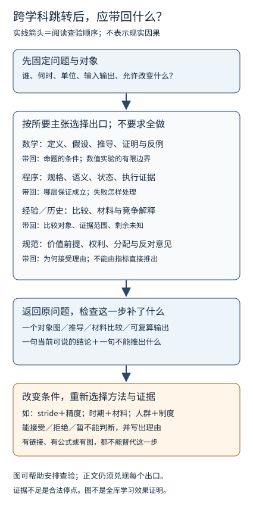

# 非 CFA 全库深审与贯通改进方案

**结论先行：当前库的下一步应从“各页有解释、有链接”，推进到“读者能沿同一问题连续追踪对象、条件、证据与失败”。** 数学、AI 和计算机已经有许多较深的局部推导、反例与实践，重复建设概论课收益很低。更大的改善在阅读关口、共同案例、可辨别条件的图例、来源到具体主张的追溯，以及哲学独立主干。学科方法需要相互参照，同时保留不同的证明与证据义务。

本报告依据 2026-10-04 当前工作树；Git HEAD 为 `4b1408e482191a6184e090aba2b15207c079ca20`，但当天跨层与 CS:APP 改进已有未提交字节，审计使用这些当前字节。CFA 专项正文、习题与专项脚本排除；非考试经济、金融、政策保留。AItextbook 不写入。原稿、历史日志、私人剪藏、保留材料不被当作已经核验的教材正文，也不因结构统计而改写或删除。

这是全量结构盘点与代表性深审的结合，**不是全库逐句正确性认证**。八项分工覆盖结构、数学、AI、计算机/编程、人文、社科、读者走读和视觉；分域约七十余项抽样记录存在重叠，另有五条多页阅读链和八张原有图的离线查看。未逐句复算所有证明、外部史料和课程源码，未进行真人试读或 Obsidian 客户端点击验收。未读与未验证部分保持未知。

## 1. 当前基础：哪部分已经做好，哪部分需要改善

### 1.1 全量结构的事实边界

六域加 Obsidian 教学范围内有 1,341 个 Markdown；其中六个知识域为 1,195 个。分类按路径、文件名和已有属性进行，“正文”仅指未归为 MOC 的 Markdown，含实践与资源说明，不表示它们都是独立课程。

| 知识域 | Markdown | MOC/地图 | 其余 Markdown | 含图 Markdown（结构标记） | 当前审计判断 |
| --- | ---: | ---: | ---: | ---: | --- |
| 数学 | 241 | 23 | 218 | 79 | 独立主干和证明/反例较强；初次落到哪一叶页、几何配对图与数值迁移仍可改善 |
| AI | 242 | 28 | 214 | 65 | 超越 LLM，已有统计学习、搜索、视觉、生成、RL、具身；公共目标/观察/行动合同可更连贯 |
| 计算机知识 | 630 | 22 | 608 | 131 | 系统课程、形式方法、工程反例与综合链较扎实；先复用已有综合正文，避免平行教程 |
| 编程知识 | 17 | 2 | 15 | 1 | 当前正则专题有明确责任边界，系统语言课程由计算机域维护；解析出口可更明确 |
| 哲学与文化 | 14 | 2 | 12 | 1 | 文化政治专题较完整，但不是完整哲学；认识论、伦理/政治哲学、科学解释缺独立学习单元 |
| 社会科学（非 CFA） | 51 | 7 | 44 | 30 | 测量、账户、机制、识别、价值分界较好；跨页案例职责和统计回退仍可改善 |
| Obsidian 教学 | 146 | 14 | 132 | 11 | 教学与试错区独立存在；以基础 Markdown 阅读、链接回溯和真实操作任务检验收益 |

图像资源也不少：计算机 169、AI 84、数学 79、社科 11、人文 1 个；SVG/PNG 的同图双版本会被计为两个文件。这些数值只用于定位资源，不换算成学科覆盖率、解释深度或个人掌握度。

根检查器作为既有完整结构基线扫描了 1,477 个 Markdown、20,587 个链接和 271 个源码镜像，结果仍为 **4 error / 45 review**；114 项维护测试通过。完整基线含历史材料与 CFA 的机械端点，未对 CFA 作内容审计。四个旧错误是剪藏目标缺失、两处Obsidian教学演示缺链及该剪藏的属性类型冲突，不由本轮擅自删除或制造目标以变绿。其余 review 包括附件片段与歧义等须按具体用途确认；不是 45 条内容错误。

范围受限的解析器会把被排除的端点视为不可见，故它产生的 134 个 missing 候选**不能**当作新增全库断链。现有完整检查器的逐项结果才是当前结构诊断口径。源码镜像一致、路径解析成功与知识正确、客户端可用、真人理解分别验收。

### 1.2 跨域已有联系，但强弱分布不均

范围内可解析引用中，AI→数学 248、AI→计算机 217、数学→AI 104、计算机→AI 79、计算机→数学 66。社科→人文 8、社科→数学 7。这是方向性盘点，同页重复引用也计数；不要求各域对称，也不要求人文大量链接 AI。

结构上，技术三域的往返较密；人文与社科联系较少。教学上更关键的不是把稀疏方向“补到相同数量”，而是让需要的跳转兑现：历史材料的分母可借用统计语言，但史料身份、代表性与竞争解释要另外论证；模型内条件化可借给状态估计，但不能据此得到干预效果或政治正当性。

只有两项代表性零入度/零出度候选：Obsidian 的“迷宫-X-孤岛”和 Kali 导入修订说明。前者本就是练习设计；后者是交付材料。**本轮不以孤岛指标判定教学缺陷，也不强制补链。**

### 1.3 明确保留的已有成果

- [[计算机知识/40-并行与异构计算/80-张量跨层执行/01-同一张量从数值到线程|同一张量跨层]] 已让值、位、坐标、stride、地址、线程与误差保持同一对象；这是可复用的教学方法。
- [[AI/80-实践/09-从一句话到学习与生成/01-一句话的目标更新与生成|一句话学习]]、[[AI/45-机器人与具身智能/20-状态估计与LQG/05-从不完整读数到条件不确定性|状态估计]]、[[AI/80-实践/05-RAG评测与私有服务/02-有引用的回答与可交付行动|RAG/Agent]]、[[哲学与文化/10-主题/01-文化政治与组织结构/09-科举命题的证据与竞争解释|历史证据]]、[[社会科学/40-公共政策与社会学/08-局部有效政策与累积优势的判断|政策判断]] 已有双入口、条件变化题和未知出口。
- [[计算机知识/85-综合贯通/01-一次订单请求贯通十三学科|订单总例]]、[[计算机知识/85-综合贯通/02-超时重试幂等与事务发件箱|超时与发件箱]]、[[计算机知识/85-综合贯通/03-从复杂度到尾延迟的性能证据链|性能链]]、[[计算机知识/85-综合贯通/04-跨层保证与反例矩阵|保证与反例]] 已承担系统贯通；[[计算机知识/00-开始/全局导航/11-难点导读与研究证据|难点导读]] 已有自然语言入口。本轮撤销重建这些课程或再造入口卡的初步建议。
- [[AI/20-LLM/30-训练/15-LoRA低秩几何QLoRA与蒸馏边界|LoRA 页]] 已在同一段区分 SVD、PCA、LoRA、MLA。后续若补，只补同一数例下的目标/误差/成本，保留主解释。
- 今天的 SVD 左右核、群作用与陪集、RD 带宽表述、P-04/P-09 来源限制及检查器修复不重新列作当前错误。

## 2. 已定位问题与修正组

P1 表示可能阻断重要理解或使承重解释越界，应先处理；P2 表示改进连贯性、维护或呈现，按读者需求推进。未证实为内容错误的风险明确标出，不用它们宣称“全库知识错误”。

| 编号/优先级 | 当前位置与证据 | 问题的具体性质 | 最小修正与验收 |
| --- | --- | --- | --- |
| A1 · P1 | [[00-工作台/基础理论学习路线#反向追问与关键比较\|基础路线]] 原第47–55行；五条走读链的概率→政策/历史交界 | 条件更新、因果识别、历史比较、价值理由并列存在，但读者需自行判断何时换证据义务；属于承接不足 | 在既有路线补四格关口及返回产物。本轮已制作具体修订；题中同时改变观测与干预条件，答者不能只套 Kalman/Bayes |
| A2 · P1 | [[数学/01-数学学习路线\|数学路线]] 原第42–60、96–103行 | 某些路线先送入较大的 MOC，首个叶页、可停任务和局部回补不够明确 | 每条实际路线补一个“第一叶页—产物—失败回补”，不规定每页都用同一模板；先挑三条路线走读 |
| A3 · P1 | [[哲学与文化/00-开始/00-哲学与文化-首页#当前覆盖与独立深入出口\|哲学覆盖]] 原第53–61行 | 首页诚实承认范围，但认识论、伦理/政治哲学、科学解释仍未有各自可学习单元；这是实质主干缺口 | 建三组完整问题单元；每组含论证重建、反对意见、来源、再答辩/迁移，不把文化政治专题或AI评测当替代 |
| A4 · P1 | [[哲学与文化/10-主题/01-文化政治与组织结构/00-文化政治与组织结构-MOC#核心结论\|专题核心框架]] 原第55–97行 | 条件乘积和连通机制图虽有免责声明，仍易暗示所有条件不可替代，以及古代组织→现代民主/科学已获同等级证据；属于表达风险，未判定模型已被证伪 | 分开描述、候选机制、现代待证结果；每条箭头写范围/材料状态；加入组织自治可以服务不正当规范的反例，防止存续→正当性跳步 |
| A5 · P1 | [[数学/40-微积分与优化/04-SGD-Momentum-Adam与AdamW\|优化器]] 原第191–193行与 [[数学/60-数值计算与量化/12-数值常微分方程局部全局误差与稳定\|ODE]] 原第71–79行 | 稳定、精度、有限数值、任务效果的区分各自存在，但缺同一对象的复算迁移 | 先用本轮二维二次目标接 Hessian→放大因子→Euler→浮点/任务边界；后续另加低精度舍入例，不把无NaN判为收敛 |
| A6 · P1 | [[AI/10-机器学习与深度学习基础/02-模型特征参数目标与泛化\|模型与目标]]、[[AI/10-机器学习与深度学习基础/05-数据集拆分清洗与泄漏\|数据与泄漏]]、[[AI/65-可信AI与真实数据实践/02-标签选择偏差与社会目标\|标签/社会目标]] | 选择、代理标签和后果在可信AI正文讲得较深，但在第一步目标/数据定义中的入口仍可提前；这是贯通改进，不是已证实公式错误 | 同一任务先列真实目标、代理标签、谁被观察/漏掉、行动后果、可申诉者；数学推导仍留主解释。迁移改变标签观察机制与总体，不能只重算准确率 |
| A7 · P1（兼容） | 网络正文原第12–14行的 `tcp-sequence.svg`；对应 PNG 实际正常 | 当前离线SVG渲染器找不到其指定Noto字体，中文成方框；尚未证明Obsidian也失字 | 先实际验默认SVG及PNG；必要时修字体链/嵌入策略，并同步DOT/SVG/PNG。不能据此声称整个课程图失效 |
| A8 · P2 | [[编程知识/10-基础/01-正则表达式/00-正则表达式-MOC#什么时候不要用正则\|正则出口]] 原第121–128行 | “词法器、语法分析器”只有工具文字，缺明确前端学习出口；旁边Unicode/tokenization已可跳转 | 链到[[计算机知识/70-编译原理/00-编译原理-MOC#第一阶段：前端——文本怎样成为带语义的程序\|编译前端]]，携带字符→token→AST的区别；不复制编译课 |
| A9 · P2 | [[社会科学/20-经济流动与宏观/04-教育住房地域与累积优势\|住房/教育]] 原第56–75行与[[社会科学/40-公共政策与社会学/08-局部有效政策与累积优势的判断\|新政策样板]] 原第24–45行 | MTO两页目前未发现矛盾，但事实与适用范围有重复编辑点，未来易漂移 | 前页负责选择、反馈、ITT/LATE；样板保留必要事实回顾，负责容量/外推/取舍；数值与来源定位指定一处主解释，成组签收 |
| A10 · P2 | [[社会科学/10-共同工具/03-因果图反事实与识别\|因果真源]] 原第69–82行和 [[社会科学/10-共同工具/04-比较研究偏差与证据审计\|比较审计]] 原第58–77行 | 抽样总体、单位、处理版本在公式入口之前的局部回补不够直观 | 先固定“谁进入样本、比较何处理、测何时结果”，再读可交换性/正值性。由一个正确区间但不能识别因果的反例验收 |
| A11 · P2 | [[数学/35-微分几何/04-曲率内外在几何与完整算例\|曲面几何]]、[[数学/15-微积分/15-曲面积分与通量法向和面积元\|通量]]、条件化/政策/LM图 | 已有图常能解释主例，但二维→三维对应和单条件反例面板不足 | 按第5节补成对图：参数域→曲面小片、相关为零→后验不改另一分量、局部支持区→外推总体、四类mask各控什么 |
| A12 · P2（筛查） | 计算机域52个含Mermaid页面；分布式/系统/工程代表页 | 未命中“替代文字”标题不证明没有正文解释，不能直接判错 | 按承重性深读10页，确认图失败时正文能否复述节点/箭头/条件/失败；已有解释足够则no_change |

来源台账另有 P-01—P-03、P-05—P-08、P-10 等未核命题。**缺证据定位是待研究，不是事实已经错误。** 优先核对战时国家形成、组织权利/财产、长期组织筛选等承重断言；一次核验只提升相应句子，不提升整篇/整个专题。

## 3. 宏观重构：以问题往返，保持学科自己的深度

保留 [[00-工作台/按问题找知识|问题入口]]、[[00-工作台/基础理论学习路线|基础路线]] 和各域 MOC，不建立第二份全库目录。三条贯穿路线继续承担“学习与计算”“状态与执行”“证据、解释与选择”；实际学习仍从读者问题开始。

大胆但可实施的改变是：**每个核心学习单元围绕一个需要重新判断的问题组织，核心验收从“读完页面”换成“能预测、能说明条件、能造反例、能在陌生条件下选择”。** 这不是要求每页套模板，而是每组完整单元有清楚的学习闭环。原推导与历史论证保留，读者可以返回独立学科课程读深。

文字替代：先写研究对象、范围和单位；再按主张选择出口。数学需要定义、假设和证明；程序需要规格、语义和执行/故障证据；经验/历史需要比较、材料与竞争解释；规范需要价值前提与反对意见。各出口不必全部走过。返回原问题时交一项可检查产物和结论边界；改变条件后重新选择证据，缺信息时允许停止。箭头只表示查验顺序，不是现实因果。

双入口汇入同一正文。基础补桥给术语预览、一个手算/观察例、可停点和局部回补；本科快进给对象、假设、关键证明/论证与深入节。基础层保留真实条件，深入层返回同一例子。哲学/社科不以编程和线性代数作共同入门门槛。

深度按问题体现：纯数学可以继续问定理条件、证明策略、构造反例和等价结构；AI问目标/数据/机制/评测；系统问状态/语义/资源/故障；人文问材料范围/论证/竞争解释；政策问识别/分配/规范理由。不能把全部知识改写成“怎样训练模型”。

## 4. 八条值得验收的贯通链

下表中的箭头是阅读或对象变换，不默认是因果。已有正文承担主解释；只在它们不能承接时补短桥。关键跳转说明“为什么去、读哪节、带何问题、回来补哪一步”。

| 理解链与读者问题 | 既有主解释与需要携带的对象 | 最深处要分开的条件 | 陌生任务验收 |
| --- | --- | --- | --- |
| 数值→几何→优化→执行：为什么方向对仍失败？ | [[数学/40-微积分与优化/81-二维参数与三维目标图像\|本轮二次目标示范]] → Hessian → ODE/浮点 → 张量执行 | 实数放大因子、数值舍入、实际kernel、任务损失分别是谁的保证 | 同时改曲率和初值，再改精度；先预测失败，再选择何种证据能确认 |
| 概率→学习→条件更新→因果：观察能说明什么？ | 条件概率/协方差 → 学习目标/状态案例 → 因果共同工具；追踪变量、条件事件、总体 | 模型内后验、干预分布、现实识别、运输性不能互推 | 观测相同但机制不同的两例，指出仅凭观测无法区分什么 |
| 文本→形式语言→模型token→证据：同一个“词”是什么？ | 正则 → 编译前端 → [[AI/20-LLM/10-原理/01-文本Unicode-Token与词表\|Unicode/token]] → RAG案例 | 字节、码点、字素、lexer token、AST、模型token各有不同对象/可逆性 | 输入含组合字符、emoji、嵌套表达式，同时改规范化与tokenizer；说清缓存、匹配、解析各改哪层 |
| 规格→算法证明→程序语义→执行证据：怎样说“正确”？ | 算法 → [[计算机知识/70-编译原理/13-操作语义求值策略与程序等价\|操作语义]] → [[计算机知识/70-编译原理/15-Hoare逻辑循环不变量与终止\|Hoare与终止]] → 既有保证矩阵 | 交换论证、类型安全、部分正确、终止/活性和有限测试的结论不同 | 把数学整数换机器整数并加异常；指出哪段证明必须重做，哪项仅有测试支持 |
| 字节流→业务状态→持久/复制→重试：超时究竟发生了什么？ | 既有订单/X-02/WAL/服务模型，追踪业务键、消息ID、FD、提交和观察者 | ACK、返回成功、本地持久、外部效果、副本可见性 | 提交后丢响应且副本尚未可见，返回unknown/对账方案；不新增重复教程 |
| 采样→信号→视觉/音频→任务：输入里还剩什么？ | [[数学/70-信号处理与多模态数学/00-信号处理与多模态数学-MOC\|信号主线]] → 卷积混叠 → ViT/音频；携带采样间隔、频率、轴 | 连续信号假设、采样、滤波、patch信息丢失和任务错误 | 同时改变stride与最小对象尺度；解释为何分类没变但边界/定位已失败 |
| 测量→账户→机制→识别→规范：指标好就应该扩展吗？ | 社科共同工具 → MTO/最低工资 → 统计/因果 → 独立伦理问题 | 恒等式非因果、局部效应非全体、总体平均非分配、效果非正当性 | 同时改人群、容量和制度；写可识别/不可外推/需要价值理由的三种句子 |
| 历史材料→论证→竞争解释→科学/政治问题：为什么可信？ | 人文四层框架 → P-04材料 → 社科比较方法 → 待建认识论/科学解释单元 | 概念框架、来源覆盖、历史比较、现代观察和规范性理由 | 给反例或改变时期；收紧命题，列能改变判断的新材料，允许暂不能判断 |

学习者可以只完成一条；跨学科的价值是让解释和边界更清楚，不是迫使任何问题经过所有领域。

## 5. 二维、三维与框图：每种图承担一种解释任务

本轮已补一个完整小例：[[数学/40-微积分与优化/81-二维参数与三维目标图像|两个参数的三种观察]]，包含二维等高线/梯度、三维曲面、目标随迭代变化，源码、CSV与反例题。它把函数、公式、图与计算保持一致，而不是独立的装饰插图。

| 图类型 | 具体落点 | 必须看清的关系 | 怎样判定有用 |
| --- | --- | --- | --- |
| 2D等高线＋3D曲面 | 本轮二次目标、Hessian/优化 | 同一二维参数，三维仅增加函数高度；曲率、步长、放大因子 | 换曲率和初值时能预测稳定区间；能指出图不是收敛证明 |
| 2D参数域＋3D局部曲面 | 通量/参数曲面/曲率 | 参数小矩形如何成曲面小片；切向量、法向、面积元、方向 | 换参数次序时能判断方向反转；解释圆柱空间弯曲与内在曲率不同 |
| 2D单位圆→椭圆/可选3D椭球 | SVD/条件数/PCA | 输入空间、输出空间、旋转/伸缩、左右核、主轴 | 由短轴解释逆映射放大；不能从二维截面推出高维全貌或任务最优 |
| 2D协方差椭圆＋失败面板 | 条件化/Kalman/扩散对照 | 椭圆是等值线，不是运动轨迹；观测位置为什么改速度 | 仅改变交叉协方差或噪声，预测哪分量更新；另给偏置/延迟失败 |
| token位置矩阵＋梯度计算图 | LM/packing/VJP/attention | causal、padding、文档隔离、loss mask分别控制什么；共享路径求和 | 改位置、监督和长度后准确指出标签、可见范围、分母和梯度贡献 |
| 时间泳道＋状态/责任框图 | 生成/KV/Agent/服务/控制 | 发生、采样、到达、读取、动作、提交、失效分别何时发生 | 撤销证据、晚到响应、复用FD、超时等情况下允许拒答/unknown/回退 |
| 2D支持区＋总体分布/小倍图 | RD/政策/评测 | 阈值邻域、估计量、区间、目标人群与外推条件 | 把人群和制度一起改掉后不只复制点估计；图必须注明真实数据或示意 |
| 分期证据矩阵＋竞争解释图 | 人文/社科 | 时期×地区×群体、直接材料/推断/未知/反例 | 能从强结论追回具体材料，能说新证据会使哪个解释改变 |

三维只在空间方向、曲面、坐标变换或真实三维数据确有解释价值时使用。社科网络布局、历史长链和抽象机制通常更适合二维矩阵、时间线或关系图；立体位置不自动表示因果、权力或相似性。任何可旋转图都应有静态二维投影和文字替代，关键结论不依赖某个旋转角度。

每张图的最低合同是：标题对应问题；对象、轴、下标、单位和正文一致；线型/文字解释箭头；来源或构造身份明确；不看图仍能读懂对象与结论。计算图、时间流、证据支持、数学依赖、候选因果不能共享未标注箭头。颜色不能是唯一编码。复杂图拆成总览/局部，保留可编辑SVG、Mermaid或绘图源码；数据图保存数据身份与生成方法。

新图先做源尺寸和425px离线渲染，检查字体、边缘裁切、图例、灰度与缩放。客户端主题和真人理解另验。旧图可有足够的近邻正文，无须强制新增“替代文字”标题；只在实际解释断点出现时修补。

## 6. 各域的深入与覆盖：扩展要有参照范围

“覆盖大部分知识”必须先回答“哪种学习者、哪种课程/问题范围”。数学现有[[数学/90-资源/05-六科覆盖矩阵与学习验收|六科矩阵]]、AI的[[AI/00-开始/07-学科覆盖矩阵与分层学习清单|覆盖清单]]和计算机的[[计算机知识/00-开始/全局导航/05-知识覆盖与逐科查漏|查漏矩阵]]继续作为主入口，不用新增页面数计算完成率。

| 域 | 保留的独立路线 | 下一组深度增强 | 扩面边界 |
| --- | --- | --- | --- |
| 数学 | 分析/代数/几何/拓扑/概率/优化/数值/信号 | 条件改变后的命题与反例；投影从矩阵到函数空间；数值稳定/精度/误差同例 | 每个长定理标明完整证明、证明路线或外部依赖；高等专著方向按问题另选 |
| AI | 统计学习/搜索推理/NLP/视觉/生成/RL/具身/可信AI | 目标—观察—选择—评测—行动反馈；同一输入跨感知与控制的时点；任务专属指标与支持集 | 大型训练、真实部署、机器人硬安全不由CPU toy或漂亮曲线认证 |
| 计算机 | 语言/DS算法/组成OS/网络DB/编译形式/分布式/工程 | 复用已合格综合链；源程序→ABI/目标文件→进程的CSAPP回路；语义与资源/故障模型联合迁移 | 以官方课程范围逐问题族查；图形/HCI等未在本次充分审查，先标未定位，不直接判空缺 |
| 编程 | 正则与文本实践 | 匹配→词法/解析→业务约束→tokenization边界与可跳转出口 | 语言主课程仍在计算机域，避免两域平行维护 |
| 哲学与文化 | 现历史文化专题 | 论证/知识；伦理与政治正当性；科学解释/方法三组独立单元 | 不以单一文化政治研究题代表全哲学，不把技术指标直接当价值论证 |
| 社会科学 | 测量核算/宏观/金融风险/政策/社会网络 | 同一主张在测量、识别、外推、分配、价值上的不同义务；跨页案例主解释一致 | 定量模型与制度/历史背景并重；非CFA金融保留，不加考试专项 |

计算机可以把 [ACM/IEEE-CS/AAAI CS2023 的知识域](https://csed.acm.org/knowledge-areas/)用作范围参照，包含数学统计、算法、系统、AI、HCI、图形与社会伦理等；目录只能帮助选择核对对象，不能认证本库已经覆盖。哲学基础可以参照 [Stanford 的有效性/可靠性教学定义](https://web.stanford.edu/~bobonich/terms.concepts/valid.sound.html)：演绎形式有效与前提真实是不同义务。本库进一步的历史、归纳和规范问题仍需各自来源与论证。

覆盖记录面向问题族，逐项记主解释、直观例、推导/论证、练习、反例、来源和当前边界，状态为**已有、部分、未定位、不适用**，核验状态另列。不新增全库强制概念数据库、逐页布尔合同或机器任务登记；格式服务于真实缺口，不服务于模板。

扩展顺序：已确认错误 → 当前案例的先修缺口 → 重复出现的解释断点 → 选定学科主干 → 研究选修。物理、电子、控制等先做相关支线，若未来要建立完整独立课程再另定范围，不把它们设成所有读者的共同门槛。

## 7. 微观写作与知识链接的执行标准

每个承重公式先核对对象、定义域、shape、索引、单位和量词。例子与证明用同一符号，符号重用时重新定义：例如LQR的代价矩阵与Kalman的噪声协方差同叫Q/R，也不能因此互换。数值页再核对无效输入、零分母、有限精度与参考解；历史页核对时期、群体、材料取得与比较对象；规范页明确价值前提和反对意见。

一处主解释可以有多个应用回顾。必要回顾让应用页独立可读，完整证明、数据数字和源码只指定一个主位置。MTO/P-04/低秩等成组修订时核对双方声明，避免某页改变范围而另一页仍承诺旧结论。已有正文能兑现则保留；无法兑现时降低链接承诺或补说明。

关键桥接用五种关系：先修、同一对象跨层、比较、反例、验证/实践。无需给所有普通链接贴标签，但读者依赖的桥要讲清楚。例如“去读梯度页的单位方向定义，回来解释为何黑箭头垂直等高线”；“去读因果识别页，回来说明现材料无法支持哪个干预主张”。

建议把各处六层/三层/五层证据框汇入一种可复用学习产物，而不强行重写所有章节：一张主张卡记录对象/范围、材料/单位、机制/竞争解释、比较/识别、分配/价值前提、当前可说/未知。历史案例的因果估计栏可以不适用；纯数学的资料栏可以是定义与公理。它是练习工具，不是强制任务系统。

所有答案接受满足题设的等价方案。尤其迁移题要接受合理拒答、暂不能判断、已知偏差可校正的方案及不同证明路线；评分依据条件与论证，不依据作者预想的固定步骤。反例要能撤去至少一个承重条件，不能只给夸张错误答案供读者辨认。

## 8. 合作与工具：以小组完整产物推进

采用两名作者分别负责技术与人文社科小组、两名独立审阅者滚动核对即可按需扩展，容量不是要用满的指标。主线程整合发布；作者在库外候选工作，审阅者只读具体版本。非机械修改须独立审阅，争议用原文、计算或反例解决。实际模型/effort可核实时记录，未知费用不编造，角色数不等于质量。

一个组同时交正文、图、答案、源码与镜像；跨页共享定义一起签收。先完成可发布的小组，不让读者等待依赖的另一页。候选、队列、临时证据保存在库外，主库保留正文、必要来源和实际结果指针；不让学习者管理哈希/机器任务。

插件维持点名启用。本文、公式、图与入口以基础Markdown可读为基线；本轮没有启用任何插件/MCP或改变配置。图谱若不能回答具体阅读问题就不增加；查找与记录工具只按某次实际任务的收益评估。不引入自动同步、全库概念数据库、强制任务系统或常驻服务。

## 9. 分批方案与可验收的完成边界

| 修订组 | 精确落点与产物 | 应核对的来源/计算 | 完成标准 |
| --- | --- | --- | --- |
| G0：本轮示范与关口 | 新二次目标单元、三图/源码/数据；基础路线的跨方法关口；本报告与框图 | 两个放大因子、目标值、边界初值、源码闭式参考、所有目标锚点 | 独立审阅，相关执行和离线425px图；原有诊断无新增；CFA和非写集合保持原字节 |
| G1：人文承重框架 | 文化政治MOC的乘积/机制图与来源台账；先选P-01/P-02/P-03/P-05/P-10承重句 | 原始材料实际读取范围、竞争解释、时期/群体与自治/正当性分界 | 每条强断言有匹配材料或明确待研究；现代结果不由古代总箭头认证；两类读者能收紧结论 |
| G2：首步可完成＋文本出口 | 数学学习路线中三条实际路径；正则MOC的解析出口 | 目标叶页/节真正兑现；同一输入的regex/lexer/AST/model token区别 | 新手不用全库搜索能交第一次产物；失败只回补直接缺口；无需复制课程 |
| G3：数据与评测到行动 | ML基础02/05/18、可信AI标签页、ViT/视觉与状态/控制的相关节 | 切分单位、目标总体、标签选择、支持/分布边界与行动时点 | 同时改样本观察和行动环境，重新选指标/证据；无答案/不可见/冲突时保留未知出口 |
| G4：数值与视觉深化 | Hessian/ODE/浮点同例支线；通量参数域/曲面；条件化与政策反例面板 | 精确模型、离散误差、浮点误差、误差范数、图轴/方向/来源 | 图可回到相邻推导；失败例只改变声明的条件；真实GPU/控制/客户端未跑则待验 |
| G5：社科案例与范围 | MTO两页、因果与比较共同工具、主张卡 | 同一estimand、处理/总体/时点、出处、局部支持区和规范理由 | 没有两份独立事实真源；能说哪项事实、哪项因果、哪项外推、哪项价值尚不能裁决 |
| G6：哲学独立主干及其余覆盖 | 三组哲学单元；各域现有矩阵中的具名未定位问题 | 源文、论证重建、反对意见、已选课程/问题范围 | 每次新增完整单元，不建只有标题的空课；范围声明不扩大为全学科完成 |

G1/G2先推进，G3/G4/G5可按实际卡点并行小组交付，G6只按明确范围滚动扩展。G0是本轮实际落实；其余是经审计提出的修订组，尚未全部写回。

每组通过四层验收：内容（公式/论证/来源/反例）；组合（跨页对象/承诺/图/源码镜像）；结构与呈现（现有检查/相关执行/窄屏，客户端未看则待验）；学习（双入口预测与陌生迁移）。从库根运行已有维护入口，保留精确旧诊断；缺依赖记未运行，不装依赖或删检查来变绿。

真人试读可自愿参加，每种入口先完成一组，不看答案处理同级陌生题。记录真实卡点、误解、点击与答案；agent走读与真人数据分别保留。一个读者读得顺只支持该次条件，未试读不宣称教学效果已获验证。

## 10. 本轮实际结果与回查

本轮交付独立审计报告、跨方法关口的具体改进、一个完整二维/三维学习单元和框图。保留既有课程、常用标题/锚点、源稿与学习记录；没有批量重写学科、没有提交/推送。其余修订组保留为具体方案，不能称为已实施。

分域审阅、结构JSON、运行输出、输入/产物哈希与恢复回执存于本机库外 `/private/tmp/wwl-deep-audit-20261004-200638/`；临时路径寿命有限，持久化位置以 [[Logs/2026-10-04_非CFA全库深审与图例示范|本轮实际结果记录]] 为准。只依赖该日志明示的发布/检查层，不由审计角色、图数或状态字段推断其余内容通过。

从 [[00-工作台/按问题找知识|问题入口]] 返回一个你真正要解释的现象；需要系统范围时沿各学科MOC继续。完成标准是六个案例与新增单元能让读者追踪、核对、反驳和重新判断，并让下一轮扩展有具体缺口依据；不是把所有材料连接成一张大图。
