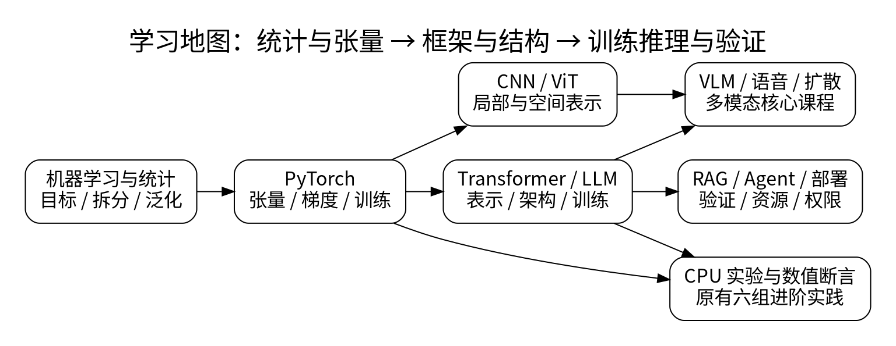
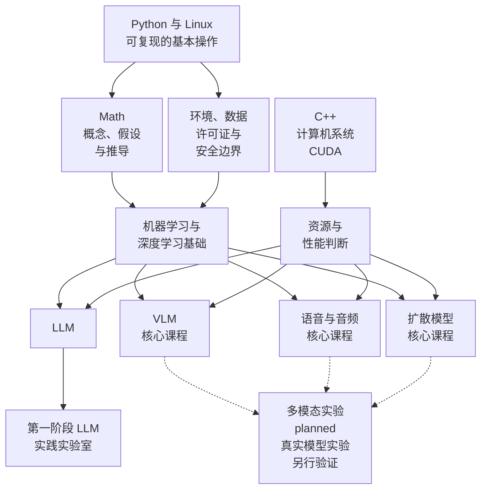

# AI

<!-- deep-review-02 -->
> [!tip] 本轮深化：从当前概念继续追问
> 先从[[AI/00-开始/05-问题驱动知识图谱与难点导航|问题驱动知识图谱]]定位困难，再用[[AI/00-开始/06-统一符号形状与公式阅读方法|符号与形状手册]]补工具，按[[AI/00-开始/07-学科覆盖矩阵与分层学习清单|覆盖矩阵]]区分入门、机制深化和实验验证。跨域数学内容从[[数学/00-数学-首页|数学首页]]进入；本目录的[[AI/11-数学与统计桥梁/00-数学与统计桥梁-MOC|数学桥梁]]只提供 AI 语境下的衔接。

这里是人工智能知识域的入口。它面向已经学过高中数学、会写一点基础程序的读者：先建立可解释、可复现的学习与实验习惯，再按问题进入统计学习、语言与 LLM、多模态、语音、扩散、显式搜索与规划、传统语言结构或具身闭环。

> [!abstract] 这条路线的终点
> 你不需要一开始拥有高端显卡，也不需要先下载大模型。完成第一阶段后，你应能把一个 AI 问题拆成数据、目标、模型、评估、资源与风险，并能在受控环境中运行一个小实验、保存必要的配置和结果、说明它为何可信或为何还不能下结论。

先从本库 [[../../README|知识库总入口]] 选择知识域；本页负责 AI 域内的阅读分流；阅读顺序摘要见 [[AI/README|AI 阅读入口]]。[[AI/00-交付说明|导入说明]] 与 [[AI/90-资源/06-修订与验收报告|修订与验收报告]] 保留为历史交付记录，不作为当前学习的起点。

## 从哪里开始

| 你的现状或目标 | 第一站 | 到达这一站后再去 |
| --- | --- | --- |
| 会写一点 Python，但不清楚项目和环境 | [[计算机知识/10-编程语言/01-Python/00-Python基础-MOC\|Python 基础 MOC]] | 本页的 [[AI/00-开始/02-学习路线与先修诊断\|先修诊断]] |
| 不熟悉命令行、进程、文件或网络 | [[计算机知识/20-操作系统/01-Linux/00-Linux基础-MOC\|Linux 基础 MOC]] | [[AI/00-开始/04-环境安全许可证与资源边界\|环境、安全、许可证与资源边界]] |
| 想从数据、模型和评估的共同语言开始 | [[AI/10-机器学习与深度学习基础/00-机器学习与深度学习基础-MOC\|机器学习与深度学习基础 MOC]] | 按问题选择 LLM、模态、搜索或具身路线 |
| 想理解显存、系统与 CUDA | [[AI/00-开始/03-8GB-16GB与24GB实践路线\|8GB、16GB 与 24GB 实践路线]] | [[计算机知识/30-计算机系统/00-计算机系统-MOC\|计算机系统]] 与 [[计算机知识/40-并行与异构计算/01-CUDA/00-CUDA-MOC\|CUDA]] |
| 要比较格式、术语、工具或来源 | [[AI/90-资源/00-AI资源-MOC\|AI 资源 MOC]] | 回到对应课程或实践页固定版本与验证证据 |

## 训练选出的模型凭什么推广

“模型用训练数据选出来，未来风险的保证还保护它吗？”从 [[AI/10-机器学习与深度学习基础/30-统计学习理论/00-统计学习理论-MOC|统计学习理论]] 进入PAC量词、近似ERM、增长函数/VC及正则稳定性。先修第12课有限类界与概率不等式；读完用同一四点分布区分训练目标求解、类内风险、独立抽样与部署偏移，再返回机器学习基础路线。

## 搜索、推理与规划这条分支

“没有训练数据，能否在规则给定的世界里找到行动方案？”进入 [[AI/13-搜索推理与规划/00-搜索推理与规划-MOC|搜索、推理与规划]]：从状态空间与代价开始，比较图搜索、A星、对抗搜索、约束传播、规则归结及计划验证。先修逻辑与图模型见 [[数学/12-离散数学与逻辑/00-离散数学与逻辑-MOC|离散数学与逻辑]]。

这条路线关心搜索保证与显式规则；有限规则世界中的成功，不自动证明现实环境中的可靠行动，也不等于机器学习的泛化。可与机器学习主线并行选择，不必先读完 LLM。

## 语言结构与行动闭环：按问题选择

“词性、实体边界和句法修饰为何不能用同一正确率回答？”进入 [[AI/35-传统NLP/00-传统NLP-MOC|传统NLP]]，按词级分词与n-gram→HMM前后向和Viterbi→CRF与结构评测→句法解析读01–04，再用80穷举小例。先补条件概率与动态规划；词级模型和合成解析树不认证真实语料效果，也不替代LLM主线。

“读数有噪声，找到路线之后怎样纠偏？”进入 [[AI/45-机器人与具身智能/00-机器人与具身智能-MOC|机器人与具身智能]]，按坐标→Bayes/Kalman估计→配置空间、轨迹与反馈→闭环边界读01–04，再用80复算。对象是已知固定朝向的平面全向加速度平台，有限仿真未覆盖SLAM、接触、机械臂、学习策略或真实机器人实验。

## 一张学习地图

静态图在离线阅读时也可显示。下面保留原学习路线的可编辑 Mermaid 源图。

这张图只画统计学习与神经模态的一组关系，不是 AI 全域路线图，也不是“所有箭头都是前置条件”。显式搜索与规划、传统 NLP、机器人与具身智能从各自问题入口进入；LLM 不是这些主题的共同前置。例如，阅读 LLM 的概念介绍不必先写 CUDA；但若要解释性能、编译扩展、显存不足或 GPU 兼容性，就要回到系统与并行计算的路径。数学的定义与完整推导保留在 `数学/`，这里仅说明它们在 AI 中何时有用。

## 本域入口与交付状态

下表说明各主题现在解决什么问题及其入口。跨模态接口先读 [[AI/20-LLM/20-架构/07-编码器解码器与多模态接口|编码器、解码器与多模态接口]]；历史交付范围和当时实验记录见 [[AI/00-交付说明|导入说明]] 与 [[AI/90-资源/06-修订与验收报告|修订与验收报告]]。篇数和历史批次不代表当前完成状态；真实模型、GPU 与生产部署仍按具体课程的证据范围判断。

| 主题 | 你要学会判断什么 | 入口 |
| --- | --- | --- |
| 机器学习与深度学习 | 目标、数据、损失、泛化和评估是否彼此一致 | [[AI/10-机器学习与深度学习基础/00-机器学习与深度学习基础-MOC\|基础 MOC]] |
| 搜索、推理与规划 | 状态、代价、显式规则和动作模型何时支持搜索或计划结论 | [[AI/13-搜索推理与规划/00-搜索推理与规划-MOC\|搜索推理与规划 MOC]] |
| 传统 NLP | 词级概率、标签链与句法树分别回答什么语言结构问题 | [[AI/35-传统NLP/00-传统NLP-MOC\|传统 NLP MOC]] |
| 机器人与具身智能 | 带噪读数如何形成状态估计并进入反馈行动 | [[AI/45-机器人与具身智能/00-机器人与具身智能-MOC\|机器人与具身智能 MOC]] |
| PyTorch | 张量形状、自动微分、训练状态与性能诊断 | [[AI/12-PyTorch/00-PyTorch-MOC\|PyTorch MOC]] |
| 卷积神经网络 | 互相关、感受野、残差与视觉任务 | [[AI/15-卷积神经网络/00-卷积神经网络-MOC\|CNN MOC]] |
| 大语言模型 | token、Transformer、训练、推理、上下文与工具调用的边界 | [[AI/20-LLM/00-LLM-MOC\|LLM MOC]] |
| 视觉语言模型（核心课程） | 图像与文本如何对齐，以及评估不能证明什么 | [[AI/30-VLM/00-VLM-MOC\|VLM 课程地图]] |
| 语音与音频模型（核心课程） | 音频表示、识别、生成及隐私边界 | [[AI/40-语音与音频模型/00-语音与音频模型-MOC\|语音与音频模型课程地图]] |
| 扩散模型（核心课程） | 噪声、采样、条件控制与生成风险 | [[AI/50-扩散模型/00-扩散模型-MOC\|扩散模型课程地图]] |
| 实践 | 用小而可恢复的实验连接以上概念 | [[AI/80-实践/00-AI实践-MOC\|AI 实践 MOC]] |

## 从指标走向真实数据与可撤回的判断

“公平指标都算了，为什么仍不能替受影响者决定目标？”到 [[AI/65-可信AI与真实数据实践/01-公平指标分母与基率冲突|公平指标与基率冲突]] → [[AI/65-可信AI与真实数据实践/02-标签选择偏差与社会目标|标签与观察机制]]区分统计条件、真实对象与价值选择。需要真实数据项目时，从 [[AI/65-可信AI与真实数据实践/00-可信AI与真实数据实践-MOC|可信AI实践路线]]进入固定日期/时间拆分、简单基线、经验区间覆盖、时段失败、行动代价及本地发布/回滚演练；这是聚合租车小时数据的限定项目，时段切片不等于人口公平实证，演练不等于生产上线。

## 学习时保持的三条边界

1. **结果不是解释。** 一次跑通、一个漂亮样例、一个分数都不足以证明模型理解了任务；记录数据来源、评估集、随机性、失败例子和资源限制。
2. **容器优先，但不把容器当安全边界。** 容器帮助固定依赖和减少宿主污染；它仍可能读写被挂载的目录、占用 GPU、下载内容或监听网络。开始前先读 [[AI/00-开始/04-环境安全许可证与资源边界|环境与安全边界]]。
3. **模型文件不是普通笔记附件。** 权重、数据、API key、cookie、私有提示词、个人样本和实验输出不进入 Git。只提交可公开的代码、最小配置样板、许可证说明、校验信息和可重建步骤。

## 与其他知识域的连接

| 需要补的能力 | 从哪里进入 | 为什么不是在 AI 页重复讲一遍 |
| --- | --- | --- |
| 语言、项目、依赖与测试 | [[计算机知识/10-编程语言/01-Python/00-Python基础-MOC\|Python 基础]] | AI 项目仍是软件项目，环境与测试需可重建 |
| 进程、文件、网络、包管理与 Arch | [[计算机知识/20-操作系统/01-Linux/00-Linux基础-MOC\|Linux 基础]] | 命令和系统写操作的安全边界由系统课程维护 |
| 底层性能与原生扩展 | [[计算机知识/10-编程语言/02-C++/00-C++-MOC\|C++ MOC]] | Python 调用的库常含 C/C++ 实现，但语言基础不应被省略 |
| 内存、缓存、ABI 与性能测量 | [[计算机知识/30-计算机系统/00-计算机系统-MOC\|计算机系统 MOC]] | “慢”或“占内存”必须回到系统层分析 |
| GPU、线程、显存和 CUDA | [[计算机知识/40-并行与异构计算/01-CUDA/00-CUDA-MOC\|CUDA MOC]] | GPU 兼容性和并行程序有独立的正确性条件 |
| 线性代数、概率、微积分、信息论与数值计算 | [[数学/00-数学-首页\|数学首页]]、[[数学/02-AI数学应用索引\|AI 数学应用索引]] | 完整定义、推导、假设与练习集中在数学域 |
| 模型落地后的治理、分配或公共决策问题 | [[社会科学/00-开始/00-社会科学-首页\|社会科学首页]] | 模型机制不能直接推出社会后果；需要把经验研究、制度条件与价值判断分别说明 |

## 完成首页阶段的标准

- [ ] 我能从本页选出一条适合当前基础的路线，而不是把所有工具一次装完。
- [ ] 我能区分“学习概念”“运行小实验”“部署服务”三种不同风险等级的活动。
- [ ] 我知道需要 GPU 时先检查任务、内存、显存、驱动、许可证和数据权限，而不是只看模型参数量。
- [ ] 我知道不把权重、数据、密钥和个人样本提交到 Git，也知道容器不自动隔离网络与挂载目录。
- [ ] 我已经选定下一页：[[AI/00-开始/01-AI知识地图|AI 知识地图]] 或 [[AI/00-开始/02-学习路线与先修诊断|学习路线与先修诊断]]。

---

**知识库总入口**：[[../../README|返回根目录]] · **下一站**：[[AI/00-开始/01-AI知识地图|AI 知识地图]] · **先做诊断**：[[AI/00-开始/02-学习路线与先修诊断|学习路线与先修诊断]] · **资源路线**：[[AI/00-开始/03-8GB-16GB与24GB实践路线|8GB、16GB 与 24GB 实践路线]] · **安全边界**：[[AI/00-开始/04-环境安全许可证与资源边界|环境、安全、许可证与资源边界]]
