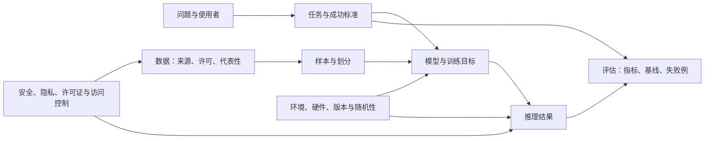

# AI 知识地图

<!-- deep-review-02 -->
> [!tip] 本轮深化：从当前概念继续追问
> 先从[[AI/00-开始/05-问题驱动知识图谱与难点导航|问题驱动知识图谱]]定位困难，再用[[AI/00-开始/06-统一符号形状与公式阅读方法|符号与形状手册]]补工具，按[[AI/00-开始/07-学科覆盖矩阵与分层学习清单|覆盖矩阵]]区分入门、机制深化和实验验证。原来通往其他知识域的链接继续有效；本次未上传的数学资料可先用[[AI/11-数学与统计桥梁/00-数学与统计桥梁-MOC|本地数学桥梁]]衔接。

这一页回答的不是“该装哪个框架”，而是“一个 AI 结论由哪些部分共同决定”。把它当作读课程、看论文、运行 notebook 和比较工具时的检查表。

## 一个 AI 系统的最小地图

如果其中任一格没有写清楚，结论通常就不能直接迁移。例如：准确率高也许只是评估集与训练集泄漏；输出流畅也许不等于事实可靠；速度快也许只是在特定 GPU、batch 大小和精度下成立。

## 六个层次，六种常见误解

| 层次 | 要问的问题 | 常见误解 | 应留下的最小证据 |
| --- | --- | --- | --- |
| 问题 | 谁要用？做什么决策？错误代价是什么？ | “能生成”就是“能解决问题” | 一句可检验的任务描述与不做什么 |
| 数据 | 来源、许可、代表性、敏感性如何？ | 数据量大就自然公平或正确 | 数据卡、采样规则、划分方式与已知缺口 |
| 表示 | 文本、图像、音频或表格如何变成输入？ | token 或 embedding 本身有固定含义 | 输入输出示例、长度/采样/预处理设置 |
| 模型与目标 | 模型在优化什么？ | 模型名称足以说明能力 | 架构、目标函数、关键超参数与版本 |
| 评估 | 指标能否代表真实使用？ | 单一分数可比较所有模型 | 基线、测试集来源、指标定义、失败例 |
| 运行与治理 | 谁能访问？资源和许可证允许什么？ | 能运行就可以分享、部署或商用 | 环境清单、硬件条件、许可证与访问边界 |

## 课程地图：先共同基础，再按模态分叉

1. [[AI/10-机器学习与深度学习基础/00-机器学习与深度学习基础-MOC|机器学习与深度学习基础]]提供监督学习、表示、优化、泛化、评估等共同语言。
2. [[AI/20-LLM/00-LLM-MOC|LLM]]以文本 token、Transformer、预训练、对齐和推理工程为主线。
3. [[AI/30-VLM/00-VLM-MOC|VLM（核心课程）]]说明视觉与语言的表示、对齐和多模态评估的课程设计；核心正文从图像输入、ViT 走到图文对齐与连接器。
4. [[AI/40-语音与音频模型/00-语音与音频模型-MOC|语音与音频模型（核心课程）]]说明波形/频谱、识别与生成的课程设计，以及声音数据的隐私与同意边界；已有波形/频谱、CTC、识别和生成的核心正文，真实音频模型实验未随包提供。
5. [[AI/50-扩散模型/00-扩散模型-MOC|扩散模型（核心课程）]]说明噪声建模、条件生成、采样代价与内容风险的课程设计；已有 DDPM、latent、CFG 与 Flow Matching 入门正文，另有 CPU 代数小例。
6. [[AI/80-实践/00-AI实践-MOC|AI 实践 MOC]]把概念缩小为可复现、可清理、可说明局限的实验。

## 数学与系统：何时需要回去补

| 看到的概念         | 先获得什么直觉           | 权威数学或系统入口                                                                             |
| ------------- | ----------------- | ------------------------------------------------------------------------------------- |
| 向量、矩阵、投影、特征   | 模型把样本表示为可计算对象     | [[数学/20-线性代数与几何/00-线性代数与几何-MOC\|线性代数与几何]]                                             |
| 概率、分布、抽样、置信区间 | 数据和生成结果都带不确定性     | [[数学/30-概率与统计/00-概率与统计-MOC\|概率与统计]]                                                   |
| 导数、梯度、优化      | 训练是按目标逐步调整参数      | [[数学/40-微积分与优化/00-微积分与优化-MOC\|微积分与优化]]                                                |
| 熵、编码、交叉熵      | “损失”如何描述预测与目标的不一致 | [[数学/50-信息论/00-信息论-MOC\|信息论]]                                                         |
| 误差、稳定性、浮点数    | 数字计算不是实数运算        | [[数学/60-数值计算与量化/00-数值计算与量化-MOC\|数值计算与量化]]                                             |
| 内存、I/O、进程、GPU | 资源瓶颈为何不同于算法错误     | [[计算机知识/30-计算机系统/00-计算机系统-MOC\|计算机系统]]、[[计算机知识/40-并行与异构计算/01-CUDA/00-CUDA-MOC\|CUDA]] |

不要在不懂推导时假装已经懂：可以先写下“我目前只理解用途，不理解假设”，然后沿链接去补。反过来，也不要把所有数学课学完才做第一个小实验；一个小实验能让抽象符号有明确问题可回答。

## 一个可观察的小例子：预测分数不等于可信结论

假设模型在测试集上达到 95% 准确率。下面三种情况都会让“95%”的含义改变：

- 测试集与训练集来自同一批重复记录，结果可能包含泄漏；
- 任务中 95% 的样本很容易，但关键少数类别全错；
- 真实用户输入与测试数据分布不同，离线分数未必能外推。

因此，记录一项实验时，至少把“测试集如何获得、选择的指标、一个失败例子”并列写下。

## 练习：为一个想法补齐地图

任选一个你关心的想法，例如“根据短文本给学习资料分类”。用六行写下：

1. 使用者和具体决策；
2. 可用数据及其许可/隐私边界；
3. 输入输出各是什么；
4. 最小可行基线（可以是规则，不一定是模型）；
5. 一个指标和一个必须看的失败例；
6. 运行地点、资源上限以及谁能访问结果。

**成功标准：** 另一位读者只看这六行，也能指出你还缺哪类证据；你不会把“选了模型”误当作已经完成项目设计。

---

**上一站**：[[AI/00-开始/00-AI-首页|AI 首页]] · **下一站**：[[AI/00-开始/02-学习路线与先修诊断|学习路线与先修诊断]] · **先学共同基础**：[[AI/10-机器学习与深度学习基础/00-机器学习与深度学习基础-MOC|机器学习与深度学习基础 MOC]]
