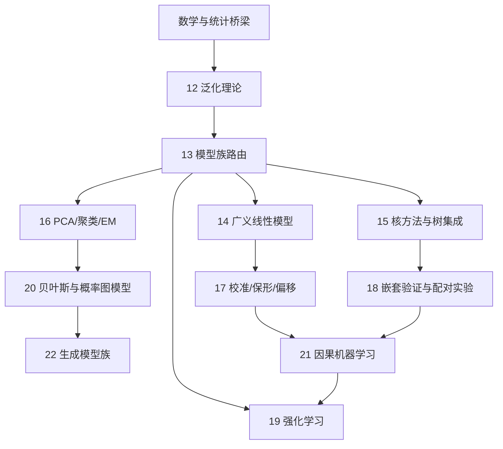

# 机器学习与深度学习基础

<!-- deep-review-02 -->
> [!tip] 本轮深化：从当前概念继续追问
> 已有课程保持原路径。完成入门后，从下面的“本科核心进阶路线”按问题继续；箭头表示推荐阅读次序，不表示后一个概念与前一个等价。

本组面向已会基础 Python 的学习者。目标不是背框架，而是建立一条判断链：问题是否适合学习、数据是否代表未来、模型怎样更新、如何证明它没有只记住训练样本。

## 学习路线

1. [[AI/10-机器学习与深度学习基础/01-AI机器学习深度学习与生成模型的边界|AI、ML、DL 与生成模型的边界]]
2. [[AI/10-机器学习与深度学习基础/02-模型特征参数目标与泛化|特征、目标、参数与泛化]]
3. [[AI/10-机器学习与深度学习基础/03-张量形状广播与批处理|张量、shape、广播与批处理]]
4. [[AI/10-机器学习与深度学习基础/09-神经网络层激活函数与表示学习|神经网络、激活函数与表示学习]]
5. [[AI/10-机器学习与深度学习基础/04-计算图与自动微分|计算图与自动微分]]
6. [[AI/10-机器学习与深度学习基础/05-数据集拆分清洗与泄漏|数据集拆分、清洗与泄漏]]
7. [[AI/10-机器学习与深度学习基础/06-损失函数优化与训练循环|损失函数、优化与训练循环]]
8. [[AI/10-机器学习与深度学习基础/07-过拟合正则化归一化与可复现|过拟合、正则化、归一化与可复现]]
9. [[AI/10-机器学习与深度学习基础/10-基线指标阈值误差分析与分布偏移|基线、指标、阈值、误差分析与分布偏移]]
10. [[AI/10-机器学习与深度学习基础/11-经典机器学习基线与模型选择|经典机器学习基线与模型选择]]
11. [[AI/10-机器学习与深度学习基础/08-PyTorch与LLM训练生态职责|PyTorch 与 LLM 训练生态职责]]

## 本科核心进阶路线

入门路线建立训练词汇，进阶路线补上“为什么能泛化、模型族如何选择、概率与因果问题怎样区分”。主干建议：

| 想回答的问题 | 主解释 | 先修/下一步 |
|---|---|---|
| 有限训练误差为何能约束未来误差？ | [[AI/10-机器学习与深度学习基础/12-统计学习泛化与实验设计\|12 统计学习与泛化]] | [[AI/11-数学与统计桥梁/00-数学与统计桥梁-MOC\|数学与统计桥梁]] |
| 新任务先比较哪些模型族？ | [[AI/10-机器学习与深度学习基础/13-树集成核方法与无监督学习\|13 模型族路由]] | 再分流到 14/15/16 |
| 线性、logit、Poisson 与正则化怎样统一？ | [[AI/10-机器学习与深度学习基础/14-线性回归逻辑回归与概率建模\|14 广义线性模型]] | [[AI/10-机器学习与深度学习基础/17-概率校准保形预测与分布偏移\|17 校准与偏移]] |
| 没有标签时，重建、聚类和密度各学什么？ | [[AI/10-机器学习与深度学习基础/16-PCA聚类EM与表示学习\|16 无监督与表示学习]] | [[AI/10-机器学习与深度学习基础/20-贝叶斯学习概率图模型与近似推断\|20 概率图与推断]] |
| 后验、图模型与近似推断为何需要？ | [[AI/10-机器学习与深度学习基础/20-贝叶斯学习概率图模型与近似推断\|20 贝叶斯学习]] | [[AI/10-机器学习与深度学习基础/22-生成建模自回归VAE流GAN与扩散\|22 生成模型族]] |
| 预测得准为何不等于行动有效？ | [[AI/10-机器学习与深度学习基础/21-因果机器学习选择偏差与反事实评估\|21 因果机器学习]] | 一般识别回到 [[社会科学/10-共同工具/03-因果图反事实与识别\|因果识别主解释]] |
| 动作会改变后续数据时怎样学习？ | [[AI/10-机器学习与深度学习基础/19-强化学习MDP价值函数与策略梯度\|19 强化学习]] | 先区分 on/off-policy 与支持集 |

> [!tip] 只读一条最短路线
> 表格监督学习：12 → 13 → 14/15 → 18。无监督与生成：13 → 16 → 20 → 22。在线决策：12 → 21 → 19。神经网络训练机制：09 → 07 → 17，再进入对应 CNN/LLM 专题。

> [!note] 文件编号是稳定课程 ID；学习顺序以本 MOC 为准
> 为了让已有链接和笔记路径保持稳定，文件名前的编号不等同于学习路线序号。新增课程使用可用的稳定 ID `11`；实际先后关系由本 MOC 的学习路线维护。

> [!tip] 本组先建立“能检查”的共同语言
> 本组只要求基础 Python、能读文件和运行已有的 CPU 小样例。遇到矩阵、概率或梯度时，先记下它在训练中解决什么问题，再按需回到数学页；不需要为了看懂第一轮概念而先完成全部数学推导。读完本组后可以进入 LLM 原理、架构和推理的**理解路线**；构建 C++ 后端或阅读 `llama.cpp` 源码是另一道进阶门槛，须先完成 C++、系统和对应硬件前置。

## 学完后能回答

- 一个任务应先写规则、做预测模型，还是用生成模型？
- 哪些列能在预测时使用，哪些是标签或泄漏的未来信息？
- 张量的每一轴代表什么；广播为何成立或失败？
- 为什么没有非线性的多层线性网络仍只等价于一层线性映射？
- 训练损失下降为何仍不证明模型可用？
- 为什么总体准确率可能掩盖少数类失败；阈值为何必须在验证集上选？
- 为什么应先比较规则、常数预测和经典模型；什么时候神经网络不应是默认方案？
- 线性/逻辑回归、kNN、决策树与聚类各自适合什么，以及缩放、泄漏、解释和偏移的边界是什么？
- PyTorch、Transformers、Tokenizers、Datasets、PEFT、TRL、Accelerate 各自负责什么？

## 数学与后续路线

本组只说明数学在训练中做什么，完整定义、推导和练习保留在数学域。需要补强时从 [[数学/00-数学-首页|数学首页]] 进入，特别是 [[数学/20-线性代数与几何/00-线性代数与几何-MOC|线性代数与几何]]、[[数学/30-概率与统计/00-概率与统计-MOC|概率与统计]] 和 [[数学/40-微积分与优化/00-微积分与优化-MOC|微积分与优化]]。完成本组后进入 [[AI/20-LLM/10-原理/00-LLM原理-MOC|LLM 原理]]，再到 [[AI/20-LLM/20-架构/00-LLM架构-MOC|LLM 架构]] 把通用训练概念用于 token、Transformer、预训练和微调。只有要构建原生后端或改源码时，才沿 [[计算机知识/30-计算机系统/00-计算机系统-MOC|计算机系统]]、[[计算机知识/10-编程语言/02-C++/00-C++-MOC|C++]] 与 [[计算机知识/40-并行与异构计算/01-CUDA/00-CUDA-MOC|CUDA]] 的路线继续。

## 实验边界

伴随脚本只构造微型 CPU 数据，不联网、不下载模型或数据。部分脚本可选用已安装的 CPU PyTorch；第 11 课的经典模型对比只用 Python 标准库。玩具实验只验证概念，不能外推为真实业务结论。

## 返回

- [[AI/00-开始/00-AI-首页|AI 首页]]
- [[AI/20-LLM/00-LLM-MOC|LLM MOC]]

## 统计基础与下一条实践主线

[[AI/10-机器学习与深度学习基础/12-统计学习泛化与实验设计|统计学习泛化与实验设计]]：补充机制、推导、小例与验证边界。

[[AI/10-机器学习与深度学习基础/13-树集成核方法与无监督学习|树集成核方法与无监督学习]]：补充机制、推导、小例与验证边界。

[[AI/12-PyTorch/00-PyTorch-MOC|PyTorch 专题]]：将已有张量与训练概念落实为可检查的程序。

[[AI/15-卷积神经网络/00-卷积神经网络-MOC|卷积神经网络专题]]：由局部连接、感受野走到视觉任务与 ViT。

## 从有限类进入统计学习理论

“候选模型无穷多，为什么还能保证学习？”在第12课有限类界后进入 [[AI/10-机器学习与深度学习基础/30-统计学习理论/00-统计学习理论-MOC|PAC、VC与稳定性课程]]，依次推一致收敛到近似ERM、增长函数到VC保证、强凸正则化到稳定性。[[AI/10-机器学习与深度学习基础/30-统计学习理论/80-有限分布复算与条件破坏|固定四点分布复算]] 用全部样本计数比较训练/真实风险，并以复制行和分布偏移检验条件；高年级主干不作为第一轮训练词汇的额外先修。

## 集中复算

[[AI/90-资源/实验/ml_foundations_20260916/README|机器学习基础集中复算包]]把岭回归、有限类界、GMM 责任度、Bellman backup、Beta-Bernoulli、分层率反向、自回归归一化和 flow 变量变换放在三个轻量文件中。它只复算合成例，不是现实效果或深度模型训练证据。
