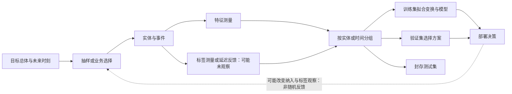

# 数据集拆分、清洗与泄漏

<!-- deep-review-02 -->
> [!tip] 本轮深化：从当前概念继续追问
> 拆分单位应与泛化问题一致：同一用户、文档或近重复内容跨分区可能泄漏。预处理和超参数搜索也会吸收数据的信息，不只模型拟合需要隔离。 深化与验证：[[AI/10-机器学习与深度学习基础/18-嵌套验证配对实验与指标陷阱|嵌套验证配对实验与指标陷阱]]；[[AI/20-LLM/30-训练/14-预训练数据配方去重课程与消融|预训练数据配方去重课程与消融]]。

## 目标与适用场景

模型选择之前，先保护评估。你将能建立训练、验证、测试的职责边界，并发现模型或团队在不该看未来时已经看到了未来的泄漏。

## 直觉

- **训练集** 用于拟合参数。
- **验证集** 用于选超参数、早停轮次、阈值、特征方案和模型版本。
- **测试集** 只用于最后一次独立报告。

不断查看测试分数并据此调模型，团队本身就在对测试集过拟合。因此测试集不是一个普通文件夹，而是一条决策访问控制线。

## 精确定义：先切分，再学习变换

清洗分两类：

1. 规则型变换，例如统一单位、解析日期、删除明确损坏记录。规则及其影响都要留审计记录。
2. 从数据估计的变换，例如均值填补、标准化统计量、词表、类别映射和主成分。

第二类必须只在训练集上拟合，再用同一结果变换验证、测试和未来输入。否则测试分布已经参与了表示学习，报告会乐观偏差。

抽样、分布和分层的数学背景见 [[数学/30-概率与统计/00-概率与统计-MOC|概率与统计]]。

## 三类常见泄漏

| 类型 | 例子 | 防护问题 |
| --- | --- | --- |
| 未来泄漏 | 用最终解决时长预测工单刚创建时是否升级 | 预测时刻拿得到吗？ |
| 同源泄漏 | 同一用户的近似记录分进训练和测试 | 实体、会话、文档或时间窗重叠吗？ |
| 预处理泄漏 | 用全量数据计算标准化均值 | 这个统计量只从训练集得来吗？ |

随机切分不总是正确。时间序列通常按时间向前切；同一用户、多张同源图片或同一文档片段，通常按组切分。策略必须模拟上线时的真正新样本。

## 先画数据怎样来到你手里

切分并不是数据工作的第一步。一个可审查的学习问题至少有这条生成链：

箭头表示信息产生或进入决策的方向，不自动表示因果效应。若部署动作改变了谁会被记录、谁会得到标签，最后一条反馈边会让下一批训练数据不再等同于最初总体。

先区分三个单位：

- **预测单位**：上线时一次要给谁或什么做预测，例如一位用户的一次申请；
- **近似独立的观察单位**：重复信息从哪里产生，例如同一用户的多次申请通常相关；
- **切分/重采样单位**：为了模拟未来新样本，应整体留在哪一侧，例如按用户而非按行切分。

四位用户各有两条模板近似相同的记录。若每位用户一条进训练、一条进测试，测试的 4 条记录都有同源模板已被模型见过，重叠率是 $4/4$；若按用户把两位放训练、两位放测试，用户重叠率是 $0/2$。两个切分都可能叫“50% 测试”，但回答的是完全不同的泛化问题。

### 在同一份数据里分开两种失败

到[[AI/10-机器学习与深度学习基础/23-从数据到评测与行动#同一份八行数据先拆分再找分母|八行工单表]]，先把 A/B 用户放训练、C/D 放测试。用户没有跨区，仍有 C2、D2 的标签未知；“分区正确”与“目标总体被充分观察”是两项检查。

若问题是**同一批老用户明天的工单**，时间窗口比排除全部老用户更贴题；若问题是**从未见过的新用户**，按用户隔离才模拟对应信息边界。混合问题可同时限制时间和用户，但要报告因此排除了谁，不能把更严格切分自动叫更有代表性。无论哪种切分，都要列标签已成熟且确被观察的数量，并保留未观察行。去读[[AI/65-可信AI与真实数据实践/02-标签选择偏差与社会目标#一个能跟算的选择标签反例|选择标签反例]]，带回“哪些人的观察概率可能为零”，而不是只带回一个加权公式。

## 标签也是测量，不是天然真值

标签可能来自人工判断、传感器、后续行为或业务规则。至少区分：

| 问题 | 例子 | 需要留下的证据 |
| --- | --- | --- |
| 口径错配 | 用“点击”代理“满意” | 为什么代理与真正目标有关，何时会失效 |
| 随机测量误差 | 图像模糊导致标注者偶尔看错 | 重标样本、分歧率和困难切片 |
| 系统误差 | 某语言的投诉更常被漏记 | 按来源/人群的标签获得机制 |
| 标签延迟 | 贷款是否违约要数月后才知道 | 截止时间、删失和成熟样本定义 |

多数人同意只说明标注规则下一致，不必然等于世界中不可争议的真值。训练前应保存原始观测、标注指南、版本、分歧和裁决方式；评测时不要把未知标签悄悄当负类。

## 缺失值透露的是机制问题

统计教材常用三种理想化语言组织缺失：缺失与已观测/未观测值都无关（MCAR）；给定已观测变量后与缺失值本身无关（MAR）；即使给定已观测变量，缺失仍依赖未观测值（MNAR）。它们是分析假设，不是从一张带空格的数据表就能自动证明的标签。

“体检项目为空”可能是随机漏录，也可能是医生认为无须检测，或高风险者拒绝检测。均值填补在三种机制下含义不同。缺失指示可以是有用的预测信号，却也可能只编码某家医院或某版产品的流程；部署流程一变，信号就消失。先记录为什么缺、何时缺、谁决定测量，再选择删除、填补、显式建模或敏感性分析。

## 选择偏差与反馈回路

如果只有获批贷款才能观察还款，训练标签来自“历史策略选择过的人”，而目标可能是所有申请人。100 个申请中 40 个获批，观察到 36 个按时还款；`36/40=90%` 是获批者中的经验比例，不能改写为全部申请人的按时还款率。未获批 60 人的结果没有被观测，模型无法仅凭这张表补出反事实。

搜索排序、风控拦截和推荐也会决定后续哪些点击、投诉或奖励被看到。评估时应写清当前策略、探索/人工复核覆盖、标签延迟和不可观察区域；关于机器学习中的干预与反事实评估继续读 [[AI/10-机器学习与深度学习基础/21-因果机器学习选择偏差与反事实评估|因果预测、选择偏差与反事实评估]]。

## 数据说明的最小合同

| 字段 | 必答问题 |
| --- | --- |
| 目标总体 | 结论要推广到什么人、对象、地区和时间？ |
| 预测时刻 | 每个特征和标签在何时产生？ |
| 实体键 | 哪些行来自同一用户、设备、文档或事件？ |
| 纳入/排除 | 谁没有进入数据，谁进入后没有标签？ |
| 测量口径 | 特征、标签、单位和业务规则的版本是什么？ |
| 缺失 | 为什么没测、如何编码、是否随流程改变？ |
| 切分 | 按时间、实体、来源还是空间隔离，模拟哪种新样本？ |
| 决策访问 | 验证/测试分别允许哪些人和流程查看？ |

这一合同描述可复查边界，不证明样本已经代表目标总体。数据生成、模型选择和上线反馈应分别接受审阅。

## 最小例

前 80 天用于训练、后 20 天用于评估。正确做法是只用前 80 天的均值和标准差，再标准化所有集合；错误做法是先用 100 天计算统计量。后者没有直接给标签，却把未来分布提前告诉了训练过程。

“异常值”也不能自动删除。它可能是录入错误、罕见但真实的情况，或恰是未来必须面对的人群。保留不可变原始数据、清洗规则、删除理由和每步样本数。

## 一份可执行的拆分说明

每个项目至少写下：

1. 预测发生的时间点与实体单位。
2. 训练、验证、测试的时间范围或分组规则。
3. 每个特征的产生时间和可用性。
4. 哪些统计变换只在训练集拟合。
5. 最终测试集由谁在何时访问，且之后不再用于哪些决策。

## 练习

有 2024 到 2026 年同一批用户的交易记录，目标是预测未来 30 天是否流失。

1. 解释为什么随机按行切分会泄漏同一用户历史。
2. 设计按时间的训练、验证、测试窗口。
3. 列两项看似有用、但预测时可能不可用的字段。
4. 说明标准化和缺失值填补在哪个集合拟合。

## 成功标准

- 能说清三种数据集合允许做什么决策。
- 能从时间、实体重叠和预处理检查泄漏。
- 能解释先切分后拟合变换的原因。

## 导航

- 上一页：[[AI/10-机器学习与深度学习基础/04-计算图与自动微分|计算图与自动微分]]
- 下一页：[[AI/10-机器学习与深度学习基础/06-损失函数优化与训练循环|损失、优化与训练循环]]
- 返回：[[AI/10-机器学习与深度学习基础/00-机器学习与深度学习基础-MOC|机器学习与深度学习基础 MOC]]

## 来源与证据边界

- [scikit-learn 1.9.1：Common pitfalls and recommended practices](https://scikit-learn.org/stable/common_pitfalls.html)：12.1–12.2 节的训练/测试预处理与管线泄漏；动态文档实际打开版本 1.9.1，候选核验日期 2026-09-16。
- [van Buuren：Flexible Imputation of Missing Data，2.2.4 节](https://stefvanbuuren.name/fimd/sec-idconcepts.html)：作者教材给出 MCAR/MAR/MNAR 的响应指示定义，并说明 MAR 与 MNAR 一般不能仅从缺失数据中检验区分；本页只把它们作为组织假设。
- [Suresh 与 Guttag：A Framework for Understanding Sources of Harm throughout the Machine Learning Life Cycle](https://arxiv.org/abs/1901.10002v5)：数据收集、开发与部署阶段的伤害来源框架；本页没有把该分类当作现实风险已被测量。

所有数字都是教学构造。它们用于检查分母、重叠和可观察性，不代表贷款、医疗或任何人群的实测结果。
