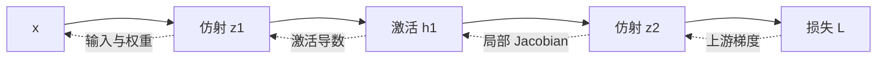

# 神经网络、层、激活函数与表示学习

<!-- deep-review-02 -->
> [!tip] 本轮深化：从当前概念继续追问
> 激活函数既影响可表达的函数，也影响梯度路径；残差提供恒等通路，但并不保证任意权重、步长下都稳定。用局部 Jacobian 分析比只记架构名称更可靠。 深化与验证：[[AI/11-数学与统计桥梁/02-矩阵微积分VJP与反向传播|矩阵微积分VJP与反向传播]]；[[AI/15-卷积神经网络/07-残差网络轻量卷积与训练配方|残差网络轻量卷积与训练配方]]。

## 目标与适用场景

在进入自动微分和 Transformer 前，先回答一个更基础的问题：神经网络的一层究竟做什么，为什么要在层之间加入非线性，以及“学习表示”与手工指定特征是什么关系。

## 直觉：先混合特征，再通过非线性门

一个最小神经网络层可分成两步：

1. 线性/仿射变换把输入特征重新加权、组合并平移；
2. 激活函数逐元素改变结果，使网络能表达弯曲、分段或门控的关系。

对单个输入向量 $x\in\mathbb{R}^{D_{in}}$，一层常写作：

$$
z=xW+b,\qquad h=\phi(z),
$$

其中 $W\in\mathbb{R}^{D_{in}\times D_{out}}$、$b\in\mathbb{R}^{D_{out}}$ 是可学习参数，$z$ 称为 pre-activation，$h$ 是该层输出。对批次输入 `[B,D_in]`，输出是 `[B,D_out]`；层对每个样本复用同一组参数。

矩阵乘法的完整定义与被求和轴见 [[数学/20-线性代数与几何/02-矩阵乘法线性映射与Einsum|矩阵乘法、线性映射与 Einsum]]。本页只保留神经网络中的职责与 shape。

## 为什么非线性不可少

假设把两个没有激活函数的层叠起来：

$$
h=xW_1+b_1,
$$

$$
y=hW_2+b_2.
$$

代入第一式：

$$
y=x(W_1W_2)+(b_1W_2+b_2).
$$

括号中的两项仍可看成一个新矩阵和一个新偏置，所以无论叠多少个纯仿射层，整体仍只是一层仿射变换。这不是说线性层没用，而是说**深度要配合非线性，才不会在函数表达上塌回一层**。

这段只展示神经网络中的代入结果；线性映射、仿射变换与复合的权威解释仍在数学域。

## 常见激活函数的角色

| 激活 | 直觉 | 常见优点 | 需要留意 |
| --- | --- | --- | --- |
| ReLU：`max(0,z)` | 负数关掉，正数直通 | 简单、分段线性、计算便宜 | 长期落在负区间的单元可能梯度为 0 |
| Sigmoid | 把实数压到 `(0,1)` | 适合作为某些二分类输出的概率参数 | 大绝对值区间梯度很小；隐藏层中不再是默认选择 |
| Tanh | 压到 `(-1,1)` | 输出以 0 为中心 | 大绝对值区间同样会饱和 |
| GELU / SiLU | 平滑地按输入大小门控 | Transformer/现代网络中常见 | 具体选择是架构事实，不应从家族名猜测 |

激活函数不是“把任意输出变成概率”的通用按钮。二分类 logits、单标签多分类 logits、多标签 logits 的输出合同不同；最终是否用 sigmoid 或 softmax，取决于损失函数与任务定义，见 [[AI/10-机器学习与深度学习基础/06-损失函数优化与训练循环|损失函数、优化与训练循环]]。

## 从手工特征到表示学习

传统表格任务常由人先定义“近 7 天订单数”“价格/面积”等特征。深度网络则让中间层在训练目标驱动下形成可复用表示：图像早期层可能对局部边缘敏感，文本模型的 hidden state 会随上下文变化。

但“表示是学出来的”不等于它有唯一、可读的自然语言含义：

- 同一个维度通常不是稳定的单一概念开关；
- 表示会同时携带任务信号、数据偏差和偶然相关；
- 训练目标没有要求保留的信息，模型未必可靠保留；
- 线性探针能读取某属性，不自动证明模型靠该属性做决定。

LLM 中 token embedding、上下文化 hidden state 与检索 embedding 的区别见 [[AI/20-LLM/10-原理/03-Embedding表示与语义空间|Embedding、表示与语义空间]]。

## 能表达、能优化、能泛化是三件事

| 问题 | 关注对象 | 一个失败例 |
| --- | --- | --- |
| 表达能力 | 是否存在一组参数表示目标函数 | 单条直线不能分 XOR |
| 优化可达性 | 训练过程能否在预算内找到好参数 | 饱和激活使梯度极小 |
| 统计泛化 | 从有限样本选出的参数是否适用于未来 | 记住训练 ID |
| 计算可行性 | 时间、内存、数值精度是否允许 | 激活或优化器状态超预算 |

“网络足够宽所以能表示”只回答第一行；训练 loss 下降只给第二行的局部证据；测试集与时间外数据才开始回答第三行；参数量也不能单独回答第四行。

## 梯度为何会消失或爆炸

对标量两层网络 $\hat y=w_2\phi(w_1x)$，

$$
\frac{\partial \hat y}{\partial w_1}=w_2\phi'(w_1x)x.
$$

深度增加后，反向路径包含许多局部 Jacobian 的乘积。若典型尺度持续小于 1，信号会衰减；持续大于 1，信号会放大。sigmoid 在 $z=0$ 时导数为 $0.25$，在 $z=10$ 时约 $4.54\times10^{-5}$；相同 $x,w_2$ 下，后者给早期权重的梯度约小 5500 倍。ReLU 正区间导数为 1，却会在负区间给 0；这不是“所有 ReLU 网络没有梯度问题”。

虚线是反向敏感度的复合，不表示“梯度作为另一个前向张量流进输入”。共享参数被多处使用时，各路径贡献还要相加；完整 VJP 见 [[AI/11-数学与统计桥梁/02-矩阵微积分VJP与反向传播|矩阵微积分与 VJP]]。

## 初始化是在保护信号尺度

若一层有 $n_{in}$ 个近似独立、零均值输入，权重也独立且零均值，则线性组合的方差大致随 $n_{in}\operatorname{Var}(W)$ 缩放。让权重方差约为 $1/n_{in}$ 可防止前向方差仅因宽度成倍变化；同时兼顾前向与反向得到 Glorot/Xavier 类型尺度。ReLU 会把一部分输入截为零，He 初始化常用约 $2/n_{in}$ 的方差补偿这一效应。

这些推导依赖独立性、分布和激活的近似，解决的是初始信号尺度，不保证非凸训练收敛，更不保证泛化。bias、残差、归一化、卷积扇入和截断正态的具体约定都要查实现。

## 归一化与残差改变不同的路径

BatchNorm 常跨 batch 及部分空间轴估计统计量，训练和推理状态不同；LayerNorm 对单样本的特征轴归一化，通常不依赖 batch 统计。究竟归一化哪些轴必须从张量语义写出，不能只看名称。

残差块写作

$$
h_{l+1}=h_l+F_l(h_l),\qquad
\frac{\partial h_{l+1}}{\partial h_l}=I+J_{F_l}.
$$

恒等项提供一条直接敏感度路径，并让 $F_l=0$ 时块能表示恒等映射。它不保证 $I+J_F$ 的所有奇异值合适，也不修复过大学习率、错误目标或不稳定归一化。CNN 的具体残差配方见 [[AI/15-卷积神经网络/07-残差网络轻量卷积与训练配方|残差网络与训练配方]]；Transformer 中 pre/post norm 的位置见 [[AI/20-LLM/20-架构/03-FFN归一化残差与SwiGLU|FFN、归一化与残差]]。

## 表示的坐标并不唯一

先区分三种对象：网络实现的函数、隐藏表示的坐标，以及存储在文件中的参数数组。两个网络可以实现同一函数，却使用不同隐藏坐标和不同参数；直接平均数组时，计算机不会自动知道哪些隐藏单元彼此对应。下面先声明重编码的条件，再在 [[#同一算例：隐藏单元置换与参数平均|两隐藏单元算例]] 中比较函数不变、坐标改变与参数平均失效。

### 激活后重编码与激活前改参数

沿用本页的**行向量**约定：输入 $x\in\mathbb R^{1\times d}$，$W_1\in\mathbb R^{d\times m}$、$b_1\in\mathbb R^{1\times m}$，隐藏表示 $h=\phi(xW_1+b_1)\in\mathbb R^{1\times m}$；输出 $y=hW_2+b_2\in\mathbb R^{1\times k}$，其中 $W_2\in\mathbb R^{m\times k}$、$b_2\in\mathbb R^{1\times k}$。$d,m,k$ 分别是输入、隐藏与输出维数。

对任何可逆 $S\in\mathbb R^{m\times m}$，在**激活之后**定义新编码 $h'=hS$，并让读出矩阵改为 $W_2'=S^{-1}W_2$，便有

$$
h'W_2'+b_2=(hS)(S^{-1}W_2)+b_2=hW_2+b_2=y.
$$

这里保存的是完整表示可被逆变换恢复、以及读出结果不变；并没有声称每个坐标数值、欧氏长度或单坐标含义不变。它还没有说明怎样在原有“仿射层 → 固定逐元素激活 → 仿射层”的架构中产生 $h'$。若要把 $S$ 吸收到第一层参数里，写成 $W_1'=W_1S$、$b_1'=b_1S$，还必须检查

$$
\phi(zS)\stackrel{?}=\phi(z)S,\qquad z=xW_1+b_1.
$$

这个等式成立时，新的隐藏输出才恰好等于旧表示的重编码。下一例中 $S$ 只是交换两个坐标；同一种逐元素激活与这种交换可以互换次序。一般可逆矩阵则没有这项保证。

### 同一算例：隐藏单元置换与参数平均

取 $d=k=1,m=2$，所有偏置为 0：

$$
W_1=\begin{pmatrix}1&-1\end{pmatrix},\qquad
W_2=\begin{pmatrix}1\\-1\end{pmatrix},\qquad
f(x)=\operatorname{ReLU}(xW_1)W_2.
$$

第一单元记录正半轴的大小，第二单元记录负半轴的大小，输出以“第一项减第二项”重新拼成输入：

$$
f(x)=\operatorname{ReLU}(x)-\operatorname{ReLU}(-x)
=\begin{cases}x-0=x,&x\ge0,\\0-(-x)=x,&x<0.\end{cases}
$$

所以这是对**所有实数输入**成立的恒等函数；样点表只能核对计算，不能替代这个分支证明。

现在用 $S=\begin{pmatrix}0&1\\1&0\end{pmatrix}$ 交换隐藏单元，$S^{-1}=S$。第一层交换输出列，第二层同步交换输入行：

$$
W_1'=W_1S=\begin{pmatrix}-1&1\end{pmatrix},\qquad
W_2'=S^{-1}W_2=\begin{pmatrix}-1\\1\end{pmatrix}.
$$

对任意行向量 $z=(z_1,z_2)$，$\operatorname{ReLU}(zS)=(\operatorname{ReLU}(z_2),\operatorname{ReLU}(z_1))=\operatorname{ReLU}(z)S$。因此

$$
f'(x)=\operatorname{ReLU}(xW_1S)S^{-1}W_2
=\operatorname{ReLU}(xW_1)SS^{-1}W_2=f(x)=x.
$$

第一个模型的“正半轴单元”位于第 1 列，第二个模型的同一职责位于第 2 列。若忽略这层对应关系，把同一数组位置当成同一职责，直接逐项平均参数，则

$$
\bar W_1=\frac{W_1+W_1'}2=\begin{pmatrix}0&0\end{pmatrix},\qquad
\bar W_2=\frac{W_2+W_2'}2=\begin{pmatrix}0\\0\end{pmatrix}.
$$

均值模型 $f_{\bar\theta}(x)=0$，而平均两份**输出**得到 $\tfrac12(f(x)+f'(x))=x$。两种平均的对象和执行顺序不同：参数平均先造一个新网络，再做一次前向；输出平均分别做前向，再合并预测。

| 输入 $x$ | 原隐藏表示 $h$ | 置换后表示 $h'$ | 原输出 $f(x)$ | 置换输出 $f'(x)$ | 参数均值输出 | 输出均值 |
| ---: | --- | --- | ---: | ---: | ---: | ---: |
| $-2$ | $(0,2)$ | $(2,0)$ | $-2$ | $-2$ | $0$ | $-2$ |
| $0$ | $(0,0)$ | $(0,0)$ | $0$ | $0$ | $0$ | $0$ |
| $1$ | $(1,0)$ | $(0,1)$ | $1$ | $1$ | $0$ | $1$ |

若先把第二个模型对齐回来，$W_1'S^{-1}=W_1$、$SW_2'=W_2$，再平均就恢复原模型。这个例子说明坐标错配足以造成合并失败；它没有证明找到任意置换后，两个独立训练模型的平均一定良好。真实模型中的置换匹配算法和经验边界可查 [Git Re-Basin 原论文](https://arxiv.org/abs/2209.04836)。

### 失败返回：一般可逆变换不能越过 ReLU

把问题缩小到只有一个隐藏单元：$g(x)=\operatorname{ReLU}(x)$，即两层权重都是 1，偏置为 0。取可逆标量 $S=-1=S^{-1}$。在激活后重编码，$h'=-\operatorname{ReLU}(x)$，读出再乘 $-1$，仍得到 $g(x)$。

但若直接把第一层权重改成 $-1$、第二层也改成 $-1$，固定 ReLU 架构算出的是

$$
\tilde g(x)=-\operatorname{ReLU}(-x).
$$

在 $x=1$ 时，原输出为 1，新输出为 0。失败恰好发生在 $\operatorname{ReLU}(-x)\ne-\operatorname{ReLU}(x)$，而不是逆矩阵不存在。想使用一般换基，就必须返回激活定义检查；若同时改变激活本身，可以定义 $\phi_S(u)=\phi(uS^{-1})S$，但它一般不再是原先固定的逐元素 ReLU，已经改变了架构中的激活操作。

置换并非 ReLU 的唯一相容变换，例如正对角缩放满足正齐次性；这里不分类全部对称性。若加入偏置，要同步变换 $b_1$；若加入归一化、残差或共享权重，还要检查统计量、各分支和每个共享使用位置是否相容，不能仅凭两层公式声称已经有适用于全部 Transformer 的对齐算法。

隐藏坐标可以重标记，说明“第 417 维就是某概念”需要跨样本读取、干预、替代解释和稳定性证据。线性 probe 说明属性可被读出，不证明模型在决策中使用它；干预若制造分布外隐藏状态，也不能自动给出因果结论。

### 返回数学条件与模型合并

- 要检查换基方向，回到 [[数学/20-线性代数与几何/11-基变换相似与矩阵表示#基变换先问哪个坐标由哪个得到|列向量的基变换定义]]。那里 $[v]_{\mathcal B}=P[v]_{\mathcal C}$，转成行向量便是 $h_{\mathcal C}=h_{\mathcal B}P^{-T}$，对应本页 $S=P^{-T}$。该页的相似公式用于同一线性算子的定义域和陪域一起换基；本页只对隐藏空间重编码、保持输入输出坐标不变，不能把两者当作同一个矩阵公式。
- 要判断真实合并还缺哪些条件，回到 [[AI/20-LLM/30-训练/16-持续学习遗忘评测与模型合并#模型合并为什么需要共同坐标系|共同坐标系与模型合并]]。先说明平均的是参数、任务向量还是预测，再检查坐标对应和任务评测。

### 节点重编号：同时变换 A、H 与输出

这里的初始节点表示 H 记作 X，行索引是节点，列索引是节点特征。以下作用对象与本页的隐藏特征坐标分开声明。

隐藏通道置换也不同于图节点重编号。以一个简单消息传递层 $F(A,X;W)=\phi(AXW)$ 为例，$A\in\mathbb R^{n\times n}$、$X\in\mathbb R^{n\times d}$、$W\in\mathbb R^{d\times k}$，$\phi$ 逐元素作用。节点置换矩阵 $Q\in\mathbb R^{n\times n}$ 同时作用为 $A'=QAQ^T,X'=QX$，保持 $W$ 不变，由 $(QAQ^T)(QX)W=QAXW$ 和逐元素激活与行重排可交换，得到 $F(A',X';W)=QF(A,X;W)$：节点输出随节点重排，叫等变。本页的 $S$ 作用在隐藏特征列并伴随下一层权重行的变换，外部输入与最终输出保持不变。二者共同的检查习惯是先声明置换作用在哪个对象上；不能因都出现置换矩阵就混成同一个任务。若继续学习群表示，置换矩阵可作为群作用的例子，但一般线性表示仍不能免除上面的非线性相容条件。

要把两种作用放进统一表示语言，返回 [[数学/25-高等代数/50-模与有限群表示/05-循环移位Fourier基与对称性合同#输入节点与隐藏参数：两种作用不能混写|群、对象与输入输出合同]]。该数学页采用列隐藏向量，本页采用行隐藏向量，二者按 P=Sᵀ 对齐：h′=hS 转置后为 h′ᵀ=Phᵀ，第一层和第二层权重也同时转置。节点置换 Q 作用于节点行，隐藏置换 S 作用于特征列，不能互相代换；表示理论的 [[数学/25-高等代数/50-模与有限群表示/03-S3表示Maschke与Schur引理#Schur 引理：不可约块之间能有什么线性接口|Schur 线性交织条件]] 也不把此处的非线性网络直接变成线性映射。

将这个编号合同带入 [[AI/16-图表示学习/01-图对象消息传递与学习目标#同一张图算前向、读出、损失与梯度|三节点消息传递、图读出与一次参数更新]]，再到 [[AI/16-图表示学习/02-消息传递表达能力与结构反例#逐层证明：任意深度和参数仍相同|六环与双三角形的逐层反例]] 检查等变为何不自动保留全部结构。两课分别明确图内节点与独立图样本、可用特征与模型类的条件。

### 固定输入实验与迁移自测

可执行源码：[09_隐藏单元置换与参数平均.py](09_隐藏单元置换与参数平均.py)。只使用 Python 标准库，固定输入 $(-2,0,1)$，输出 JSON；没有训练、随机数、模型下载或文件写入。脚本计算原模型、同步置换、参数平均、输出平均、仅交换第一层，以及 $S=-1$ 的前后激活区别。

从本页目录运行：`python3 -B 09_隐藏单元置换与参数平均.py`。先用表中数值与下题答案预测输出，再运行核对；正文中的预期来自代数推导，不是运行回执。有限输入实验用于发现实现错误，全实数结论仍由分支证明承担。

2026-10-09已运行−2、0、1三个固定输入，同步置换、直接参数平均、对齐后平均及ReLU前后重编码的全部输出字段均由独立标量oracle逐项核对通过。代码版本、命令、原始输出和环境见[[AI/80-实践/隐藏单元置换与参数平均/README|隐藏单元置换实跑记录]]；该结果只验证此构造例。

**迁移题：** 只把第一层两个输出列交换，第二层仍用原 $W_2$。分别回答：（1）新函数是否仍为 $x$，哪步消去失效？（2）新隐藏坐标是否仍可恢复？（3）它与原模型平均参数、平均输出分别得到什么？给出非零输入反例。若第（1）题出错，返回置换证明检查 $S$ 与 $S^{-1}$；若第（2）题出错，返回重编码式区分“信息可恢复”与“读出已同步”；若第（3）题出错，重新写清被平均的对象。

> [!question]- 解答：逐项核对函数、坐标与平均
> （1）新函数 $q(x)=\operatorname{ReLU}(-x)-\operatorname{ReLU}(x)=-x$，在 $x=1$ 时为 $-1$。第二层未乘 $S^{-1}$，故乘积中没有可消去的 $SS^{-1}$；本例实际有 $SW_2=-W_2$。（2）隐藏表示仍为 $hS$，可右乘 $S^{-1}$ 恢复 $h$，信息没有丢失，但原读出矩阵解读了错误的坐标，最终函数改变。（3）与原模型平均后第一层为零、第二层仍为 $W_2$，所以参数均值输出为 0；此时输出均值也为 $(x+(-x))/2=0$。这与同步置换例中“输出均值仍为 $x$”不同。两种平均恰好都为零不能被推广成二者一般相等。

## 一个可手算例子：XOR 为何难倒单一线性边界

XOR 的四个输入是：

| $x_1$ | $x_2$ | $y$ |
| ---: | ---: | ---: |
| 0 | 0 | 0 |
| 0 | 1 | 1 |
| 1 | 0 | 1 |
| 1 | 1 | 0 |

在二维平面中，两个正例位于相对角，两个负例位于另外两个角；一条直线无法把它们完全分开。加入含非线性的隐藏层后，可以先构造多个分段边界，再在输出层组合它们。

这个例子只证明“单一线性决策边界不够而非线性网络可以表达该形状”，不证明训练一定找到正确参数，也不证明更深网络在任何数据上都更好。

## 容量、参数与归纳偏好

更宽、更深的网络通常有更大的函数表达空间，但效果还取决于数据、优化、正则化和任务。架构把某些偏好写进模型：卷积偏好局部共享，注意力允许按内容跨位置读取，残差连接保留加法主干。这些偏好称为归纳偏好；它们能让学习更有效，也可能与目标问题不匹配。

参数量不是容量、计算、内存或泛化的同义词。至少分开问：参数有多少、一次前向激活哪些参数、计算多少、保存哪些激活、训练数据是否足够、验证分布是否匹配。

## 练习

1. 输入 shape 为 `[32,10]`，线性层权重为 `[10,24]`、偏置为 `[24]`。写出 pre-activation 和输出 shape，并标出偏置怎样广播。
2. 将两个无激活函数的线性层代入合并，说明“层数增加”为什么没有增加非线性表达能力。
3. 画出 XOR 四个点，尝试用一条直线分开正负例，再说明至少需要怎样的分段边界。
4. 对一句“第 417 个隐藏维度就是讽刺神经元”的说法，列出两项必须补充的干预或跨样本证据。

## 成功标准

- 能从 `[B,D_in]`、`[D_in,D_out]` 推出 `[B,D_out]`，并说明参数沿 batch 复用。
- 能完成两层仿射变换的代入，明确指出非线性的必要性。
- 能区分参数、激活、表示和最终预测，不把 hidden state 的单一坐标当作天然概念。
- 能用 XOR 解释“可表达”与“可训练、可泛化”是三种不同主张。

## 导航

- 上一页：[[AI/10-机器学习与深度学习基础/03-张量形状广播与批处理|张量形状广播与批处理]]
- 下一页：[[AI/10-机器学习与深度学习基础/04-计算图与自动微分|计算图与自动微分]]
- 架构应用：[[AI/20-LLM/20-架构/03-FFN归一化残差与SwiGLU|FFN、归一化、残差与 SwiGLU]]
- 相关数学：[[数学/20-线性代数与几何/02-矩阵乘法线性映射与Einsum|矩阵乘法、线性映射与 Einsum]]
- 返回：[[AI/10-机器学习与深度学习基础/00-机器学习与深度学习基础-MOC|机器学习与深度学习基础 MOC]]

## 来源与证据边界

- [Goodfellow、Bengio、Courville：Deep Learning，第 6、8 章](https://www.deeplearningbook.org/)：前馈网络、反向传播与深度优化的作者教材入口；候选核验日期 2026-09-16。
- [Glorot 与 Bengio：Understanding the difficulty of training deep feedforward neural networks](https://proceedings.mlr.press/v9/glorot10a.html)：激活饱和、跨层激活/梯度与初始化；PMLR 原论文页。
- [He 等：Delving Deep into Rectifiers](https://arxiv.org/abs/1502.01852)：针对 rectifier 的初始化推导；原论文入口。
- [He 等：Deep Residual Learning for Image Recognition](https://arxiv.org/abs/1512.03385)：残差形式与原始实验；本页只使用结构公式，不复述性能数字。

本页的导数与方差是局部/初始化近似，用于解释机制；没有把任何初始化、激活或残差结构写成无条件收敛或泛化保证。
