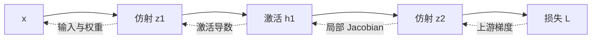

# 神经网络、层、激活函数与表示学习

<!-- deep-review-02 -->
> [!tip] 本轮深化：从当前概念继续追问
> 激活函数既影响可表达的函数，也影响梯度路径；残差提供恒等通路，但并不保证任意权重、步长下都稳定。用局部 Jacobian 分析比只记架构名称更可靠。 深化与验证：[[AI/11-数学与统计桥梁/02-矩阵微积分VJP与反向传播|矩阵微积分VJP与反向传播]]；[[AI/15-卷积神经网络/07-残差网络轻量卷积与训练配方|残差网络轻量卷积与训练配方]]。

## 目标与适用场景

在进入自动微分和 Transformer 前，先回答一个更基础的问题：神经网络的一层究竟做什么，为什么要在层之间加入非线性，以及“学习表示”与手工指定特征是什么关系。

## 直觉：先混合特征，再通过非线性门

一个最小神经网络层可分成两步：

1. 线性/仿射变换把输入特征重新加权、组合并平移；
2. 激活函数逐元素改变结果，使网络能表达弯曲、分段或门控的关系。

对单个输入向量 $x\in\mathbb{R}^{D_{in}}$，一层常写作：

$$
z=xW+b,\qquad h=\phi(z),
$$

其中 $W\in\mathbb{R}^{D_{in}\times D_{out}}$、$b\in\mathbb{R}^{D_{out}}$ 是可学习参数，$z$ 称为 pre-activation，$h$ 是该层输出。对批次输入 `[B,D_in]`，输出是 `[B,D_out]`；层对每个样本复用同一组参数。

矩阵乘法的完整定义与被求和轴见 [[数学/20-线性代数与几何/02-矩阵乘法线性映射与Einsum|矩阵乘法、线性映射与 Einsum]]。本页只保留神经网络中的职责与 shape。

## 为什么非线性不可少

假设把两个没有激活函数的层叠起来：

$$
h=xW_1+b_1,
$$

$$
y=hW_2+b_2.
$$

代入第一式：

$$
y=x(W_1W_2)+(b_1W_2+b_2).
$$

括号中的两项仍可看成一个新矩阵和一个新偏置，所以无论叠多少个纯仿射层，整体仍只是一层仿射变换。这不是说线性层没用，而是说**深度要配合非线性，才不会在函数表达上塌回一层**。

这段只展示神经网络中的代入结果；线性映射、仿射变换与复合的权威解释仍在数学域。

## 常见激活函数的角色

| 激活 | 直觉 | 常见优点 | 需要留意 |
| --- | --- | --- | --- |
| ReLU：`max(0,z)` | 负数关掉，正数直通 | 简单、分段线性、计算便宜 | 长期落在负区间的单元可能梯度为 0 |
| Sigmoid | 把实数压到 `(0,1)` | 适合作为某些二分类输出的概率参数 | 大绝对值区间梯度很小；隐藏层中不再是默认选择 |
| Tanh | 压到 `(-1,1)` | 输出以 0 为中心 | 大绝对值区间同样会饱和 |
| GELU / SiLU | 平滑地按输入大小门控 | Transformer/现代网络中常见 | 具体选择是架构事实，不应从家族名猜测 |

激活函数不是“把任意输出变成概率”的通用按钮。二分类 logits、单标签多分类 logits、多标签 logits 的输出合同不同；最终是否用 sigmoid 或 softmax，取决于损失函数与任务定义，见 [[AI/10-机器学习与深度学习基础/06-损失函数优化与训练循环|损失函数、优化与训练循环]]。

## 从手工特征到表示学习

传统表格任务常由人先定义“近 7 天订单数”“价格/面积”等特征。深度网络则让中间层在训练目标驱动下形成可复用表示：图像早期层可能对局部边缘敏感，文本模型的 hidden state 会随上下文变化。

但“表示是学出来的”不等于它有唯一、可读的自然语言含义：

- 同一个维度通常不是稳定的单一概念开关；
- 表示会同时携带任务信号、数据偏差和偶然相关；
- 训练目标没有要求保留的信息，模型未必可靠保留；
- 线性探针能读取某属性，不自动证明模型靠该属性做决定。

LLM 中 token embedding、上下文化 hidden state 与检索 embedding 的区别见 [[AI/20-LLM/10-原理/03-Embedding表示与语义空间|Embedding、表示与语义空间]]。

## 能表达、能优化、能泛化是三件事

| 问题 | 关注对象 | 一个失败例 |
| --- | --- | --- |
| 表达能力 | 是否存在一组参数表示目标函数 | 单条直线不能分 XOR |
| 优化可达性 | 训练过程能否在预算内找到好参数 | 饱和激活使梯度极小 |
| 统计泛化 | 从有限样本选出的参数是否适用于未来 | 记住训练 ID |
| 计算可行性 | 时间、内存、数值精度是否允许 | 激活或优化器状态超预算 |

“网络足够宽所以能表示”只回答第一行；训练 loss 下降只给第二行的局部证据；测试集与时间外数据才开始回答第三行；参数量也不能单独回答第四行。

## 梯度为何会消失或爆炸

对标量两层网络 $\hat y=w_2\phi(w_1x)$，

$$
\frac{\partial \hat y}{\partial w_1}=w_2\phi'(w_1x)x.
$$

深度增加后，反向路径包含许多局部 Jacobian 的乘积。若典型尺度持续小于 1，信号会衰减；持续大于 1，信号会放大。sigmoid 在 $z=0$ 时导数为 $0.25$，在 $z=10$ 时约 $4.54\times10^{-5}$；相同 $x,w_2$ 下，后者给早期权重的梯度约小 5500 倍。ReLU 正区间导数为 1，却会在负区间给 0；这不是“所有 ReLU 网络没有梯度问题”。

虚线是反向敏感度的复合，不表示“梯度作为另一个前向张量流进输入”。共享参数被多处使用时，各路径贡献还要相加；完整 VJP 见 [[AI/11-数学与统计桥梁/02-矩阵微积分VJP与反向传播|矩阵微积分与 VJP]]。

## 初始化是在保护信号尺度

若一层有 $n_{in}$ 个近似独立、零均值输入，权重也独立且零均值，则线性组合的方差大致随 $n_{in}\operatorname{Var}(W)$ 缩放。让权重方差约为 $1/n_{in}$ 可防止前向方差仅因宽度成倍变化；同时兼顾前向与反向得到 Glorot/Xavier 类型尺度。ReLU 会把一部分输入截为零，He 初始化常用约 $2/n_{in}$ 的方差补偿这一效应。

这些推导依赖独立性、分布和激活的近似，解决的是初始信号尺度，不保证非凸训练收敛，更不保证泛化。bias、残差、归一化、卷积扇入和截断正态的具体约定都要查实现。

## 归一化与残差改变不同的路径

BatchNorm 常跨 batch 及部分空间轴估计统计量，训练和推理状态不同；LayerNorm 对单样本的特征轴归一化，通常不依赖 batch 统计。究竟归一化哪些轴必须从张量语义写出，不能只看名称。

残差块写作

$$
h_{l+1}=h_l+F_l(h_l),\qquad
\frac{\partial h_{l+1}}{\partial h_l}=I+J_{F_l}.
$$

恒等项提供一条直接敏感度路径，并让 $F_l=0$ 时块能表示恒等映射。它不保证 $I+J_F$ 的所有奇异值合适，也不修复过大学习率、错误目标或不稳定归一化。CNN 的具体残差配方见 [[AI/15-卷积神经网络/07-残差网络轻量卷积与训练配方|残差网络与训练配方]]；Transformer 中 pre/post norm 的位置见 [[AI/20-LLM/20-架构/03-FFN归一化残差与SwiGLU|FFN、归一化与残差]]。

## 表示的坐标并不唯一

隐藏层若同时乘一个可逆矩阵、下一层乘其逆，整体函数可以不变，而单个隐藏坐标已经改变。因此“第 417 维就是某概念”需要跨样本读取、干预、替代解释和稳定性证据。线性 probe 说明属性可被读出，不证明模型在决策中使用它；干预若制造分布外隐藏状态，也不能自动给出因果结论。

## 一个可手算例子：XOR 为何难倒单一线性边界

XOR 的四个输入是：

| $x_1$ | $x_2$ | $y$ |
| ---: | ---: | ---: |
| 0 | 0 | 0 |
| 0 | 1 | 1 |
| 1 | 0 | 1 |
| 1 | 1 | 0 |

在二维平面中，两个正例位于相对角，两个负例位于另外两个角；一条直线无法把它们完全分开。加入含非线性的隐藏层后，可以先构造多个分段边界，再在输出层组合它们。

这个例子只证明“单一线性决策边界不够而非线性网络可以表达该形状”，不证明训练一定找到正确参数，也不证明更深网络在任何数据上都更好。

## 容量、参数与归纳偏好

更宽、更深的网络通常有更大的函数表达空间，但效果还取决于数据、优化、正则化和任务。架构把某些偏好写进模型：卷积偏好局部共享，注意力允许按内容跨位置读取，残差连接保留加法主干。这些偏好称为归纳偏好；它们能让学习更有效，也可能与目标问题不匹配。

参数量不是容量、计算、内存或泛化的同义词。至少分开问：参数有多少、一次前向激活哪些参数、计算多少、保存哪些激活、训练数据是否足够、验证分布是否匹配。

## 练习

1. 输入 shape 为 `[32,10]`，线性层权重为 `[10,24]`、偏置为 `[24]`。写出 pre-activation 和输出 shape，并标出偏置怎样广播。
2. 将两个无激活函数的线性层代入合并，说明“层数增加”为什么没有增加非线性表达能力。
3. 画出 XOR 四个点，尝试用一条直线分开正负例，再说明至少需要怎样的分段边界。
4. 对一句“第 417 个隐藏维度就是讽刺神经元”的说法，列出两项必须补充的干预或跨样本证据。

## 成功标准

- 能从 `[B,D_in]`、`[D_in,D_out]` 推出 `[B,D_out]`，并说明参数沿 batch 复用。
- 能完成两层仿射变换的代入，明确指出非线性的必要性。
- 能区分参数、激活、表示和最终预测，不把 hidden state 的单一坐标当作天然概念。
- 能用 XOR 解释“可表达”与“可训练、可泛化”是三种不同主张。

## 导航

- 上一页：[[AI/10-机器学习与深度学习基础/03-张量形状广播与批处理|张量形状广播与批处理]]
- 下一页：[[AI/10-机器学习与深度学习基础/04-计算图与自动微分|计算图与自动微分]]
- 架构应用：[[AI/20-LLM/20-架构/03-FFN归一化残差与SwiGLU|FFN、归一化、残差与 SwiGLU]]
- 相关数学：[[数学/20-线性代数与几何/02-矩阵乘法线性映射与Einsum|矩阵乘法、线性映射与 Einsum]]
- 返回：[[AI/10-机器学习与深度学习基础/00-机器学习与深度学习基础-MOC|机器学习与深度学习基础 MOC]]

## 来源与证据边界

- [Goodfellow、Bengio、Courville：Deep Learning，第 6、8 章](https://www.deeplearningbook.org/)：前馈网络、反向传播与深度优化的作者教材入口；候选核验日期 2026-09-16。
- [Glorot 与 Bengio：Understanding the difficulty of training deep feedforward neural networks](https://proceedings.mlr.press/v9/glorot10a.html)：激活饱和、跨层激活/梯度与初始化；PMLR 原论文页。
- [He 等：Delving Deep into Rectifiers](https://arxiv.org/abs/1502.01852)：针对 rectifier 的初始化推导；原论文入口。
- [He 等：Deep Residual Learning for Image Recognition](https://arxiv.org/abs/1512.03385)：残差形式与原始实验；本页只使用结构公式，不复述性能数字。

本页的导数与方差是局部/初始化近似，用于解释机制；没有把任何初始化、激活或残差结构写成无条件收敛或泛化保证。
