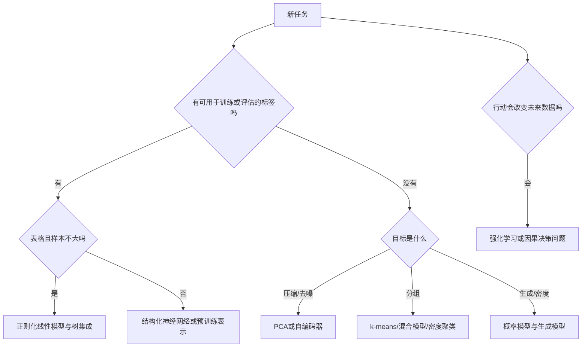

# 树集成、核方法与无监督学习

<!-- deep-review-02 -->
> [!tip] 本轮深化：从当前概念继续追问
> 树的分段划分、核的相似度几何和聚类的结构假设提供不同偏置。无监督损失低，并不自动保留下游任务所需的变量。 深化与验证：[[AI/10-机器学习与深度学习基础/15-核方法树集成与归纳偏置|核方法树集成与归纳偏置]]；[[AI/10-机器学习与深度学习基础/16-PCA聚类EM与表示学习|PCA聚类EM与表示学习]]。

已有的经典机器学习课给出了线性模型、kNN 和决策树的入口。本页补充“这些模型为什么有用、什么时候会失败”，不把机器学习缩成神经网络之前的过场。

## 树为什么能处理非线性

决策树逐层问条件，例如“长度是否大于 20”“关键词是否出现”。分类树选择能降低子节点不纯度的划分，回归树常选择能减少平方误差的划分。一棵深树能拟合细碎的局部模式，但对数据扰动敏感；叶子最小样本数、深度限制和剪枝都在限制这种敏感性。

随机森林对样本和候选特征随机化，再把多棵树聚合。若各树误差完全相同，多种几乎相同的意见并不比一个可靠；降低相关性正是随机化有用的原因。对方差均为 $\sigma^2$、两两相关系数近似为 $\rho$ 的 $M$ 个估计，平均值方差为：

$$
\operatorname{Var}(\overline f)=\rho\sigma^2+\frac{1-\rho}{M}\sigma^2.
$$

这是明确假设下的推导，不是所有森林性能的完整理论。它说明继续加树只能消去第二项，不能抹掉共同偏差。

梯度提升则顺序修正当前模型：

$$
F_m(x)=F_{m-1}(x)+\eta h_m(x),\qquad
r_i=-\left.\frac{\partial\ell(y_i,F(x_i))}{\partial F(x_i)}\right|_{F=F_{m-1}}.
$$

下一棵树拟合的是负梯度 $r_i$。只有平方损失时它直接退化成通常说的残差；把所有任务的 boosting 都叫“拟合标签减预测”并不精确。学习率、树深和轮数需要一起选。

## SVM 与核：把相似性放进模型

线性 SVM 的软间隔目标可写成：

$$
\min_{w,b}\frac12\lVert w\rVert^2+C\sum_i\max(0,1-y_i(w^Tx_i+b)),\quad y_i\in\{-1,1\}.
$$

第一项偏好较宽间隔，第二项惩罚间隔内或误分类的点。$C$ 增大意味着更不愿容忍训练违例。核方法通过 $k(x,z)$ 计算隐式特征空间的内积；不是任意相似度都一定构成合法正半定核。RBF 核的长度尺度决定多远的样本还被视为相似，因此特征单位与标准化尤其重要。

高斯过程也用核，但把它用于函数分布和预测不确定性。其不确定性依赖核、噪声和模型假设；在假设严重错误时，并不自动可靠。朴素贝叶斯用“给定类别后特征条件独立”换来简单估计，文本分类中可成为强基线，却不意味着输入特征实际上独立。

## PCA、聚类、密度和异常不是一个问题

中心化矩阵 $X$ 的截断 SVD 给出 PCA：在正交投影约束下，用低秩表示最小化平方重建误差。最大方差方向不一定最适合分类；若量纲不同，先决定标准化是否符合任务。PCA 只在训练集拟合，然后应用到验证和测试。

k-means 最小化样本到所属中心的平方距离，偏好紧凑的欧氏簇。它总会给出分组，即使数据没有有意义的天然类别。高斯混合把样本归属作为软概率，并通过 EM 交替估计责任度和参数；密度较高也不等于语义正确。DBSCAN 按局部密度连接点，能识别非球状区域，但对距离度量、邻域尺度和不同密度区域敏感。

异常检测还要区分：训练集已混入异常的离群点检测，与训练主要由正常样本组成的新颖性检测。阈值应按误报成本和验证条件设定，而不是固定成“最奇怪的 1%”。降维散点图上的间距和簇面积通常不能直接解释为原空间概率。

## 任务到方法的选择

表格数据先比较正则化线性模型和树集成；稀疏高维文本先比较词频加线性分类器；少量样本且相似性定义可信时可尝试核方法；图像和语言的复杂表示通常需要利用结构或预训练。每个选择都要回到相同拆分、指标、预算和误差分析。

**自检：** 某一特征在森林中重要，能否说它导致结果？不能。共线性、采样偏差和混杂都能形成预测关联。置换重要性衡量打乱后的预测变化，也不等价于真实世界的干预效果。

## 本页是模型族路由，不复制各自的完整主解释

面对新问题，先问数据和行动约束，再问算法名称：

这张图区分的是训练与评估材料。监督预测不要求预测时已经知道正确标签：例如订单风险标签可能事后才得到，部署时使用的输入特征却必须在作决定的时点可获得。将未来标签或事后才形成的特征当作输入会泄漏；延迟标签仍可用于后续评估。这张图只排出第一轮候选。[[AI/10-机器学习与深度学习基础/15-核方法树集成与归纳偏置|第 15 课]]承担树、核与归纳偏置的主解释；[[AI/10-机器学习与深度学习基础/16-PCA聚类EM与表示学习|第 16 课]]承担 PCA、聚类、EM；[[AI/10-机器学习与深度学习基础/19-强化学习MDP价值函数与策略梯度|第 19 课]]承担序列决策。阅读本页应得到路由问题，不应把三页证明再抄一遍。

## 用同一个数据集看见不同归纳偏置

设二维数据中的正类由“$x_1>0$ 且 $x_2>0$”或“$x_1<0$ 且 $x_2<0$”组成，也就是两个对角象限。不同模型会怎么解释？

| 模型族 | 首要偏好 | 该例中的表现 | 首先检查 |
|---|---|---|---|
| 线性分类器 | 一个超平面 | 无法一次分开两块对角区域 | 特征交互 $x_1x_2$ |
| 单棵树 | 轴对齐矩形 | 少量切分即可表达 | 深度与叶样本数 |
| RBF 核 | 局部相似 | 可形成弯曲边界 | 标准化与带宽 |
| kNN | 邻域标签平滑 | 密集处有效，稀疏处不稳 | 距离、维度与查询成本 |
| 神经网络 | 组合表示 | 能表达但小数据可能浪费容量 | 基线、公平预算、正则化 |

给线性模型增加 $x_1x_2$ 后，问题可变成一维符号判断。这说明“模型能力”同时来自算法与表示；不能把手工特征带来的归纳偏置藏在模型名后面。

## bagging、boosting 和 stacking 不应混称为集成

- **bagging** 平行训练多个高方差模型再平均，主要降低由样本扰动造成的方差；前面的相关系数公式说明共同误差仍留下。
- **boosting** 顺序添加弱学习器以降低当前目标；它对损失、步长和早停敏感。
- **stacking** 用第二层模型组合第一层预测；第二层训练输入必须来自 out-of-fold 预测，否则会看到第一层对训练样本的过度乐观结果。

假设两棵回归树在某点误差各自方差为 4，相关系数 0.25。平均误差的方差为 $0.25\times4+(1-0.25)\times4/2=2.5$，而不是 2，也不是 0。若相关系数为 1，平均毫无方差收益。这个手算把“树越多越好”改成可检验条件。

## 选择后必须保持同一比较协议

同一拆分、同一可用特征、同一调参层级和同一计算预算，才让模型族比较有意义。树不需要缩放不等于允许它看到测试统计量；核模型需要标准化不等于可在全数据拟合 scaler；预训练模型用过的外部数据也属于信息条件。比较完成后仍需做校准、切片、偏移与代价分析，不能由交叉验证均分替代。

> [!example] 三轮停止规则
> 先跑常数/规则基线，再跑正则化线性与树模型，只有当错误结构显示局部模式、序列结构或高维表示不足时，才增加相应复杂度。每轮都记录“复杂化解决了哪类错误”，没有可重复改善就停止。

## 一手资料

1. [Shalev-Shwartz 与 Ben-David：《Understanding Machine Learning》](https://www.cs.huji.ac.il/~shais/UnderstandingMachineLearning/understanding-machine-learning-theory-algorithms.pdf)，第 II 部分的第 9、16、18 章分别覆盖线性预测、核与决策树；第 III 部分另讨论在线学习、聚类与降维。
2. [scikit-learn 1.9.1：监督学习](https://scikit-learn.org/stable/supervised_learning.html)，用于模型族和实现接口核对；动态文档版本与核验日期为 1.9.1、2026-09-16。
3. [scikit-learn 1.9.1：无监督学习](https://scikit-learn.org/stable/unsupervised_learning.html)，用于聚类、分解与密度方法的实现边界。

**课程入口：** [[AI/10-机器学习与深度学习基础/00-机器学习与深度学习基础-MOC]]。
