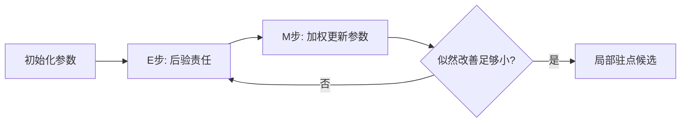

# PCA、聚类、EM 与表示学习：没有标签时到底学到了什么

**先修与定位：** [[AI/11-数学与统计桥梁/01-向量空间投影SVD与低秩|投影与 SVD]]、[[AI/11-数学与统计桥梁/03-概率似然贝叶斯与信息论|贝叶斯和 KL]]。

无监督不是没有目标，而是目标不是外部给定的类别标签。重建、密度、相似性和预测缺失部分各自偏好不同的表示。先说清目标，才能判断“找到了结构”究竟是什么意思。

## PCA 最大化方差，与最小化重建误差相连

对训练数据先减去训练均值，得到 $X$。一条单位投影方向 $u$ 的样本方差与 $u^TX^TXu$ 成比例。最大化它得到协方差矩阵最大特征值的特征向量。取多个正交方向可得到低秩线性重建。[^S27]

但方差不等于任务信息。构造 $x_1\sim\mathcal N(0,100)$、$x_2\in\{-0.1,0.1\}$，标签由 $x_2$ 的符号决定。PCA 的首方向会偏爱 $x_1$，却丢掉分类需要的信息。这个反例说明：解释方差占比高，不代表下游任务一定好。

标准化后做 PCA 是另一个目标，因为各输入方向的尺度权重被改写。只有训练集可拟合均值和分解，随后把同一变换应用到验证与测试。更多几何连接见 [[AI/11-数学与统计桥梁/01-向量空间投影SVD与低秩|SVD 与任务加权误差]]。

## k-means 的两个步骤在共同降低什么

k-means 最小化样本到所属中心的平方距离总和。固定中心时，把每点分给最近中心；固定分组时，用组均值更新中心。两个步骤都不增大该目标，但可能收敛到局部解，初始化很重要。

数据 $\{0,1,9,10\}$、两个簇的合理中心为 0.5 和 9.5。若实际结构是一条弯月曲线，欧氏球状分组就可能不符合目标。聚类数、距离、缩放和密度差异都会改变结果。聚类标签的编号没有天然含义，不能把第 0 簇在另一次运行中当同一群体。

## 高斯混合模型把硬分组变成概率责任

设 $p(x)=\sum_k\pi_k\mathcal N(x\mid\mu_k,\Sigma_k)$。潜在变量表示样本来自哪个成分。EM 的 E 步用旧参数求责任：

$$
r_{ik}=\frac{\pi_k\mathcal N(x_i\mid\mu_k,\Sigma_k)}{\sum_j\pi_j\mathcal N(x_i\mid\mu_j,\Sigma_j)}.
$$

M 步用责任加权更新混合权重、均值和协方差。责任不是已经观察到的真标签，而是当前模型假设下的后验分配。[^S28]

理解 EM 的关键是补上一条恒等式：对任意分布 $q(z)$，

$$
\log p_\theta(x)=\mathbb E_q[\log p_\theta(x,z)-\log q(z)]
+D_{\rm KL}(q(z)\|p_\theta(z\mid x)).
$$

KL 非负，使第一项成为下界。E 步令下界在旧参数处贴紧；M 步提高下界。精确更新在适当条件下不降低观测似然，但不保证找到全局最优。某成分协方差塌到极小，还可能让似然无界增大，因此约束和正则化不是装饰。

## 表示学习为何还需要防止平凡解

自动编码器可通过压缩瓶颈学习重建，但若容量很大，可能只学会复制。对比学习把正对拉近、负对推开，可避免所有表示完全相同的某些平凡解；但错误负样本会把语义相同的对象推开。非对比方法还可利用预测器、停止梯度或方差约束，其防塌缩机制不能仅用“有正样本”解释。

数据增强规定了希望表示忽略什么。猫图像的小幅裁剪可能保留类别，数字 6 旋转后却可能改变标签。强制不变性总在交换信息，不能默认增强越强越好。连接 [[AI/15-卷积神经网络/05-采样混叠感受野与平移鲁棒性|视觉不变性]] 与 [[AI/30-VLM/03-视觉语言对齐信息瓶颈与反事实评测|图文对齐]]。

## 如何评价“学到结构”

重建误差、聚类紧致性、线性探测和下游微调分别测不同问题。把标签留给最后分析，并不自动防止你反复依据标签改表示而泄漏。应保留独立评估流程。

**问题：** silhouette 高是否说明发现了真实社会群体？不能。它只在选定距离下衡量簇结构，而且现实群体可能重叠、连续或受采样影响。

**练习：** 用高方差无关变量加低方差标签变量构造上面的 PCA 反例，比较重建与分类。这比再画一张漂亮的二维散点图更能检验理解。

## PCA 的三点复算：先中心化才有投影解释

取三点 $(0,0),(2,0),(0,2)$。训练均值是 $(2/3,2/3)$，中心化后的散布矩阵为

$$
X^TX=\begin{bmatrix}8/3&-4/3\\-4/3&8/3\end{bmatrix}.
$$

特征向量 $(1,-1)/\sqrt2$ 的特征值为 4，$(1,1)/\sqrt2$ 的特征值为 $4/3$，所以首主轴沿反对角线。若忘记中心化而直接分解原矩阵，会得到另一个关于原点的近似问题。PCA 的主轴符号可以整体翻转，重建不变；不要把“正向载荷”当成跨运行固定的语义标签。

当缺失值存在时，先用全数据均值填补再拆分会泄漏；而直接把缺失填 0 又改变几何。插补、标准化、PCA 必须按训练折顺序拟合。若变量单位有实际含义，是否标准化是建模选择，不是机械清洗。

## EM 的一次责任度手算

两个一维高斯成分方差都为 1，均值分别是 0 和 2，先验权重各 0.5。对 $x=0.5$，公共常数和权重相消：

$$
r_1=\frac{e^{-0.5^2/2}}{e^{-0.5^2/2}+e^{-(0.5-2)^2/2}}
=\frac{e^{-0.125}}{e^{-0.125}+e^{-1.125}}\approx0.731.
$$

这不是“73.1% 确定它来自真实类别 1”，而是给定当前两高斯模型和参数的后验责任。集中实验包 `gmm_responsibilities` 在 log-domain 归一化，避免密度都极小时直接下溢为零。

“似然单调不降”只针对精确 E/M 更新及同一目标；mini-batch、近似推断、数值截断可能破坏该保证。GMM 还存在标签置换不辨识：交换两个成分编号得到同一密度。

## 异常分数、概率与决策阈值分三层

异常检测器常只输出排序分数 $s(x)$。它不必是 $P(\text{异常}\mid x)$；即使拟合了密度，低密度也可能只是少见的正常模式。阈值把分数变成行动，需要验证集中的误报/漏报代价和可处理容量。

例如每天 10,000 个事件，真实异常率 0.1%。若检测器召回 90%、假阳性率 1%，期望真阳性 9 个，假阳性约 100 个，告警中真实异常只约 $9/(9+100)=8.3\%$。这不是检测器“准确率 99%”能表达的。部署后人工只审最高 20 个告警，又会让后续标签集中在高分区域，形成选择偏差；连接 [[AI/10-机器学习与深度学习基础/21-因果机器学习选择偏差与反事实评估|因果机器学习与选择偏差]]。

## 表示目标决定保留什么

| 目标 | 鼓励保留 | 典型平凡/捷径解 | 反证测试 |
|---|---|---|---|
| 像素重建 | 输入细节 | 近似复制、背景纹理 | 遮挡背景后下游表现 |
| 对比一致性 | 增强下不变信息 | 用批次/水印识别正对 | 跨来源正对与错配负对 |
| 掩码预测 | 可由上下文推断的信息 | 局部共现捷径 | 改变上下文长度/遮挡方式 |
| 聚类紧致性 | 指定距离下的局部相似 | 按尺度或采集设备分组 | 来源切片与稳定性 |

线性探测高说明表示使某标签容易线性读出；它不证明表示没有编码敏感信息，也不证明端到端微调一定更好。评价协议必须和读者真正关心的问题一致。

## 来源与证据边界

本页的数值例与推导用于解释机制，不代表大型模型或真实业务上的实测效果。旧接口来源与本轮新增作者教材定位均于 2026-09-16 复核。

[^S27]: [scikit-learn：Decomposing signals](https://scikit-learn.org/stable/modules/decomposition.html)。官方文档；PCA与矩阵分解。
[^S28]: [scikit-learn：Gaussian mixture models](https://scikit-learn.org/stable/modules/mixture.html)。官方文档；混合分布与EM。

概率主线另见 [Murphy：《Probabilistic Machine Learning: An Introduction》作者项目页](https://probml.github.io/pml-book/book1.html)：8.7 节给 EM 通用推导，第 20 章覆盖 PCA/因子分析/自编码器等降维，第 21.4 节覆盖 GMM 聚类；本页只承担这些方法在无监督学习中的主解释。

**返回与迁移：** [[AI/10-机器学习与深度学习基础/00-机器学习与深度学习基础-MOC|本主题课程地图]]；[[AI/00-开始/05-问题驱动知识图谱与难点导航|按问题跨主题继续]]。
