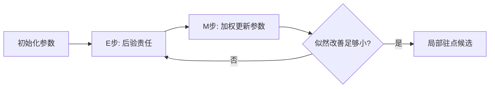

# PCA、聚类、EM 与表示学习：没有标签时到底学到了什么

**先修与定位：** 起步只需会二维向量的点积和平方距离；下面会在同一组三点上算出压缩与重建。若投影的几何还不熟，借读 [[AI/11-数学与统计桥梁/01-向量空间投影SVD与低秩#投影为什么是最小误差近似|单位方向的投影]] 后回到本页三点例；读到 EM 的下界时，再按需借读 [[AI/11-数学与统计桥梁/03-概率似然贝叶斯与信息论|贝叶斯和 KL]]。

无监督不是没有目标，而是目标不是外部给定的类别标签。重建、密度、相似性和预测缺失部分各自偏好不同的表示。这里先完成一个问题：**每个二维点只保留一个数，怎样还能尽量重建原来的点？** 完成这个压缩问题后，再问 k-means 如何分组、EM 如何分配责任。

## PCA 最大化方差，与最小化重建误差相连

### PCA 的三点复算：先中心化才有投影解释

取三个训练点 $x_1=(0,0)^T,x_2=(2,0)^T,x_3=(0,2)^T$，两个坐标按同一尺度计算欧氏平方距离。我们要共用一条直线来重建它们：每点只存沿直线的一个坐标，均值和方向作为整组共享的模型保存。

训练均值是

$$
\mu=\frac{x_1+x_2+x_3}{3}=(2/3,2/3)^T.
$$

先减去这个共同基准，记 $y_i=x_i-\mu$。三个偏移分别为 $(-2/3,-2/3)^T,(4/3,-2/3)^T,(-2/3,4/3)^T$，它们相加为零。这样选择的是**穿过数据均值的直线**，用于保留数据相对均值的变化；若直接投影原始坐标，就强制重建直线穿过原点，解决的是另一个问题。

选定单位方向 $u$ 后，压缩得到的一维坐标是 $z_i=u^Ty_i$；重建时先沿方向走 $z_i$，再回加均值：

$$
\widehat x_i=\mu+z_i u,\qquad
\epsilon_i=\|x_i-\widehat x_i\|^2=\|y_i-z_i u\|^2.
$$

$z_i$ 是一个数，$z_i u$ 和 $\widehat x_i$ 都是二维向量；$\epsilon_i$ 是丢掉的二维残差的平方长度。为什么用点积作坐标？对任意候选坐标 $a$，

$$
\|y_i-au\|^2=\|y_i\|^2-2a(u^Ty_i)+a^2
=(a-u^Ty_i)^2+\|y_i\|^2-(u^Ty_i)^2.
$$

这里用了 $\|u\|=1$。第一项在 $a=u^Ty_i$ 时为零，所以对固定直线，投影就是最近的重建点；选对直线之后还需要这一步编码，不能直接把某个原坐标当成压缩结果。

中心化还让直线的位置合适：三个投影残差的和为零。对固定方向，若把过均值的直线垂直平移距离 $c$，每个残差都会多出同一个垂直分量，展开误差时交叉项因残差和为零而抵消，总平方误差增加 $3c^2$。所以穿过均值的位置最优；沿直线平移则只改变一维坐标的原点。

先沿候选方向 $u=(1,-1)^T/\sqrt2$ 完成一次编码与重建，下一段再核对它为何最优：

| 原始点 $x_i$ | 中心化偏移 $y_i$ | 一维坐标 $z_i=u^Ty_i$ | 重建 $\widehat x_i=\mu+z_i u$ | 平方误差 $\epsilon_i$ |
| --- | --- | --- | --- | --- |
| $(0,0)$ | $(-2/3,-2/3)$ | $0$ | $(2/3,2/3)$ | $8/9$ |
| $(2,0)$ | $(4/3,-2/3)$ | $\sqrt2$ | $(5/3,-1/3)$ | $2/9$ |
| $(0,2)$ | $(-2/3,4/3)$ | $-\sqrt2$ | $(-1/3,5/3)$ | $2/9$ |

例如第二点的编码是 $(4/3+2/3)/\sqrt2=\sqrt2$，再乘方向得到 $(1,-1)$，回加均值得到 $(5/3,-1/3)$。三点的残差分别是 $(-2/3,-2/3),(1/3,1/3),(1/3,1/3)$，均与 $u$ 正交。重建点都满足 $\widehat x_{i,1}+\widehat x_{i,2}=4/3$；重建不必落在原始三点构成的三角形内部，目标只约束平方距离。

总平方重建误差为

$$
E=\sum_{i=1}^3\epsilon_i=\frac89+\frac29+\frac29=\frac43.
$$

这里 $E$ 是三点的误差**总和**；若按每个样本取平均，结果是 $E/3=4/9$。三个数保留了反对角方向的差别，垂直于它的变化丢失了；这就是压缩的收益与代价。

### 为什么这条轴最好：从误差到散布矩阵

上面的平方距离展开还给出 $\epsilon_i=\|y_i\|^2-z_i^2$。因此换方向时，总量 $\sum_i\|y_i\|^2$ 不变，要使丢掉的量最少，就要使保留的量 $\sum_i z_i^2$ 最大。这一步把“最小重建误差”变成了“最大投影平方长度”，仍是同一压缩问题。

把三条偏移按行堆成 $X\in\mathbb R^{3\times2}$：

$$
X=\begin{bmatrix}-2/3&-2/3\\4/3&-2/3\\-2/3&4/3\end{bmatrix},\qquad
X^TX=\begin{bmatrix}8/3&-4/3\\-4/3&8/3\end{bmatrix}.
$$

矩阵没有引入新数据：$X^TX$ 的对角项累加各坐标的偏移平方，非对角项累加两个坐标的偏移乘积。它是这组三点的**散布矩阵**，还没有除以样本协方差的分母 $3-1$。向量 $Xu$ 收集三个一维坐标，故

$$
\sum_i z_i^2=\|Xu\|^2=u^TX^TXu.
$$

直接相乘可核对：方向 $u_-=(1,-1)^T/\sqrt2$ 的特征值为 $4$，正交方向 $u_+=(1,1)^T/\sqrt2$ 的特征值为 $4/3$。任意单位方向都能写成 $u=a u_-+b u_+$，且 $a^2+b^2=1$，所以

$$
u^TX^TXu=4a^2+\frac43b^2\le4.
$$

因此最优首主轴沿反对角线，即表中的 $u_-$。总偏移平方长度是 $\operatorname{tr}(X^TX)=16/3$；它保留了 $4$，丢掉 $16/3-4=4/3$，与逐点误差相同。投影坐标均值为零，样本方差为 $\sum_i z_i^2/(3-1)$，所以最大化上述保留量也就是最大化投影方差。首轴解释方差比例为 $4/(16/3)=3/4$，这个比例说明保留了多少几何变化。[^S27]

### 同一计算怎样接到 SVD

更多样本、更多坐标时，仍把中心化样本按行放入 $X\in\mathbb R^{N\times d}$。单位方向在特征空间 $\mathbb R^d$ 中，样本协方差为 $C=X^TX/(N-1)$（这里需 $N\ge2$）。对 $X$ 做 SVD，$X=U\Sigma V^T$，右奇异向量就是 $X^TX$ 的特征向量，奇异值平方就是散布矩阵的特征值。三点例的两个奇异值是 $2$ 和 $2/\sqrt3$；保留首方向后，丢掉的奇异值平方仍是 $4/3$。

取 $1\le k\le\min(N,d)$，保留 $k$ 条正交方向，把它们作为 $V_k\in\mathbb R^{d\times k}$ 的列，一次编码为 $Z=XV_k\in\mathbb R^{N\times k}$，中心化重建为 $\widehat X=ZV_k^T$。每一行再加回同一训练均值，才回到原始坐标。本例 $k=1$，$Z=(0,\sqrt2,-\sqrt2)^T$，正是表中的三个数。截断 SVD 在欧氏平方误差下给出最优低秩重建；完整推导见 [[数学/20-线性代数与几何/16-SVD的推导最优低秩与PCA#为什么截断就是最优低秩|截断 SVD 的最优性]]，读完可返回这里核对“丢掉的奇异值平方”和总误差的关系。

PCA 的主轴符号可以整体翻转，三个坐标也一起翻转，$z_i u$ 与重建不变；不要把“正向载荷”当成跨运行固定的语义标签。

### 换尺度或换任务，最优也会改变

**标准化改变了误差的权重。** 若先用训练集尺度 $s_j>0$ 将第 $j$ 个中心化坐标变为 $(x_{ij}-\mu_j)/s_j$，在标准化坐标中最小化平方误差，换回原单位后相当于最小化 $\sum_{i,j}(x_{ij}-\widehat x_{ij})^2/s_j^2$，不再是原来的等权平方距离。零方差变量不能直接除以零，需单独处理。变量单位有实际含义时，是否标准化是建模选择，不是机械清洗。更多任务加权几何见 [[AI/11-数学与统计桥梁/01-向量空间投影SVD与低秩#从一条方向扩展到 SVD|SVD 与任务加权误差]]。

**高方差不等于任务信息。** 构造两个随机特征：相互独立的 $x_1\sim\mathcal N(0,100)$、等概率取值的 $x_2\in\{-0.1,0.1\}$，标签由 $x_2$ 的符号决定。总体协方差为 $\operatorname{diag}(100,0.01)$，首 PCA 方向保留 $x_1$，几何上解释方差很高，却丢掉分类所需的 $x_2$；有限训练样本的主轴会有波动。这个反例说明：重建目标成功，不代表下游任务一定好。

均值、插补、标准化和分解都只在训练集或当前训练折拟合，然后把同一变换应用到验证与测试。当缺失值存在时，先用全数据均值填补再拆分会泄漏；直接把缺失填 0 又改变几何。评估新点时应使用训练均值，而不是为每个新点重新中心化。

### 撤去提示，再改变一个条件

1. **使用同一模型：** 来了一个新点 $q=(1,0)^T$，仍用上述训练均值与主轴。自行求它的一维坐标、重建和平方误差；解释为什么不重新拟合均值。
2. **改变一个训练点：** 把第三点从 $(0,2)$ 改为 $(0,4)$，其余两点不动。重算均值与散布矩阵，再检查旧轴是否仍为特征向量；这里不要求求出新的特征向量。
3. **漏掉中心化：** 对原来的三点直接沿 $u_-=(1,-1)^T/\sqrt2$ 投影到过原点的直线，不回加均值。求误差总和，并解释为什么它不等于 $4/3$。若还要从原始数据挑方向，最佳方向是否唯一？

> [!question]- 参考解：检查保留对象与误差目标
> 1. $q-\mu=(1/3,-2/3)^T$，$z=1/\sqrt2$；重建为 $\mu+(1/2,-1/2)^T=(7/6,1/6)^T$，残差 $(-1/6,-1/6)^T$，平方误差 $1/18$。它是既有模型的样本外变换；重新拟合会改变整组数据共同使用的基准，无法直接比较同一模型的表现。
> 2. 新均值为 $(2/3,4/3)^T$，散布矩阵为 $\begin{bmatrix}8/3&-8/3\\-8/3&32/3\end{bmatrix}$。乘旧轴得到 $(16/3,-40/3)^T/\sqrt2$，两坐标不按 $(1,-1)$ 的比例变化，旧轴已不是特征向量。训练数据变了，要重新拟合方向，不能把原表的数直接沿用。
> 3. 重建依次为 $(0,0),(1,-1),(-1,1)$，平方误差为 $0,2,2$，总和 $4$。原始数据矩阵记为 $A$，有 $A^TA=\operatorname{diag}(4,4)$；任意单位方向都保留 $4$，总原始平方长度为 $8$，故误差均为 $4$，最佳方向不唯一。这是在过原点的直线中选近似；中心化 PCA 则沿穿过均值的直线重建，允许保留共同偏移，目标不同。

现在已能说明一个点被压成了什么、怎样还原、丢掉了多少，以及为什么选这条轴。下面换一个目标：不再用同一条直线重建所有点，而是给每点选择一个簇中心。

## k-means 的两个步骤在共同降低什么

PCA 已经回答了二维点怎样压成一个连续坐标。现在换用本页已有的一维四点 $D=\{0,1,9,10\}$：每个数本来就是一次测量值，这次不要求降维，而是要用**两个共享中心和每点的簇编号**表示四点。编号只是选择哪个中心，不是上一节的投影坐标。

选 $K=2$，初中心 $c_1^{(0)}=0,c_2^{(0)}=10$，与 [[AI/90-资源/实验/ml_foundations_20260916/README|集中复算包]] 的 `kmeans_step` 固定输入一致。记 $a_i\in\{1,2\}$ 为第 $i$ 点的指派，目标是

$$
J(a,c)=\sum_{i=1}^4(x_i-c_{a_i})^2.
$$

**第一次指派：** 保持中心不动，逐点选平方距离较小的中心。

| 点 $x_i$ | 到 $c_1^{(0)}=0$ 的平方距离 | 到 $c_2^{(0)}=10$ 的平方距离 | 指派 |
| --- | --- | --- | --- |
| $0$ | $0$ | $100$ | $1$ |
| $1$ | $1$ | $81$ | $1$ |
| $9$ | $81$ | $1$ | $2$ |
| $10$ | $100$ | $0$ | $2$ |

指派后 $J=0+1+1+0=2$。**重算中心：** 保持这次分组不动，组均值变成 $c_1^{(1)}=(0+1)/2=0.5$、$c_2^{(1)}=(9+10)/2=9.5$。为什么均值是最优中心？对非空组 $S$，记均值为 $\overline x_S$，展开可得

$$
\sum_{i\in S}(x_i-c)^2
=\sum_{i\in S}(x_i-\overline x_S)^2+|S|(c-\overline x_S)^2.
$$

第二项只在 $c=\overline x_S$ 时为零。两个中心更新后，四点到各自中心的平方距离都为 $1/4$，所以 $J=1$。

**再指派：** 新中心会改变距离，不能只算均值就宣布完成；用新中心再查四点。

| 点 $x_i$ | 到 $c_1^{(1)}=0.5$ 的平方距离 | 到 $c_2^{(1)}=9.5$ 的平方距离 | 新指派 |
| --- | --- | --- | --- |
| $0$ | $1/4$ | $361/4$ | $1$ |
| $1$ | $1/4$ | $289/4$ | $1$ |
| $9$ | $289/4$ | $1/4$ | $2$ |
| $10$ | $361/4$ | $1/4$ | $2$ |

分组没变，再重算仍得到 $0.5,9.5$；这次输入已到达一个固定点。指派步逐点取较小距离，中心步在固定组内取最优均值，所以两个步骤都不增大**同一个** $J$。一般数据上，停在固定点只给出局部候选，不保证全局最优；不能由四点的顺利停止推出任何初始化都好。[^S29]

等距和空簇也必须说清。新点 $x=5$ 到两个已学中心的平方距离均为 $20.25$，必须约定 tie 规则，不能把编号解释为自然类别。集中复算包取第一个最小值，内部编号为 $0,1$，对应这里的 $1,2$；空簇则保留旧中心。本次四点既没有等距指派，也没有空簇，因此没有用到这两个分支。若用其他空簇处理方式或提前按容差停止，需另说明其停止含义。[^S29]

若实际结构是一条弯月曲线，欧氏球状分组就可能不符合目标。聚类数、距离、缩放和密度差异都会改变结果；在多维数据中逐特征缩放会重写各方向的距离权重。聚类标签的编号没有天然含义，不能把第 0 簇在另一次运行中当同一群体。

**撤去步骤后自查：**

1. 对这四点只允许 $K=1$，自己求中心与 $J$。在这个 $K$ 下把 $J$ 降到最低，是否就证明分组反映真实结构？
2. 仍取 $K=2$，只把初中心改为 $(5,5)$，沿上述 tie 与空簇规则做一次指派和中心更新，再指派。它会停在哪里？与 $J=1$ 比较，说明“停住”能证明什么。

> [!question]- 参考解：区分目标、停止与结构
> 1. 均值为 $5$，$J=25+16+16+25=82$。它是一个中心条件下的最优结果；允许中心数变多通常可降低训练平方距离，不能用不同 $K$ 的 $J$ 直接认证天然类别。
> 2. 四点都与两个中心等距，规则把它们全分到第一簇；第一中心的均值为 $5$，第二簇为空，旧中心也保留 $5$。再指派仍全部进第一簇，$J=82$，流程停住却比 $J=1$ 差。这是指定空簇规则下的退化固定状态，不能称为全局最优，甚至不能据此认定是非退化的局部极小值；重新初始化或处理空簇是必要的实现选择。

硬分组对每点只选一个中心。下一步沿同一四点，问能否保留对两个成分的相对支持，同时让每个成分表达自己的尺度。

## 高斯混合模型把硬分组变成概率责任

仍用四点 $D=\{0,1,9,10\}$，把它们视为独立观测。现在假设每点由两个一维高斯成分之一生成；来自哪个成分是未观察到的潜在变量。模型学习的是混合密度与参数：

$$
p_\theta(x)=\sum_{k=1}^2\pi_k\mathcal N(x\mid\mu_k,v_k),\qquad
\pi_k>0,\quad\sum_k\pi_k=1,\quad v_k>0.
$$

这里 $v_k=\sigma_k^2$ 是方差，$\pi_k$ 是混合权重；连续密度 $p_\theta(x)$ 不是“恰好观测到这个数的概率”。多维情形把 $v_k$ 换成协方差矩阵 $\Sigma_k$，得到原来的 $p(x)=\sum_k\pi_k\mathcal N(x\mid\mu_k,\Sigma_k)$。此次拟合仍保留原手算的初参数：

$$
\theta^{(0)}:\quad(\pi_1,\pi_2)=(0.5,0.5),\quad
(\mu_1,\mu_2)=(0,2),\quad(v_1,v_2)=(1,1).
$$

这些 GMM 初均值不是 k-means 更新后的中心，两个算法各自优化自己的目标。保留这组初参，才能追踪原责任度手算怎样走到参数更新。

E 步用旧参数对每个训练点求**责任**，即当前模型下的成分后验：

$$
r_{ik}^{(t)}=\frac{\pi_k^{(t)}\mathcal N(x_i\mid\mu_k^{(t)},v_k^{(t)})}{\sum_j\pi_j^{(t)}\mathcal N(x_i\mid\mu_j^{(t)},v_j^{(t)})}.
$$

每一行的两个责任非负且相加为 1。它们不是已经观察到的真标签；即使取较大者得到硬编号，也不能从后验值推出真实类别。[^S28]

### EM 的一次责任度手算

先用原来的诊断点 $x=0.5$ 看一次 E 步。两个一维高斯成分方差都为 1，均值分别是 0 和 2，先验权重各 0.5，公共常数和权重相消：

$$
r_1=\frac{e^{-0.5^2/2}}{e^{-0.5^2/2}+e^{-(0.5-2)^2/2}}
=\frac{e^{-0.125}}{e^{-0.125}+e^{-1.125}}\approx0.731.
$$

这不是“73.1% 确定它来自真实类别 1”，而是给定当前两高斯模型和参数的后验责任。**这个额外诊断点不加入四点训练集**；这里只完成了一次责任计算，下一段才对四点全部计算 E 步并执行 M 步。集中实验包 `gmm_responsibilities` 在 log-domain 归一化，避免密度都极小时直接下溢为零；源码参数 `stds` 接收标准差 $\sigma_k=\sqrt{v_k}$，不要把方差直接传入。

### 对同一四点完成 E、M 与下一次 E

初参的权重与方差相同，故第一成分的责任可化为

$$
r_{i1}^{(0)}=\frac1{1+e^{2x_i-2}},\qquad r_{i2}^{(0)}=1-r_{i1}^{(0)}.
$$

| 训练点 $x_i$ | $r_{i1}^{(0)}$ | $r_{i2}^{(0)}$ |
| --- | --- | --- |
| $0$ | $0.880797078$ | $0.119202922$ |
| $1$ | $0.5$ | $0.5$ |
| $9$ | $1.125351621\times10^{-7}$ | $0.999999887$ |
| $10$ | $1.522997951\times10^{-8}$ | $0.999999985$ |

例如 $x=1$ 离两个均值等远，在同权重、同方差下责任各半；较远的 $9,10$ 也更支持第二成分，但这不说明第二高斯的均值 $2$ 已适合它们。E 步把当前模型的解释写成责任表，尚未改善参数。下列数值表只用于阅读，均作舍入；更新应使用未舍入责任，尤其不能把最后两行的小责任提前置零。

M 步冻结这张责任表，将每个点按责任分给两个成分。令 $N_k=\sum_{i=1}^4r_{ik}^{(0)}$ 为成分的有效样本数，更新为

$$
\pi_k^{(1)}=\frac{N_k}{4},\qquad
\mu_k^{(1)}=\frac{\sum_i r_{ik}^{(0)}x_i}{N_k},\qquad
v_k^{(1)}=\frac{\sum_i r_{ik}^{(0)}(x_i-\mu_k^{(1)})^2}{N_k}.
$$

$N_k$ 可以不是整数，但 $N_1+N_2=4$。均值和方差都除以所属成分的有效样本数 $N_k$；方差使用**更新后的均值**，这是最大似然更新，分母不是 $N_k-1$。本次 $N_k$ 和新方差均为正，能直接使用这些式子。

这些分母不是任意的平均规则。固定责任后，要最大化的加权完整数据对数似然，忽略常数可写为

$$
Q(\theta\mid\theta^{(0)})
=\sum_k N_k\log\pi_k
-\frac12\sum_{i,k}r_{ik}^{(0)}\left[\log v_k+\frac{(x_i-\mu_k)^2}{v_k}\right].
$$

在 $\sum_k\pi_k=1$ 下，权重项的驻点给 $\pi_k=N_k/4$；均值项求导给 $\sum_i r_{ik}^{(0)}(x_i-\mu_k)=0$；方差项求导给 $N_kv_k=\sum_i r_{ik}^{(0)}(x_i-\mu_k)^2$。这就得到上面的三个更新，解释了软责任为什么必须先汇总后更新。

| M 步量 | 成分 1 | 成分 2 |
| --- | --- | --- |
| $N_k$ | $1.380797206$ | $2.619202794$ |
| $\sum_i r_{ik}^{(0)}x_i$ | $0.500001165$ | $19.499998835$ |
| $\sum_i r_{ik}^{(0)}(x_i-\mu_k^{(1)})^2$ | $0.318954967$ | $36.322244670$ |
| $\pi_k^{(1)}$ | $0.345199301$ | $0.654800699$ |
| $\mu_k^{(1)}$ | $0.362110499$ | $7.445012993$ |
| $v_k^{(1)}$ | $0.230993346$ | $13.867671778$ |

第二成分仍部分负责左侧点 $0,1$，同时主要负责 $9,10$，因此第一轮更新后的均值并不是 $9.5$，方差也很大。第一成分的有效样本数不是硬分组中的两个点；这正是它的中心也没有变成 $0.5$ 的原因。

**下一次 E 步**必须带入新权重、新均值和新方差，不能再用初参的简化式 $1/(1+e^{2x-2})$：

| 同一训练点 $x_i$ | $r_{i1}^{(1)}$ | $r_{i2}^{(1)}$ |
| --- | --- | --- |
| $0$ | $0.957786984$ | $0.042213016$ |
| $1$ | $0.883309382$ | $0.116690618$ |
| $9$ | $3.223433842\times10^{-70}$ | $\approx1$ |
| $10$ | $2.468168895\times10^{-87}$ | $\approx1$ |

下一轮左侧两点更支持第一成分；但这只是更新后的责任，还没有做第二次 M 步。表里的 $\approx1$ 是显示舍入，不是把另一成分概率在数学上设为零。

作为同一目标的检查，四点观测对数似然总和（使用自然对数）为

$$
\ell(\theta)=\sum_{i=1}^4\log\left[\sum_{k=1}^2
\pi_k\frac{1}{\sqrt{2\pi v_k}}e^{-(x_i-\mu_k)^2/(2v_k)}\right].
$$

代入初参得到 $\ell(\theta^{(0)})\approx-62.628268$；代入一次 M 步的新参得到 $\ell(\theta^{(1)})\approx-9.133995$，提高约 $53.494273$。这是同一四点、同一高斯混合族、未加方差正则的一次更新；既没有换数据，也没有把平方距离 $J$ 当成似然。数值复算宜用 log-sum-exp，最少说明见 [[AI/11-数学与统计桥梁/03-概率似然贝叶斯与信息论#用 log-sum-exp 避免数学正确、浮点错误|混合密度的稳定求和]]；复算之后返回本表核对责任与似然。

### 为什么精确 E/M 不降低同一观测似然

理解 EM 的关键是补上一条恒等式：对任意分布 $q(z)$，

$$
\log p_\theta(x)=\mathbb E_q[\log p_\theta(x,z)-\log q(z)]
+D_{\rm KL}(q(z)\|p_\theta(z\mid x)).
$$

这里 $z$ 是潜在成分编号，区别于 PCA 用作压缩坐标的 $z_i$。各成分密度与权重均正时，后验支持每个成分；一般使用此恒等式仍需 KL 和期望有定义。KL 非负，使第一项成为下界。E 步令 $q(z)=p_{\theta^{(t)}}(z\mid x)$，下界在旧参数处贴紧；M 步冻结 $q$ 并提高下界，所以新观测对数似然至少达到旧值。对独立四点逐点相加，就给出本次的似然检查。精确更新在适当条件下不降低观测似然，但不保证找到全局最优。某成分协方差塌到极小，还可能让似然无界增大，因此约束和正则化不是装饰。

“似然单调不降”只针对精确 E/M 更新及同一目标；mini-batch、近似推断、数值截断可能破坏该保证。GMM 还存在标签置换不辨识：交换两个成分编号得到同一密度。若成分的有效样本数为零或更新方差为零，不能继续套用上述除法与密度公式；重新初始化、参数约束或正则化需明确，并重新说明优化的目标。[^S28]

### 改变一个条件，检查责任的解释

1. 保留初均值 $0,2$ 与权重各 $0.5$，仅将第二成分方差从 $1$ 改为 $100$。对 $x=1$，两边几何距离仍相等，责任是否仍各半？先写比值，再解释哪项改变了答案。
2. 假设这四个数是四人的测量值，模型的成分编号是否已经足以断言两种真实社会群体？说明还缺哪些证据。

> [!question]- 参考解：尺度和模型假设都不能省略
> 1. 第一成分的加权密度与 $e^{-1/2}$ 成比例，第二成分与 $\tfrac1{10}e^{-1/200}$ 成比例，所以 $r_1=e^{-1/2}/(e^{-1/2}+0.1e^{-1/200})\approx0.859070$。改变方差同时改变密度的峰高与尾部；只按与均值的距离判断，遗漏了 $1/\sqrt{v_k}$ 和误差除以 $v_k$。这只求改变条件后的责任，不声称已经重新完成 E/M 拟合。
> 2. 责任是给定混合族和参数的后验，紧致分组或高似然都不证明现实群体。还需测量与采样背景、相关外部证据、跨来源稳定性及可反驳的解释；成分编号也可交换。原来的 silhouette 问题会在后面接着检验这一边界。

至此，三种目标已有不同的可核结果：

| 方法 | 本页保留或拟合的对象 | 目标与已完成的计算 |
| --- | --- | --- |
| PCA | 三个二维点的一个连续坐标及共享均值、方向 | 最小平方重建误差；三点总误差 $4/3$ |
| k-means | 四个一维点的硬指派及两个共享中心 | 最小点到所属中心的平方距离；指派、均值更新、再指派到 $J=1$ |
| GMM/EM | 同一四点的混合密度参数及成分后验责任 | 提高观测似然；完成一次 E/M 并核下一次 E，尚未声称训练收敛 |

重建、分组和密度拟合各自有代价与条件。下一节换到更一般的表示学习：目标能否避免把输入直接复制，或把所有对象变成同一个表示？

## 表示学习为何还需要防止平凡解

自动编码器可通过压缩瓶颈学习重建，但若容量很大，可能只学会复制。对比学习把正对拉近、负对推开，可避免所有表示完全相同的某些平凡解；但错误负样本会把语义相同的对象推开。非对比方法还可利用预测器、停止梯度或方差约束，其防塌缩机制不能仅用“有正样本”解释。

数据增强规定了希望表示忽略什么。猫图像的小幅裁剪可能保留类别，数字 6 旋转后却可能改变标签。强制不变性总在交换信息，不能默认增强越强越好。连接 [[AI/15-卷积神经网络/05-采样混叠感受野与平移鲁棒性|视觉不变性]] 与 [[AI/30-VLM/03-视觉语言对齐信息瓶颈与反事实评测|图文对齐]]。

## 如何评价“学到结构”

重建误差、聚类紧致性、线性探测和下游微调分别测不同问题。把标签留给最后分析，并不自动防止你反复依据标签改表示而泄漏。应保留独立评估流程。

**问题：** silhouette 高是否说明发现了真实社会群体？不能。它只在选定距离下衡量簇结构，而且现实群体可能重叠、连续或受采样影响。

**练习：** 用高方差无关变量加低方差标签变量构造上面的 PCA 反例，比较重建与分类。这比再画一张漂亮的二维散点图更能检验理解。

## 异常分数、概率与决策阈值分三层

异常检测器常只输出排序分数 $s(x)$。它不必是 $P(\text{异常}\mid x)$；即使拟合了密度，低密度也可能只是少见的正常模式。阈值把分数变成行动，需要验证集中的误报/漏报代价和可处理容量。

例如每天 10,000 个事件，真实异常率 0.1%。若检测器召回 90%、假阳性率 1%，期望真阳性 9 个，假阳性约 100 个，告警中真实异常只约 $9/(9+100)=8.3\%$。这不是检测器“准确率 99%”能表达的。部署后人工只审最高 20 个告警，又会让后续标签集中在高分区域，形成选择偏差；连接 [[AI/10-机器学习与深度学习基础/21-因果机器学习选择偏差与反事实评估|因果机器学习与选择偏差]]。

## 表示目标决定保留什么

| 目标 | 鼓励保留 | 典型平凡/捷径解 | 反证测试 |
|---|---|---|---|
| 像素重建 | 输入细节 | 近似复制、背景纹理 | 遮挡背景后下游表现 |
| 对比一致性 | 增强下不变信息 | 用批次/水印识别正对 | 跨来源正对与错配负对 |
| 掩码预测 | 可由上下文推断的信息 | 局部共现捷径 | 改变上下文长度/遮挡方式 |
| 聚类紧致性 | 指定距离下的局部相似 | 按尺度或采集设备分组 | 来源切片与稳定性 |

线性探测高说明表示使某标签容易线性读出；它不证明表示没有编码敏感信息，也不证明端到端微调一定更好。评价协议必须和读者真正关心的问题一致。

## 来源与证据边界

本页的数值例与推导用于解释机制，不代表大型模型或真实业务上的实测效果。旧接口来源与本轮新增作者教材定位均于 2026-09-16 复核。

[^S27]: [scikit-learn：Decomposing signals](https://scikit-learn.org/stable/modules/decomposition.html)。官方文档；PCA与矩阵分解。
[^S28]: [scikit-learn：Gaussian mixture models](https://scikit-learn.org/stable/modules/mixture.html)。官方文档；混合分布与EM。
[^S29]: [scikit-learn：Clustering，K-means](https://scikit-learn.org/stable/modules/clustering.html#k-means)。官方文档；平方距离目标、交替指派/中心更新与初始化边界。

概率主线另见 [Murphy：《Probabilistic Machine Learning: An Introduction》作者项目页](https://probml.github.io/pml-book/book1.html)：8.7 节给 EM 通用推导，第 20 章覆盖 PCA/因子分析/自编码器等降维，第 21.4 节覆盖 GMM 聚类；本页只承担这些方法在无监督学习中的主解释。

**返回与迁移：** [[AI/10-机器学习与深度学习基础/00-机器学习与深度学习基础-MOC|本主题课程地图]]；[[AI/00-开始/05-问题驱动知识图谱与难点导航|按问题跨主题继续]]。
