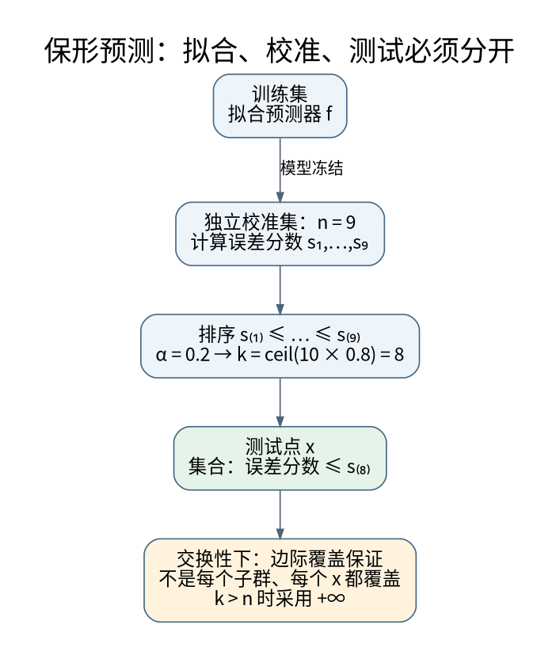

# 概率校准、保形预测与分布偏移：不确定性保证在哪里结束

**先修与定位：** [[AI/11-数学与统计桥梁/05-统计估计置信区间与因果边界|统计区间]]、[[AI/11-数学与统计桥梁/03-概率似然贝叶斯与信息论|概率语言]]。

## 排序、校准与决策是三个问题

一个模型可以把正例排在负例前，却把所有分数都夸大；AUC 很高，概率仍不可信。也可以总预测总体正例率而整体校准不错，但没有区分个体的能力。校准不是准确率的别名。[^S12]

二分类校准的理想形式是 $\mathbb E[Y\mid \widehat p=p]=p$。实际连续分数不会恰好重复，因此常分箱估计可靠性。分箱会引入分辨率与样本量的取舍，ECE 会随箱数、边界和数据量变化。不能仅凭一个小 ECE 就宣称每个子群体可信。

## 温度缩放改变概率，通常不改变 argmax

多类 logits 经 $p_i(T)=\operatorname{softmax}(z_i/T)$，$T>0$。同一个样本中，对所有类使用同一温度，类别排序不变；$T$ 较大通常使分布更平缓。用独立校准数据拟合温度可改善某些失配，但不能创造模型没有学到的区分信息。不能在最终测试集上拟合温度后，再把同一集当未接触测试。

Brier 分数和负对数似然同时受到概率质量多个方面影响，不是纯粹校准误差。选择评分规则后仍需查看区分能力、可靠性图与重要切片。

## Split conformal 为什么只需一个排序分数

先在训练集拟合回归器 $\widehat f$，再用独立校准集计算 $s_i=|y_i-\widehat f(x_i)|$，样本数为 $n$。给定 $\alpha$，令 $k=\lceil(n+1)(1-\alpha)\rceil$，取第 $k$ 小的校准分数为 $q$；若 $k>n$，使用 $q=+\infty$，而不是擅自截断到最大值。输出集合

$$
C(x)=[\widehat f(x)-q,\widehat f(x)+q].
$$

在校准样本与新测试点可交换、预测器和评分规则事先固定等条件下，具有有限样本边际覆盖保证 $P\{Y_{new}\in C(X_{new})\}\ge1-\alpha$。[^S13]

为什么有 $n+1$？因为考虑把新点的分数和 $n$ 个校准分数一起排序。可交换性使新点秩在这 $n+1$ 个位置之间对称。连续无并列时，落在前 $k$ 个位置的概率为 $k/(n+1)$；并列可使非随机化区间更保守。这个论证比背一个百分位函数更重要。

例如 $n=9,\alpha=0.2$，$k=8$；校准残差为 $0.1,0.2,\ldots,0.9$ 时，$q=0.8$。预测中心为 2，区间是 $[1.2,2.8]$。这只是手算，不代表某个现实回归任务已经达到 80% 覆盖。

## 最容易误读的三个限定

边际保证不是对每个固定 $x$、每个群体都保证同样覆盖。某类困难样本可能系统性覆盖不足，被简单样本抵消。区间宽度也是质量维度，永远输出全集可覆盖但没用。

可交换性也不是“没有参数分布假设，所以什么数据都行”。时间漂移、主动筛选、重复用户、训练污染都可能破坏条件。使用校准集反复挑评分规则，再原样套保证，也需要额外处理选择效应。

分类保形可根据 $1-\widehat p_y$ 等非一致性分数构造标签集合，结果可能有多个标签，甚至空集。集合覆盖不是单标签准确率，部署需定义如何处理多标签集合。

## 偏移时该看哪里

协变量偏移假设 $p(y\mid x)$ 不变但 $p(x)$ 改变；标签偏移假设 $p(x\mid y)$ 不变但 $p(y)$ 改变；概念漂移涉及条件关系改变。这些是假设化分解，不是现实系统总会整齐落入某一类。

重要性加权需要支持集重叠和可靠密度比，极端权重会增加方差。没有标签时，输入分布漂移报警不能直接量化准确率下降。LLM 自报置信同样需要独立校准与任务定义，而非把流畅语气当概率。

## 纯标签偏移下的赔率修正

同一检测规则在平衡测试集上报出的“98.9% 真阳性概率”，为什么到了低基率流量只剩8.26%？先固定**观测对象**，再用 Bayes 换先验。这里不训练新模型，也不凭空估计业务基率。

设源总体为 s、目标总体为 t，标签 $Y\in\{0,1\}$ 含义不变，$X$ 为同一个固定观测或固定分数表示，$\pi_s=P_s(Y=1)$、$\pi_t=P_t(Y=1)$ 都在 $(0,1)$ 内。假定

$$P_t(X\mid Y)=P_s(X\mid Y).$$

只在有概率质量或适当密度、条件后验有定义的支持上讨论。令 $q_s(x)=P_s(Y=1\mid X=x)$，先取 $0<q_s(x)<1$。由[[数学/30-概率与统计/01-概率分布条件概率与贝叶斯关系#贝叶斯公式的推导|Bayes 的两个联合概率分解]]，后验赔率满足

$$
o_s(x)=\frac{q_s(x)}{1-q_s(x)}
=\frac{p_s(x\mid1)}{p_s(x\mid0)}\frac{\pi_s}{1-\pi_s},\qquad
o_t(x)=o_s(x)\frac{\pi_t/(1-\pi_t)}{\pi_s/(1-\pi_s)},\qquad
q_t(x)=\frac{o_t(x)}{1+o_t(x)}.
$$

中间消掉的是同一类条件似然比。$q_s$ 必须是源总体的相应条件后验，任意置信分数不能直接代入。若只对一个校准分数 $S$ 条件化，所得是 $P_t(Y=1\mid S=s)$，不宣称恢复了原始特征 $X$ 中被分数丢掉的信息；须相应检查 $P_t(S\mid Y)=P_s(S\mid Y)$。后验0或1处不做除零运算，用原 Bayes 式或相应极限；缺少支持的点不由本式补出答案。

### 同一检测器的告警与未告警两端

复用[[计算机知识/Kali/06-取证逆向与检测/07-YARA日志与检测规则#补强：为什么“检出率 90%”仍可能让多数告警是误报|YARA 百万样本例]]，这里 $X=D$ 只表示是否告警。固定检出率 $t=P(D=1\mid Y=1)=0.9$、误报率 $f=P(D=1\mid Y=0)=0.01$；源基率 $\pi_s=0.5$，目标基率 $\pi_t=0.001$。先验赔率比是 $1/999$。

| 观测 | 源总体后验 $q_s$ | 源赔率 $o_s$ | 目标赔率 $o_t$ | 目标后验 $q_t$ |
| --- | ---: | ---: | ---: | ---: |
| 告警 $D=1$ | $90/91\approx0.98901$ | $90$ | $90/999=10/111$ | $10/121\approx0.0826446$ |
| 未告警 $D=0$ | $10/109\approx0.0917431$ | $10/99$ | $10/98901$ | $10/98911\approx0.000101101$ |

未告警端也必须修正：其似然比为 $(1-t)/(1-f)$，不是告警端的 $t/f$。另一条独立核对路线是目标总体一百万个样本的计数：正类1000个，告警900、漏检100；负类999000个，误报9990、未告警989010。于是两端分别为 $900/(900+9990)=10/121$ 与 $100/(100+989010)=10/98911$。这是声明模型下的总体概率表，不是一次有限抽样已观察到的精度。

### 排序保留，概率阈值可能改变动作

对两个档位 $D=1>D=0$，AUC 以正负样本配对、同分各计半分：

$$\mathrm{AUC}=t(1-f)+\tfrac12\{tf+(1-t)(1-f)\}
=\frac{1+t-f}{2}=0.945.$$

AUC 的配对各从正类和负类条件分布抽取，因此这里不含基率；类条件分布不变时两个总体都为0.945。乘正的先验赔率比再转回概率是严格单调变换，保留排序与 ties，却改变概率数值。修正后的两档值才等于目标总体各档真实正类比例，从而在这个模型下校准；保持旧概率不会因 AUC 相同而自动校准。

固定原告警规则仍是同一个动作集合，但其 precision 从 $90/91$ 降到 $10/121$。若另定“后验至少0.5才复核”，源概率会让告警进入，目标修正概率却让两档都不进入。两者是不同阈值合同；现实中还须给漏检/误报损失及复核容量，不能以“概率下降”单独决定停报。固定误报约束、后验阈值和损失最优行动也不能互换：本例似然比 $t/f=90$ 不变，改变的是先验赔率及其对应行动成本问题。

### 哪个前提坏了，修正就会失效

只把目标 FPR 改为0.02，其余不变，真实告警后验为

$$\frac{0.9\times0.001}{0.9\times0.001+0.02\times0.999}=\frac5{116}\approx0.0431034.$$

仍套旧似然比90会报 $10/121\approx0.0826446$。失效点是 $P_t(D\mid Y)=P_s(D\mid Y)$，不是 Bayes 定理坏了。未知目标先验、选择性复核导致的未知标签、类别缺失和标签定义变化，都不能由这条已知先验公式自行解决。部署反馈或推荐曝光改变出现时，要具体查它改变了哪一个分布；反馈存在本身不证明所有分类模型都违反标签偏移。

### 从二元标签转到实值响应，先重新检查对象

带着本例的 $Y\in\{0,1\}$、固定告警 $D$ 以及 $P(D\mid Y)$，去[[AI/65-可信AI与真实数据实践/04-区间代价分组失败与发布漂移#同一部署下，观察选择与结果反应分开算|同一部署下的响应与观察选择]]。那里的 $Z_\theta$ 是实值响应，$\theta$ 改变其支持、均值与方差；尚无同一二元标签、固定观测和类条件不变合同，不能把 $\theta$ 当基率或把本页两类权重当成整个响应分布的修复。

反过来，**选择确实可能只改变基率**。另行假定源检测总体仍为本例的 $\pi_s=1/2,t=0.9,f=0.01$；用 $R=1$ 表示进入目标样本，给定真类的入选概率为 $r_1=1/999,r_0=1$，并假定 $R\perp D\mid Y$。则

$$P(Y=1\mid R=1)=\frac{(1/2)r_1}{(1/2)r_1+(1/2)r_0}=\frac1{1000},\qquad P(D\mid Y,R=1)=P(D\mid Y).$$

这是一个满足类条件不变的选择机制，仍得到上表的两个目标后验；它说明“有选择或有反馈”本身不足以否定标签偏移。这里的真类入选率是教学给定量，现实中选择性复核造成的缺失标签不能据此假装已知。若入选依赖告警本身，例如告警全入选、未告警仅一半入选，则目标 TPR 变为 $0.9/(0.9+0.1/2)=18/19$，FPR 变为 $0.01/(0.01+0.99/2)=2/101$；旧的 $t,f$ 已不保持，不能只换基率。以上都是对声明联合概率的 Bayes 复算；标签偏移条件仍以 [Lipton等（2018）](https://proceedings.mlr.press/v80/lipton18a.html) 的定义为准。

同一个似然比还可带入三种阅读问题：把本例告警端的90带到[[数学/30-概率与统计/14-似然比最优检验与置换推断#同一检测观测，固定误报与换先验怎样分开|固定误报的最优检验]]，问它怎样用于排序拒绝区域、为什么仍须声明误报预算；再到[[信号与系统/30-随机信号与推断/02-匹配滤波检测与未知到达时间#用两档检测先看清先验，再返回波形判决|信号判决的阈值与代价]]，比较“似然比乘先验赔率得到后验”和“再带入误判代价选择行动”。数值90属于此二档检测器，不是那里的 Gaussian 统计量数值。若问题是是否值得再取证，去[[AI/13-搜索推理与规划/20-部分可观测决策/03-信息价值科学取证与行动#免费信息与收费净收益|观察前后最优行动损失]]，带入自己的先验、信号和行动后果重新算；不能把本例后验变化或AUC保持直接当收益。

> [!question]- 迁移：这次拿回的是概率，还是信息价值？
> 若 $t,f$ 和两档分数固定，把基率改为0.01，告警后验是多少？AUC 是否变化？这是否已经证明多取一份证据更值得？
>
> 告警后验为 $0.009/(0.009+0.0099)=10/21$；AUC仍为0.945。后验与基率改变没有增加观测，不能直接称信息价值增加；信息价值还要比较观察前后最优行动的期望损失并扣除取证成本。返回[[计算机知识/Kali/06-取证逆向与检测/07-YARA日志与检测规则#指标中的分母决定含义|检测分母]]时，带回 $\pi,t,f$ 和动作阈值，检查问题究竟在问误报比例、后验还是行动负担。

复算源码与输入见[[AI/80-实践/基率赔率与部署反馈/README#先验赔率修正|先验赔率修正接口]]；精确表、AUC配对和失效例均可用标准库完成。这里不宣称已跑真实检测、分类器训练、客户端或真人试读。[Lipton、Wang、Smola（2018）](https://proceedings.mlr.press/v80/lipton18a.html)的摘要与方法定位支持标签偏移的条件定义及未知先验估计另需条件；本文已知先验推导直接来自 Bayes，不复现 BBSE。

## 自检与参考解

**问题：** 在全部人群中 90% 覆盖，能否推出某稀有群体也 90%？不能，边际平均可掩盖条件差异。

**问题：** 9 个校准点要求 99% 覆盖，还想得到有限宽度区间，直接取最大残差可以吗？按上述有限样本构造不可以，因为 $k=10>9$。小校准集对极高覆盖目标的信息不足必须如实体现。

机制验证接 [[AI/80-实践/08-深层机制数值实验/00-数值实验导航与验收|保形分位数与边界测试]]，实验设计接 [[AI/10-机器学习与深度学习基础/18-嵌套验证配对实验与指标陷阱|数据隔离]]，应用场景接 [[AI/20-LLM/70-工程应用与工具链/10-LLM评测污染裁判偏差与统计检验|LLM 评估]]。

若要把温度缩放、NLL/Brier/ECE与实体隔离落实到真实30受试者的多类数据，进入[[AI/65-可信AI与真实数据实践/10-实体拆分与概率校准/00-实体拆分与概率校准-MOC|实体拆分与概率校准]]；该应用页保留一般校准定义在本页，只补按人拆分、固定数据和失败切片。

## 来源与证据边界

本页的数值例与推导用于解释机制，不代表大型模型或真实业务上的实测效果。方法与接口依据如下，来源核验日期为 2026-09-06。

[^S12]: [scikit-learn：Probability calibration](https://scikit-learn.org/stable/modules/calibration.html)。官方文档；校准与评分规则。
[^S13]: [Angelopoulos与Bates：A Gentle Introduction to Conformal Prediction](https://arxiv.org/abs/2107.07511v6)。2022修订；有限样本边际保证。

**返回与迁移：** [[AI/10-机器学习与深度学习基础/00-机器学习与深度学习基础-MOC|本主题课程地图]]；[[AI/00-开始/05-问题驱动知识图谱与难点导航|按问题跨主题继续]]。
