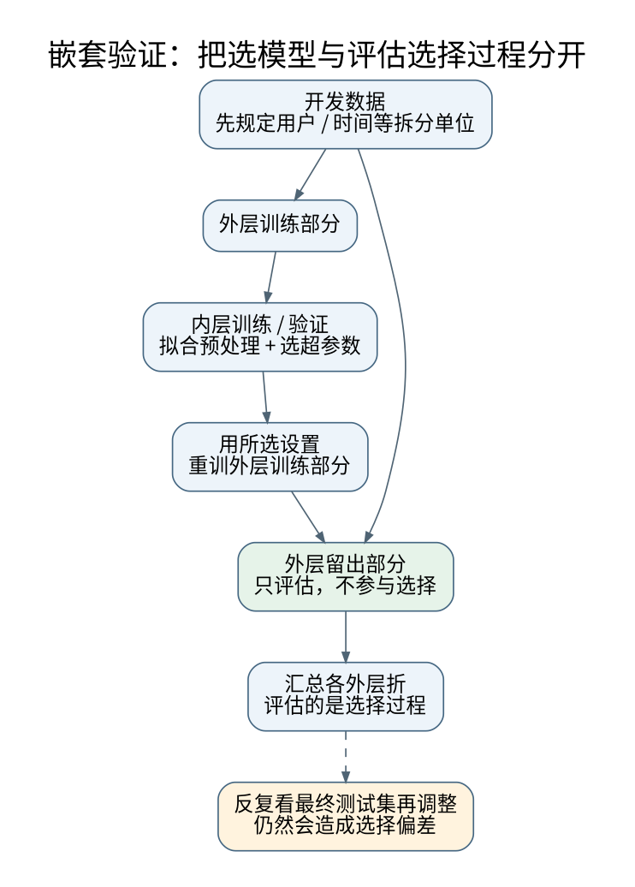

# 嵌套验证、配对实验与指标陷阱：让模型比较回答正确问题

**先修与定位：** [[AI/11-数学与统计桥梁/05-统计估计置信区间与因果边界|估计对象与配对比较]]。

## 把“训练算法”当成要评估的对象

一个建模流程不仅有模型权重，还包括特征选择、缺失值插补、阈值、早停、模型类别和超参数。只把梯度更新叫训练，会漏掉其他适应数据的步骤。若这些步骤读过测试集，测试集就不再是独立证据。[^S10]

在外层第 $j$ 折，先把外层测试数据封存；其余数据内部做交叉验证选择整套流程。选好后用外层训练数据重拟合，最后只预测外层测试。重复外层分割得到的是“包含模型选择的流程”的评估，而非从多个最佳内层分数中再挑最好看的一项。[^S11]

### 三种校正回答不同问题

一次验证选出最高分模型，与在信号记录里选最大峰、在候选里选最高验证器分数，共有“看过集合后再选择”的结构；但嵌套验证估计的是包含选择的流程表现，不自动给多项显著性声明的族错误率保证。[[数学/30-概率与统计/09-假设检验错误概率与功效#三种控制办法各自在控制什么|固定检验族、最大值标定与整流程评估]]区分三者。100个独立的有效1%零假设检验至少一次误报约0.634，这个数字不能直接叫作“选中模型的泛化误差”。

外层结果也不能反复参与调参或决定“再收一点数据直到显著”。若确实要根据不断到来的外部数据停止，应在方案中给出停止规则及适用的序贯保证；[[数学/30-概率与统计/09-假设检验错误概率与功效#固定终点、逐步偷看与有效似然过程|固定终点与逐步查看]]说明为何仅写“事先约定”仍不够。保留测试集使用记录，是为了核对选择流程是否越过了原来的证据边界。

## 从一个泄漏例子推到所有预处理

假设验证数据中一个罕见类别均值较高。先在全数据做标准化，即使未读取标签，也把未来分布信息输入了训练。更隐蔽的例子包括全数据挑最相关特征、用测试文本拟合词表、生成增强后再随机拆分，使同一原始样本的近重复版本跨集合。

正确原则不是“所有无监督预处理都安全”，而是部署时是否允许提前看到这些信息。某些明确的 transductive 任务允许使用未标注测试特征，但必须把这种信息边界写进任务，不能与普通 inductive 评估混报。

## 指标的分母决定评价了谁

在 1000 个样本中正例只有 10 个，全部预测负类准确率 99%，召回率为零。若模型报出 20 个正类，其中 8 个正确，precision 为 0.4、recall 为 0.8。只报告准确率会掩盖这个决策差异。

宏平均先逐类计算再等权平均，微平均把计数合并。稀有类的重要性不同，结果可完全不同。检测 mAP 还依赖 IoU 匹配与置信排序，不能和二分类 AUC 混成一个“面积指标”，见 [[AI/15-卷积神经网络/06-检测分割匹配损失与评估协议|视觉评估协议]]。

ROC-AUC 反映成对排序，PR 曲线受正类基率影响；相同模型在不同基率下 precision 可以变化。AP 与梯形积分 PR-AUC 的数值定义也可能不同，报告必须固定具体实现。

## 逐题配对与完整失败分母

系统 A、B 应尽量使用相同输入、相同预算和相同评估规则。保存逐题得分、无效输出、超时、拒答与费用，而不只保存平均数。超时不应悄悄从分母消失，除非目标明确是“成功返回条件下的质量”，且另报返回率。

比较平均损失时先计算逐题差；比较不同大小题目簇时，应按目标总体选择“每题等权”还是“每用户等权”。若一个用户提交了 1000 个高度相似问题，它不应该无意间支配用户层面的满意度结论。

## 同一评测合同各任务保留自己的指标

公共合同是“评价谁、允许选什么、比较怎样配对、失败进入哪个分母”。下面是教学协议候选，任务定义改变后必须重选，不能机械复制指标名。

| 任务与主评分单位 | 最终报告前冻结 | 配对与成本分母 | 不能由该结果外推什么 |
| --- | --- | --- | --- |
| 工单预测：一次工单的误差；用户目标可先逐用户平均 | 预处理、模型、阈值、标签成熟规则 | 同一组测试工单逐题比较；所有进入服务的工单另报返回率、等待与复核占用 | 已有标签的准确率不能代表标签未观察者，也不证明分流能减少升级 |
| 检测：一张图中的真值对象与匹配预测集合 | 输入管线、score/IoU协议、NMS；报警阈值在内层选择 | 同图同协议比较 AP、FN、FP；成本按所有输入图计，另报无输出/超时 | AP不证明连续时间漏警风险；重复框不能当多个TP |
| 搜索：一次图问题的路径成本与求解状态 | 状态抽象、边成本单位、启发式、预算 | 同图同起终点；所有问题计成功/超时/未知，成功成本单列 | 抽象图最优不证明真实环境可行；距离下界不能直接用于能耗 |
| RL：一个回合的回报及终止状态 | 策略、环境/奖励版本、起始分布、终止/截断、预算 | 可共享场景与外生随机种子，但动作使轨迹不同；按全部回合计回报、失败与资源 | 旧行为策略无支持的动作不能仅凭旧日志估值；高回报不证明安全 |
| 控制：一条闭环场景轨迹的代价、约束违例与时限 | 模型/估计器、$Q,R$、约束、采样期、求解器与回退 | 同初值/扰动场景；状态因动作不同不能逐时刻当同一输入；按全部场景与控制调用计失败 | 仿真低cost不证明真实机器人碰撞安全或延迟下递归可行 |

这里“配对”要求相同评测问题和规则，不要求交互系统产生同一条状态轨迹。不能把两个不同环境里的均值相减叫配对效应。嵌套验证隔离选择信息，仍不能消除标签选择偏差或部署反馈；关于前者读[[AI/65-可信AI与真实数据实践/02-标签选择偏差与社会目标#一个能跟算的选择标签反例|选择概率与零支持]]，回来说明可评总体。

入门先在[[AI/10-机器学习与深度学习基础/23-从数据到评测与行动#同一份八行数据先拆分再找分母|八行表]]报“已知标签正确数/已知标签数”和“输出数/所有输入数”。进阶保持同一对象，再设计外层分割与内层阈值选择，按用户或时间块处理依赖，分别说明测试样本和训练种子不确定性。不要拿八行教学表计算一个看似可靠的总体置信区间。

## 消融必须控制新增资源

新模块提高分数，可能因为额外参数、训练更久或筛掉了困难样本。至少考虑等参数或等计算对照、等数据流程对照，以及去除关键机制但保留相近开销的对照。无法完全匹配时，要明确结论只涉及整套系统，而非某个机制的因果贡献。

训练种子与测试题波动是两层不确定性。只重采样测试题不能估计重新训练的波动；只跑多个种子不能弥补测试分布过窄。研究预算不足时应先报告可测部分，而不是给一个万能误差条。

## 一个完整的最小协议

先冻结任务、数据划分与主指标，然后规定预算和模型选择规则。在相同折上比较简单规则、线性模型与候选方法；按外层结果报告效应量、失败切片与成本，最后把全部探索记录和未胜出的实验保留下来。测试集使用次数也应记录。

**自检：** 在同一验证集上选了最佳阈值与最佳模型，再把该分数叫“最终泛化准确率”，缺了什么？缺少评价整套选择流程的独立数据。把阈值看作超参数即可识别问题。

继续 [[AI/20-LLM/80-研究拓展/03-从论文主张到可复现实验|从论文主张到实验]]；LLM 特有污染、裁判偏差和预算对齐见 [[AI/20-LLM/70-工程应用与工具链/10-LLM评测污染裁判偏差与统计检验|LLM 评测]]。

## 来源与证据边界

本页的数值例与推导用于解释机制，不代表大型模型或真实业务上的实测效果。方法与接口依据如下，来源核验日期为 2026-09-06。

[^S10]: [scikit-learn：Common pitfalls](https://scikit-learn.org/stable/common_pitfalls.html)。动态官方文档；泄漏与管线。
[^S11]: [scikit-learn：Nested versus non-nested cross-validation](https://scikit-learn.org/stable/auto_examples/model_selection/plot_nested_cross_validation_iris.html)。官方方法示例。

**返回与迁移：** [[AI/10-机器学习与深度学习基础/00-机器学习与深度学习基础-MOC|本主题课程地图]]；[[AI/00-开始/05-问题驱动知识图谱与难点导航|按问题跨主题继续]]。
