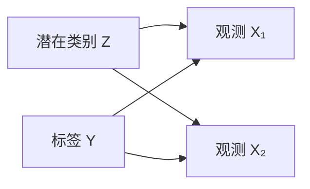
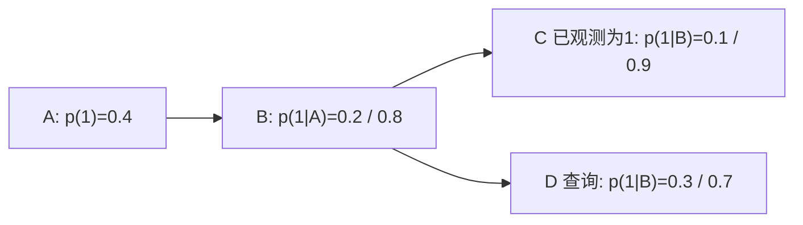

# 贝叶斯学习、概率图模型与近似推断

**读者问题：** 点估计给一个参数，贝叶斯学习为什么保留一整个分布？图模型怎样把联合分布拆成可检查的条件关系？精确后验算不动时，近似究竟牺牲了什么？

本页建立概率机器学习的统一语言。概率与信息论定义由 [[AI/11-数学与统计桥梁/03-概率似然贝叶斯与信息论|数学桥梁]]承担；线性/逻辑回归的似然主解释在 [[AI/10-机器学习与深度学习基础/14-线性回归逻辑回归与概率建模|第 14 课]]。

## 从一个硬币例子看后验预测

设硬币正面概率为 $\theta$，先验 $\theta\sim\operatorname{Beta}(\alpha,\beta)$。观察到 $h$ 次正面、$t$ 次反面，Bernoulli 似然与 Beta 先验共轭：

$$
p(\theta\mid D)=\operatorname{Beta}(\alpha+h,\beta+t).
$$

取均匀先验 $\operatorname{Beta}(1,1)$，观察 3 正 1 反，后验是 $\operatorname{Beta}(4,2)$。三个常被混淆的答案是：

| 问题 | 答案 | 此例数值 |
|---|---|---:|
| 最大似然点估计 | $h/(h+t)$ | 0.75 |
| 后验均值 | $(\alpha+h)/(\alpha+\beta+h+t)$ | $4/6\approx0.667$ |
| 下一次为正面的后验预测概率 | $\int\theta p(\theta\mid D)d\theta$ | $4/6\approx0.667$ |

后验预测把参数不确定性积分掉。样本增多后先验影响通常减弱；若先验把真实附近赋予零密度，数据无法把它“救回来”。集中实验包 `beta_bernoulli_update` 复算参数与预测均值，并拒绝负计数。

这里的计数更新还要求：给定同一个固定 $\theta$ 后，各次抛掷条件独立且同分布，并使用相同的固定先验。因此4次序列0011与0101对 $\theta$ 给出相同似然和 Beta 后验。[[数学/30-概率与统计/12-充分统计量与估计效率|充分统计量与估计效率]]从因子分解解释为何可丢弃排列，并用 Markov 转移概率给出反例：两条序列虽有相同总数，路径似然比却随转移参数变化。换成有记忆的生成模型后，应重新写联合似然，不能继续只做成功／失败计数相加。

## 似然、先验、证据与后验各有不同职责

$$
p(\theta\mid D)=\frac{p(D\mid\theta)p(\theta)}{p(D)},\qquad
p(D)=\int p(D\mid\theta)p(\theta)d\theta.
$$

- 似然把参数当变量、数据固定，说明某参数如何解释观测。
- 先验表达观察当前数据前的建模假设。
- 后验合并两者，用于预测或决策。
- 证据（marginal likelihood）对参数积分，可比较完整概率模型，但会受先验体积强烈影响。

MAP 最大化 $\log p(D\mid\theta)+\log p(\theta)$，只保留后验峰值；零均值、各向同性高斯先验对应以原点为中心的 L2 惩罚，一般高斯先验则给带中心和协方差的二次惩罚。MAP 不能提供完整后验预测区间。贝叶斯方法也不会自动校准：模型族、似然或先验错了，后验仍可能自信地错。

## 高斯线性反演与 Tikhonov

若前向映射为 $y=Ax+\epsilon$，$x$ 的零均值 Gaussian 先验与 $\epsilon$ 的零均值 Gaussian 噪声独立，且两者协方差已给定并正定，负对数后验可写为残差与参数的两个精度加权二次型。配方得到后验均值、协方差；在这一个正定 Gaussian 后验中均值等于 MAP。仅求二次型的极小点并没有保留其曲率所代表的整个分布。

去 [[信号与系统/50-通信与反演/02-前向算子反卷积与正则化重建#同一 MAP，后验尺度仍不同|热反演的 Gaussian 配方与 A/B 对照]]，带回明确的前向 $A$、平方和／均值损失口径、先验与噪声独立条件。该课沿同一 $A=\operatorname{diag}(1,.01)$ 和主观测 $(1,.02)$，由配方推出 $\lambda=\sigma^2/\tau^2$，再同时放大噪声和先验方差4倍，展示同一 MAP $(10000/10001,1)$ 仍可有4倍后验方差。继续读其独立重复段：新增独立观测让弱而非零方向的精度积累，复制旧数据不会。回本节解释为什么后验的区间宽度必须依赖绝对概率尺度，再回热页核边界与观测协议；同一个正则参数没有自动认证模型或实际覆盖率。

## 图模型是一种联合分布的因子分解

有向无环图中，每个节点以父节点为条件：

$$
p(x_1,\ldots,x_d)=\prod_j p(x_j\mid \operatorname{pa}(x_j)).
$$

若只用朴素贝叶斯部分，可写 $Y\to X_1,Y\to X_2$，得到 $p(y)p(x_1\mid y)p(x_2\mid y)$，声明 $X_1\perp X_2\mid Y$。这是模型假设，不是看到箭头后自动成立的自然事实。无向图用势函数乘积再归一化，更适合表达对称关系，但归一化常成为计算瓶颈。

> [!warning] 概率图与因果图不能只看画法互换
> 一个 DAG 可以只编码观察分布的条件独立，也可以在额外因果语义下表达干预。一般因果识别主解释见 [[社会科学/10-共同工具/03-因果图反事实与识别|因果图、反事实与识别]]；本页只把图当概率分解工具。

## 三种基础推断任务

1. **边缘化：** 求 $p(x)=\sum_z p(x,z)$ 或连续情形的积分。
2. **条件化：** 求 $p(z\mid x)$，如 GMM 的责任度。
3. **MAP：** 求最可能配置 $\arg\max_z p(z\mid x)$，它与边缘后验不是同一个问题。

变量消元依次相乘并求和；顺序不同会产生大小不同的中间因子。链和树可用消息传递精确推断；一般稠密图的精确推断可能随图宽指数增长。“图画得清楚”不代表推断便宜。

### 四个二值变量：同一后验，两种消元成本

取 $A\to B\to C$、$B\to D$，每个变量均在 $\{0,1\}$。这里的图只声明概率分解，查询为 $p(D\mid C=1)$：

斜线前后分别对应父变量为 0、1。完整因子分解是 $p(a,b,c,d)=p(a)p(b\mid a)p(c\mid b)p(d\mid b)$；每个二值条件表的另一项取 $1-p(1\mid\cdot)$。例如 $p(0,1,1,1)=0.6\times0.2\times0.9\times0.7=0.0756$。下面把 16 项全部列出，四列的列名是 $(C,D)$，每行不是一个条件分布。

| $(A,B)$ | $(0,0)$ | $(0,1)$ | $(1,0)$ | $(1,1)$ |
| --- | ---: | ---: | ---: | ---: |
| (0,0) | .3024 | .1296 | .0336 | .0144 |
| (0,1) | .0036 | .0084 | .0324 | .0756 |
| (1,0) | .0504 | .0216 | .0056 | .0024 |
| (1,1) | .0096 | .0224 | .0864 | .2016 |

全表求和为 1。条件化 $C=1$ 后只保留右两列：证据质量 .452；$D=0,1$ 的质量分别 .158、.294，后验 $p(D=1\mid C=1)=.294/.452=147/226\approx.65044248$。

**先消 $A$：** 只相乘含 $A$ 的因子，再求和，$m_A(b)=\sum_a p(a)p(b\mid a)$ 得 $(.56,.44)$。接着相乘 $m_A(B)p(C=1\mid B)p(D\mid B)$，在 $(B,D)$ 上得到中间表：

| $B$ | $D=0$ | $D=1$ |
| --- | ---: | ---: |
| 0 | .0392 | .0168 |
| 1 | .1188 | .2772 |

最后消 $B$ 按列求和，得到 $(.158,.294)$，再归一化。

**先消 $B$：** 先相乘三个含 $B$ 的因子 $p(B\mid A)p(C=1\mid B)p(D\mid B)$，乘积作用域是 $(A,B,D)$，有 8 个格子；对 $B$ 求和后得到 $m_B(A,D)$：

| $A$ | $D=0$ | $D=1$ |
| --- | ---: | ---: |
| 0 | .11 | .15 |
| 1 | .23 | .51 |

例如 .15 来自 $.8\times.1\times.3+.2\times.9\times.7$。这个消息不含 $p(A)$，不能直接把两行相加。乘先验后的表为 $(.066,.09)$ 与 $(.092,.204)$，消 $A$ 才得到同一个 $(.158,.294)$。消元是有限求和重新结合，正数加乘的次序变换不改变精确结果；中间因子不一定归一化。[^PGMworked]

这里把“每步完整乘积表的格子数之和”当教学成本：$A,B$ 序为 $4+4=8$、峰值 4；$B,A$ 序为 $8+4=12$、峰值 8。此数不等于浮点运算次数或实测耗时，但显式展示了中间作用域为何影响内存和计算。稠密图中作用域继续长大时，二值变量数每多一个就可能让表翻倍。

到 [[AI/90-资源/实验/ai_worked_examples_20260917/README|五个可跟算实验]] 的 PGM 部分运行 `joint_table` 与 `eliminate`，可看到每步乘积及消息，用独立联合枚举核对两种顺序；也核对 $C=0$。迁移题：若改为查询 $D$ 且观测一个模型赋予零概率的事件，可以照样归一化吗？不能，分母为零，需明确模型/观测不相容，而不是返回“全零后验”。

[^PGMworked]: [CMU 10-708，Lecture 4: Exact Inference](https://www.cs.cmu.edu/~epxing/Class/10708-19/notes/lecture-04/)：条件化、sum-product 消元与中间因子作用域；本页参数、表及成本计数为教学构造，2026-09-17 核对。

### 同一模型继续比较三种推断

上面的 16 格枚举与两种消元已经给出精确目标 $P(D=1\mid C=1)=147/226$。沿用同一模型、同一观测，先精确消去 $A$，得到 $p(B,D\mid C=1)$ 的四格；再去 [[AI/10-机器学习与深度学习基础/24-同一后验的精确变分与MCMC|同一后验的精确、变分与 MCMC]]，手算受限独立族的一轮 ELBO 更新，并逐项核对 Metropolis 接受率与完整四状态转移矩阵。该课用有限精确矩阵区分族误差、冷启动偏差与相关样本波动，目标始终是本节的 $D$ 查询；不会把另一个二元 ELBO 合成例当作本模型的后验。

## 近似推断的两条主路

### 变分推断：把积分变成优化

选择可计算分布族 $q_\phi(z)$，利用恒等式

$$
\log p(x)=\underbrace{\mathbb E_q[\log p(x,z)-\log q(z)]}_{\mathrm{ELBO}}
+D_{KL}(q(z)\|p(z\mid x)).
$$

最大化 ELBO 等价于在给定族内最小化 $D_{KL}(q\|p)$。mean-field 假设 $q(z)=\prod_jq_j(z_j)$ 带来可计算性，也可能低估强相关后验的不确定性。VAE 正是把每个样本的近似后验用神经网络摊销，见 [[AI/10-机器学习与深度学习基础/22-生成建模自回归VAE流GAN与扩散|生成模型族图谱]]。

#### ELBO 从哪里来：Bayes 分解与一个有限构造

先在**有限离散**潜变量空间推导。设 $p(x)>0$，并且只要 $q(z)>0$，就有 $p(z\mid x)>0$；$q(z)=0$ 的项贡献为 0，求和可只取 $q$ 的支持。于是参与计算的对数项都是有限实数，Bayes 分解

$$
\log p(x,z)=\log p(z\mid x)+\log p(x)
$$

可在这些位置逐项使用。对两边取 $q$ 的期望，再同时减去 $\mathbb E_q[\log q(z)]$，得到

$$
\begin{aligned}
\log p(x)
&=\mathbb E_q[\log p(x,z)-\log q(z)]\\
&\quad+\mathbb E_q[\log q(z)-\log p(z\mid x)]\\
&=\mathrm{ELBO}+D_{KL}(q(z)\|p(z\mid x)).
\end{aligned}
$$

KL 的非负性在最后一步给出 $\mathrm{ELBO}\leq\log p(x)$。在这个有限离散情形中，间隙为零当且仅当 $q$ 与后验相同。$q$ 若漏掉后验的一部分支持，KL 仍可能有限，但会留下正间隙；若在后验为零的位置放正质量，则 KL 发散。对连续或无限可数情形，支持关系本身不保证有限值：使用上述有限实数恒等式时，还须核对绝对连续性及相应对数比的可积性，避免把发散期望拆成 $\infty-\infty$；等号条件按分布几乎处处相同理解。

用一个归一化的二元潜变量构造检查每一项。给定观测 $x$ 的联合质量为 $p(x,z=0)=0.1$、$p(x,z=1)=0.4$，其余观测的联合质量合计为 $0.5$，故全模型总质量为 1。于是 $p(x)=0.5$、$p(z\mid x)=(0.2,0.8)$。取 $q=(0.5,0.5)$，所有对数均取自然对数：

| $z$ | $p(x,z)$ | $p(z\mid x)$ | $q(z)$ |
| --- | ---: | ---: | ---: |
| 0 | 0.1 | 0.2 | 0.5 |
| 1 | 0.4 | 0.8 | 0.5 |
| 合计 | 0.5 | 1 | 1 |

逐项代入 ELBO：

$$
\begin{aligned}
\mathrm{ELBO}
&=0.5\log(0.1/0.5)+0.5\log(0.4/0.5)\\
&\approx-0.804719-0.111572\\
&\approx-0.916291.
\end{aligned}
$$

同一 $q$ 的 KL 间隙为：

$$
\begin{aligned}
D_{KL}(q\|p(z\mid x))
&=0.5\log(0.5/0.2)+0.5\log(0.5/0.8)\\
&\approx0.458145-0.235002\\
&\approx0.223144.
\end{aligned}
$$

两项相加为 $-0.693147\approx\log0.5=\log p(x)$。改取真实后验 $q=(0.2,0.8)$ 时，KL 为 0，ELBO 恰为 $\log p(x)$。这个合成例子只比较**固定联合模型和固定观测**下的两个近似分布；此时 ELBO 更大意味着上述方向的 KL 更小。任意改变模型、观测、变分族或目标尺度后，不能把更大的 ELBO 直接等同于更好的生成质量或更准确的后验近似。

### Monte Carlo：用样本近似期望

若 $z^{(m)}\sim p(z\mid x)$，则

$$
\mathbb E[f(z)\mid x]\approx\frac1M\sum_{m=1}^M f(z^{(m)}).
$$

MCMC 构造以后验为平稳分布的马尔可夫链；链中样本相关，因此 10,000 次迭代不等于 10,000 个独立样本。需检查多链、混合、有效样本量和尾部探索。重要性采样还要求提议分布覆盖目标支持集，否则权重可爆炸或直接遗漏区域。

| 方法 | 得到什么 | 主要误差来源 | 常见误读 |
|---|---|---|---|
| MAP | 一个峰值 | 忽略参数不确定性 | 当成完整贝叶斯预测 |
| 变分推断 | 受限族内的 $q$ | 族限制、局部最优、摊销差距 | ELBO 高就等于后验准确 |
| MCMC | 相关样本 | burn-in、混合、Monte Carlo 误差 | 迭代次数当独立样本数 |

### 一条有平稳分布却不收敛的链

[[数学/30-概率与统计/20-随机过程/03-Markov链与长期平均#三条二状态链，三个不同答案|Markov主课]]用 $P=\begin{pmatrix}0&1\\1&0\end{pmatrix}$ 展示：从0开始，逐时分布在 $(1,0)$ 与 $(0,1)$ 间交替，唯一平稳分布却是 $(1/2,1/2)$，一条轨迹的时间占比也趋于各半。它因此分开“有平稳分布”“逐时分布收敛”和“遍历平均”；第三条非周期链另给相邻相关造成的方差修正。返回本页时检查实际采样核的条件，不能由目标后验不变就认证独立样本误差条。

若用当前估计或检验结果决定何时结束运行，还要分别核对估计的收敛与所报告区间／检验的停止有效性；[[数学/30-概率与统计/20-随机过程/02-鞅与停止规则的条件|停时主课]]给一般条件，[[数学/30-概率与统计/09-假设检验错误概率与功效#固定终点、逐步偷看与有效似然过程|20步固定终点与查看协议]]给有限反例。“链运行很久”没有替代任一项验证。

## 学习与决策之间还差一个效用函数

预测分布回答“可能发生什么”，行动还要最小化期望损失。例如两种处理 $a\in\{0,1\}$ 的后果不对称，应比较 $\mathbb E[L(a,Y)\mid x,D]$。后验最可能类别不一定是最低风险行动；阈值推导见 [[AI/10-机器学习与深度学习基础/14-线性回归逻辑回归与概率建模|第 14 课]]。

把同一结构用于 [[社会科学/30-金融市场与风险/09-金融工具保险与家庭风险#同一保单：先固定成本分布|家庭保单的完整成本分布]]：该例将年度事故概率0.1视为已知，条件信息 $x,D$ 固定；采用 $L(a,Y)=C_a(Y)$ 时最小化平均货币成本，采用 $L(a,Y)=C_a(Y)^2$ 时最小化平方成本期望。同一概率下动作可以不同，因为改变的是损失函数。平方货币与货币不能跨目标比较；非线性损失或负效用是否合适，还需任务的后果与偏好依据。另去 [[社会科学/30-金融市场与风险/08-杠杆保证金传染与系统性风险#5. VaR 看阈值，ES 平均固定的上尾概率质量|VaR/ES 的分位与尾部主解释]]，核对直接评价 $C_a$ 的95% ES取哪段概率质量。再完成保险页 [[社会科学/30-金融市场与风险/09-金融工具保险与家庭风险#撤去提示：只改变保费|只改保费的迁移题]]，返回本段写出所用 $L$、单位、条件信息及目标；不能由“最小化期望损失”推出损失必须线性等于钱，也不能由训练MSE较小推出现实部署安全。

后验和损失已经给定时，还可以在行动前选择是否补证据。进入 [[AI/13-搜索推理与规划/20-部分可观测决策/03-信息价值科学取证与行动#固定后果与行动时点后再算|同一监测任务的信息价值]]：先把状态、行动后果、信号及获取时点写全，再逐分支重选动作并求事前平均。已有条件期望损失没有自动完成这一步；边际似然是模型证据，EVSI是给定动作和损失下的期望决策改善。

跟算后只把预防成本20改60，返回该课 [[AI/13-搜索推理与规划/20-部分可观测决策/03-信息价值科学取证与行动#只把预防成本20改60|有信息却不改变行动]]：后验仍为8/17与2/83，行动阈值改变，免费EVSI为0。知识仍更新；不能把当前决策无改善说成信号完全无信息。需要多次主动观测时去 [[AI/13-搜索推理与规划/20-部分可观测决策/02-beliefBellman与独立策略树#从条件期望到Bellman递推|belief Bellman与策略树]]；返回本段时说明当前跟踪的是参数后验、状态belief还是行动价值，以及效用和真实后果依据来自哪里。

## 自检

1. **四次都是正面，为何预测下一次不是 1？** Beta(1,1) 先验下后验预测是 $5/6$；有限数据仍保留不确定性。
2. **ELBO 上升是否证明真实证据上升？** 对固定模型，ELBO 是证据下界；优化下界不等于已经精确求得证据，也不比较未纳入的模型。
3. **后验区间能否覆盖模型外偏差？** 不能。它条件于模型、数据过程与先验。

## 来源与证据边界

- [Murphy：《Probabilistic Machine Learning: An Introduction》作者项目页](https://probml.github.io/pml-book/book1.html)：3.6 节引入图模型，第 4.6 节定位 Bayesian statistics，第 5 章是 decision theory，第 8.7 节给 EM 通用推导，第 21.4 节覆盖 mixture-model clustering；核验使用作者页所列 2025-04-18 draft 目录。
- [Murphy：《Probabilistic Machine Learning: Advanced Topics》作者项目页](https://probml.github.io/pml-book/book2.html)：近似推断与深生成模型的进阶入口。

本页例子是可复算的教学模型，不证明真实硬币、用户或系统满足这些分布假设。

**返回：** [[AI/10-机器学习与深度学习基础/00-机器学习与深度学习基础-MOC|机器学习基础 MOC]]。
