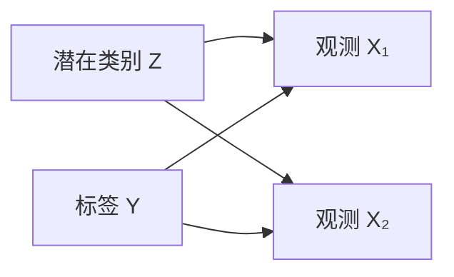

# 贝叶斯学习、概率图模型与近似推断

**读者问题：** 点估计给一个参数，贝叶斯学习为什么保留一整个分布？图模型怎样把联合分布拆成可检查的条件关系？精确后验算不动时，近似究竟牺牲了什么？

本页建立概率机器学习的统一语言。概率与信息论定义由 [[AI/11-数学与统计桥梁/03-概率似然贝叶斯与信息论|数学桥梁]]承担；线性/逻辑回归的似然主解释在 [[AI/10-机器学习与深度学习基础/14-线性回归逻辑回归与概率建模|第 14 课]]。

## 从一个硬币例子看后验预测

设硬币正面概率为 $\theta$，先验 $\theta\sim\operatorname{Beta}(\alpha,\beta)$。观察到 $h$ 次正面、$t$ 次反面，Bernoulli 似然与 Beta 先验共轭：

$$
p(\theta\mid D)=\operatorname{Beta}(\alpha+h,\beta+t).
$$

取均匀先验 $\operatorname{Beta}(1,1)$，观察 3 正 1 反，后验是 $\operatorname{Beta}(4,2)$。三个常被混淆的答案是：

| 问题 | 答案 | 此例数值 |
|---|---|---:|
| 最大似然点估计 | $h/(h+t)$ | 0.75 |
| 后验均值 | $(\alpha+h)/(\alpha+\beta+h+t)$ | $4/6\approx0.667$ |
| 下一次为正面的后验预测概率 | $\int\theta p(\theta\mid D)d\theta$ | $4/6\approx0.667$ |

后验预测把参数不确定性积分掉。样本增多后先验影响通常减弱；若先验把真实附近赋予零密度，数据无法把它“救回来”。集中实验包 `beta_bernoulli_update` 复算参数与预测均值，并拒绝负计数。

## 似然、先验、证据与后验各有不同职责

$$
p(\theta\mid D)=\frac{p(D\mid\theta)p(\theta)}{p(D)},\qquad
p(D)=\int p(D\mid\theta)p(\theta)d\theta.
$$

- 似然把参数当变量、数据固定，说明某参数如何解释观测。
- 先验表达观察当前数据前的建模假设。
- 后验合并两者，用于预测或决策。
- 证据（marginal likelihood）对参数积分，可比较完整概率模型，但会受先验体积强烈影响。

MAP 最大化 $\log p(D\mid\theta)+\log p(\theta)$，只保留后验峰值；零均值、各向同性高斯先验对应以原点为中心的 L2 惩罚，一般高斯先验则给带中心和协方差的二次惩罚。MAP 不能提供完整后验预测区间。贝叶斯方法也不会自动校准：模型族、似然或先验错了，后验仍可能自信地错。

## 图模型是一种联合分布的因子分解

有向无环图中，每个节点以父节点为条件：

$$
p(x_1,\ldots,x_d)=\prod_j p(x_j\mid \operatorname{pa}(x_j)).
$$

若只用朴素贝叶斯部分，可写 $Y\to X_1,Y\to X_2$，得到 $p(y)p(x_1\mid y)p(x_2\mid y)$，声明 $X_1\perp X_2\mid Y$。这是模型假设，不是看到箭头后自动成立的自然事实。无向图用势函数乘积再归一化，更适合表达对称关系，但归一化常成为计算瓶颈。

> [!warning] 概率图与因果图不能只看画法互换
> 一个 DAG 可以只编码观察分布的条件独立，也可以在额外因果语义下表达干预。一般因果识别主解释见 [[社会科学/10-共同工具/03-因果图反事实与识别|因果图、反事实与识别]]；本页只把图当概率分解工具。

## 三种基础推断任务

1. **边缘化：** 求 $p(x)=\sum_z p(x,z)$ 或连续情形的积分。
2. **条件化：** 求 $p(z\mid x)$，如 GMM 的责任度。
3. **MAP：** 求最可能配置 $\arg\max_z p(z\mid x)$，它与边缘后验不是同一个问题。

变量消元依次相乘并求和；顺序不同会产生大小不同的中间因子。链和树可用消息传递精确推断；一般稠密图的精确推断可能随图宽指数增长。“图画得清楚”不代表推断便宜。

## 近似推断的两条主路

### 变分推断：把积分变成优化

选择可计算分布族 $q_\phi(z)$，利用恒等式

$$
\log p(x)=\underbrace{\mathbb E_q[\log p(x,z)-\log q(z)]}_{\mathrm{ELBO}}
+D_{KL}(q(z)\|p(z\mid x)).
$$

最大化 ELBO 等价于在给定族内最小化 $D_{KL}(q\|p)$。mean-field 假设 $q(z)=\prod_jq_j(z_j)$ 带来可计算性，也可能低估强相关后验的不确定性。VAE 正是把每个样本的近似后验用神经网络摊销，见 [[AI/10-机器学习与深度学习基础/22-生成建模自回归VAE流GAN与扩散|生成模型族图谱]]。

### Monte Carlo：用样本近似期望

若 $z^{(m)}\sim p(z\mid x)$，则

$$
\mathbb E[f(z)\mid x]\approx\frac1M\sum_{m=1}^M f(z^{(m)}).
$$

MCMC 构造以后验为平稳分布的马尔可夫链；链中样本相关，因此 10,000 次迭代不等于 10,000 个独立样本。需检查多链、混合、有效样本量和尾部探索。重要性采样还要求提议分布覆盖目标支持集，否则权重可爆炸或直接遗漏区域。

| 方法 | 得到什么 | 主要误差来源 | 常见误读 |
|---|---|---|---|
| MAP | 一个峰值 | 忽略参数不确定性 | 当成完整贝叶斯预测 |
| 变分推断 | 受限族内的 $q$ | 族限制、局部最优、摊销差距 | ELBO 高就等于后验准确 |
| MCMC | 相关样本 | burn-in、混合、Monte Carlo 误差 | 迭代次数当独立样本数 |

## 学习与决策之间还差一个效用函数

预测分布回答“可能发生什么”，行动还要最小化期望损失。例如两种处理 $a\in\{0,1\}$ 的后果不对称，应比较 $\mathbb E[L(a,Y)\mid x,D]$。后验最可能类别不一定是最低风险行动；阈值推导见 [[AI/10-机器学习与深度学习基础/14-线性回归逻辑回归与概率建模|第 14 课]]。

## 自检

1. **四次都是正面，为何预测下一次不是 1？** Beta(1,1) 先验下后验预测是 $5/6$；有限数据仍保留不确定性。
2. **ELBO 上升是否证明真实证据上升？** 对固定模型，ELBO 是证据下界；优化下界不等于已经精确求得证据，也不比较未纳入的模型。
3. **后验区间能否覆盖模型外偏差？** 不能。它条件于模型、数据过程与先验。

## 来源与证据边界

- [Murphy：《Probabilistic Machine Learning: An Introduction》作者项目页](https://probml.github.io/pml-book/book1.html)：3.6 节引入图模型，第 4.6 节定位 Bayesian statistics，第 5 章是 decision theory，第 8.7 节给 EM 通用推导，第 21.4 节覆盖 mixture-model clustering；核验使用作者页所列 2025-04-18 draft 目录。
- [Murphy：《Probabilistic Machine Learning: Advanced Topics》作者项目页](https://probml.github.io/pml-book/book2.html)：近似推断与深生成模型的进阶入口。

本页例子是可复算的教学模型，不证明真实硬币、用户或系统满足这些分布假设。

**返回：** [[AI/10-机器学习与深度学习基础/00-机器学习与深度学习基础-MOC|机器学习基础 MOC]]。
