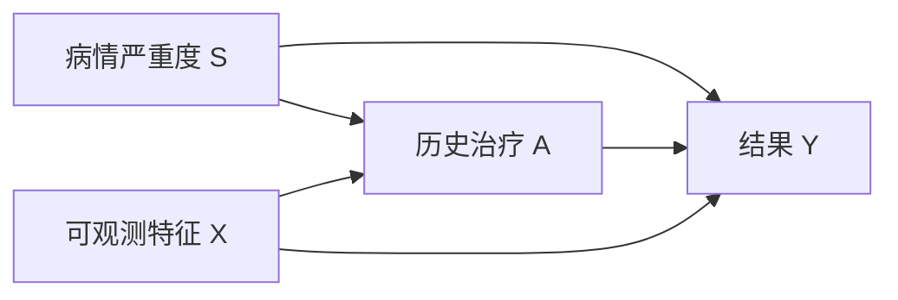
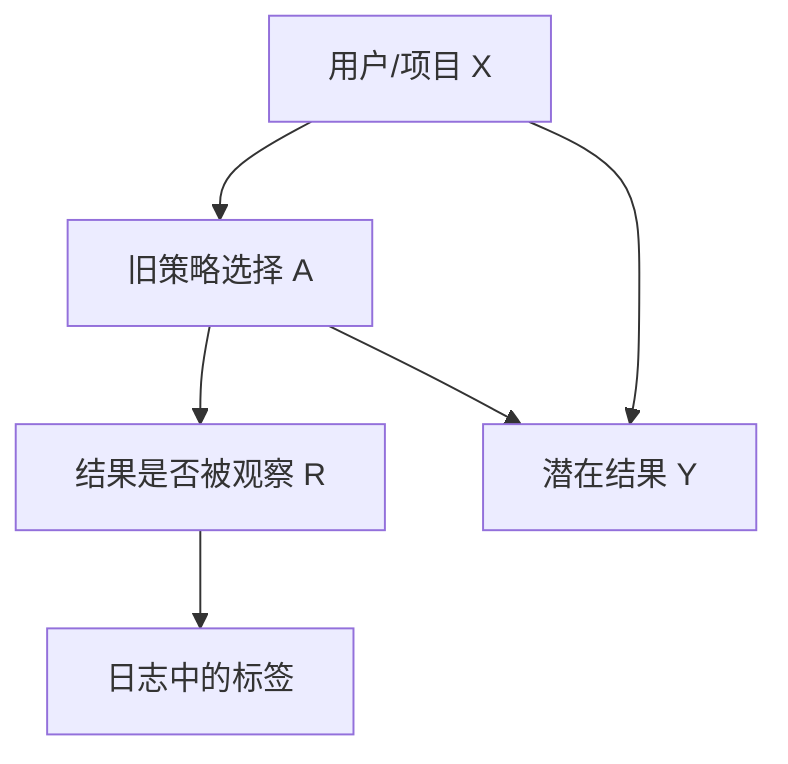

# 因果机器学习：选择偏差与反事实评估

**读者问题：** 一个模型预测得准，为什么不能直接回答“采取行动会怎样”？历史系统只展示过部分选项，怎样离线评价新策略？

本页限定在机器学习工作流：预测目标、选择产生的标签、策略日志与反事实评估。潜在结果、DAG、混杂、调整集与识别的一般主解释统一放在 [[社会科学/10-共同工具/03-因果图反事实与识别|因果图、反事实与识别]]；阅读本页前先在那里确认估计对象和识别条件。

## 预测问题和干预问题的下标不同

普通预测问 $P(Y\mid X=x)$：看到这些特征的人，结果通常怎样。干预问题问 $P(Y^a\mid X=x)$ 或平均处理效应 $E[Y^1-Y^0]$：若把行动设为 $a$，结果怎样。

医疗记录中，“接受治疗”可能预测更差结果，因为重病者更常接受治疗。这不推出治疗有害。预测器可以利用所有稳定关联；因果估计必须说明行动、结果、目标总体、时间零点和可识别条件。

若 $S$ 未测量，单纯训练 $Y\sim A,X$ 的高精度模型不会自动消除混杂。若目标只是预测资源需求，关联可能仍有用；若要选择治疗，就必须回到识别问题。

## 选择机制决定我们能看到哪些标签

推荐系统只观察已展示项目的点击；信贷系统只观察获批用户的还款；异常检测只复核高分告警。用 $R=1$ 表示标签被观察，训练集实际来自 $P(X,A,Y\mid R=1)$，而部署问题可能针对不同总体。

随机拆分日志只能复现旧选择机制。它能测“在旧策略看过的区域上预测怎样”，不能证明新策略会去的区域可识别。首先保存 action、propensity、时间、可用候选集与标签延迟；缺少这些字段，事后往往无法恢复反事实评估。

## Simpson 反向例：总体率会被分层比例改写

两种策略 A、B 在两个难度层的成功数/总数为：

| 层 | A | A成功率 | B | B成功率 |
|---|---:|---:|---:|---:|
| 容易 | 81/87 | 93.1% | 234/270 | 86.7% |
| 困难 | 192/263 | 73.0% | 55/80 | 68.8% |
| 合并 | 273/350 | 78.0% | 289/350 | 82.6% |

A 在两个层内都更高，合并后 B 却更高，因为 B 获得了更多容易案例。集中实验包 `grouped_and_pooled_rates` 逐项复算。这个表只证明“分层组成可导致关联反向”；它没有独自证明哪一层该调整、层变量是否混杂、或 A 的因果效应。变量角色需由时间顺序与因果问题决定。

## 反事实评估从支持集开始

contextual bandit 日志含 $(x_i,a_i,r_i,p_i)$，其中 $p_i=\mu(a_i\mid x_i)$ 是历史策略采取该动作的概率。要评估新策略 $\pi$，inverse propensity score（IPS）估计为

$$
\widehat V_{IPS}(\pi)=\frac1n\sum_i
\frac{\pi(a_i\mid x_i)}{\mu(a_i\mid x_i)}r_i.
$$

若旧策略在某类 $x$ 上从不选动作 1，即 $\mu(1\mid x)=0$，而新策略会选，权重无定义。模型再复杂也不能从零支持中恢复该动作结果；要限制新策略、增加随机探索或收集新数据。

### 四条日志的手算

旧策略对记录动作的 propensity 都是 0.5，新策略对其中两条记录动作给概率 1，对另两条给 0；奖励依次为 $1,0,1,1$。IPS 权重是 $2,0,2,0$，估计价值为 $(2+0+2+0)/4=1$。若某个 propensity 是 0.01，同样命中奖励的权重会变成 100，方差可能很大。裁剪权重降低方差但引入偏差，必须报告裁剪规则。

direct method 先拟合 $\widehat r(x,a)$ 再对新策略动作求预测；它能外推，但模型错时有偏。doubly robust（DR）把 outcome model 与 propensity correction 组合：在论文所述条件下，两类 nuisance 模型至少一类足够好时仍可获得一致性，但“双重稳健”不表示任意两份坏模型会互相修好，也不免除重叠和抽样条件。

## 处理效应异质性不是普通分组排行榜

机器学习可估计 conditional average treatment effect（CATE）

$$
\tau(x)=E[Y^1-Y^0\mid X=x].
$$

它可支持个体化策略，但标签中永远只看到同一对象的一个潜在结果。训练误差无法直接用另一个反事实标签计算。应使用交叉拟合避免同一数据同时拟合 nuisance 与评估残差，使用独立策略价值或实验数据评价最终决策，并限制事后挑选“受益亚组”的自由度。

> [!warning] 不要把可预测的处理选择当处理效应
> propensity 模型预测 $A$，outcome 模型预测 $Y$，CATE 估计 $Y^1-Y^0$。三个任务的标签和评估量不同。

## 部署让数据生成机制发生反馈

模型决定展示、审批或复核后，新标签分布受当前策略影响。仅用新日志定期训练可能强化既有选择：没展示的内容继续没有点击，没获批的人继续没有还款标签。最低限度的工程契约包括：

- 记录策略版本、action propensity、候选集与时间；
- 保留受控探索或随机审计样本，并设安全界限；
- 把标签缺失与负标签分开；
- 用时间外推检查策略改变后的偏移；
- 评价新策略前声明支持集、权重诊断和敏感性分析。

RL 中行动改变未来状态的主解释见 [[AI/10-机器学习与深度学习基础/19-强化学习MDP价值函数与策略梯度|第 19 课]]；本页只处理日志选择与反事实评价的接口。

若部署还改变结果本身，而不只是改变哪些标签被看见，去[[AI/65-可信AI与真实数据实践/04-区间代价分组失败与发布漂移#部署改变分布时的重训与风险|冻结分布重训与部署风险]]。带回“结果反应函数来自假设还是已识别证据”，再核本页日志选择/支持条件。那里重训稳定点与部署风险最优点不同，只是给定两点分布的推演；策略版本和无未来泄漏本身不能识别真实反应函数。

## 自检

1. **随机拆分历史点击日志，AUC 很高，能否证明新推荐策略提高点击？** 不能；它评价旧展示分布中的标签预测，还没有识别新策略价值。
2. **propensity 都大于零是否足够？** 仍需一致性、无未控制混杂/正确随机化记录等条件；极小 propensity 还会带来高方差。
3. **DR 是否总比 IPS 好？** 不是。有限样本、模型过拟合、权重极端和交叉拟合选择都会影响表现。

## 来源与证据边界

- [Hernán 与 Robins：《What If》作者页](https://miguelhernan.org/whatifbook)及[作者 PDF](https://miguelhernan.org/s/hernanrobins_WhatIf_2jan25.pdf)：潜在结果、观察数据中的因果问题与目标试验框架；一般识别细节由社会科学主解释页承接。
- [Dudík、Langford 与 Li：Doubly Robust Policy Evaluation and Learning](https://arxiv.org/abs/1103.4601)：历史 contextual-bandit 日志、新旧策略动作比例不匹配、direct/importance-weighted/DR 的问题设定。

本页的 Simpson 表与四条日志是合成复算，不是现实政策或产品效果证据。

**返回：** [[AI/10-机器学习与深度学习基础/00-机器学习与深度学习基础-MOC|机器学习基础 MOC]]。
