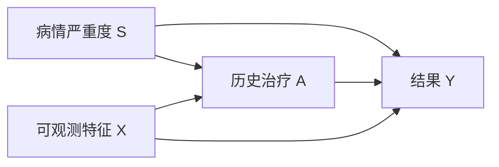
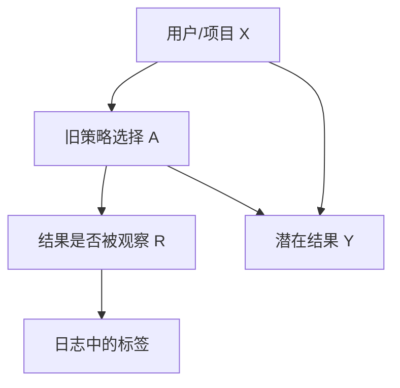

# 因果机器学习：选择偏差与反事实评估

**读者问题：** 一个模型预测得准，为什么不能直接回答“采取行动会怎样”？历史系统只展示过部分选项，怎样离线评价新策略？

本页限定在机器学习工作流：预测目标、选择产生的标签、策略日志与反事实评估。潜在结果、DAG、混杂、调整集与识别的一般主解释统一放在 [[社会科学/10-共同工具/03-因果图反事实与识别|因果图、反事实与识别]]；阅读本页前先在那里确认估计对象和识别条件。

## 预测问题和干预问题的下标不同

普通预测问 $P(Y\mid X=x)$：看到这些特征的人，结果通常怎样。干预问题问 $P(Y^a\mid X=x)$ 或平均处理效应 $E[Y^1-Y^0]$：若把行动设为 $a$，结果怎样。

医疗记录中，“接受治疗”可能预测更差结果，因为重病者更常接受治疗。这不推出治疗有害。预测器可以利用所有稳定关联；因果估计必须说明行动、结果、目标总体、时间零点和可识别条件。

若 $S$ 未测量，单纯训练 $Y\sim A,X$ 的高精度模型不会自动消除混杂。若目标只是预测资源需求，关联可能仍有用；若要选择治疗，就必须回到识别问题。

## 选择机制决定我们能看到哪些标签

推荐系统只观察已展示项目的点击；信贷系统只观察获批用户的还款；异常检测只复核高分告警。用 $R=1$ 表示标签被观察，训练集实际来自 $P(X,A,Y\mid R=1)$，而部署问题可能针对不同总体。

随机拆分日志只能复现旧选择机制。它能测“在旧策略看过的区域上预测怎样”，不能证明新策略会去的区域可识别。首先保存 action、propensity、时间、可用候选集与标签延迟；缺少这些字段，事后往往无法恢复反事实评估。

**裁判标签的迁移题。** 带着“部署针对谁、标签何时被观察”，去 [[社会科学/63-法学/06-同题比较与共同案例完整解答#进入裁判样本后，胜诉率还代表谁|100件合成争议例]]，只拿原规则下75条有裁判记录的数据训练、随机拆分。先明确符号：本页原 $R$ 是观察标记，记为 $R_{\mathrm{observed}}$；法律例的 $R$ 是程序资源，映射为 **$R_{\mathrm{observed}}\leftrightarrow S$**，资源仍另列一个输入字段。写出拆分能检验的总体，再预测全入后的100件标签比例，指出哪一格不能从旧记录验证。

> [!answer]- 条件答案
> 拆分评测来自 $P(X,Y\mid S=1)$，只检验原机制选中的裁判样本，不认证全部100件上的预测。原记录中50/75胜诉，全入题设给出50/100；新增的 $(R=0,H=0)$ 层原先没有标签支持。即使模型学到 $Y=H$，在该格的输出仍是依赖题设/模型的外推，不能由旧测试集验证，大权重也不能补回零支持。法院胜败是具体请求、证据与程序中的标签，不能替代全部社会交易里的违法真值。若援助还改变证据，潜在标签可能随之改变；返回法律例的第三项迁移题重算，并核目标、记录窗口与新证据，而非把比例下降自动解释为法官更有偏见。

## Simpson 反向例：总体率会被分层比例改写

两种策略 A、B 在两个难度层的成功数/总数为：

| 层 | A | A成功率 | B | B成功率 |
|---|---:|---:|---:|---:|
| 容易 | 81/87 | 93.1% | 234/270 | 86.7% |
| 困难 | 192/263 | 73.0% | 55/80 | 68.8% |
| 合并 | 273/350 | 78.0% | 289/350 | 82.6% |

A 在两个层内都更高，合并后 B 却更高，因为 B 获得了更多容易案例。集中实验包 `grouped_and_pooled_rates` 逐项复算。这个表只证明“分层组成可导致关联反向”；它没有独自证明哪一层该调整、层变量是否混杂、或 A 的因果效应。变量角色需由时间顺序与因果问题决定。

## 反事实评估从支持集开始

contextual bandit 日志含 $(x_i,a_i,r_i,p_i)$，其中 $p_i=\mu(a_i\mid x_i)$ 是历史策略采取该动作的概率。要评估新策略 $\pi$，inverse propensity score（IPS）估计为

$$
\widehat V_{IPS}(\pi)=\frac1n\sum_i
\frac{\pi(a_i\mid x_i)}{\mu(a_i\mid x_i)}r_i.
$$

若旧策略在某类 $x$ 上从不选动作 1，即 $\mu(1\mid x)=0$，而新策略会选，权重无定义。模型再复杂也不能从零支持中恢复该动作结果；要限制新策略、增加随机探索或收集新数据。

### 同一80人表：从分层均值到 IPS

带着“要评估哪项策略”回到 [[社会科学/10-共同工具/03-因果图反事实与识别#从反事实到可估计表达式|一般识别条件]]，再读 [[社会科学/10-共同工具/03-因果图反事实与识别#一个能手算的混杂例子|80人期望表]] 和 [[社会科学/10-共同工具/03-因果图反事实与识别#同一80人构造怎样变成策略价值|新增的随机分配设定]]。下面保留同一单位、结果窗口与目标，只改成日志记法：context $x=Z\in\{A,B\}$，行动 $a=T=1/0$ 为参训/不参训，reward $r=Y^\star\in\{0,1\}$ 为六个月成功指标；层A/B不是两项行动。每层期望40人，目标层权重各 $.5$，与此次日志总体相同。

**propensity 来自设计。** 层内用已知概率随机分配，$\mu(1\mid A)=.25,\mu(1\mid B)=.75$，给定Z的分配独立于潜在结果。还假定明确版本、一致性、无干扰与适配的抽样/结果记录。只有人数比不能倒推出这些条件；若实际日志有未测混杂，下面的加权数字即使算对也不自动是策略的干预价值。

| context层 | $\mu(1\mid Z)$ | 行动1期望人数/成功数 | $\mu(0\mid Z)$ | 行动0期望人数/成功数 |
| --- | ---: | ---: | ---: | ---: |
| A | $1/4$ | $10/8$ | $3/4$ | $30/18$ |
| B | $3/4$ | $30/12$ | $1/4$ | $10/2$ |

令 $m_a(z)=E[Y^\star(a)\mid Z=z]$，固定事先给定的策略 $\pi$。对它会选择的每项行动要求 $\pi(a\mid z)>0\Rightarrow\mu(a\mid z)>0$，仅在这些受支持项上求和。层内随机化与一致性给出

$$
E\!\left[\frac{\pi(T\mid Z)}{\mu(T\mid Z)}Y^\star\mid Z=z\right]
=\sum_{a:\,\mu(a\mid z)>0}\pi(a\mid z)m_a(z).
$$

这是先按历史行动求条件期望，把 $\mu(a\mid z)$ 约掉；再按共同层权重平均，才得到 $V(\pi)$。不把没有行动支持的项写成 $0/0$。原表给期望计数，所以把它代入经验 IPS 形式所得的是本构造的**期望加权值**；一次有限随机样本的 IPS 会围绕它波动，不保证恰好相等，也不借此声称观察过每个人两种潜在结果。

全参训策略 $\pi_1(1\mid z)=1$ 仅保留行动1的成功数，故

$$
V(\pi_1)=\frac{8/.25+12/.75}{80}
=\frac{32+16}{80}=.60.
$$

全不参训策略 $\pi_0(0\mid z)=1$ 则为

$$
V(\pi_0)=\frac{18/.75+2/.25}{80}
=\frac{24+8}{80}=.40.
$$

两者分别等于社会页的 $\tfrac12(.8+.4)$ 和 $\tfrac12(.6+.2)$，其差 $.20$ 才是该目标ATE（20个百分点）。这也不是下文四日志的估计值1。[Hernán–Robins《What If》Technical Point 2.3，印刷页25](https://miguelhernan.org/s/hernanrobins_WhatIf_2jan25.pdf)证明正值性下加权与标准化的等式，并另列可交换性/一致性；[Dudík 等 §2–2.1](https://arxiv.org/pdf/1103.4601)给策略日志与 IPS 对象。这里的80人数字来自原教学表。

### 撤去提示：让一层从不参训

改变历史分配而保留目标两层各 $.5$：A层 $\mu(1\mid A)=0,\mu(0\mid A)=1$，B层仍 $.75/.25$。A层现在只有不参训结果；新日志期望40人、成功24，不能继续套用旧A层的10/30人数。**遮住旧A层参训率 $.8$**，只允许使用新日志可观察的率。求全参训、全不参训、以及“在A不参训、在B参训”的策略 $\pi_s$ 哪些仍可识别；总体ATE呢？再写出两套与新日志相容、却使ATE不同的潜在结果分布。

> [!answer]- 支持变化的答案
> A层行动1均值 $m_1(A)$ 未被新日志约束；在不额外假定跨层关系或携入旧实验的前提下，全参训价值 $.5m_1(A)+.2$ 与ATE $[.5m_1(A)+.2]-.4$ 不能点识别。令 $m_1(A)=.1$ 或 $.9$，保持 $m_0(A)=.6,m_1(B)=.4,m_0(B)=.2$，各层用满足这些边缘的二元潜在结果分布（例如两结果独立）并按新设计分配，两套新日志相同，却给全参训 $.25/.65$ 和ATE $-.15/.25$；原构造的真实 $.8$ 若由题外信息给定，属于额外依据。全不参训仍可识别为 $.4$；$\pi_s$ 只选择两层受支持动作，价值 $.5\times.6+.5\times.4=.5$，其IPS期望式为 $(24/1+12/.75)/80=.5$。不能用更大权重补A层从未采取的行动1。删去A层会把目标改成B层；限制为 $\pi_s$ 会改变策略，二者都须明说。

即使所有行动都有支持，仍要回 [[社会科学/10-共同工具/03-因果图反事实与识别#顺时序且预测相同，干预为何仍不同|同分布双模型]] 核结构/随机化：全支持没有消除隐藏共同原因。目标地区、时期或context构成变化还需运输/抽样条件；这里只在日志总体与目标同为两层各 $.5$ 时直接用上式，action propensity不自动修正目标人口差异。主动探索可提供未来受支持的新结果，不能补写旧单位未观察的反事实；带这一缺口到 [[AI/13-搜索推理与规划/20-部分可观测决策/03-信息价值科学取证与行动#固定后果与行动时点后再算|主动取证的后果假设]]，回来说明新增的是哪个行动/哪个总体的证据。

[计量识别 #195](https://github.com/EunsonZ/WWL/issues/195) 与 [推荐曝光 #162](https://github.com/EunsonZ/WWL/issues/162) 继续各自建设设计和应用；消费者应携带具体目标与缺支持的动作返回本节。本例只是一轮给定context的策略评估，不能外推为完整动态强化学习保证；[[AI/10-机器学习与深度学习基础/19-强化学习MDP价值函数与策略梯度#on-policy、off-policy 与重要性采样|轨迹概率比]]另有状态转移、连续行动后果与多步支持条件。回到原社会表，用相同两层权重报告“两个策略值之差”与“某一个策略值”的区别。

### 四条日志的手算

旧策略对记录动作的 propensity 都是 0.5，新策略对其中两条记录动作给概率 1，对另两条给 0；奖励依次为 $1,0,1,1$。IPS 权重是 $2,0,2,0$，估计价值为 $(2+0+2+0)/4=1$。若某个 propensity 是 0.01，同样命中奖励的权重会变成 100，方差可能很大。裁剪权重降低方差但引入偏差，必须报告裁剪规则。

direct method 先拟合 $\widehat r(x,a)$ 再对新策略动作求预测；它能外推，但模型错时有偏。doubly robust（DR）把 outcome model 与 propensity correction 组合：在论文所述条件下，两类 nuisance 模型至少一类足够好时仍可获得一致性，但“双重稳健”不表示任意两份坏模型会互相修好，也不免除重叠和抽样条件。

## 处理效应异质性不是普通分组排行榜

机器学习可估计 conditional average treatment effect（CATE）

$$
\tau(x)=E[Y^1-Y^0\mid X=x].
$$

它可支持个体化策略，但标签中永远只看到同一对象的一个潜在结果。训练误差无法直接用另一个反事实标签计算。应使用交叉拟合避免同一数据同时拟合 nuisance 与评估残差，使用独立策略价值或实验数据评价最终决策，并限制事后挑选“受益亚组”的自由度。

> [!warning] 不要把可预测的处理选择当处理效应
> propensity 模型预测 $A$，outcome 模型预测 $Y$，CATE 估计 $Y^1-Y^0$。三个任务的标签和评估量不同。

**从平均差返回个体归因。** 在本页的固定 $X=x$ 层内，另用社会因果页的合成技术配置例：$A=1/0$ 是明确的两种配置，$Y=1$ 是同一窗口内的指定损害。即使该层两种干预风险都已识别为 $.2$ 与 $.1$，$\tau(x)=.1$ 仍只是风险差10个百分点。读 [[社会科学/10-共同工具/03-因果图反事实与识别#已知群体风险，为什么个体归因仍有界|同边缘、不同联合的完整证明]]，携带“同一单位的 $(Y(1),Y(0))$ 怎样配对”返回这里；不要把这一损害结局与前面的点击、奖励或医疗标签混用。

**完整返回答案。** 若该层内四格为 $(.1,.1,0,.8)$，且在该层满足一致性、无干扰、明确版本、正值性及 $A\perp(Y(1),Y(0))\mid X=x$，实际配置1且受损单位的 PN 为 $.5$；四格改为 $(0,.2,.1,.7)$，相同两风险及相同 CATE 对应 PN 为1。因此点识别 CATE 不能点识别这个条件反事实概率，更没有观察到某个人的两个结果。算法把输出称作“个体化”只说明输入按 $x$ 区分，不增加反事实标签；$X=x$ 层内仍可存在两种联合机制。若额外有单位层面的 $Y(1)\ge Y(0)$ 机制依据，才在此条件范围内得到 $.5$；平均差为正不提供该依据。

**撤去方法提示。** 仍在同一层，给四格 $(.05,.15,.05,.75)$；遮住上面的推导，报告两风险、CATE和实际配置1且受损这类单位的 PN，并解释模型能否宣称已知道某个用户的个人效应。随后改为“只从被复核并留有标签的记录取得 $.2/.1$”：原答案还能否原样保留，须先查什么？

> [!success]- 返回答案
> 在前述层内联合独立等条件下，两风险为 $.2/.1$，CATE为 $.1$，PN为 $.75$；这些是该层和条件事件的模型量，未给某个人的联合类型，不能把平均差写成已观察个人效应。仅有被复核记录时，须先查标签选择如何依赖配置、结果及其他变量，以及它是否连接到同一参考总体的干预风险；预测准确、随机拆分和更大样本都不自动补上这座桥。若条件不足，保留未知并返回本页“选择机制决定我们能看到哪些标签”，不能把选择比例直接代进 PN。

## 部署让数据生成机制发生反馈

模型决定展示、审批或复核后，新标签分布受当前策略影响。仅用新日志定期训练可能强化既有选择：没展示的内容继续没有点击，没获批的人继续没有还款标签。最低限度的工程契约包括：

- 记录策略版本、action propensity、候选集与时间；
- 保留受控探索或随机审计样本，并设安全界限；
- 把标签缺失与负标签分开；
- 用时间外推检查策略改变后的偏移；
- 评价新策略前声明支持集、权重诊断和敏感性分析。

RL 中行动改变未来状态的主解释见 [[AI/10-机器学习与深度学习基础/19-强化学习MDP价值函数与策略梯度|第 19 课]]；本页只处理日志选择与反事实评价的接口。

若部署还改变结果本身，而不只是改变哪些标签被看见，去[[AI/65-可信AI与真实数据实践/04-区间代价分组失败与发布漂移#部署改变分布时的重训与风险|冻结分布重训与部署风险]]。带回“结果反应函数来自假设还是已识别证据”，再核本页日志选择/支持条件。那里重训稳定点与部署风险最优点不同，只是给定两点分布的推演；策略版本和无未来泄漏本身不能识别真实反应函数。

## 自检

1. **随机拆分历史点击日志，AUC 很高，能否证明新推荐策略提高点击？** 不能；它评价旧展示分布中的标签预测，还没有识别新策略价值。
2. **propensity 都大于零是否足够？** 仍需一致性、无未控制混杂/正确随机化记录等条件；极小 propensity 还会带来高方差。
3. **DR 是否总比 IPS 好？** 不是。有限样本、模型过拟合、权重极端和交叉拟合选择都会影响表现。

## 来源与证据边界

- [Hernán 与 Robins：《What If》作者页](https://miguelhernan.org/whatifbook)及[作者 PDF](https://miguelhernan.org/s/hernanrobins_WhatIf_2jan25.pdf)：潜在结果、观察数据中的因果问题与目标试验框架；一般识别细节由社会科学主解释页承接。
- [Dudík、Langford 与 Li：Doubly Robust Policy Evaluation and Learning](https://arxiv.org/abs/1103.4601)：历史 contextual-bandit 日志、新旧策略动作比例不匹配、direct/importance-weighted/DR 的问题设定。

本页的 Simpson 表与四条日志是合成复算，不是现实政策或产品效果证据。

**返回：** [[AI/10-机器学习与深度学习基础/00-机器学习与深度学习基础-MOC|机器学习基础 MOC]]。
