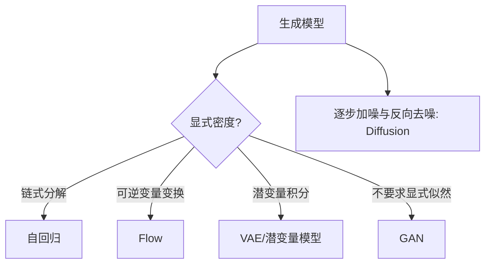

# 生成建模：自回归、VAE、流、GAN 与扩散

**读者问题：** 这些模型都能“生成”，训练目标和可计算量究竟哪里不同？高质量样本、较高似然和覆盖数据分布为何不是同一个承诺？

生成模型试图学习数据分布或一套从随机性到样本的机制。条件生成学习 $p(x\mid c)$；判别模型常学习 $p(y\mid x)$。能采样不表示能给规范化密度，能算似然也不保证样本符合人的偏好。

## 先用四个问题给模型族定位

1. 是否能精确计算或稳定估计 $\log p(x)$？
2. 采样是一次并行、按序列逐步，还是迭代去噪？
3. 是否有显式潜变量，推断 $p(z\mid x)$ 是否可算？
4. 训练目标覆盖数据分布，还是只通过判别器/代理目标比较样本？

| 模型族 | 密度/训练量 | 采样方式 | 主要结构限制 | 常见失败 |
|---|---|---|---|---|
| 自回归 | 精确分解的 log-likelihood | 按顺序逐步 | 次序与条件器 | 慢、暴露误差累积 |
| VAE | 优化 ELBO | 潜变量后一次解码 | 近似后验与解码似然 | 模糊、posterior collapse |
| normalizing flow | 精确变量变换密度 | 可逆变换 | 维度相同、Jacobian 可算 | 架构受限、算力权衡 |
| GAN | 隐式分布，无通用精确似然 | 一次前向 | 对抗博弈 | mode collapse、训练不稳 |
| diffusion | 去噪/score 目标与变分联系 | 多步反向过程 | 噪声过程与采样器 | 采样成本、误差累积 |

## 自回归：联合分布总能按链式法则分解

$$
p(x_1,\ldots,x_T)=\prod_{t=1}^T p(x_t\mid x_{<t}).
$$

两个二元变量的例子：$P(X_1=1)=0.4$，$P(X_2=1\mid X_1=0)=0.25$，$P(X_2=1\mid X_1=1)=0.75$。联合表为

| $X_1$ | $X_2=0$ | $X_2=1$ |
|---:|---:|---:|
| 0 | $0.6\times0.75=0.45$ | $0.6\times0.25=0.15$ |
| 1 | $0.4\times0.25=0.10$ | $0.4\times0.75=0.30$ |

四格和为 1。`autoregressive_joint` 复算并检查非负与归一化。链式法则本身无近似；困难在于条件分布的表示与训练。文本 teacher forcing 时训练条件是真实前缀，生成时条件是模型自己采样的前缀，两者分布可不同。

## VAE：为不可算后验学习一个近似入口

潜变量模型 $p_\theta(x,z)=p(z)p_\theta(x\mid z)$ 的边缘似然需积分 $z$。VAE 用 encoder $q_\phi(z\mid x)$ 最大化

$$
\mathrm{ELBO}=\mathbb E_{q_\phi(z\mid x)}[\log p_\theta(x\mid z)]
-D_{KL}(q_\phi(z\mid x)\|p(z)).
$$

第一项鼓励重建，第二项把每个样本的潜变量分布拉向先验，使从先验采样有意义。重参数化 $z=\mu_\phi(x)+\sigma_\phi(x)\odot\epsilon$、$\epsilon\sim N(0,I)$ 把随机性移到参数外，允许低方差路径梯度。

若 decoder 太强，它可以忽略 $z$，KL 接近 0，形成 posterior collapse；若观测似然假设与感知质量不匹配，平均似然解可能显得模糊。ELBO 是下界，不应把不同实现的 ELBO 直接当可比的真实 log-likelihood。

## Flow：精确密度来自可逆性和 Jacobian

设 $x=f(z)$，$f$ 可逆，则

$$
\log p_X(x)=\log p_Z(f^{-1}(x))+
\log\left|\det\frac{\partial f^{-1}}{\partial x}\right|.
$$

一维仿射变换 $x=az+b$、$z\sim N(0,1)$ 给出

$$
\log p_X(x)=-\frac{z^2}{2}-\frac12\log(2\pi)-\log|a|.
$$

取 $a=2,b=1,x=1$，$z=0$，log density 为 $-\tfrac12\log(2\pi)-\log2\approx-1.612$。漏掉 $-\log|a|$ 后密度不再正确归一化。`affine_flow_log_density` 复算该项并拒绝零尺度。

可逆性通常要求输入输出维度一致；让 Jacobian determinant 可算会约束网络结构。Flow 的“精确似然”只在指定连续密度和数值实现下成立，离散图像的 dequantization 选择也影响报告值。

## GAN：通过判别博弈匹配样本分布

经典目标为

$$
\min_G\max_D\;E_{x\sim p_{data}}\log D(x)
+E_{z\sim p(z)}\log(1-D(G(z))).
$$

判别器寻找真实与生成样本的差别，生成器试图消除差别。理想化容量与最优判别器分析不等于有限网络、交替梯度会收敛。生成器可能只覆盖少数模式仍产生锐利样本；训练曲线也不是一个像监督损失那样直接可读的质量标尺。

## Diffusion：学习逆转一个逐步加噪过程

前向过程逐步把数据变成近高斯噪声，例如

$$
q(x_t\mid x_{t-1})=N(\sqrt{1-\beta_t}x_{t-1},\beta_tI).
$$

模型学习反向条件或等价的噪声/score 参数化，从 $x_T\sim N(0,I)$ 多步还原。训练可随机抽时间步并预测加入的噪声；采样却通常要经过许多时间步。减少步数会改变速度和误差，不是免费加速。

条件引导提高样本对条件的符合度时，可能牺牲多样性或放大数据偏差。Diffusion 的去噪目标、变分界与 score matching 有联系，但不同采样器和权重约定不能仅凭“都是 diffusion”互换。

## 评价：至少把 fidelity、coverage 与记忆分开

- **fidelity：** 单个样本是否逼真、条件是否满足。
- **coverage/diversity：** 数据分布中的模式是否被覆盖。
- **density：** 对留出数据给出的概率如何；高似然不必等于感知上更好。
- **memorization/privacy：** 是否复现训练样本或敏感片段。
- **downstream utility：** 合成数据对明确下游任务是否有益，并需在真实留出集评价。

FID 把真实与生成图像映射到指定 Inception 表示，再以各自高斯的均值和协方差计算距离。它因此只比较该表示下的一、二阶统计，不能单独揭示某个亚群是否消失。人工偏好也要盲评、配对并报告抽样范围。任何单指标都不足以证明“学会真实分布”。

## 自检

1. **GAN 生成图很锐利，能否说覆盖完整？** 不能，可能 mode collapse。
2. **Flow 能算精确似然，能否说最符合人类视觉？** 不能，密度目标与感知质量不同。
3. **VAE 的 encoder 是生成时必需的吗？** 训练/推断潜变量时需要；从先验生成可只用 decoder。
4. **Diffusion 每步误差小，最终误差必然小吗？** 不必然，多步组合和采样器都会影响终点分布。

## 来源与证据边界

- [Bengio 等：A Neural Probabilistic Language Model](https://jmlr.org/papers/v3/bengio03a.html)：联合序列概率与分布式词表示的早期神经自回归主线。
- [Kingma 与 Welling：Auto-Encoding Variational Bayes](https://arxiv.org/abs/1312.6114)：重参数化变分下界与 VAE。
- [Goodfellow 等：Generative Adversarial Nets](https://arxiv.org/abs/1406.2661)：GAN 原始博弈目标。
- [Papamakarios 等：Normalizing Flows for Probabilistic Modeling and Inference](https://arxiv.org/abs/1912.02762)：可逆变换、表达力与计算权衡综述。
- [Ho、Jain 与 Abbeel：Denoising Diffusion Probabilistic Models](https://arxiv.org/abs/2006.11239)：加噪、去噪与加权变分目标。
- [Heusel 等：GANs Trained by a Two Time-Scale Update Rule](https://arxiv.org/abs/1706.08500)：提出 FID，并以 Inception 表示的均值和协方差比较真实与生成样本；本页只据此说明定义及其只保留该表示下一、二阶统计的边界。

所有数值表都是合成教学例，不是模型质量实验。大模型生成训练与推理的具体实现继续走 [[AI/20-LLM/00-LLM-MOC|LLM MOC]]。

**返回：** [[AI/10-机器学习与深度学习基础/00-机器学习与深度学习基础-MOC|机器学习基础 MOC]]。
