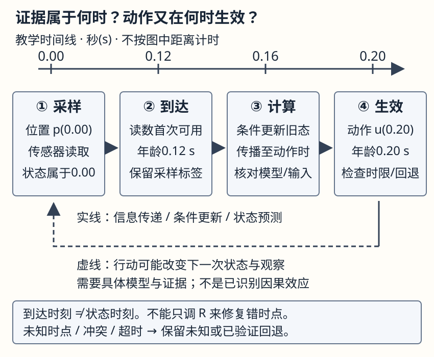

# 从数据到评测与行动：一个分数究竟允许做什么

**读者问题：** 测试分数不错，为什么还不能直接扩大自动分流，或把视觉估计送进控制器？本页只连接已有主解释；所有数据与时间数字都是教学构造。

两个入口读同一正文。刚入门时先读下方八行表，交一张“谁进入哪区、哪些标签未知、质量分母和服务分母”的自然表格即可；已有概率/编程基础时在同表追加目标总体、观察机制和冻结对象，再读时间表。双方最后做同一道陌生迁移题，卡在哪里只回补对应链接。

## 同一份八行数据先拆分再找分母

设服务希望下一月**全部新到工单**更及时得到恰当帮助；当前只先预测“旧排班和处理策略下，创建后24小时内是否实际升级”。二者尚未等同。字段 $X$ 是创建时的描述/人数，$Y$ 是升级标签，$O=1$ 表示截止时标签已成熟且被审计。老策略只审计高优先队列。A、B、C、D是用户，A1等是工单；第10/11日均已超过24小时，未知项不是未成熟，而是未审计。

| 工单 | 用户 | 创建日 | 旧队列/是否审计 $O$ | $Y$ | 按用户隔离的示例区 |
| --- | --- | ---: | --- | --- | --- |
| A1 | A | 10 | 高 / 1 | 1 | train |
| A2 | A | 11 | 低 / 0 | ? | train |
| B1 | B | 10 | 高 / 1 | 0 | train |
| B2 | B | 11 | 低 / 0 | ? | train |
| C1 | C | 10 | 高 / 1 | 1 | test |
| C2 | C | 11 | 低 / 0 | ? | test |
| D1 | D | 10 | 高 / 1 | 0 | test |
| D2 | D | 11 | 低 / 0 | ? | test |

用户隔离消除了此表的训练/测试用户重叠，却只评到了测试工单中 $O=1$ 的两条。若冻结的规则给 C1/C2/D1/D2 四条输出为 `1/0/0/0`，已观察标签上的准确率为 $2/2$；标签覆盖为 $2/4$，输出覆盖为 $4/4$，全体四条的准确率仍未知。即使假设缺失标签是可信二值结果，全体准确率也只能在 $2/4$ 到 $4/4$ 之间；不能把未知填零得到100%。这个极小表不支持总体精度或改策略的效果估计。

新用户泛化可按用户隔离；老用户未来事件泛化可按时间向前。随机按行只在其信息边界与目标问题相符时才合适。做后两种拆分时，必须重写上表的 split，而不是沿用该示例。去[[AI/10-机器学习与深度学习基础/05-数据集拆分清洗与泄漏#先画数据怎样来到你手里|数据生成与三个单位]]，带回预测单位、依赖单位、切分单位；去[[AI/65-可信AI与真实数据实践/02-标签选择偏差与社会目标#一个能跟算的选择标签反例|选择概率反例]]，带回为什么低队列无标签不能靠权重凭空恢复。

## 冻结选择后仍要重新问行动目标

对新数据，预处理、模型、阈值、标签成熟/审计规则及预算先冻结，随后在封存测试上报告。若想用测试发现的问题改阈值，可以继续探索，但需要新的独立报告数据；测试不能同时为同一轮选择和报告提供独立证据。内外层怎样分工由[[AI/10-机器学习与深度学习基础/18-嵌套验证配对实验与指标陷阱#把“训练算法”当成要评估的对象|完整流程评估]]承担。

报告至少把三个问题写成不同的句子：已审计标签上的预测误差是多少；全部输入中有多少返回、超时或等待；新分流动作是否改善了真正的帮助目标。前两者可从合适日志描述，第三者需要可比较的行动证据和明确的识别前提。模型主动升级、减少记录或改变人工投入，都会让后续标签机制和结果改变；前后升级率相减不能自动归因于模型。证据不足可以限制结论到旧策略/已观察总体，并保留未知。

指标随目标重选。工单在已成熟且确被观察的标签上，令 $D=1$ 表示分流、$Y=1$ 表示当前定义的标签阳性，可分别报告漏分流率 $\mathrm{FN}/(\mathrm{TP}+\mathrm{FN})$（分母是已观察阳性数）和误分流率；本段明确选用 $\mathrm{FPR}=\mathrm{FP}/(\mathrm{FP}+\mathrm{TN})$（分母是已观察阴性数），任一分母为零时相应率未定义。复核等待和容量另报；“需要帮助”若没有有效测量，就不能把升级标签的召回当需求召回。检测、搜索、RL、控制的评分单位和不可外推条件在[[AI/10-机器学习与深度学习基础/18-嵌套验证配对实验与指标陷阱#同一评测合同各任务保留自己的指标|跨任务合同表]]；去读自己任务的一行，带回主指标、失败分母和成本单位，不把各任务都叫准确率。

## 把采样到达预测和动作放回时间

图为教学时间线，实线箭头表示信息传递或预测计算，虚线箭头表示需要另行核对的行动反馈；不是一张已识别的因果图。一次位置观测属于0.00s，到达却是0.12s；计算在0.16s完成，动作在0.20s生效。若只按到达顺序把读数当0.12s位置，会错用状态。

| 必须分清的对象 | 这个例子的时点 | 带回模型/行动的什么信息 |
| --- | --- | --- |
| 物理状态与采样 | $p(0.00)$，位置读数采于0.00s | 观测模型针对采样时状态；传感器外参/单位也要可信 |
| 到达与可用 | 0.12s到达 | 这是程序首次可用时间，不是状态时间；检查时钟同步和乱序 |
| 条件更新与预测 | 0.16s完成计算；可先条件化0.00s状态，再传播 | 明确所用模型、过程中已执行输入、预测状态时点和不确定性 |
| 提案与生效 | 为0.20s动作生成提案，0.20s生效 | 测量证据年龄0.20s；对动作时点的预测需要验证模型和截止时间 |

没有速度、动力学或已执行输入资料时，不能仅由 $p(0.00)$ 补出 $p(0.20)$。先去[[AI/45-机器人与具身智能/20-状态估计与LQG/05-从不完整读数到条件不确定性#本科快进：Schur 补就是“看见 y 后还剩多少不确定性”|条件化假设]]，带回精确 Gaussian 所需条件；再去[[AI/45-机器人与具身智能/10-LQR与约束控制/00-LQR与约束控制-MOC#从仿真进入执行前先判断失败出口|执行失败出口]]，带回何时不能行动。ViT、扩散和社会数据没有自动满足这些物理模型假设。

## 先保留四种出口再计算分数

| 状态 | 合理的交付 | 评测中保留什么 |
| --- | --- | --- |
| 未知：目标、标签或时间映射尚未确认 | 限制结论，说明缺哪项测量/假设 | 未知数量与原因，质量分母明确排除条件 |
| 无答案：当前问题没有唯一可接受答案 | 给范围、分歧或可接受替代答案 | 评分规则允许等价论证，不能把作者偏好当唯一真值 |
| 不可见：关键像素、标签或状态缺失 | 拒答/新增观测；不可凭先验补成证据 | 全部输入仍进入服务/成本分母，另报可回答比例 |
| 冲突：图文、标签裁决或时间戳相互矛盾 | 指出各证据来源，暂缓结论或转复核 | 冲突切片与处理结果，不能悄悄选有利的一项 |

拒答既可能合理，也可能过多。分别评价“该答时是否答对”和“本应可答却拒绝的覆盖损失”；不把所有拒答都记成功或都记失败。具体规则在最终测试前定好。

## 陌生迁移题观察和行动环境一起变

服务从文字工单换成机器人提交的照片，目标改为“7天内取消”；新站点只有夜间人工回访过的工单才有成熟标签。原来分流到不限量人工，新环境每天只允许20次回访，且照片平均延迟0.4s到达，图中文字可能与操作员备注冲突。现在建议用旧测试100%准确率直接扩大自动处理。

不用照抄上表。请交一张自然表格或一段解释：写目标总体和代理标签，指出不可用字段；选择拆分和至少两个有效分母；重定主指标与冻结对象；说明一个行动反馈和一个时间问题；写当前可说、不可说以及要补的证据。允许认为现有资料不足以选定唯一指标或动作，但需说明判断条件。

核对依据与可接受答案

旧分数只评价旧策略下已审计的24小时标签，不能支持新站点7天结果或自动行动效果。新目标若仍是及时帮助，取消也只是代理；“7天内”需等观察窗成熟，且夜间回访规则排除了未回访者。分区可按未来时间和站点，也可为新设备按设备组隔离，答案须解释它模拟的部署问题；仅按行随机拆分而不说明依赖/选择不能通过。

可报成熟且已观察标签上的误差/召回、全部输入的返回率、按全部请求计回访等待/超容量，另报标签覆盖。容量20意味着阈值/队列/回退会影响谁获回访和哪些标签回流，应在选择数据上定方案，用独立未来数据报告。不同问题也可用每用户、每设备或每场景成本，只要总体与权重一致；零阳性分母的召回应写未定义，不写0或1。

0.4s是到达延迟，需要采样与动作时点、时钟及动力学信息；不能把旧像素当当前状态，也不能只调Kalman的噪声来认证VLM。图文冲突、不可见或无唯一答案可触发复核/拒答。新测量可包括适当授权下覆盖被排除者的审计、目标代理验证、按时点记录的感知输入和受控行动比较；没有这些资料可先限制为描述旧观察集并暂缓行动扩张。具体受控设计仍须任务依据，不能凭本题宣称已经识别因果或完成硬安全。

评分看五项：对象/时点明确；拆分和观察机制分开；分母与未知有效；冻结/行动反馈重写；证据与出口可执行说明。每项0–2分，满分10；提出有依据的替代指标、切分、限制总体或合理暂不能判断，同样得分。漏掉观察选择或把不可见/冲突直接补成确定答案，即使计算正确，也未通过关键边界。

## 来源范围与当前边界

- [scikit-learn Common pitfalls，12.1–12.2](https://scikit-learn.org/stable/common_pitfalls.html)与[Nested versus non-nested CV](https://scikit-learn.org/stable/auto_examples/model_selection/plot_nested_cross_validation_iris.html)：核对训练拟合变换、测试不能参与选择、内外层职责；不认证本页工单或策略效果。
- [Barocas、Hardt、Narayanan，Datasets](https://fairmlbook.org/datasets.html)的测量与单一目标讨论：支持代理与实际用途的区分；不提供本页容量、标签规则或规范结论。
- [Stanford EE363 Estimation，第18–24页](https://ee363.stanford.edu/archive/lectures/estim.pdf)：核对一般条件均值、联合Gaussian与线性观测的区别；不支持把这些假设借给图像模型或社会数据。

本页八行数据、容量与时间均为教学构造，没有业务、VLM、机器人闭环或真人试读结果。来源只局部核对上述机制；跨任务指标的完整定义仍由各主解释承担。
