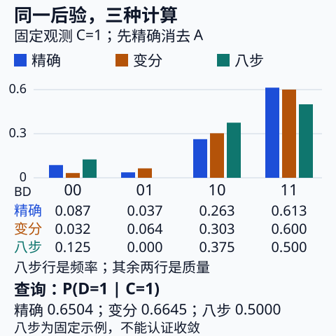

# 同一后验的精确、变分与 MCMC

**读者问题：** 精确枚举、变分优化和 MCMC 都说自己在“推断后验”，它们到底计算什么，误差从哪里来？本课固定原 [[AI/10-机器学习与深度学习基础/20-贝叶斯学习概率图模型与近似推断#四个二值变量：同一后验，两种消元成本|四变量 16 格模型]]，不另换一组数字。证据一直是 $C=1$，问题一直是 $\mu=P(D=1\mid C=1)$。模型小到可以精确求解，正好把真实答案当作检查近似的参照；在这个例子中并不需要用 MCMC 节省计算。

## 1. 精确边缘化给出共同目标

沿用 $A\to B\to C$、$B\to D$：$P(A=1)=0.4$，$P(B=1\mid A=0,1)=(0.2,0.8)$，$P(C=1\mid B=0,1)=(0.1,0.9)$，$P(D=1\mid B=0,1)=(0.3,0.7)$。其余二值概率取补数。

这里先**精确**消去 $A$，保留二变量目标 $z=(B,D)$：

$$w_{bd}=\sum_{a=0}^1p(a,b,C=1,d),\quad
Z=P(C=1)=\sum_{b,d}w_{bd}=0.452,\quad
\pi_{bd}=w_{bd}/Z.$$

$P(B=1)=0.6\cdot0.2+0.4\cdot0.8=0.44$，故 $P(B=0)=0.56$。按固定状态顺序 $00,01,10,11$：

| 状态 $(B,D)$ | 未归一化 $w$ | 后验 $\pi$ | $f(B,D)=D$ |
|---|---:|---:|---:|
| 00 | 0.0392 | $98/1130\approx0.086726$ | 0 |
| 01 | 0.0168 | $42/1130\approx0.037168$ | 1 |
| 10 | 0.1188 | $297/1130\approx0.262832$ | 0 |
| 11 | 0.2772 | $693/1130\approx0.613274$ | 1 |

例如 $w_{01}=0.56\cdot0.1\cdot0.3=0.0168$。查询为

$$\mu=\sum_z\pi_zf(z)=\frac{42+693}{1130}=\frac{147}{226}\approx0.65044248.$$

本课所有近似均面对这四状态后验，既不是先验 $p(B,D)$，也不是完整八状态 $p(A,B,D\mid C=1)$。若想恢复完整后验，还需接回 $p(A\mid B,C=1,D)=p(A\mid B)$；本课不把消去 $A$ 称作近似。16 格枚举与消元一致性仍见原课；[CMU Lecture 4，Elimination on Chains 与 Variable Elimination Algorithm](https://www.cs.cmu.edu/~epxing/Class/10708-19/notes/lecture-04/) 对照求和、因子作用域和归一化。

## 2. 受限变分：能优化，却不能制造相关性

取 mean-field 族

$$q_{r,t}(B,D)=\operatorname{Bern}(B;r)\operatorname{Bern}(D;t),\quad 0\le r,t\le1.$$

四个质量依次为 $((1-r)(1-t),(1-r)t,r(1-t),rt)$。目标固定为

$$\mathcal L(r,t)=\sum_{b,d}q_{r,t}(b,d)\log\frac{w_{bd}}{q_{r,t}(b,d)}
=\log Z-D_{KL}(q_{r,t}\|\pi).$$

全部使用自然对数、$0\log0=0$ 约定。$w$ 在四点均正，所有这些 $q$ 的反向 KL 都有限；$0<r,t<1$ 时支持覆盖全部四点。**支持齐全仍不代表分布族包含目标。** 对独立四格表必有 $q_{00}q_{11}=q_{01}q_{10}$，而后验交叉比为

$$\frac{\pi_{00}\pi_{11}}{\pi_{01}\pi_{10}}=\frac{49}{9}\ne1.$$

因此本族不能表示该后验的相关性，优化误差减小后仍留下族限制误差。[CMU 2017 Mean Field 讲义 §2、PDF 第 4–5 页的固定其他因子坐标更新](https://www.cs.cmu.edu/~epxing/Class/10708-17/notes-17/10708-scribe-lecture13.pdf) 可对照一般推导；下面直接从这四项推导，参数并非取自讲义。

### 一次可以手算的更新

固定 $t$，把 $\mathcal L$ 中与 $r$ 有关的部分写成

$$rA_1+(1-r)A_0-r\log r-(1-r)\log(1-r),$$

其中 $A_b=\sum_dq_D(d)\log w_{bd}$。对 $r$ 求导令零：

$$\log\frac r{1-r}=A_1-A_0
=(1-t)\log\frac{297}{98}+t\log\frac{693}{42}.$$

这是一个坐标上的严格凹问题，二阶导数 $-1/[r(1-r)]<0$。同理固定**刚更新后的** $r$，得到

$$r\leftarrow\sigma\!\left((1-t)\log\frac{297}{98}+t\log\frac{693}{42}\right),\qquad
t\leftarrow\sigma\!\left((2r-1)\log\frac73\right),$$

$\sigma(v)=1/(1+e^{-v})$。从 $r=t=1/2$ 开始，第一步 $r/(1-r)=\sqrt{(297/98)(693/42)}=99/14$，故 $r=99/113$；用此值更新 $t\approx0.654154$。

| 完整轮数 | $r$ | $t=E_q[D]$ | ELBO | $D_{KL}(q\|\pi)$ |
|---|---:|---:|---:|---:|
| 0 | .500000 | .500000 | −1.298402 | .504329 |
| 1 | .876106 | .654154 | −.831310 | .037237 |
| 2 | .901792 | .663934 | −.827628 | .033555 |
| 3 | .903250 | .664485 | −.827615 | .033542 |
| 20 | .903336 | .664517 | −.827615 | .033542 |

每次坐标更新准确最大化该坐标、提高或保持 ELBO；“变化很小”只检查迭代状态，不单独证明最优。一般 mean-field 的联合问题可能有多个局部驻点。本模型另有可验证的特殊条件：$\mathcal L$ 的 Hessian 对角元分别为 $-1/[r(1-r)]$、$-1/[t(1-t)]$，交叉项为 $\lambda=\log(49/9)\approx1.6946$。内部对角元绝对值至少 4，所以行列式 $\ge16-\lambda^2>0$，Hessian 负定。边界向内移动时熵的导数发散为正，最大点不会落在边界；因此本例有唯一的内部全局最大点。实验另用消去 $r$ 后的一维导数二分核对它，不能把这个特例推广为一般变分全局保证。

优化后的 $E_q[D]\approx0.66451750$，对精确查询的有符号误差 $+0.01407502$；KL 仍约 .0335423。**KL 间隙与查询误差是不同尺度**：一个测四格分布与目标的差异，一个只测 $D$ 的期望；不能用二者的数值大小直接判断优劣。

## 3. Metropolis：转移表怎样把概率质量送回来

现在不限制目标为独立分布，链状态仍为 $z=(B,D)$。每一步以 $1/2$ 选 $B$ 或 $D$，翻转所选位，提议邻居 $z'$；提议 $Q(z'\mid z)=1/2$ 是对称的。接受概率

$$\alpha(z,z')=\min\left(1,\frac{w_{z'}}{w_z}\right),$$

抽独立均匀数 $U\in[0,1)$，$U<\alpha$ 则移动，否则保持当前状态。这里正常随机算法要求各步位选择与均匀数来自相应独立抽样；后面的固定轨迹只用于手算。

归一化常数 $Z$ 在比值中抵消。若提议不对称，须乘 $Q(z\mid z')/Q(z'\mid z)$，不能继续使用此简式。[CMU Lecture 14，Metropolis–Hastings 的算法和详细平衡小节](https://www.cs.cmu.edu/~epxing/Class/10708-19/notes/lecture-14/) 对照接受规则；本课不用该页的经验接受率或一阶相关近似充当收敛证明。

令 $P_{ij}=P(X_{k+1}=j\mid X_k=i)$，行是出发、列是到达。非对角项为 $Q\alpha$；对角项收集拒绝概率，完整表为：

| 出发\到达 | 00 | 01 | 10 | 11 |
|---|---:|---:|---:|---:|
| 00 | $2/7$ | $3/14$ | $1/2$ | 0 |
| 01 | $1/2$ | 0 | 0 | $1/2$ |
| 10 | $49/297$ | 0 | $199/594$ | $1/2$ |
| 11 | 0 | $1/33$ | $3/14$ | $349/462$ |

例如 $00\to01$ 的接受率是 $42/98=3/7$，转移概率却是 $(1/2)(3/7)=3/14$，二者不能混同。$11\to01$ 的接受率是 $42/693=2/33$，转移概率为 $1/33$。每行和为 1，拒绝后要记录重复状态，不能只记录被接受的跳转。

邻边上的平衡通量是

$$\pi_iP_{ij}=\frac1{2Z}\min(w_i,w_j)=\pi_jP_{ji}.$$

对所有出发状态求和，得到 $\pi P=\pi$。四点图连通、所有邻边转移正，因此不可约；$00$ 等状态有正自环，不可约链因而非周期。**有限状态定理保证本链从任意初始化在极限趋向唯一 $\pi$**，却没有声称第 8 步就达到后验。下面用矩阵直接计算有限步分布和误差。

### 初始化 00，跟踪八步

固定下面提议和均匀数，以便逐行检查接受规则。$X_0=00$ 不计入均值；每次转移后的 $X_1,\ldots,X_8$ 都计入，无 burn-in、无 thinning。

| 步 | 当前 | 提议 | $u$ | $\alpha$ | 结果 |
|---|---|---|---:|---:|---|
| 1 | 00 | 01 | .5 | $3/7$ | 拒绝，00 |
| 2 | 00 | 10 | .2 | 1 | 接受，10 |
| 3 | 10 | 11 | .8 | 1 | 接受，11 |
| 4 | 11 | 01 | .2 | $2/33$ | 拒绝，11 |
| 5 | 11 | 10 | .3 | $3/7$ | 接受，10 |
| 6 | 10 | 00 | .5 | $98/297$ | 拒绝，10 |
| 7 | 10 | 11 | .9 | 1 | 接受，11 |
| 8 | 11 | 10 | .8 | $3/7$ | 拒绝，11 |

保留的 $D$ 序列是 $0,0,1,1,0,0,1,1$，均值 $\widehat\mu_8=1/2$，相对精确目标差 $-0.15044248$，本轨迹接受比例 $4/8=1/2$。这些数字来自特意给定的教学路径，**不是一次随机实验的收敛证据**。接受比例恰好 .5 也没让该查询准确。

## 4. 分清族误差、初始化偏差和相关样本波动

对随机算法所有可能路径的期望，冷启动分布为 $\nu_0=(1,0,0,0)$，第 $k$ 步分布 $\nu_k=\nu_0P^k$。故

$$E[\widehat\mu_n]=\frac1n\sum_{k=1}^n\nu_kf.$$

八步时矩阵精确给 $E[\widehat\mu_8]\approx0.53446914$，初始化偏差约 $-0.11597333$。它不同于上一条路径的实际均值 .5；前者平均了所有位选择与均匀数，后者只是一个固定实现。

样本相关还影响方差。一般 $\operatorname{Var}(\widehat\mu_n)=n^{-2}\sum_{k,l}\operatorname{Cov}(f(X_k),f(X_l))$。若从 $\pi$ 随机初始化，均值一开始正确，但独立样本方差 $\mu(1-\mu)/n$ 仍不能直接用：本链平稳一阶协方差约 .0773671，为正。实验按“当前状态、累计 $D=1$ 次数”递推全分布，以分数精确计算八步均值和二阶矩。

| 八步平均的分布 | 期望 | 方差 |
|---|---:|---:|
| 独立抽 8 个后验样本 | .65044248 | .02842088 |
| Metropolis，从后验随机初始化 | .65044248 | .05625135 |
| Metropolis，固定从 00 初始化 | .53446914 | .05427126 |

后两行是这张具体 $P$ 的有限精确结果，不是由长链估计的诊断。相关链的平稳八步均值方差约为独立抽样的 1.98 倍；只看迭代数会漏掉这个差异。冷启动方差稍小也不表示更准确，还须加偏差平方才得到相对目标的 MSE。没有把八步方差比当作任意长度、任意函数的有效样本量。

## 5. 三个能推翻错误结论的反例

**漏支持的变分族：** 限制 $q(B=1)=1$。该族内最优为 $q(D=1)=P(D=1\mid B=1,C=1)=.7$，四格 $q=(0,0,.3,.7)$。对任何支持在 $B=1$ 的 $q$，

$$D_{KL}(q\|\pi)=D_{KL}(q_D\|\pi(D\mid B=1))-\log\pi(B=1).$$

最低间隙 $-\log(99/113)\approx.132268>0$。KL 有限，却永久漏掉 $B=0$；增加优化轮数不能救回族外支持。反方向 $D_{KL}(\pi\|q)$ 则无限，因为 $q$ 在目标正质量处为零。

**只记接受状态：** 上面路径若删掉拒绝时的重复，会变成 $10,11,10,11$。一般这样得到的跳链平稳质量与 $\pi_i$ 乘离开状态概率成正比，会过少记录难离开的高概率状态；本链 $01$ 离开概率为 1，而 $11$ 离开概率仅 $113/462$。本条路径的 $D$ 均值碰巧仍为 .5，并不消除算法错误。

**停在模态：** 四格模式是 $11$，只报其 $D=1$ 给 1，查询误差约 +.349558。即使运行 Metropolis，从 $11$ 连续拒绝也有正概率 $(349/462)^n$，有限段不动不能证明模式质量为 1。若干脆只提议翻 $D$，链从 $B=1$ 再也到不了 $B=0$，长期均值会是 .7；接受机制正确也无法修复不可约性缺失。一般多模态问题中的跨模态探索可能更慢，不能由本四点例认证。

图逐状态对照相同 $(B,D)$，八步频率是固定教学路径，不是平稳分布。底部并列同一查询的三个结果；数值不相等的原因在上面的族限制、初始化与路径波动。图由 [[AI/10-机器学习与深度学习基础/assets/generate_same_posterior_inference.py|显式输出生成源]] 生成，数学模型与 [[AI/10-机器学习与深度学习基础/84-同一后验推断实验|标准库实验]] 一致。

## 6. 带答案的迁移检查

1. 把 $A$ 从推断状态中去掉，本课是否改变了模型或使用了变分近似？
2. $q$ 支持全部四点，为什么仍无法精确表示后验？如果将变分族改为任意四分类分布呢？
3. 从 $00$ 提议 $01$，$u=.4$ 是否接受？正确转移概率是多少？
4. 如果从后验随机初始化，八步均值无偏，是否可以按 8 个独立样本算标准误？
5. 初始在 $11$，只翻 $D$，为什么把迭代数加到百万仍不能回答完整查询？
6. 比较冷启动和后验初始化的八步误差时，除方差外还应算什么？

> [!question]- 解答
> 1. 没有；$A$ 按原模型被精确求和，查询 $P(D=1\mid C=1)$ 保持原值，三法比较的是同一边缘后验。
> 2. 支持不约束相关性；独立族的交叉比为 1，目标为 $49/9$。任意四分类族包含 $\pi$，ELBO 最大值可达到 $\log Z$，KL 为零。
> 3. $.4<3/7$，接受；转移概率为提议概率乘接受率 $3/14$。
> 4. 不可；平稳不等于独立。本链八步方差 .05625135 大于独立的 .02842088。
> 5. $B$ 永远等于 1，链不可约性失败；回答的是条件 $B=1$ 的 .7，缺失目标的 $B=0$ 质量。
> 6. 对精确目标的偏差平方；冷启动 MSE 为方差加 $(-.11597333)^2$，后验初始化偏差为零。

## 实验与阅读边界

[[AI/10-机器学习与深度学习基础/84-同一后验推断实验|84 实验]] 使用标准库 `Fraction` 精确枚举 16 格、核对手算四格与整张转移表、验证详细平衡/平稳性，独立标量导数二分对照坐标更新，并用两种矩阵递推交叉核对有限均值。源码逐字镜像交付，导入无输出或写文件。实验不需要安装库，不运行长链来宣称收敛，也不验证真实模型的校准、一般 MCMC 混合或高维近似性能。

回到 [[AI/10-机器学习与深度学习基础/20-贝叶斯学习概率图模型与近似推断#ELBO 从哪里来：Bayes 分解与一个有限构造|原页有限 ELBO 恒等式]]，可将本文间隙逐项放回 Bayes 分解；原页的另一个二元合成例仍只用于恒等式，未被冒充为本四变量后验。
