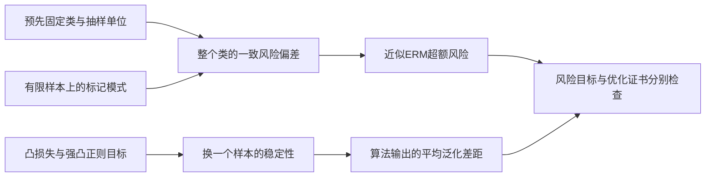

# 统计学习理论：什么让训练选择能够推广

训练数据选出预测器后，为什么还能谈未来误差？第12课已经给出有限类的答案：一个同时保护全部候选的好事件，也保护在其中用数据选出的候选。本课程把这条思路延伸到无限类，再比较以整个类为对象的复杂度保证与以算法输出为对象的稳定性保证。

这是高年级监督学习主干。先能读懂概率事件、期望、上确界和凸性；不要求先学完深网、LLM或强化学习。[[数学/30-概率与统计/12-充分统计量与估计效率|数理统计]]解释统计量如何保留参数信息及提高估计效率；这里解释选择一个预测规则之后，它对指定分布的损失如何受控。

| 读者问题 | 主解释与要带回的结果 |
| --- | --- |
| 在哪个随机样本上、对哪些分布保证学会？ | [[AI/10-机器学习与深度学习基础/30-统计学习理论/01-PAC一致收敛与近似ERM\|01 PAC与近似ERM]]：量词、可实现/不可实现、$2\epsilon+\eta$及逼近误差 |
| 阈值参数有无穷多个，为什么还可学？ | [[AI/10-机器学习与深度学习基础/30-统计学习理论/02-增长函数VC与不可学习\|02 增长函数与VC]]：Sauer归纳、幽灵样本、VC界、打散下界 |
| 正则化如何限制换一个样本带来的变化？ | [[AI/10-机器学习与深度学习基础/30-统计学习理论/03-正则化稳定性与范数复杂度\|03 稳定性与复杂度]]：固定目标的强凸推导、期望与高概率、范数与单位 |
| 理论界与真实风险在一个可完全计算的世界中是什么关系？ | [[AI/10-机器学习与深度学习基础/30-统计学习理论/80-有限分布复算与条件破坏\|80 有限分布复算]]：固定分布、全部样本计数、解析答案、重复行与分布偏移 |

图中的两条路径共享iid抽样与指定风险对象，保护范围却不同。类的一致事件允许类内选任意输出；稳定性必须核对具体算法。把数据换成同一人的重复记录或改变部署分布，两条路径都需重新核条件。

从 [[数学/30-概率与统计/05-统计估计置信度与模型评测#准确率的标准误与近似区间|独立准确率估计]] 或 [[数学/30-概率与统计/05-统计估计置信度与模型评测#模型比较：优先保留配对|配对比较]] 进入01的“对哪个样本、哪个假设类同时成立”，读完回 [[AI/10-机器学习与深度学习基础/12-统计学习泛化与实验设计#泛化界究竟在界什么|第12课有限类界]]，解释哪一种数据选择已被好事件保护。拿着 [[数学/40-微积分与优化/08-凸优化对偶与最优性证书|优化证书]] 进入01的误差分解，区分给定训练目标的求解误差与未来风险。

学完后尝试在同一模型上完成四件事：写完整PAC量词；算阈值/区间的增长函数；推近似ERM界并指出正则目标的换算；改变一个抽样或尺度条件并指出证明中失效的具体一步。80课的有限复算为这些问题提供可检查输入。来源核对、程序执行、Obsidian显示和真人理解分别验收，文件存在不代替后三者。

本课程完成二分类PAC/VC及凸正则预测器的代表性一般理论。多分类复杂度、局部复杂度、PAC-Bayes、依赖数据、非凸SGD、函数逼近与探索下的RL保证仍需各自条件与课程；机器人复杂操作、视频和长序列的能力不由本课程认证。

返回 [[AI/10-机器学习与深度学习基础/00-机器学习与深度学习基础-MOC|机器学习基础路线]]；真实评测协议继续由 [[AI/10-机器学习与深度学习基础/18-嵌套验证配对实验与指标陷阱|第18课]]维护。
