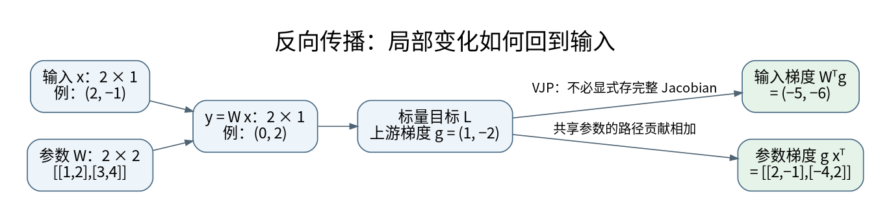

# 矩阵微积分、VJP 与反向传播：梯度沿什么方向传

反向传播最难的部分往往不是求导规则，而是不知道每一步在对哪个对象求导。本页统一采用列向量描述单样本，批量实现另行明确。对照 [[AI/00-开始/06-统一符号形状与公式阅读方法|形状约定]]，不要把行向量代码中的转置机械抄到列向量公式里。

## 用一个局部线性近似理解导数

对于 $y=f(x)$，微小扰动满足 $dy\approx J_f(x)dx$。雅可比 $J$ 的行对应输出分量，列对应输入分量。若下游给出标量损失的梯度 $g_y=\nabla_yL$，则

$$
dL=g_y^Tdy=g_y^TJdx=(J^Tg_y)^Tdx,
\qquad g_x=J^Tg_y.
$$

反向传播计算的是向量与雅可比的乘积，也称 VJP，而不是显式构造每一层的巨大雅可比。前向模式计算 $Jv$，适合追踪某个输入扰动如何影响输出；反向模式计算 $J^Tv$，适合从少量标量目标求很多参数的梯度。[^S02][^S04]

## 线性层的三个梯度为什么形状不同

令 $y=Wx+b$，其中 $W\in\mathbb R^{m\times n}$、$x\in\mathbb R^n$、$g=\nabla_yL\in\mathbb R^m$。逐分量计算：

$$
\nabla_xL=W^Tg,\qquad \nabla_WL=gx^T,\qquad \nabla_bL=g.
$$

输入梯度将输出误差信号映射回输入空间；权重梯度是“输出误差”乘“曾经出现的输入”。某个输入分量为零时，该样本不会通过这条边提供相应权重的直接梯度。

设 $W=\begin{pmatrix}1&2\\3&4\end{pmatrix}$、$x=(2,-1)^T$、$g=(1,-2)^T$，则 $\nabla_xL=(-5,-6)^T$，$\nabla_WL=\begin{pmatrix}2&-1\\-4&2\end{pmatrix}$。这些值比“backward 自动做完了”更适合建立直觉。

PyTorch 常用批量行向量 $Y=XW_{\rm code}^T+b$，其中 `nn.Linear(in,out).weight` 的形状为 `[out,in]`。对一个批次，权重梯度会把所有样本贡献相加；若损失先除以 batch 大小，梯度也相应缩小。归一化不是反向传播额外替你决定的。

## 分叉处为什么相加，而不是只选一条路

若 $z=x^2+x$，同一个 $x$ 通过两条路径影响 $z$，导数为 $2x+1$。这说明共享参数的梯度要对所有使用位置求和。Embedding 同一 token 出现多次、卷积核扫过不同位置、语言模型输入与输出权重共享，都遵循同一规则。

残差块 $y=x+F(x)$ 的输入梯度为 $g_x=g_y+J_F^Tg_y$。恒等路径提供直接通路，但不能保证梯度永远不消失或不爆炸：两项可能相消，支路也可能产生很大的增益。分析应看整体雅可比，而非把“有残差”当作无条件保证。

## Softmax 为什么让类别彼此竞争

设 $p_i=e^{z_i}/\sum_j e^{z_j}$。对 $z_j$ 求导得

$$
\frac{\partial p_i}{\partial z_j}=p_i(\mathbf1_{i=j}-p_j).
$$

提高一个 logit 会影响所有类别，因为大家共用分母。对目标分布 $y$、$\sum_i y_i=1$ 的交叉熵 $L=-\sum_i y_i\log p_i$，梯度简化为 $\nabla_zL=p-y$。

例如 $p=(0.7,0.2,0.1)$，正确类别为第二个，梯度为 $(0.7,-0.8,0.1)$。梯度下降压低错误类别、抬高正确类别。全部分量相加为零，对应 softmax 对统一加常数不变。这个不变量是非常便宜的单元测试。

注意力的 softmax 也有竞争，但竞争对象是可见 key 位置，而不是词表类别。后续 [[AI/20-LLM/20-架构/10-注意力反向传播与Softmax竞争|注意力反向传播]] 会把这条局部求导嵌入 $QK^T$ 与 $AV$。

## 自动微分不是数值差分，也不替你修建错误目标

有限差分用 $[L(\theta+h)-L(\theta-h)]/(2h)$ 近似导数。$h$ 太大有截断误差，太小有相消舍入误差。float64、平滑的小函数、多个 $h$ 和相对误差共同检查，才比单个小数可靠。

自动微分对实际执行的运算求导。错误广播、意外 `detach`、错误 mask 的计算图，也能得到完全正确的“错误目标的梯度”。因此验证顺序是：先验明目标，再验形状和前向数值，最后验梯度。[^S04]

`create_graph=True` 让导数计算本身可再次求导；`retain_graph=True` 保留已有图以便再次反传。两者职责不同。`x.grad` 为 `None` 可能意味着未参与目标、未要求梯度或非叶子未保留，不应直接解释成数学导数为零。

## 自检与参考解

**问题：** 对 $L=(wx)^2/2$，把中间 $wx$ 断开梯度后，数值 loss 仍正确，训练会怎样？损失数值不变，但 $w$ 的梯度通路被切断；前向正确不蕴含训练正确。

**练习：** 手算 $x=2,w=3$ 时的 $\partial L/\partial w$。因为 $wx=6$，结果为 $6\times2=12$。再用 autograd 与中心差分验证，最后把 $x$ 在同一个目标中使用两次，观察梯度如何相加。对应 [[AI/12-PyTorch/06-梯度诊断数值验证与自定义算子|梯度排错]] 与 [[AI/80-实践/08-深层机制数值实验/00-数值实验导航与验收|CPU 数值实验]]。

## 来源与证据边界

本页的数值例与推导用于解释机制，不代表大型模型或真实业务上的实测效果。方法与接口依据如下，来源核验日期为 2026-09-06。

[^S02]: [Dive into Deep Learning：Calculus](https://d2l.ai/chapter_preliminaries/calculus.html)。教材作者章节；链式法则。
[^S04]: [PyTorch 2.10：Autograd mechanics](https://docs.pytorch.org/docs/2.10/notes/autograd.html)。固定版本官方接口。

**返回与迁移：** [[AI/11-数学与统计桥梁/00-数学与统计桥梁-MOC|本主题课程地图]]；[[AI/00-开始/05-问题驱动知识图谱与难点导航|按问题跨主题继续]]。
