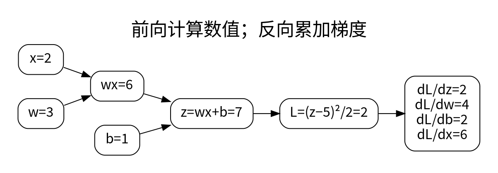

# 自动微分、模块与参数管理

<!-- deep-review-02 -->
> [!tip] 本轮深化：从当前概念继续追问
> 冻结权重不等于切断经过该层的输入梯度。LoRA 首步中 A 梯度为零、B 梯度非零可以是正确初始化结果，应从图和目标判断，而不是见零就报错。 深化与验证：[[AI/12-PyTorch/06-梯度诊断数值验证与自定义算子|梯度诊断数值验证与自定义算子]]；[[AI/20-LLM/30-训练/15-LoRA低秩几何QLoRA与蒸馏边界|LoRA低秩几何QLoRA与蒸馏边界]]。


自动微分不是靠每个参数轻轻挪动一次来近似梯度。它在前向执行时记录实际使用的运算，再沿计算图用链式法则传播向量与雅可比矩阵的乘积。



## 手算一次再调用 backward

令 $z=wx+b$、$L=(z-y)^2/2$，则：

$$
\frac{\partial L}{\partial z}=z-y,\quad
\frac{\partial L}{\partial w}=(z-y)x,\quad
\frac{\partial L}{\partial b}=z-y.
$$

取 $x=2,w=3,b=1,y=5$，前向得到 $z=7,L=2$，梯度为 $\partial L/\partial w=4$ 和 $\partial L/\partial b=2$。图中也给出 $\partial L/\partial x=6$，虽然训练时未必需要更新输入。

```python
import torch
w = torch.tensor(3.0, requires_grad=True)
b = torch.tensor(1.0, requires_grad=True)
loss = (w * 2 + b - 5).square() / 2
loss.backward()
assert w.grad.item() == 4.0 and b.grad.item() == 2.0
```

叶子张量通常把梯度累积到 `.grad`。非叶子中间激活默认不保留 `.grad`，但这不代表梯度没有经过它；要观察它可以显式 `retain_grad()`。非标量输出需要指定上游梯度，或者先构造标量损失。

## 累积和计算图释放不是同一件事

对新前向结果连续调用 `backward()`，参数梯度会相加。一次 backward 后，所需中间状态通常被释放；在同一图上反传第二次不等于做了一个新训练样本。`retain_graph=True` 只是保留图，不会自动清梯度，而且容易使内存失控。

`detach()` 返回从当前图断开的视图式张量，仍可能共享存储。它适用于明确截断梯度的情况，不应拿来“修好报错”。原地操作可能覆盖反传需要的数值，版本检查会报错；绕过检查操作 `.data` 会制造更隐蔽的问题。

## Module 负责登记，不只负责 forward

```python
from torch import nn
class Classifier(nn.Module):
    def __init__(self, d: int, classes: int):
        super().__init__()
        self.net = nn.Sequential(nn.Linear(d, 32), nn.ReLU(), nn.Linear(32, classes))
        self.register_buffer("input_scale", torch.tensor(1.0))
    def forward(self, x):
        return self.net(x / self.input_scale)
```

`nn.Parameter` 自动作为可学习参数被登记；buffer 随模块迁移、通常进入 `state_dict`，但不由优化器默认更新。普通 Python 列表中的层不会像 `ModuleList` 那样注册。优化器创建后再替换子模块，新参数不会自动加入旧优化器。检查 `named_parameters()` 比盯着 loss 更早发现这种错误。

## train、eval 和 no_grad 各管什么

`model.train()` 与 `model.eval()` 改变 Dropout、BatchNorm 等模块的行为。`no_grad()` 禁止记录反向图，`inference_mode()` 还使用更严格的推理优化语义。`eval()` 不会关闭梯度，`no_grad()` 也不会关闭 Dropout，因此验证通常要同时设评估模式和关闭梯度。

冻结参数用 `requires_grad_(False)`；冻结模块的 BatchNorm 运行统计还需要评估模式。若冻结权重但仍需要对输入求梯度，不能粗暴地把整个模块包进 `no_grad()`。

**排错顺序：** 确认参数已注册、loss 确实依赖它、`requires_grad` 正确、没有意外 detach、优化器持有的是同一参数对象，最后才怀疑自动微分。用有限差分或 `gradcheck` 检查自定义小算子时，优先用 float64 和远离不可导点的输入。

## 一手资料

1. [PyTorch：自动微分教程](https://docs.pytorch.org/tutorials/beginner/blitz/autograd_tutorial.html)。

**课程入口：** [[AI/12-PyTorch/00-PyTorch-MOC]]。
