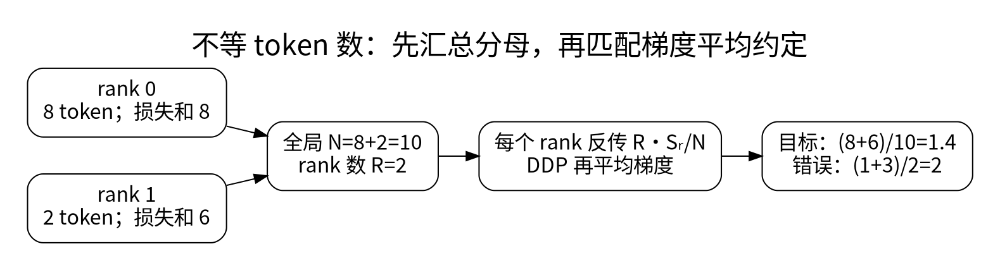

# 混合精度、分布式、编译与性能诊断

<!-- deep-review-02 -->
> [!tip] 本轮深化：从当前概念继续追问
> 全局 batch、有效 token 分母和梯度归约语义要先一致；AMP、DDP 与 compile 不会自动保证这些语义。性能比较还需同样的质量目标和计时边界。 深化与验证：[[AI/12-PyTorch/08-DDP全局目标通信与分片边界|DDP全局目标通信与分片边界]]；[[AI/12-PyTorch/09-性能剖析编译动态形状与内存账本|性能剖析编译动态形状与内存账本]]。

性能优化的第一步是把正确性基线留下来。输入、权重、随机性、输出容差和测量方法不固定，“更快”可能只是少算了内容。

## 混合精度并非把模型全部转半精度

`autocast` 按算子选择计算类型。某些矩阵乘法适合低精度，归一化与归约往往需要更稳健的累加。FP16 梯度可能下溢，梯度缩放先放大 loss，反传后再把梯度缩回。BF16 指数范围较宽，通常不需要 FP16 式的缩放，但有效位更少，仍有舍入误差。

顺序应是 autocast 前向、缩放 loss、backward、unscale、梯度裁剪、scaler step/update。裁剪缩放后的梯度会改变阈值含义。累积期间保持缩放约定一致，并在一次真正更新的边界才 unscale 和 step。先检查本地 PyTorch 与设备支持，再使用示例接口。[1]

## DDP 的关键不是“每张卡各训练一次”

数据并行把不同样本分到多个 rank，计算梯度后同步，再保持各副本参数一致。DDP 不会自动替你正确切分所有 Dataset；需要明确 sampler 和各 epoch 的随机顺序。

若 rank $r$ 有损失总和 $S_r$、有效 token 数 $n_r$，目标是：

$$
L=\frac{\sum_r S_r}{N},\qquad N=\sum_r n_r.
$$

常规 DDP 对梯度按 $R$ 个 rank 平均。若不使用改变约定的通信 hook，则每个 rank 可反传 $R S_r/N$，同步后才得到全局 token 平均梯度。直接平均 $S_r/n_r$ 在 $n_r$ 不同时会使小批次拥有过大的权重。分母应跨所有相关 micro-batch 和 rank 计算并保持无梯度。[2]

`no_sync()` 可在累积的非末次 micro-batch 避免同步；其上下文必须覆盖相应前向和反向。FSDP/ZeRO 把参数、梯度或优化器状态分片，减少副本内存，却增加通信与重建开销。它们不是让一个任意大的模型免费装进显存。

## compile 与 checkpoint 改变什么

`torch.compile` 尝试捕获和优化可编译的计算区域。Python 控制流、动态形状、数据相关分支和某些操作可能导致图中断或重新编译。首次编译时间应与稳态吞吐分开。先验证输出、梯度和训练曲线，再评价提速；编译不是改变模型容量的算法。

Activation checkpointing 丢弃部分前向激活，在反向时重算，交换计算时间和显存。随机算子、状态修改和重算语义必须兼容。它与保存到磁盘的训练 checkpoint 完全不同，名称相同不代表职责相同。

## 排查瓶颈的顺序

首先用小模型排除错误和数据等待，然后测数据加载、主机到设备拷贝、前向、反向、同步和优化器。GPU 工作异步提交，未经同步的 Python 计时可能只测到提交耗时；可用设备事件或明确同步的边界。预热、固定输入大小、记录峰值分配内存与保留内存，防止把 allocator 缓存当泄漏。

速度结论必须同时给 batch、序列长度、dtype、设备、版本和并发。吞吐提高可能牺牲单请求延迟。若显存增长，先看是否在列表里存了带图的 loss/输出、是否保留图或缓存，再考虑 allocator 参数。

**练习：** 两个 rank 的 token 数为 8 和 2，loss 总和分别 8 和 6。局部均值的平均是 2，但全局均值是 1.4。用纸笔解释这不是四舍五入误差，而是换了优化目标。

## 一手资料

1. [PyTorch：AMP 示例](https://docs.pytorch.org/docs/stable/notes/amp_examples.html)。
2. [PyTorch：DistributedDataParallel](https://docs.pytorch.org/docs/stable/generated/torch.nn.parallel.DistributedDataParallel.html)。

**课程入口：** [[AI/12-PyTorch/00-PyTorch-MOC]]。
