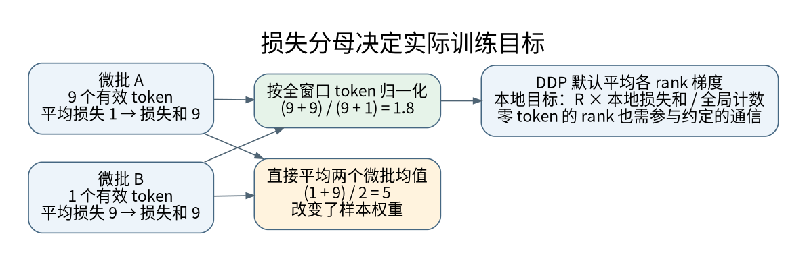

# 变长批处理、Packing 与有效 Token 归一化

**先修与定位：** 原 [[AI/12-PyTorch/03-数据训练验证与保存恢复|训练闭环]]；[[AI/11-数学与统计桥梁/02-矩阵微积分VJP与反向传播|梯度的可加性]]。

## 一个 batch 需要四份不同的信息

`input_ids` 决定读取哪些 embedding；位置编号决定位置机制；attention mask 决定能看见谁；labels/loss mask 决定在哪些输出上学习。它们经常形状相近，却不承担同样职责。提示 token 可以参与注意力，但在只监督回答的 SFT 中不计入 loss；padding 既不该成为有效监督，也通常不该被有效 query 读取。

`collate_fn` 把样本组装成批量张量，DataLoader 不会自动推断这些语义。迭代式数据在多个 worker 中还要明确分片，否则可能重复遍历同一流。[^S37]

## 用两条序列手工检查移位

设第一条完整 token 序列为 `[BOS,A,B,EOS]`，输入是前三项，目标是后三项；第二条为 `[BOS,C,EOS]`，padding 后输入可为 `[BOS,C,PAD]`，目标为 `[C,EOS,IGNORE]`。总有效目标数为 5，而不是 batch×长度等于 6。

### 把五个有效目标对齐到位置

两条样本仍是不同 batch 行，下表的 key 位置均指**同一行内**的位置。`IGNORE` 只决定损失，不能代替 attention mask。[^S41]

| 行、位置 | input | shift 后 label | 有效 query 可见 key |
| --- | --- | --- | --- |
| 0、0 | `BOS` | `A` | `{0}` |
| 0、1 | `A` | `B` | `{0,1}` |
| 0、2 | `B` | `EOS` | `{0,1,2}` |
| 1、0 | `BOS` | `C` | `{0}` |
| 1、1 | `C` | `EOS` | `{0,1}` |
| 1、2 | `PAD` | `IGNORE` | 不作为有效 query |

最后一行的 `PAD` 也不能作为有效 key。若实现仍计算这个 padding query，必须采用后文的安全占位处理，确保结果不进入有效路径；这里的表格不是要求把该行全部屏蔽后直接做 softmax。

有效 labels 为 `A,B,EOS,C,EOS` 五个。若对应逐位置损失为 $\ell_0,\ldots,\ell_4$，每 token 等权目标就是

$$
L=\frac{\ell_0+\ell_1+\ell_2+\ell_3+\ell_4}{5},
$$

不能除以六个张量位置，也不能先平均两行均值。

若模型接口已经内部移位，再在 collator 中提前移一次，就会训练预测后两位。反之，完全没有移位可能让模型看见要预测的 token 本身。检查方式应是打印一条解码后的“输入位置、可见前缀、目标 token”表，而非只看 loss 很快变小。

文档 packing 有两种不同任务：连续流允许跨边界预测与上下文；隔离文档 packing 用块对角因果可见性，阻断跨文档读取。插入 EOS 只是提供一个符号，不自动构造文档隔离。损失边界与 attention 边界应分别约定。

## 为什么平均各微批均值会换目标

设微批 $k$ 有有效 token 数 $n_k$、损失和 $S_k$。全局每 token 等权目标为

$$
L=\frac{\sum_kS_k}{\sum_kn_k}.
$$

而 $K^{-1}\sum_k S_k/n_k$ 是每微批等权。若两批分别有 9、1 个 token，每 token loss 均值为 1、9，全局均值是 1.8，平均微批均值却是 5。第二种算法让最后那个 token 获得与前九个合计相同的权重。

梯度累积前先统计整个更新窗口的有效目标总数 $N$，各微批用 `reduction="sum"` 并反传 $S_k/N$，直到末批才 step。按数学加法，这与一次性对同样 token 求平均的梯度一致；但 BatchNorm、Dropout、数据顺序与浮点归约可影响严格数值等价。[^S40]

## 三个边界条件不能靠默认值糊过去

最后不足预定 K 个微批的窗口仍需使用真实总数，而非硬除 K。全为 ignore 的微批不能对空集合求均值；整个更新窗口若无有效标签，应该明确跳过更新与按更新次数计数的 scheduler，并记录发生原因。

单个零有效批次在单进程可跳过，但分布式中不能某 rank 单方面跳过 backward 而让其他 rank 等待通信。要保持集体操作路径一致，并在约定的图上构造零贡献，见 [[AI/12-PyTorch/08-DDP全局目标通信与分片边界|DDP 全局目标]]。

若采用类别权重、token 权重或其他自定义 reduction，分母未必是有效 token 数。比如带类权重的交叉熵内置 mean 会按相应权重归一化。先写目标公式，再实现分子和分母，不要拿一个通用计数公式覆盖所有损失。

## 掩码合成的逻辑

对有效 query，隔离式因果可见性可表达为：key 有效、query 与 key 属于同一文档、key 位置不晚于 query。滑窗还加上最远距离约束。SDPA 布尔 mask 的 `True` 表示允许，和某些其他 attention API 的“True 表示屏蔽”相反。[^S05]

四类掩码分别回答不同问题，组合前先明确谓词：

| 掩码 | 约束及边界 |
| --- | --- |
| padding / key-valid | key 是否是有效输入；不决定 label 是否进入 loss。 |
| causal | key 是否不晚于 query；不会自动隔离同一行的不同文档。 |
| document-block | query/key 是否属于同一文档；插入 `EOS` 不会自动形成此屏蔽。 |
| loss mask / `IGNORE` | 哪个输出贡献损失；本身不禁止 attention 读取该位置。 |

例如把文档 0 放在 `[0,4)`、文档 1 放在 `[4,7)`，且这些位置均为有效输入。文档 1 的 query 位于 5 时，隔离式因果 attention 只能看 key `{4,5}`；连续流目标允许它看 `{0,1,2,3,4,5}`。区别来自 document-block，与某个 label 是否为 `IGNORE` 无关。

全部屏蔽的一行可能产生非有限 softmax 或后端约定的输出。对 padding query，要显式规定安全占位处理并确保其结果不会进入有效路径；对有效 query，则应断言至少有一个合法 key。用一个有限大负数替代负无穷也需要数值边界分析，不能保证它在所有有效 score 尺度下都等效屏蔽。

## 如何证明实现正确

先在无 Dropout、无 BatchNorm 的小模型上比较整批梯度与不等长度微批累积梯度，再加入零有效微批和最后不满窗口。改变未来 token 后，过去有效位置的输出应不变；改变被隔离文档内容后，另一文档输出应不变。

这些检查已纳入 [[AI/80-实践/08-深层机制数值实验/00-数值实验导航与验收|深层机制实验]]。它们验证目标与计算语义，而不验证真实数据质量。学习目标继续 [[AI/20-LLM/10-原理/07-语言模型目标分词粒度与评测可比性|语言模型目标]]，多卡版继续 [[AI/12-PyTorch/08-DDP全局目标通信与分片边界|全局归一化]]。

## 来源与证据边界

本页的数值例与推导用于解释机制，不代表大型模型或真实业务上的实测效果。方法与接口依据如下，来源核验日期为 2026-09-06。

[^S37]: [PyTorch 2.10：DataLoader与Dataset](https://docs.pytorch.org/docs/2.10/data.html)。固定版本；数据分片、组批与进程。
[^S40]: [PyTorch 2.10：AMP examples](https://docs.pytorch.org/docs/2.10/notes/amp_examples.html)。固定版本；有效batch、unscale与梯度累积。
[^S05]: [PyTorch 2.10：scaled_dot_product_attention](https://docs.pytorch.org/docs/2.10/generated/torch.nn.functional.scaled_dot_product_attention.html)。固定版本；布尔掩码、dropout、非方形因果。

[^S41]: [PyTorch 2.10：CrossEntropyLoss](https://docs.pytorch.org/docs/2.10/generated/torch.nn.CrossEntropyLoss.html)。`ignore_index` 目标不贡献输入梯度；无类别权重时 mean 按非忽略目标归一化，带类别权重时分母随权重变化。

**返回与迁移：** [[AI/12-PyTorch/00-PyTorch-MOC|本主题课程地图]]；[[AI/00-开始/05-问题驱动知识图谱与难点导航|按问题跨主题继续]]。
