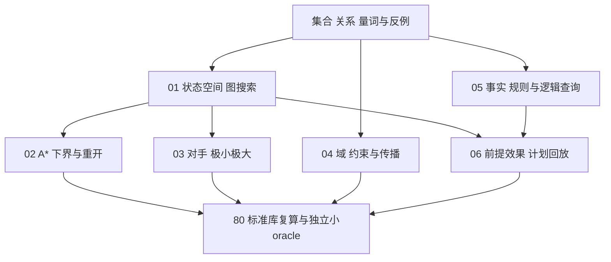

# 搜索、推理与规划：符号 AI 学习入口

怎样让一个系统明确知道“哪些情况可以行动”“为何这条路线更好”“这个结论由哪些事实推出”？本组课程用有限对象、显式规则与可复算小问题连接 AI 的符号方法。这里有六篇主课、一份标准库实验和源码镜像，适合从问题表示读到算法、反例与验证；它覆盖一个完整首组，不代表全部 AI 本科课程、机器人或真实部署已完成。

## 先识别你在问哪一种问题

| 读者问题 | 要描述的对象 | 去读什么、为什么 |
| --- | --- | --- |
| 怎样找到一条到目标的路线？ | 状态、合法动作、转移、目标、路径成本 | [[AI/13-搜索推理与规划/01-状态空间图搜索与最优性\|01 状态空间与图搜索]]用同图比较最少步与最低成本 |
| 怎样利用目标方向，还保留最优性？ | 剩余成本下界、OPEN/CLOSED、当前最佳g | [[AI/13-搜索推理与规划/02-启发式A星一致性与重开节点\|02 A*]]给可采纳/一致性证明及重开反例 |
| 对方也选行动，怎样保证自己的收益？ | 轮到谁、终局效用、对手回应 | [[AI/13-搜索推理与规划/03-对抗搜索极小极大与AlphaBeta\|03 博弈]]逐值求树，再核对剪枝界 |
| 双方同时选、都想配合，为什么换搭档却失败？ | 联合行动、个体信息、对手版本、冻结策略评测 | [[AI/13-搜索推理与规划/07-多智能体随机博弈与协作学习\|07 多智能体]]从协调表推有效环境与偏离/团队；[[AI/13-搜索推理与规划/08-隐状态通信信用与集中训练\|08 隐状态通信/CTDE]]接同历史约束、信用学习及冻结/历史自博弈/适应搭档 |
| 怎样给多个变量同时选合法值？ | 变量、域、二元或全局约束 | [[AI/13-搜索推理与规划/04-约束满足传播与回溯\|04 CSP]]手算AC-3和MRV，解释局部一致仍可无解 |
| 当前事实必然支持哪个结论？ | 常量、谓词、量词、模型、规则 | [[AI/13-搜索推理与规划/05-知识表示规则归结与查询\|05 知识表示]]给事实规则KB、统一与完整查询反驳链 |
| 哪个动作序列确实可执行并达目标？ | 前提、增删效果、初态与目标事实 | [[AI/13-搜索推理与规划/06-规划前提效果与计划验证\|06 规划]]逐步回放STRIPS，并查前提失败与目标失败 |
| 数字与代码是否一致？ | 固定输入、输出、独立小oracle | [[AI/13-搜索推理与规划/80-搜索与规划复现实验\|80 实验]]给命令、函数、预期值与证据范围 |

观测不全时，从 [[AI/13-搜索推理与规划/20-部分可观测决策/00-部分可观测决策-MOC|部分可观测决策]] 学习belief更新、条件策略、信息价值与同一风险例的复算；它复用本节搜索和经典规划的状态思想，并明确额外的概率/损失前提。

状态图搜索关注**路径**；CSP关注**完整赋值**；逻辑蕴含关注**每个模型中都真**；经典规划关注**改变事实的可执行序列**。它们可以共享搜索或约束工具，目标语义仍不同。嵌入检索能辅助寻找相关知识，不能仅凭相似度证明蕴含；工具调用也需要动作模型和观测验证，才有资格使用规划保证。

## 一条可连续走完的学习路线

先读[[数学/10-数学语言与基础/03-集合映射命题与合法推理|集合、映射、命题与合法推理]]，看懂集合成员、关系、量词和反例。然后读01→02，手算四条路径7、5、8、10及A*重开轨迹；读03，说明为何根选4而不选最大叶10；读04，逐弧删域，并解释两色三角为何仍无解；读05，从两个Parent事实推出Anc(Ada,Cora)，检查occurs check；读06，按状态表验证取件、移动、放件。每一步都可跳到80复算，然后回到正文解释“为什么”。

图中箭头是阅读前提和复算出口；不是要求同时把所有方法加入一个产品。

## 与已有主解释连接

图算法的BFS/Dijkstra、负边及邻接表成本，复用[[计算机知识/50-数据结构与算法/12-最短路最小生成树与并查集|最短路课]]；更一般的回溯安全剪枝与NP边界，复用[[计算机知识/50-数据结构与算法/14-回溯搜索剪枝与计算复杂性边界|回溯与复杂性课]]，本组不重复全部算法系统课程。共享离散逻辑与证明课程后续可提供更完整主解释，本组已保留必要定义，当前阅读无需等待新页。

如果动作结果带随机性，接已有[[AI/10-机器学习与深度学习基础/19-强化学习MDP价值函数与策略梯度|MDP、价值与策略课]]，理解期望回报与概率转移；如果事实本身不确定，接[[AI/10-机器学习与深度学习基础/20-贝叶斯学习概率图模型与近似推断|概率图模型课]]，理解概率更新。这两条是应用比较出口，概率信念不等于本组的经典真/假蕴含。

返回全域[[AI/00-开始/01-AI知识地图|AI知识地图]]，可继续统计学习与LLM路线；本组补足符号搜索、规则查询和经典规划的入门机制，不给已有模态课制造新的统一术语。

## 完整题解之后，怎样检查自己能否迁移

每课已有跟算题与答案。读者还可挑一项改变输入：把状态遗漏钥匙、把启发式高估、把对手改成随机、把CSP改为两色三角、把规则反向推、把计划漏掉删除效果。先预测结果再跑实验，并写出原结论在哪个条件失效。实验绿色不能代填个人掌握度；真正的理解是能说明选择、证据与边界。

课程参照采用 [Berkeley CS188 官方教材](https://inst.eecs.berkeley.edu/~cs188/textbook/)的搜索、约束与博弈路线，以及 [AIMA 作者官方目录](https://aima.cs.berkeley.edu/contents.htm)的知识、推理与规划分工；具体原始依据在对应主课就近定位。
