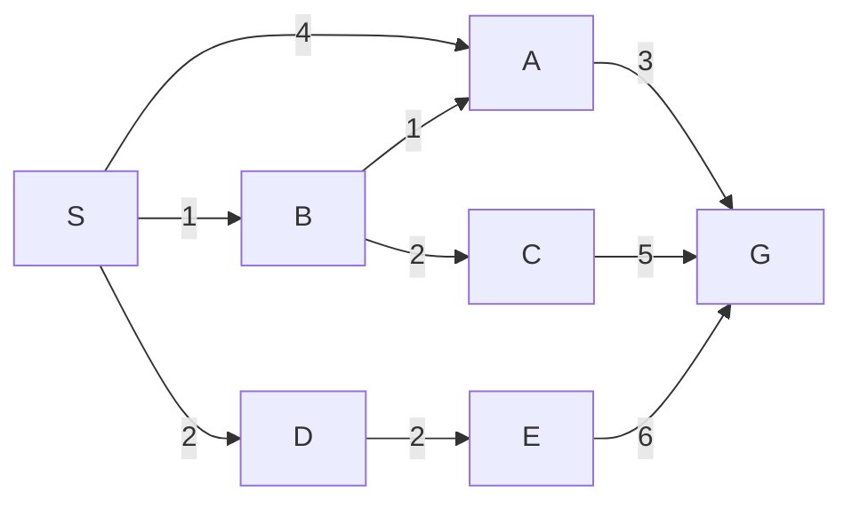

# 状态空间、图搜索与最优性

机器人怎样从起点找到目标？回答之前要说清“相同的状态”“允许的行动”和“更好的路线”。BFS、UCS 与 A* 可以用同一个搜索接口，选择下一个节点的依据却不同。本文把 AI 中常见的隐式状态空间接到已有最短路课，重点是建模、执行轨迹和结论的前提。

先修中，[[数学/10-数学语言与基础/03-集合映射命题与合法推理|集合与映射]]解释状态集合和转移函数的类型；[[计算机知识/50-数据结构与算法/12-最短路最小生成树与并查集#2. BFS：每条边代价相同|图算法的 BFS 证明]]解释按层访问为什么得到最少边数。本页给出搜索问题中要额外携带的路径、成本及停止条件。

## 从环境提取足够的状态

一个确定性、完全可观测的搜索问题可写为 $(\mathcal S,s_0,A,T,c,G)$：$\mathcal S$ 是状态集合；$s_0\in\mathcal S$ 是起点；$A(s)$ 是当前合法动作的集合；$T(s,a)\in\mathcal S$ 是执行结果；$c(s,a)\ge0$ 是这一步的成本；$G\subseteq\mathcal S$ 是满足目标的状态。路线 $s_0,a_0,s_1,\ldots,s_k$ 的成本是 $\sum_{i=0}^{k-1}c(s_i,a_i)$。本文的成本是人为指定的单位，不是运行秒数。

状态应保留决定未来合法动作、效果和代价的全部信息。若门需要钥匙，状态写成“位置”就不够；`(位置, 是否持钥匙)` 才能区分“站在门前可开门”与“站在门前不能开门”。若行动消耗电量，必须加入电量，或者证明它由已有状态唯一确定。把这两种未来不同的情况合并，会让去重丢失合法解。这是一项模型正确性要求，算法最优也救不了错误模型。

搜索节点和状态也不同：一个节点记录某条路径到达某状态的证据，包括 `state,parent,action,g,depth`。同一状态可能有两条成本不同的到达路径。**树搜索**保留不同路径节点；**图搜索**按状态识别重复并选择足够好的路径。此处的树/图是执行方式，不是在断言原状态图必须无环。有限状态可以被动作生成器按需展开，不必预先画出所有边。状态组件的课程定义参照 [Berkeley CS188，1.3 的搜索接口](https://inst.eecs.berkeley.edu/~cs188/textbook/search/uninformed.html)。

## 同一张图：最少步数和最低成本不同

以下是全部有向边，邻居按图中表格次序生成。没有逆边，`G` 是唯一目标。

| 状态 | 按顺序生成的后继（边成本） |
| --- | --- |
| S | A(4)、B(1)、D(2) |
| A | G(3) |
| B | A(1)、C(2) |
| C | G(5) |
| D | E(2) |
| E | G(6) |
| G | 无 |

四条简单目标路径是 `S-A-G`：7，`S-B-A-G`：5，`S-B-C-G`：8，`S-D-E-G`：10。第一条只有两步，第二条三步却成本最低。这里先穷举四条路线给一个独立答案，不用“算法自己说最优”当依据。

## BFS：入队时按状态去重

BFS 用先进先出队列，首次入队就把状态加入 `seen`。它保存首次到达路径；这对最少边数正确，但不会为较低加权成本更新路径。目标在有效出队时检测；把**展开**定义成实际生成后继，目标出队即返回，因此目标不计展开。后面的三个算法都用这个口径。

| 出队状态 | 出队路径成本 | 展开后的队列（状态:保存成本） |
| --- | --- | --- |
| S | 0 | A:4，B:1，D:2 |
| A | 4 | B:1，D:2，G:7 |
| B | 1 | D:2，G:7，C:3；A 已见，不再入队 |
| D | 2 | G:7，C:3，E:4 |
| G | 7 | 检测目标并返回 |

BFS 展开 `S,A,B,D` 共 4 次，得到成本 7。若所有边成本相同且为正，最少步数就对应最低成本；这里不满足该条件。对有限邻接表，状态去重 BFS 的时间 $O(|V|+|E|)$、空间 $O(|V|)$；对未穷尽的隐式搜索树，有限分支数 $b$、最浅目标深度 $d$ 给出指数级层数规模。若在深度 $d$ 的每个节点出队后还生成深度 $d+1$ 后继再检测，成本界会多一层；复杂度口径要说明检测时点。

## UCS：见过不等于已经确定

UCS 按累计成本 $g$ 弹出最小项，维护 `best_g[state]`。松弛出边时，只要新路径更便宜就更新并入堆；堆里旧条目可以留下，但弹出时若成本与 `best_g` 不同则跳过。本文相同优先级按**入堆先后**打破平局；这使展开顺序可复现。

| 有效弹出 | g | 按优先级排序的有效 OPEN（处理后） |
| --- | --- | --- |
| S | 0 | B:1，D:2，A:4 |
| B | 1 | D:2，A:2，C:3；A:4 已过期 |
| D | 2 | A:2，C:3，E:4 |
| A | 2 | C:3，E:4，G:5 |
| C | 3 | E:4，G:5；到 G 的成本8不改善 |
| E | 4 | G:5；到 G 的成本10不改善 |
| G | 5 | 返回 S-B-A-G |

共展开 6 次，过期 `A:4` 不计有效弹出或展开。UCS 不能在“生成目标”时立即结束：生成 `S-A-G` 的 7 还没有排除以后出现 5。目标从最小成本有效条目弹出时才获得最优性证据。

为什么非负成本足够？设弹出状态 $u$ 还能经另一条路径更便宜，沿那条路径取第一个尚未确定的状态 $v$。其前驱已确定，松弛已给 $v$ 不超过该路径前缀的候选成本；非负后续边使这个成本不大于通向 $u$ 的更便宜总成本。于是 $v$ 本应先弹出，矛盾。负边会破坏“后续不会变便宜”这一步；详见[[计算机知识/50-数据结构与算法/12-最短路最小生成树与并查集#3. Dijkstra：要求所有可达边权非负|Dijkstra 的 settled 不变量与反例]]。

有限图加严格改善与去重允许零成本边；有限状态会耗尽。无限图中常用的 UCS 完整性保证还要求有限分支以及每一步至少 $\varepsilon>0$：成本小于最优值的候选才不会无限多。若每次可走零成本边进入一个新状态，则可能永远不弹出成本1的目标。不能只写“非负，所以任何环境都完整”。

## A*：把未来成本下界也放入排序

在同图上用 $h(S,A,B,C,D,E,G)=(5,3,4,5,8,6,0)$。A* 按 $f=g+h$ 排序；本例这些值恰好等于真实剩余最短成本。

| 有效弹出 | (g,h,f) | 处理后的有效 OPEN |
| --- | --- | --- |
| S | (0,5,5) | B:(1,4,5)，A:(4,3,7)，D:(2,8,10) |
| B | (1,4,5) | A:(2,3,5)，C:(3,5,8)，D:(2,8,10) |
| A | (2,3,5) | G:(5,0,5)，C:(3,5,8)，D:(2,8,10) |
| G | (5,0,5) | 返回成本5 |

A* 展开 3 次；BFS 展开4次但成本7，UCS展开6次且成本5。这个节省来自此图上的好启发式，并非“一切 A* 都展开更少”；计算启发式本身也有成本。必须读下一课[[AI/13-搜索推理与规划/02-启发式A星一致性与重开节点|可采纳、一致性与重开]]才能知道这张表为什么可以提前返回。

## 练习与题解

**题1：** BFS 是否得到最优路线？若“最优”是最低成本，答案为否：7大于5；若目标是最少动作数，答案为是：S没有到G的直接边，两步已是最短。优化对象要先固定。

**题2：** 有人把 UCS 的 `best_g` 换成入队时 `seen`，会怎样？S首次生成A:4，B再生成A:2被丢弃，随后生成G:7。D-E-G为10，B-C-G为8，于是返回7。这是错误去重，不是 UCS 的固有限制。

**迁移题：** 门需要钥匙、过门耗电2；仅把状态写成 `(位置,钥匙)` 是否足够？只有当电量不会影响合法性与目标，或电量由这两个分量唯一决定时足够。若同一位置和钥匙可以对应电量1与3，就应加入电量；电量1不可过门，3可过门，合并两者改变后继集。

运行本页轨迹及简单路径穷举：[[AI/13-搜索推理与规划/80-搜索与规划复现实验#从路径表复算起|实验入口]]中的 `bfs`、`astar`、`simple_paths_oracle`。返回[[AI/13-搜索推理与规划/00-搜索推理与规划-MOC|课程入口]]。
