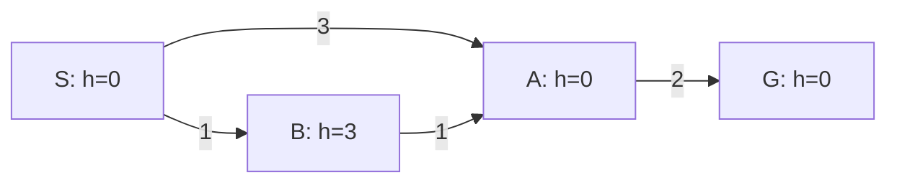

# 启发式、A* 一致性与重开节点

“估计离目标近”为什么有时能加速且仍保证最优，有时会直接错过最便宜路线？关键是估计与真实成本的关系，以及已经展开的状态能否再次处理。本文使用前课的非负成本、有效弹出检测目标、严格改善和入堆顺序平局规则。$g(s)$ 表示**当前已发现路径**的成本，不预先等于真正最短成本 $g^*(s)$；$h(s)$ 是状态函数，$h^*(s)$ 是真实剩余最短成本，$f(s)=g(s)+h(s)$。三者必须用同一成本单位。

## 两个不同的承诺

本课约定 $0\le h(s)\le h^*(s)$ 称为**可采纳**，并要求所有目标的 $h=0$。不可到达目标的状态取 $h^*=+\infty$，有限下界仍合法。**一致性**要求每条合法边 $s\to t$ 满足 $h(s)\le c(s,t)+h(t)$，同时目标为0。把不等式沿任一目标路径相加，所有中间 $h$ 抵消，得到 $h(s)\le$ 路径成本，再对路径取最小便得可采纳。反方向不成立。[Berkeley CS188，1.4 的可采纳性与图搜索](https://inst.eecs.berkeley.edu/~cs188/textbook/search/informed.html)给出 $f=g+h$ 及应保留更便宜到达路径的条件；以下数值图是本课自建反例。

一致性使同一条搜索路径上的 $f$ 不下降：$g(t)=g(s)+c(s,t)$，所以 $f(t)-f(s)=c(s,t)+h(t)-h(s)\ge0$。更直接地，将边权重写为 $c_h(s,t)=c(s,t)+h(t)-h(s)\ge0$，到 $t$ 的重写路径成本为 $g(t)+h(t)-h(s_0)$。按 $f$ 排序就对应非负重写图上的 UCS，因此状态首次有效展开已取得最短 $g$，可以永久关闭。这个证明依赖更新 OPEN 中更便宜的路径，不能给入队即关闭的错误代码背书。

## 可采纳加重开：为何弹出目标能停

设最优目标成本为 $C^*$，想象 A* 弹出成本 $C>C^*$ 的目标。沿一条最优路径，应存在一个尚在 OPEN 的节点，其 $g$ 已是最优前缀：起点如此；当它展开时，严格改善会把最优前缀传给后继，哪怕后继之前关闭也会**重开**，因此这条证据链不会被永久截断。这个节点满足 $f=g^*+h\le g^*+h^*=C^*<C$，应比成本C、h=0的目标先弹出，矛盾。此论证说明重开负责保存什么，并不是说可采纳会自动使所有首次展开正确。

在一轮展开及改善传播完成后的快照中，令 $U$ 为已发现完整可行目标路径的最小成本，尚未发现时取 $+∞$；令 $OPEN_{valid}$ 只含当前 `best_g` 对应且未关闭的有效项，过期堆项不算前沿。上述最优前缀不变量给出

$$
L=\min\left(U,\min_{s\in OPEN_{valid}}[g(s)+h(s)]\right)≤OPT≤U.
$$

理由是：若 $U=OPT$，外层取小已保证 $L≤OPT$；若 $U>OPT$，最优路径上仍有携带最优前缀的有效 OPEN 项，其 $g+h≤OPT$。当前 $g(s)$ 对任意单个状态未必最优，不能逐节点都宣布 $g+h$ 是全问题下界；保证来自这条存在性的证据链。A* 启发式在这里不是 Lagrange 对偶解，共同的上下界结构见 [[数学/40-微积分与优化/08-凸优化对偶与最优性证书#L≤OPT≤U 的两端从哪里来|一般证书比较]]，那里也可转往 LP 和 SVM 的具体数值证书。

规定空 OPEN 的内层最小值为 $+∞$：若已有有限可行 $U$，则 $L=U$，搜索已无更优可能；若 $U=+∞$ 且完整有限搜索已穷尽，表示目标不可达，不能算 $∞-∞$ 当 gap。有限两端相等，或已证明 $U-L≤ε$，才可按对应最优性/误差要求停止。提前丢弃必要节点、错误关闭、关闭后不重开，都会破坏最优前缀不变量；这时不能继续宣称公式给有效下界。搜索中断或达到预算上限造成“队列被清空”也不是完整穷尽。

在有限图上，本实验维护 `best_g`、跳过过期堆项，且只接受严格改善，因此可处理零成本循环；无限空间的终止/完整性还需成本界内候选有限等条件，常见充分条件为有限分支、$c\ge\varepsilon>0$、非负可采纳h。节点重开可很多次，可采纳本身不提供低时间复杂度保证。

## 最小反例：可采纳而不一致

真实剩余成本是 $h^*(S,A,B,G)=(4,2,3,0)$，所以 `(0,0,3,0)` 可采纳。边B→A却要求 $3\le1+0$，不成立。S生成A:g3,f3和B:g1,f4，A先展开，将G:g5,f5入堆。A首次展开走的是次优前缀，正是 CLOSED 是否可重开的分叉点。此刻已找到目标给 $U=5$，但有效前沿B给 $g+h=1+3=4$，所以 $L=4$、区间是 $[4,5]$，不能凭“已有目标”停止。保留重开后，目标才改善到4。

| 步骤 | OPEN 中有意义的候选 | 永久关闭版本 | 允许重开版本 |
| --- | --- | --- | --- |
| 展开S | A:(3,3)，B:(1,4)；括号为(g,f) | 同左 | 同左 |
| 展开A | B:(1,4)，G:(5,5) | A关闭 | A关闭 |
| 展开B | 发现A的新g=2,f=2 | 丢弃已关闭A | 移出CLOSED并入堆A:2 |
| 后续 | 两版本不同 | 弹出G:5，返回S-A-G | 再展开A，改善G到4；弹出G:4 |

错误版本展开 `S,A,B`，成本5；重开版本展开 `S,A,B,A`，成本4。同一状态展开两次并非重复bug：第二次携带更便宜前缀，必须把改善传到它的后继。仅修改A的数字而不重传播G，同样会错。独立穷举两条简单路径得到5与4，为此例的最优oracle。

## 高估反例：重开也不能恢复缺少的下界

在[[AI/13-搜索推理与规划/01-状态空间图搜索与最优性#同一张图：最少步数和最低成本不同|前课七状态图]]上，仅把B的h从4改为10，其余不变。S展开后A:f7、B:f11、D:f10；A生成G:g7,f7，下一次有效弹出G即返回7。B的真实剩余为4，高估10把成本5的路线推迟到错误目标之后。即使允许重开，这次根本还没展开B，不存在重开补救。加权 $f=g+wh,w>1$ 也不能直接套本文的最优性证明；它属于另一个算法与保证。

## 怎样构造和组合下界

放松约束可以给下界：若网格只允许上下左右走、每步成本1，去掉障碍后的最短路为 Manhattan 距离 $|x-x_G|+|y-y_G|$，原问题的可行路径是放松问题路径的子集，因此放松最优值不大于原最优值。若允许对角一步成本1，Manhattan可能高估：从(0,0)到(1,1)它为2，实际1。估计公式与动作模型必须一起使用。

若 $h_1,h_2$ 均可采纳，$\max(h_1,h_2)$ 仍可采纳；若二者均一致，选择在s处实现最大值的 $h_i$，有 $\max_jh_j(s)=h_i(s)\le c+h_i(t)\le c+\max_jh_j(t)$，所以最大值也一致。直接相加通常不行：若两个估计都等于真实成本3，相加为6会重复计同一部分；除非另证成本分解不重叠。更紧的下界可能减少无用展开，平局、计算成本和实现方式仍影响总运行时间。

## 练习与题解

**题1：** 在最小反例中把B的h改成1，是否一致？边B→A满足1≤1，S→A、S→B满足0≤相应右侧，A→G满足0≤2；一致。S生成B:f2与A:f3，B先改善A到2，这次A首次展开已是最佳前缀，无需重开。

**题2：** $h=0$ 有什么意义？非负边上0≤c+0，且0≤真实剩余成本，因此一致且可采纳；A* 就是 UCS。它没有方向信息，却是核对实现的基线。

**迁移题：** h按剩余步数估计，g按耗电毫焦耳，能直接相加吗？不能。要把h转为耗电下界，例如证明每步至少耗电e后乘e；步数最少不保证耗电最少。若每步能量可为0，则正e的证明不成立。

运行反例：[[AI/13-搜索推理与规划/80-搜索与规划复现实验#从路径表复算起|`inconsistent_reopen` 与 `inadmissible` 输出]]；继续[[AI/13-搜索推理与规划/03-对抗搜索极小极大与AlphaBeta|对抗搜索]]，在那里下一步由另一个参与者选择，单人最短路不再适用。返回[[AI/13-搜索推理与规划/00-搜索推理与规划-MOC|课程入口]]。
