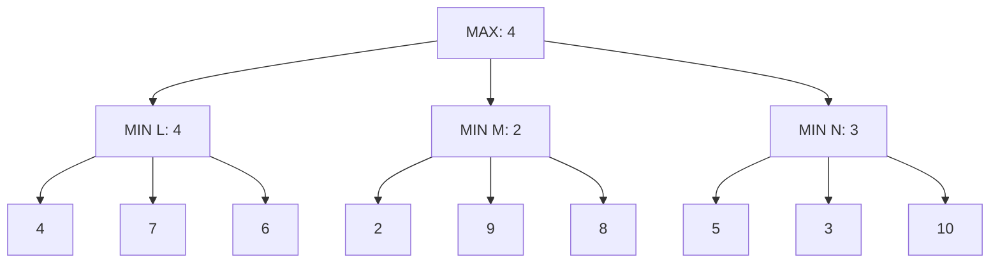

# 对抗搜索：极小极大与 Alpha–Beta

路径搜索中由自己选择后继；下棋时对方也选择，并可能让我们避开最想去的叶子。本文讨论有限、轮流行动、完全信息、确定性的两人零和博弈。所有叶子数字均是 MAX 玩家效用，MIN 的利益与之相反。随机动作、多人非零和或隐藏信息要换模型，不能把下面的保证原样搬过去。

## 从叶子逐层定义值

状态包含局面以及轮到谁行动。终局值为规则给定的 $U(s)$；MAX节点取子值最大，MIN节点取最小：

$$
V(s)=\begin{cases}
U(s),&s\text{ 为终局},\\
\max_{a\in A(s)}V(T(s,a)),&\text{轮到 MAX},\\
\min_{a\in A(s)}V(T(s,a)),&\text{轮到 MIN}.
\end{cases}
$$

从叶子向上归纳：每个终局值正确；若所有更深子值已正确，MAX可以选其中最大，MIN可以迫使其中最小，所以父值也正确。这给出对“对手最优回应”的保证，并不预测一个实际对手一定这样走。该模型与剪枝前提见 [Berkeley CS188，3.2，Minimax、Alpha-Beta、Evaluation Functions](https://inst.eecs.berkeley.edu/~cs188/textbook/games/minimax.html)。以下树与数值是本课自己的手算案例。

完整极小极大求 `L=min(4,7,6)=4`、`M=min(2,9,8)=2`、`N=min(5,3,10)=3`，根 `max(4,2,3)=4`，选择L。若只挑最大叶子10而选N，对手会选3；这就是忽略对手行动的反例。

## 剪枝保留的是根选择与值

$\alpha$ 是沿当前搜索上下文 MAX 已有的可取下界，$\beta$ 是 MIN 已有的可取上界；初始化为 $(-\infty,+\infty)$。MAX看一个子值就提高alpha，MIN看一个就降低beta。若 $\alpha\ge\beta$，剩余子树不能改善祖先需要的决策，可停止这一分支。

本树按左到右深度优先，完整执行如下。

| 位置 | 新读叶子 | 当前MIN值/上界 | 根的alpha | 结论 |
| --- | --- | --- | --- | --- |
| L | 4，7，6 | 依次4，4，4 | 完成L后更新为4 | 根已有保证4 |
| M | 2 | β=2 | 4 | 2≤4，剪去9和8 |
| N | 5 | β=5 | 4 | 5>4，还不能剪 |
| N | 3 | β=3 | 4 | 3≤4，剪去10 |
| 根 | 无 | max(4,≤2,≤3)=4 | 4 | 返回4，选择L |

读到6个叶子，剪去3个；完整极小极大要读9个。M返回的2在这里巧合等于真实值，N返回3也巧合相等，但不能一般把被剪节点返回值当成精确值。例如把M未读叶9改为−100，M实际值会是−100，根仍选4；剪枝算法在M看到2时返回的只是“至多2”的足够证据。若把这些数值存进置换表，应标上下界类型与深度，不能假称精确。

剪枝正确性来自界：在MIN节点已经看到v≤alpha，其最终最小值只能≤v；祖先MAX已有至少alpha的别的选项，所以这个分支无论剩下什么都不优于已有选项。MAX节点遇v≥beta为对偶论证。剪枝允许改变内部节点的精确计算范围，但保留根最优值；若多个动作同值，`alpha>=beta`可能略过另一个同样好的动作。本课只保证返回一个最优动作，并用先出现者破平局。

## 顺序影响工作量，截断影响保证

若根先读M、再N、最后L，依次alpha=2、3、4，此树每个MIN都要读完3个叶，共9个。好的行动排序能更早建立紧界；最坏时间仍 $O(b^d)$，近乎完美排序可达约 $O(b^{d/2})$。递归保存调用栈和逐层生成后继时，空间约 $O(bd)$；若先物化整树，则空间由整树大小决定。

真实博弈树通常太深，深度d截断时用估值 $E(s)$ 代替真实终局效用。这时 Alpha–Beta 只保持**该截断树**的极小极大结果，不证明真实游戏最优。具体反例：真实L值4、M值2，估值却E(L)=1、E(M)=6；截断算法选M，实际保证2低于4。继续深入也不自动消除所有偏差，尤其是刚好截在一次交换、强制获胜之前的“地平线效应”。估值的学习与测试属于另一个问题。

若对手是随机环境且概率已知，随机节点应取期望 $\sum_a p(a\mid s)V(T(s,a))$；把概率节点当MIN会优化最坏事件。隐藏信息中不知道当前真局面，不能凭完美信息树选择一个只在某真状态可行的动作。与随机决策的桥见已有[[AI/10-机器学习与深度学习基础/19-强化学习MDP价值函数与策略梯度|MDP、价值与策略课]]，它解释环境转移概率，不能替代两人博弈推导。

## 独立复核与练习题解

实验不只拿未剪枝同递归程序作参照。此深度二树有 $3^3=27$ 个 MIN **完整策略**：每个策略为L、M、N各指定一个回应，即便路径只实际到其中一个节点。固定MAX首选L，对27策略逐个计算实际收益，最坏4；M最坏2；N最坏3。MAX在这些保证中选最大4，与递归值一致。该oracle局限于深度二树，不能冒称任意博弈策略枚举。

**题1：** 把M首叶2改为6，其余9、8不变，需要读几叶？L先读3叶建立alpha4；M看到6尚不能剪，读9与8后真实值6，根alpha变6；N看到5≤6即可剪后面3与10。共3+3+1=7叶，根值6，选M。

**题2：** alpha=beta时可以剪吗？若目标是一个最优动作及根值，可以；相等分支不改善值。若还要枚举全部最优行动、记录完整主变化集合，就不能用同样停止规则宣称结果完整。

**迁移题：** 两个玩家都追求各自不同资源且利益不相反，MIN还应取MAX效用最小吗？不能；需定义各自效用和策略回应，零和假设已失效。

运行叶子访问与完整策略穷举：[[AI/13-搜索推理与规划/80-搜索与规划复现实验#博弈与约束怎样交叉检查|`alpha_beta` 与 `strategy_oracle`]]。继续[[AI/13-搜索推理与规划/04-约束满足传播与回溯|CSP]]，比较“对手选行动”与“给多个变量同时找合法赋值”的区别；返回[[AI/13-搜索推理与规划/00-搜索推理与规划-MOC|课程入口]]。
