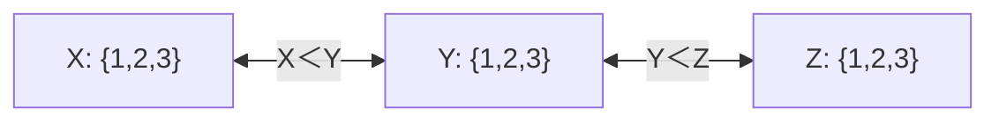

# 约束满足：传播、弧一致性与回溯

安排三场活动，每场用一个时段且必须满足先后关系；或者给相邻地区不同颜色。我们关心最终赋值是否满足所有约束，而非动作路径的累计成本。CSP把问题写成变量集合 $X=\{X_1,\ldots,X_n\}$、有限域 $D_i$ 和约束集合 $C$；解是给每个变量选一个域内值且满足所有约束的**完整赋值**。部分赋值尚可扩展，不等于已找到解。

[[计算机知识/50-数据结构与算法/14-回溯搜索剪枝与计算复杂性边界#3. 约束传播、去重与启发式：三件不同的事|已有回溯课]]区分传播和启发式：传播删去不可能值，MRV只改变尝试顺序。本文把域更新落实到每一条有向弧，再给传播仍不足以判定无解的反例。集合、积和量词语言可从[[数学/10-数学语言与基础/03-集合映射命题与合法推理|数学语言页]]回顾。

## 局部支持是什么

二元约束 $C_{ij}\subseteq D_i\times D_j$ 是允许的值对。弧 $X_i\to X_j$ 一致表示：

$$
\forall a\in D_i\;\exists b\in D_j:(a,b)\in C_{ij}.
$$

b称为a在此约束中的支持。不是“存在一个值对合法”就算一致，也不是要求每个a和每个b都相容。无支持的a可以安全删除：任何全局解若取 $X_i=a$，它在 $X_j$ 上的值必然提供支持，矛盾，所以删a不会删全局解。

无向约束需检查两个方向；方向反过来时谓词也要转置。例如X<Y对应弧X→Y的谓词a<b，Y→X则a>b，不能复用a<b。

## AC-3：域缩小会影响谁

AC-3维护所有有向弧的队列。弹出i→j，逐个检查 $D_i$ 的支持并删无支持值。若 $D_i$ 改变，把邻居k→i重新排队（经典二元同一关系转置的版本可排除刚检查的j），因为它们曾依赖i的旧域。域空表示这一分支不可能有完整解；队列空表示所有弧达到当前域下的一致性。域有限且只删不加，所以传播终止。输入初始域为空也应直接失败。课程算法与标准朴素界见 [Berkeley CS188，2.3 Filtering](https://inst.eecs.berkeley.edu/~cs188/textbook/csp/filtering.html)。以下轨迹使用显式小问题，不复制课程地图案例。

设三个时段变量X、Y、Z的初始域都为{1,2,3}，约束X<Y且Y<Z。约束图是链，但每条约束有两个检查方向。

初始队列为 `[X→Y,Y→X,Y→Z,Z→Y]`；允许重新排队出现重复，重复检查不改变最终域。手算只列会删值的事件；没删值的排队检查同样会执行。

| 检查弧 | 支持检查/删除理由 | 检查后的三个域 |
| --- | --- | --- |
| X→Y | X=3没有Y>3，删3 | X={1,2}，Y={1,2,3}，Z={1,2,3} |
| Y→X | Y=1没有X<1，删1；将Z→Y重新排队 | X={1,2}，Y={2,3}，Z={1,2,3} |
| Y→Z | Y=3没有Z>3，删3；将X→Y重新排队 | X={1,2}，Y={2}，Z={1,2,3} |
| Z→Y | Z=1、2均无Y<Z，删1、2 | X={1,2}，Y={2}，Z={3} |
| 再查X→Y | X=2无Y>2，删2 | X={1}，Y={2}，Z={3} |

最后所有弧的支持都存在，得到唯一赋值(1,2,3)。独立笛卡尔积枚举27个完整赋值，也只有它满足X<Y<Z。这里传播恰好解决问题，不能一般化。

## 弧一致仍可全局无解

三角形A、B、C，各域{1,2}，每对变量要求不相等。任何有向弧上，1得到2支持、2得到1支持，因此AC-3不删任何值。但三个两两不同变量需要三种值；只有两值，全局无解。局部支持可以来自彼此无法同时成立的不同选择。八个完整赋值穷举全失败，这给传播的边界一个可复算证据。

**前向检查**只在刚赋值变量后删其邻居冲突值；**维护弧一致性（MAC）**在每次赋值后运行AC-3，让未赋值变量间的变化继续传播。两者均需要分支回退时恢复原域。不能让分支A=1删掉的值泄漏到兄弟分支A=2；实验通过每次复制小域避免这种状态污染，大型实现可用撤销栈。

## MRV改变顺序，回溯保证穷尽

MRV（最少剩余值）在未赋值变量中选当前域最小者，失败更可能早暴露；LCV（最少约束值）优先试使邻居剩余值损失最少的值。它们是排序策略，额外计算成本也需算；不单独提供多项式复杂度或删值理由。[Berkeley CS188，2.4 Ordering](https://inst.eecs.berkeley.edu/~cs188/textbook/csp/ordering.html)给出这两种策略，以下固定排序便于比较。

用三角形不等约束，但改初始域A={1,2,3}，B={1}，C={1,2}。变量按字母破平局，值升序；求**全部解**以统一停止口径。固定字母顺序、不传播版本尝试如下：

| 首选A | 后续值尝试 | 本分支尝试数 |
| --- | --- | --- |
| A=1 | B=1即冲突 | A一次+B一次=2 |
| A=2 | B=1合法；C=1与B冲突，C=2与A冲突 | 1+1+2=4 |
| A=3 | B=1合法；C=1冲突，C=2成功 | 1+1+2=4 |

总10次“给变量尝试一个值”，只得(A,B,C)=(3,1,2)。这个计数含失败尝试，与递归调用数或约束比较次数不同。

MRV+MAC先选B=1。传播删A中的1、C中的1，C只剩2；再因A≠C删A中的2，故A只剩3。剩余A、C域大小均1，按字母平局选A=3，再C=2，共3次值尝试。注意**实际第二个被赋值的是A**，不是C；C=2先被传播确定，赋值顺序与域缩小顺序不可混写。这一输入显著节省值尝试，AC-3自己的支持检查有成本，本例不能证明总时间普遍更少。

## 算法的范围与复杂度

有限域回溯若穷举所有剩余值，并只用已证明保留解的传播剪枝，则完整；约束不满足的部分赋值不能扩展成解。朴素完整赋值规模为 $d^n$。二元AC-3若e为有向弧数、d为最大初始域大小，朴素最坏时间 $O(ed^3)$：每次检查可用 $d^2$ 逐值对比较，一个域至多删d次导致相关弧重排。若每次约束比较本身昂贵，应乘上其成本；全局AllDifferent等约束有更强专门算法，不能未经转换就套二元界。

## 练习与题解

**题1：** 若X<Y<Z的初域都改为{1,2}，为何失败？X→Y删X=2；Y→X删Y=1；Y→Z发现Y=2没有Z>2，Y域空。严格递增三变量需要至少三种值；与穷举结论一致。

**题2：** 在三角两色无解反例中先固定A=1，MAC会怎样？B≠A与C≠A使B、C都只剩2；B→C要求不同，却没有支持，产生空域。传播在做了选择之后才能发现这个矛盾；回溯A=2同理失败。

**迁移题：** “所有课程不能在同一教室同时举行”是二元还是全局约束？可按每对冲突课程建二元不重叠约束，但若还含容量、共享资源和时长，必须先写清允许关系；不能直接把每变量域设为时段就认为模型完成。

运行本页域表与10/3计数：[[AI/13-搜索推理与规划/80-搜索与规划复现实验#博弈与约束怎样交叉检查|`ac3`、`solve_csp`、`csp_oracle`]]。继续[[AI/13-搜索推理与规划/05-知识表示规则归结与查询|事实、规则与查询]]，把“找合法赋值”与“所有模型下都成立的结论”分清；返回[[AI/13-搜索推理与规划/00-搜索推理与规划-MOC|课程入口]]。
