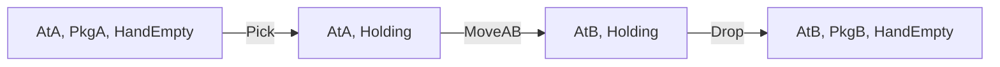

# 规划：前提、效果与计划验证

“先取包裹，再移到B，再放下”为什么是一条计划，而“先移动，再取包裹”会失败？答案不在行动名称是否听起来合理，而在每一步的前提是否由当前状态满足、效果是否保持模型不变量、最后是否达成目标。本文建立一个可回放的经典 STRIPS 小领域，并用状态空间搜索找动作序列。

本课采用完全可观测、确定性、离散、有限ground原子与动作，单行动者、顺序执行、无外生变化的**经典规划**。真实工具调用或机器人行动还可能失败、延迟或观测不全；调用循环本身不自动提供一个前提效果模型，更不自动证明计划正确。

## 状态与动作的精确定义

状态 $s\subseteq P$ 是当前为真的有限ground正原子集合，未列原子在本领域内按闭世界视为假。目标 $G\subseteq P$ 是正原子合取，满足目标当且仅当 $G\subseteq s$。动作 $a=(Pre(a),Add(a),Del(a))$ 的三项均为原子集合，本课要求Add与Del不交；适用条件为 $Pre(a)\subseteq s$。仅当适用时定义结果：

$$
T(s,a)=(s\setminus Del(a))\cup Add(a).
$$

效果未提及的原子保持。这解决此模型中的框架表示问题：不必在每个动作后重复写所有未变事实。动作不适用时实验报告错误，拒绝默默跳过；某些教材接口写为“不适用无效果”，但在验证中仍不能把这样的动作算作合法执行。STRIPS状态更新与解定义见 [AIMA 作者公开旧版第11章，11.1，印刷页376–379](https://aima.cs.berkeley.edu/newchap11.pdf)；该链接是作者站保留的旧章编号，现代版经典规划章编号不同。

## 小领域：把一个包裹从A送到B

原子：`AtA,AtB`是机器人位置，`PkgA,PkgB`是包裹落地位置，`Holding`是持包裹，`HandEmpty`是空手。没有重量、电池、锁门或失败概率；这限定了可主张范围。初态 $s_0=\{AtA,PkgA,HandEmpty\}$；目标 $G=\{PkgB\}$；所有动作成本1。

| 动作 | Pre | Add | Del |
| --- | --- | --- | --- |
| Pick | AtA，PkgA，HandEmpty | Holding | PkgA，HandEmpty |
| MoveAB | AtA | AtB | AtA |
| Drop | AtB，Holding | PkgB，HandEmpty | Holding |
| MoveBA | AtB | AtA | AtB |

Pick只在A定义，Drop只在B定义；送达后不再从B取包裹。这是明确的小领域规格，不是省略了某个默认动作。静态地图连通性被ground动作集合编码；更大领域可写带变量模式Move(from,to)，给出Connected(from,to)等前提，再有限实例化。变量参数、类型和允许实例需明确，不能用自然语言动作名称代替合法性判断。

| 步 | 输入状态 | 检查 | 输出状态 |
| --- | --- | --- | --- |
| 1 Pick | {AtA,PkgA,HandEmpty} | 三个Pre都在 | 删PkgA、HandEmpty，加Holding，得{AtA,Holding} |
| 2 MoveAB | {AtA,Holding} | AtA在 | 删AtA，加AtB，Holding未提及保持，得{AtB,Holding} |
| 3 Drop | {AtB,Holding} | 两个Pre都在 | 删Holding，加PkgB、HandEmpty，得{AtB,PkgB,HandEmpty} |

目标PkgB在终态，三步计划可执行并达目标。原子集合是无序的，不把显示顺序当执行语义。

## 三种失败不能混成一种

**前提失败。** 序列MoveAB,Pick,Drop：第一步产生{AtB,PkgA,HandEmpty}，Pick要求AtA而它不在，第二步失败。包裹仍在A，机器人已在B；不应只检查终点名称就忽略中间条件。

**可执行但未达目标。** Pick,MoveAB合法，终态{AtB,Holding}没有PkgB。机器人到了B不等于包裹已落地送达；验证要分别报告适用性与目标满足。

**动作模型写错。** 若MoveAB忘删AtA，机器人会同时AtA和AtB；后来可能在B位置错误执行A处取件。这个错误不是搜索产生的，而是效果列表违反位置唯一性。对本合法领域，从初态归纳：AtA/AtB恰有一个；PkgA/PkgB/Holding恰有一个；HandEmpty当且仅当没有Holding。Pick在空手及PkgA时删除两者加Holding，Move只替换位置，Drop替换Holding为PkgB并空手；逐动作保持这三个不变量。通用STRIPS语法不会自动保证它们，领域作者需另检。

## 找计划与独立回放

将事实集合视为[[AI/13-搜索推理与规划/01-状态空间图搜索与最优性|状态空间课]]的状态，每次生成所有前提成立动作，按效果求后继。所有成本1可用BFS，按不可变集合去重。相同事实集合对应相同未来动作与结果，所以在**当前模型**下去重正确；若遗漏电池或观测，状态不充分，此理由失效。

本例按表中动作顺序生成，BFS返回Pick,MoveAB,Drop。最少三步也可独立证明：只有Drop能新增PkgB，所以至少一次Drop；Drop要求Holding，只有Pick能新增Holding，所以它必须在Drop之前；Pick要求AtA，Drop要求AtB，至少一次MoveAB在其间。三步下界由该计划达到，故是最短动作数。实验另枚举长0、1、2、3的动作名称序列，在 `(机器人位置,包裹位置,空手)` **独立物理元组模型**里逐步执行，只有该三步序列成功；oracle不调用STRIPS的result，也不读取其Add/Del，因此能发现部分效果列表错误。它仍只覆盖长度≤3的小域，不能取代完整领域证明。

**可达性与验证不同。** 给定序列的逐步回放在本表示下很直接；找到序列可能要探索指数个事实集合，原子数m时有至多 $2^m$ 个集合，多数并不符合领域不变量。若去掉Pick动作，从初态永远无法建立Holding，BFS耗尽可达状态后返回无解。计划不存在应由模型与搜索范围说明，不能以“没想出来”冒称证明。

## 规划的边界：模型、观测与重规划

经典规划中的成功只承诺模型内的效果。真实执行MoveAB时若道路被封，预测s2不等于观测状态。执行器应记录实际观测，重新检查后续前提；偏差出现时暂停失效序列，从新的状态或信念状态重规划。部分可观测环境需要表示一组可能状态及观测更新，随机环境可能需要条件策略而非固定序列，这些属于后续机器人/概率行动课。

[[AI/13-搜索推理与规划/30-本体默认与时间/03-时间事件后继状态与惯性边界|时间事件主解释]]将同一配送动作转为逐谓词后继状态公理，证明合法步与本页集合更新等价，并展示只写效果为何不足以保证惯性。它另将观察缩小可能世界与动作实际改变世界分开；完整影响律有遗漏时，不能用“未提及保持”替现实后果作保证。

删除效果放松可得到一个更容易的问题：假设事实只能增加，合法原计划仍可对应执行，因而其**最优放松计划长度**可作原问题最优长度下界。但常用高效放松启发式不都精确求此最优值，不能统一写成可采纳。多个子目标还可能互相删除前提或已达目标，不能分别规划后直接拼接。本例目标只有PkgB，避免把这一复杂性偷藏在“送达”一词中。

自然语言工具步骤若要使用规划保证，需定义允许状态、权限相关前提、可能效果、失败观测及有效验证；这些事实不会由LLM说“已完成”自动产生。本文实验不启动外部工具，也不测试真实机器人。

## 练习与题解

**题1：** 初态改成{AtB,PkgA,HandEmpty}，最短计划是什么？MoveBA,Pick,MoveAB,Drop，共4步。机器人必须先到A，取件后回B，再放下；少任一步都缺对应前提或目标。

**题2：** 初态已经{AtB,PkgB,HandEmpty}，空计划是否正确？是。目标已满足，零步成本0；BFS应在展开初态之前检测目标。计划无需为形式完整而加动作。

**题3：** 用动作模式Move(from,to)，只写Add At(to)而不写Del At(from)，是什么错误？破坏位置唯一性；必须补删除效果并重新核对全动作链，不只是改最终检查。

**迁移题：** 包裹加上“易碎”，运输可能损坏，旧三步计划还正确吗？它在旧目标PkgB与旧模型内合法；若新目标还要求完整，就需要新增状态及效果/概率和验证。不能由旧轨迹外推新需求。

运行模型回放、失败序列和独立最短oracle：[[AI/13-搜索推理与规划/80-搜索与规划复现实验#事实规则与计划的证据链|`plan_bfs`、`replay`、`delivery_oracle`]]。返回[[AI/13-搜索推理与规划/00-搜索推理与规划-MOC|课程入口]]，用问题表复查各算法是在解哪一种问题。
