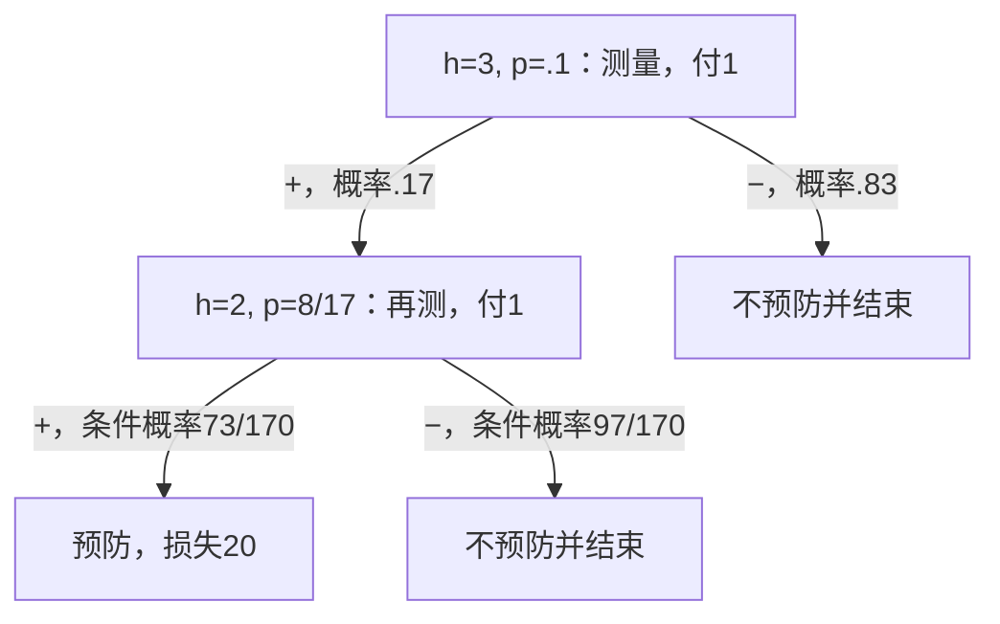

# belief Bellman与独立策略树

**读者问题：** 第一条信号为正后，应该立刻预防，还是再测一次？答案同时依赖后验、再测成本和剩余机会。只优化当前分类准确率没有表达这个问题。

## 从条件期望到Bellman递推

沿用01的时序和模型，最大化收益 $r=-L$；用 $V_h(b)$表示还剩 $h$次决策时最优期望总收益。一般非终止有限POMDP的递推是

$$V_h(b)=\max_{a\in A_h}\left\{\sum_sb(s)r(s,a)+\gamma\sum_{o:q(o\mid b,a)>0}q(o\mid b,a)V_{h-1}(\tau(b,a,o))\right\}.$$

$V_0=0$，$0\le\gamma\le1$；有限时域且收益有界，不需以 $\gamma<1$保证无穷和。已终止动作没有后续项。实际收到的新奖励若也可观察且泄漏状态，应把它纳入观测；本例测量成本固定，终止损失之后没有新决策，故没有遗漏可用于继续行动的奖励信息。

本例无贴现，$\gamma=1$，用 $p=b(1)$即可表示两状态belief。最后一次不能只测不行动，所以

$$V_1(p)=\max\{-100p,-K\};\qquad
V_h(p)=\max\left\{-100p,-K,-c+q_+(p)V_{h-1}(p_+)+q_-(p)V_{h-1}(p_-)\right\},\quad h\ge2.$$

其中 $q_+(p)=.1(1-p)+.8p$、$q_-=1-q_+$，$p_+=.8p/q_+$、$p_-=.2p/q_-$。这是对**未来信号**求平均，分支到达后才选择下一动作；不把还没发生的正/负信号随意选为自己喜欢的那一条。

推导只用有限条件求和：固定根动作，当前期望收益加上每个可发生观测分支的最优后续收益，最后对根动作取最大。归纳证明最优性：剩1次时穷尽允许终止动作；假定每个剩 $h-1$分支已最优，任一 $h$阶段策略的根动作及各后续分支都不能超过式中相应项；反过来选最大根动作并在每个分支接最优子策略即可达到该值。因此此式给模型内的最优期望值。概率模型不对时、隐藏状态不充分时，这份证明不提供现实最优性。

有限策略树与belief求值的原始定位见 [Kaelbling/Littman/Cassandra 1998，§4.1，印刷pp.108–110](https://people.csail.mit.edu/lpk/papers/aij98-pomdp.pdf)；下面是本单元的完整独立数值例。

## 两次机会：先测，再按信号行动

取 $p=.1,K=20,c=1,h=2$。立即不预防收益−10，立即预防−20。测量后正信号后验 $8/17$：不预防损失 $800/17\approx47.06$，预防20，故预防；负信号后验 $2/83$：不预防损失 $200/83\approx2.41$，故不预防。

$$Q_2(m)=-1-.17\times20-.83\times(200/83)=-6.4.$$

与−10、−20相比，最优先测，正后预防、负后不预防。6.4包含测量成本，5.4仅是信号后的事前平均行动损失；03将两者与信息价值区分。

## 三次机会：第二次测量只在某个分支值得买

第一信号后还剩2次，须重新用Bellman比较。若第一信号为正，$p=8/17$；再测一次时条件联合质量为

$$P(++\mid+)=73/170,\qquad P(+-\mid+)=97/170.$$

这里 $++$表示“此前正、此次也正”的完整历史，条件分母170来自只考察已到达的正分支。完整两信号联合概率则是 $P(++)=.073$、$P(+-)=.097$，不能混成同一分母。二次后验 $p_{++}=64/73$、$p_{+-}=16/97$。于是二次正后预防，二次负后不预防，第一正后的再测总损失是

$$1+(73/170)\times20+(97/170)\times100(16/97)=19.$$

19小于立即预防20，所以再测。此正分支的免费信息改善是2，故测量成本 $c<2$时再测、$c>2$时立即预防、$c=2$时并列。该阈值只用于剩两次的这一分支。

若第一信号为负，后验 $2/83$。再测正后的 $p_{-+}=16/97<.2$，再测负后 $p_{--}=4/733<.2$，两种结果都不预防。因此再测不会改善当前最优行动损失，还额外付1；直接不预防更好。

按隐藏状态与观测的联合路径再算一次，总风险为

$$1+.17\times1+.073\times20+.016\times100+.02\times100=6.23.$$

最后两项是危险且走到 $+,-$、危险且首次为负的联合质量；其中 `.016`和`.02`不是这些分支的后验概率。再按belief分支求平均为 $1+.17\times19+.83\times(200/83)=6.23$，两种口径一致。增加一次机会从6.4降到6.23，并不是所有历史都多买一次：策略把付费放在可能改变动作的分支。

## 不调用belief的独立策略树核对

一棵完整树为每个**观测**指定子树，不准按不可见 $Y$选枝。终止叶只有 $a_0,a_1$。测量节点的两个子树可分别选任意少一阶段的完整树，因此数量

$$N_1=2,\quad N_h=2+N_{h-1}^2;\qquad N_2=6,N_3=38.$$

38包含先终止、各种分支继续/终止和两次测量的全部确定策略。这里收益线性于随机化混合权重，有限策略中总有一个确定策略不劣于任何随机混合，故不需要另枚举连续混合权重。数量增长迅速，实验限 $h\le4$，不声称可穷举真实大POMDP。

独立oracle直接对每个真状态算树的损失 $C_\pi(y)$：终止叶读损失表；测量节点付 $c+\sum_oO(o\mid y)C_{\pi_o}(y)$；最后初始风险为 $.9C_\pi(0)+.1C_\pi(1)$。它不调用预测、Bayes归一或belief Bellman，也不把两个算法都写成同一递推再互比。枚举38树取最小，应给6.23；02的证明解释为何理论上可这样比，实验查实现和算例是否对应声明模型。

本例的恒等转移使oracle可以直接固定 $y$求和；若后续加入状态转移，oracle也要对真状态轨迹求和，不能继续用静态状态公式验证动态模型。完整输入与命令见[[AI/13-搜索推理与规划/20-部分可观测决策/80-部分可观测决策复现实验\|80课]]。

## 极限、失效与迁移

| 改一项条件 | 预测与理由 |
| --- | --- |
| 完美信号，免费，至少两次机会 | 测后完全知道Y：仅Y=1预防，风险 $20\times.1=2$，回到完全观测行动 |
| 完美信号，但只剩一次 | 不能测后再行动，仍须比较10与20；时点不是小字 |
| 两状态的信号概率相同 | 后验等于先验；免费测量最多并列，收费则严格多付成本，不能改善风险 |
| `c=3`，仍 `K=20,h=3` | 第一正后再测损失21，高于立即预防20；首次负后也不再测。首测风险8.4，与两次机会相同 |
| 预防成本 `K=60`，一条信号 | 两个后验都未到.6，不预防。信号仍改变belief；03算免费EVSI=0 |

“更多机会不更差”的理由是允许提前终止，旧策略仍可执行；若新规定强制多测或延误增加损失，允许策略集合和后果变了，不能照搬此结论。对历史的安全抽象也必须保留未来动作、转移、观测和损失所需信息，不能只因当前均值相同就合并。

**迁移题：** 保留主模型，将第二次信号改成复制第一次的缓存值。还能用6.23吗？不能。原模型假定给定Y后两次独立；缓存信号的观测机制依赖已存值，不提供同样的新证据。应将缓存状态加入模型/历史，按新观测核重算，而不是把两次相同显示当两份独立证据。

返回[[AI/13-搜索推理与规划/20-部分可观测决策/00-部分可观测决策-MOC\|课程地图]]；下一课[[AI/13-搜索推理与规划/20-部分可观测决策/03-信息价值科学取证与行动\|信息价值]]只在同一模型的一阶段切片算EVSI，不替代本课的多阶段策略。
