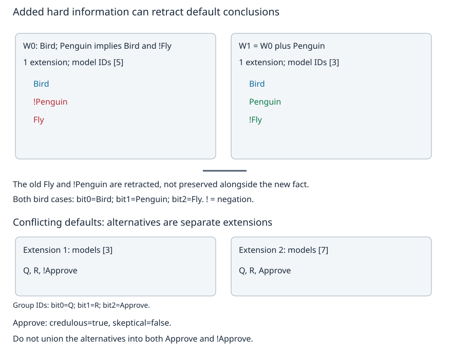

# 默认例外：扩展与结论撤回

知道Tweety是鸟，先按“鸟通常会飞”推测它能飞；后来确认它是企鹅，还应保留旧结论吗？如果把“通常”写成硬蕴涵，再把相反结论塞进经典知识库，得到的是矛盾，不是自动完成了一次合理撤回。本页选定 **Reiter默认逻辑**，明确哪些是硬知识、哪些是可撤的规则，以及“默认扩展”究竟怎样计算。

旧课的有限正Horn闭包与分区join仍有用，但它承诺固定规则、事实只增和正结论单调保持；本页改变了推理语义。上一页的本体存在约束也是硬约束：它在全部满足模型中要求见证，不能因“没查到名字”就默认删掉那个见证。

## 先固定语言，不拿一句“通常”包办所有推理

本页用有限命题原子。`Bird`表示“指定的Tweety是鸟”，`Penguin`和`Fly`同理；不是带未绑定变量的一阶规则。每个命题赋值给每个原子经典真/假，`!Fly`在源码中是显式否定 $\neg Fly$，不是“搜索没有找到Fly”。硬知识W由命题公式组成，$Cn(W)=\{\varphi:W\models\varphi\}$ 是经典语义闭包。

一个默认写作

$$
\delta=\frac{\alpha:\beta}{\gamma}.
$$

$\alpha$是前提，$\beta$是相容性理由，$\gamma$是结论。意思不是 $\alpha\to\gamma$；它要求前提能由当前构造得到，而且理由与**最后接受的整套扩展**相容，才在这套扩展中接受结论。相容在这里精确指 $\neg\beta\notin E$，不是要求先证明 $\beta\in E$。本页只用一个理由，主例中理由与结论相同，称为**正规默认**。

默认理论记为 $\Delta=(W,D)$。W里的硬公式与D里的默认是不同对象，不能把D当普通Horn规则交给旧闭包。实现限制为1–8个命题原子、至多8个默认、至多16个硬CNF子句；默认前提为文字合取、理由和结论各为一个文字。空前提表示真，空CNF表示没有硬限制，空子句表示假。没有对象生成、函数符号、量词、规则优先级或自动“更具体者优先”。这是一种可穷举的命题片段，不是通用常识推理器。

## 候选扩展和构造中的知识，不能查错地方

先猜一套候选闭理论E，再**固定E**构造 $\Gamma_\Delta(E)$：它是满足下列条件的最小理论T。

1. $W\subseteq T$；
2. $Cn(T)=T$；
3. 对每个 $(\alpha:\beta)/\gamma\in D$，若 $\alpha\in T$ 且 $\neg\beta\notin E$，则 $\gamma\in T$。

扩展要求固定点 $E=\Gamma_\Delta(E)$。计算可从 $T_0=Cn(W)$ 开始，重复

$$
T_{i+1}=Cn\!\left(T_i\cup
\{\gamma:(\alpha:\beta)/\gamma\in D,\ \alpha\in T_i,\ \neg\beta\notin E\}\right).
$$

**前提查正在增长的 $T_i$，相容性查完整候选E。** 把两处都查E会允许循环自己作证；把两处都查 $T_i$ 又可能先应用一个最终会推翻其理由的默认。[Reiter 1980原文 Definition 1 / Theorem 2.1，印刷页89–90](https://www.umiacs.umd.edu/~horty/courses/readings/reiter-default-1980.pdf)给出这个最小算子及逐层刻画。下文将它限制到本页的有限语言并展开计算。

例如 $D=\{(p:q)/q,(q:p)/p\}$、$W=\varnothing$。候选 $E=Cn(\{p,q\})$ 看起来相容，但从 $T_0=Cn(\varnothing)$ 出发，没有p或q作前提，两条规则都不能启动，所以 $\Gamma(E)=Cn(\varnothing)\ne E$。真正扩展只有 $Cn(\varnothing)$，它没有推出p，也没有推出 $\neg p$。一个闭理论含无穷多永真式，即使表中“确定文字列表”为空，也不表示它是空公式集合。

另一个固定例以 $W=\{p\lor q,\neg q\}$、$D=\{(p:r)/r\}$ 检验“前提能推出”的含义：硬知识已经经典蕴涵p，即使输入没有独立的p事实行，默认仍能启动。源码通过有限赋值的模型集合表示完整经典闭包，不只检查字符串是否出现在事实表里。

## 同一只鸟，信息增加后重算什么

固定硬规则和默认：

$$
W_0=\{Bird,\ Penguin\to Bird,\ Penguin\to\neg Fly\},\qquad
D=\left\{\frac{Bird:Fly}{Fly}\right\}.
$$

这是教学模型的明确硬承诺，不是对所有现实鸟类、游泳能力或异常个体作经验分类。现在比较两个独立输入，第二个仅在W中新增Penguin，D不变。

**未增加企鹅事实时。** $W_0$既不蕴涵Fly也不蕴涵 $\neg Fly$。试 $E_0=Cn(W_0\cup\{Fly\})$：$\neg Fly\notin E_0$，默认可用，$T_0$已有Bird，第一轮加入Fly，随后停止，确实得到 $\Gamma(E_0)=E_0$。候选 $Cn(W_0)$ 则不是固定点，因为默认会给它增加Fly。

这里还会推出一个容易漏掉的后果：硬规则 $Penguin\to\neg Fly$ 与Fly经典地推出 $\neg Penguin$。所以E₀的确定文字为 $\{Bird,Fly,\neg Penguin\}$。这项 $\neg Penguin$ 也依赖默认Fly，不能伪装成独立调查出的非企鹅事实。

**增加企鹅事实后。** $W_1=W_0\cup\{Penguin\}$ 直接蕴涵 $\neg Fly$。对 $E_1=Cn(W_1)$，$\neg Fly\in E_1$ 阻断默认，$\Gamma(E_1)=Cn(W_1)=E_1$。其确定文字为 $\{Bird,Penguin,\neg Fly\}$。新增硬事实后，旧的Fly与 $\neg Penguin$ 撤回；并非将 $E_0\cup\{Penguin\}$ 当作新知识库继续累加，后者已经矛盾。



图中模型ID是三位赋值：bit0=Bird、bit1=Penguin、bit2=Fly；E₀唯一模型为5，E₁唯一模型为3。ID只是可复核的有限编码，没有概率大小含义。完整候选/阻断默认/逐轮T的模型集合都在结果JSON，不只保存最后一句“能飞/不能飞”。

## 多扩展，不是把冲突结论都放进一个世界

设Q、R表示同一对象同时受两套规则覆盖，Approve表示许可：

$$
W=\{Q,R\},\qquad D=\left\{\frac{Q:Approve}{Approve},\frac{R:\neg Approve}{\neg Approve}\right\}.
$$

它有两个一致扩展：$E_+=Cn(W\cup\{Approve\})$ 和 $E_-=Cn(W\cup\{\neg Approve\})$。在E₊中第二个默认的理由被Approve反驳，E₋中则相反。两者不是同一扩展里的矛盾；把它们并集会毁掉这个区别。按输入顺序只输出第一个，也不是计算了全部扩展。排队次序若偷偷决定规则优先级，那是程序员在补法律，不是理论突然变懂事了。

在至少有一个一致扩展的前提下，本页接口定义：

- **怀疑式查询（skeptical）**：每个扩展都蕴涵q；
- **轻信式查询（credulous）**：至少一个扩展蕴涵q。

Q/R在两者中都成立；Approve和 $\neg Approve$ 各自轻信成立、怀疑不成立。“并非所有扩展支持Approve”不等于“所有扩展支持其否定”。

再把企鹅的不能飞也改成默认 $(Penguin:\neg Fly)/\neg Fly$，撤掉硬规则 $Penguin\to\neg Fly$，仅保留Bird、Penguin和 $Penguin\to Bird$。本次仍有两个扩展，一个飞、一个不飞。**普通Reiter默认没有自动的特殊例外优先级**。若希望更具体规则覆盖一般规则，必须明确扩充优先语义或编码阻断条件，重新讨论扩展；不能用自然语言“当然是企鹅例外”替代形式定义。

## 无扩展和硬矛盾，分别哪里出了问题

非正规默认 $D=\{(\top:p)/\neg p\},W=\varnothing$ 无扩展。逐情况证明：若候选E含 $\neg p$，默认被阻断，$\Gamma(E)=Cn(\varnothing)$，不能等于这样的E；若E不含 $\neg p$，默认启用，$\Gamma(E)$却加入 $\neg p$，仍不等于E。它的理由被自己导出的结论推翻。

若写 `all(q in E for E in [])`，程序会返回true，这是空集上全称量化的数学结果；不等于这套默认知识可用来肯定任何业务问题。**本页公开查询接口把存在一致扩展作为前提**：无扩展返回 `no_extension`，不输出怀疑式true/false；这是一条明确的输出政策，不声称改变了Reiter固定点定义或否定了空全称的真值。

另设硬W已经含p和 $\neg p$。按经典闭包所有公式都被蕴涵；Reiter理论形式上有唯一**不一致扩展**，而非“无扩展”。原文Corollary 2.2–2.3（印刷页91）明确这一点。源码报告 `hard_inconsistent`、形式扩展数1、不一致标记和空模型集合；查询同样阻止输出。三个状态不要混：

| 情形 | 模型/扩展对象 | 接口最强报告 |
| --- | --- | --- |
| 正循环无起点 | 一个一致扩展 $Cn(\varnothing)$，p两方向均未定 | 正常查询，但未支持p不等于支持 $\neg p$ |
| 自败的非正规默认 | 没有任何固定点扩展 | 无扩展，不能用空全称生产肯定答案 |
| 硬W矛盾 | 形式上一个不一致扩展、没有经典模型 | 硬输入矛盾，不作为可靠查询答案 |

## 为什么有限算法确实算完了这个片段

设n个命题原子、m个默认。每个闭理论可用其满足赋值集合表示，最多 $2^n$ 个赋值；两个经典闭理论拥有同一模型集合，就有完全相同的全部公式后果。源码穷举默认结论的子集G，形成候选 $E_G=Cn(W\cup G)$，按模型集合去重，再检验 $\Gamma(E_G)=E_G$。它没有穷举 $2^{2^n}$ 个任意模型子集，而是利用扩展的生成结构。

**候选覆盖的证明。** 任取真正扩展E。从 $T_0=Cn(W)$ 的构造中取全部曾生成的默认结论G；每步T只增加这些结论及其经典后果，故 $\Gamma(E)=Cn(W\cup G)$。E是固定点，便在本算法的候选中。反过来，任何通过固定点检验的候选按定义就是扩展。因而本有限语言内既不漏扩展，也不把一致候选自动当扩展。原文Theorem 2.5（印刷页92）给一般的生成默认后果刻画；这里的有限证明同时解释实现的枚举对象。

对固定E，$T_i$每次严格增长都至少新增一个此前未蕴涵的默认结论；至多m次这样的增长，再一轮确认不变。每次经典蕴涵用至多 $2^n$ 个赋值检查，候选至多 $2^m$ 个。因此该有限命题算法必停并完整决定扩展及本页查询，成本可随n/m指数增长，绝非“常识推理已经便宜”。超过本实现8/8/16上限明确拒绝，不把第一批找到的候选当成完整答案。

**正规默认为什么至少有一致扩展。** 对有限D、经典一致W，另给一个存在证明。开始 $T=Cn(W)$；只要有 $(\alpha:\beta)/\beta$ 满足 $\alpha\in T$、$\neg\beta\notin T$ 且 $\beta\notin T$，就令 $T:=Cn(T\cup\{\beta\})$。每次保持一致，且新增一个默认结论，至多m次后饱和，记最后理论为E。

证明它是扩展，需要两个方向，不能只说“再没有能加的”。对 $\Gamma(E)\subseteq E$，按Γ的构造归纳：W在E里；若前提已经在E、理由与E相容，饱和性保证正规默认的结论在E里，经典闭包仍留在E。对 $E\subseteq\Gamma(E)$，按贪心所选默认的次序归纳：每次前提来自先前已经生成的内容；每个被选β都留在最后一致E，所以其反面不在E，因而该默认也会在Γ(E)中生成β。经典后果随之进入Γ(E)。两包含给固定点，一致性保留。选择次序可能给不同扩展，这项证明不是一个优先级规范，也没有枚举所有扩展。一般正规存在定理可定位原文Theorem 3.1（印刷页95–96），正文证明只主张上述有限一致情形。

## 默认撤回、Bayes更新和世界改变各改什么

| 运算 | 被改变的状态对象 | 不能省略的前提 |
| --- | --- | --- |
| 固定正Horn增加事实 | 正事实闭包 | 原有限签名、固定正规则、只增；原已推正结论保持 |
| W加入例外后重算默认扩展 | 一套或多套可接受闭理论 | 固定点与相容性语义；旧默认后果可以撤回 |
| Bayes观察更新 | 对固定变量/可能状态的概率分布 | 明确先验、似然及事件；概率低不等于逻辑假 |
| 动作造成世界变化 | 不同时刻的世界状态 | 动作前提/效果和持续律；p@0与非p@1不矛盾 |

固定另一个概率模型，$Pr(F)=4/5$，$Pr(e\mid F)=1/10$、$Pr(e\mid\neg F)=3/5$，则

$$
Pr(F\mid e)=\frac{(4/5)(1/10)}{(4/5)(1/10)+(1/5)(3/5)}=2/5.
$$

这个数既不是Fly默认的撤回条件，也不是 $\neg F$ 的逻辑证明。原始分数与结果由标准库Fraction保存。一般概率更新回 [[AI/10-机器学习与深度学习基础/20-贝叶斯学习概率图模型与近似推断#似然、先验、证据与后验各有不同职责|概率主解释]]；默认“相容”不是未经声明的概率阈值，概率阈值若用于决策还需损失与规则。

## 复建与可以反驳本解释的输入

真源 [default_time_lab.py](default_time_lab.py)、[固定八组默认/时间输入](inputs/default-time.json)、[真实输出](results/default-time-results.json) 与 [[AI/13-搜索推理与规划/30-本体默认与时间/code-sync/默认与时间源码镜像|完整源码测试镜像]]。Python3.10+标准库；时间分支直接导入既有 `symbolic_ai_lab.delivery_domain` 的动作真源。旧Horn/本体/规划代码不改，不重跑其成熟suite。

本机每项经2槽、单线程、300s调度器，`PYTHONDONTWRITEBYTECODE=1`；在库根用选定Python执行：

```sh
D='AI/13-搜索推理与规划/30-本体默认与时间'
PYTHONDONTWRITEBYTECODE=1 python3 /private/tmp/wwl-next-context/run_local.py --timeout 300 -- python3 "$D/default_time_lab.py"
PYTHONDONTWRITEBYTECODE=1 python3 /private/tmp/wwl-next-context/run_local.py --timeout 300 -- python3 "$D/default_time_figures.py"
PYTHONDONTWRITEBYTECODE=1 python3 /private/tmp/wwl-next-context/run_local.py --timeout 300 -- python3 -m unittest discover -s "$D" -p test_default_time_lab.py
```

调度器只是本机资源合同，换机可直接 `python3 -B` 运行两个脚本/相关测试；不需要外部推理服务、安装包或真实业务事实。图与全部候选trace来自同一JSON；绘图支持固定命名主例及其原子编码重排，改变理论若越出原图的标签合同会明确拒绝，应阅读新JSON并另定相应图注。图资产与结果SVG同字节，镜像由活动code-sync标记核对。改变输入要声明仍在本片段内，并检查所有候选，而不是只打印一条顺眼的结论。

实验重要性高：候选E与增长T查错、循环自支持、把硬矛盾错报无扩展、0扩展误作全知，都会推翻核心语义。预期依次为：鸟前/后各1一致扩展且Fly/非Penguin撤回；冲突组与默认企鹅例各2；自败默认0；正循环仅 $Cn(\varnothing)$；硬矛盾形式1不一致；CNF前提推出p并激活r。布尔/模型集合要求**精确相等，无浮点容差**。六项相关检查与非作者独立枚举全部模型集合的路线分别核行为；一般覆盖和存在证明另核，不能拿八个测试代替定理。

这不是实际规章解释或业务权限系统。迁移需把对象、硬知识来源、默认语义、优先策略、例外可信度、事实删除/版本及冲突报告合同交齐；若新增例外后旧结论还被并入新硬知识导致矛盾，或仅因执行顺序丢掉另一扩展，就反驳当前声称的语义实现。本文没有运行真实规则服务、客户端或真人学习试验。

## 撤去提示后迁移

1. 从鸟的W₀/D出发，为什么 $\neg Penguin$ 也需要撤回？若把它当成硬事实长期存回W，再加入Penguin，会发生什么？
2. 对 $D=\{(p:q)/q,(q:p)/p\},W=\varnothing$，候选 $Cn(p,q)$ 是否扩展？再加入硬p，全部扩展如何变？
3. 把“Penguin不能飞”从硬蕴涵改成默认，而Bird/Penguin都已确认。为什么不能只输出“更具体的规则赢”？若某个界面必须作一个行动选择，还缺什么？
4. 给 $W=\varnothing,D=\{(\top:p)/\neg p\}$ 判断扩展存在性；再把理由改为 $\neg p$，判断结果。说明0扩展、$Cn(\varnothing)$和不一致扩展的区别。

<details><summary>参考答案与返回条件</summary>

1. 它由默认Fly与硬 $Penguin\to\neg Fly$ 的逆否产生，依赖可撤的前提。把它永久硬化后W含Penguin与其否定，经典无模型、形式默认扩展不一致；应保留依据并重算，不能把派生结论伪装成原始事实。
2. 不是：Γ从空硬知识无法启动任何一条前提。加p后第一条生成q，第二条结论p已在，唯一扩展 $Cn(p,q)$。同一组默认在有/无起点下不同，循环本身不能生出支持。
3. 普通Reiter没有specificity优先语义，两个一致扩展各支持一个方向。行动选择还需明确的优先规则、风险/损失或额外可靠事实，并说明其与推理答案的区别；不能把某个遍历顺序冒充理论必然结论。
4. 原规则自败，无固定点；改为 $(\top:\neg p)/\neg p$ 是正规默认，唯一扩展 $Cn(\neg p)$。0扩展是无候选可接受，$Cn(\varnothing)$是一个一致但不决定p的闭理论，不一致扩展是全部公式且无经典模型。接口分别报告，不能用同一个空列表掩盖它们。

</details>

下一步 [[AI/13-搜索推理与规划/30-本体默认与时间/03-时间事件后继状态与惯性边界|给动作和持续事实加时刻]]：撤回对同一时刻的推测，与包裹被动作实际移动到另一个位置，究竟哪一个对象改变了？
