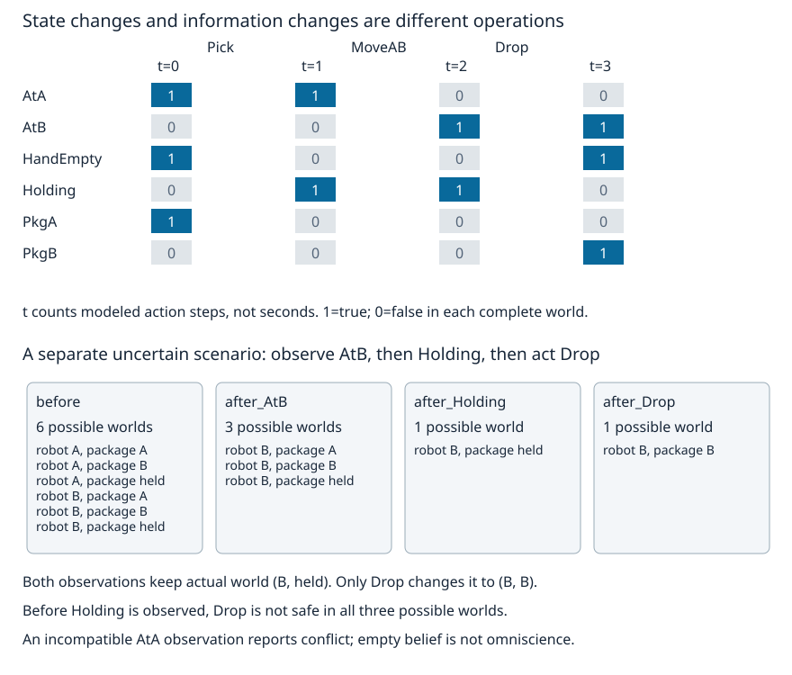

# 时间事件：后继状态与惯性边界

“拿起包裹后，走到B时还拿着吗？”动作效果若只写“机器人到了B”，经典逻辑不会替你补上“包裹没变”。原规划课用集合更新保持未改原子；本页把这项承诺拆成带时刻的逻辑公理，解释它为什么能工作、什么时候不能工作，再与仅仅**获知包裹位置**区分。

上一页撤回的是对同一对象的默认结论。本页可以同时保留“t=1时Holding”和“t=3时非Holding”，因为它们谈的是不同时刻；不需要为了描述放下包裹而把历史事实删掉。

## 状态快照、动作历史和物理时间是不同对象

复用 [[AI/13-搜索推理与规划/06-规划前提效果与计划验证#状态与动作的精确定义|既有配送STRIPS合同]] 的全部原子、动作和初态，不另造动作表。有限原子集

$$
P=\{AtA,AtB,PkgA,PkgB,Holding,HandEmpty\},\qquad
s_0=\{AtA,PkgA,HandEmpty\}.
$$

$s_t\subseteq P$ 表示第t步之后为真的原子，未列原子在**这个完整世界快照**里为假。写 $F(t)$ 等价于 $F\in s_t$。t是所给动作路径的顺序索引，不是秒数，不假定步长相等；以下共3次动作、4个状态。Holding为真的离散区间是 $t\in\{1,2\}$，可简写整数上的 $[1,3)$，不承诺现实中拿了两秒。

情况/情境演算常用 $do(a,s)$ 表示在历史s后追加动作a的历史，$S_0$表示空历史。**历史不是状态快照**：MoveAB再MoveBA可能回到同一快照，行动历史仍不同。沿一条选定路径可用t标记其前缀，但两条分支的同一个t不自动是同一情境。若未来效果只依赖当前完整状态，搜索可按快照去重；若时刻、截止期或隐藏条件影响后果，就要把它们纳入状态，不能继续沿用这项充分性理由。

本页限定有限已命名动作、单一动作顺序发生、确定性、无持续时长和未建模外生变化。原动作方向、前提/效果完整见旧表，源码直接导入 `symbolic_ai_lab.delivery_domain`：Pick在A拿起，MoveAB/MoveBA只改机器人位置，Drop在B放下。原始动作名互异，Add/Del不交，其他动作不在这份语言的行动域里；未知名称拒绝，不默认无效果。

## 只有效果公理，为什么“仍拿着”推不出来

以MoveAB为例，效果给

$$
Poss(MoveAB,t)\to AtB(t+1),\qquad
Poss(MoveAB,t)\to\neg AtA(t+1).
$$

两条式子并没有提Holding。假设输入状态是 $\{AtA,Holding\}$，一个满足上述效果的后继可以是 $\{AtB,Holding\}$，也可以是 $\{AtB,PkgB,HandEmpty\}$；后者等于包裹在没有Drop时突然落到B。即使把“机器人位置唯一、包裹在A/B/手中恰有一个、空手与持物互斥”加入检查，这两个后继都满足这些不变量。一般状态约束没有自动告诉我们变化的原因。

实际穷举6个原子的64种后继赋值，只固定MoveAB的Add为真、Del为假，有16种满足效果的后继；再筛配送不变量仍有3种。它们并非都符合原本的惯性模型。若为每个动作、每个不受影响的状态相关谓词（fluent）分别写正/负保持公理，表示会大量重复；**框架问题的这一部分**是怎样系统、紧凑地表达不变，而不是要求程序猜出世间所有后果。

[GOLOG作者原文 §2.3–§2.4，PDF页4–5](https://www.cs.toronto.edu/kr/papers/GOLOGlang.pdf) 从效果与框架公理讨论这一点，并强调完整因果律的假设。该PDF文本字形提取有乱码，本次核读的是实际渲染页；下面的配送模型和一般逐位证明由本页展开。

## 把所有改变原因汇成一个后继状态公理

对每个F，定义 $\gamma_F^+(a,t)$ 为已列明的“执行a使F变真”的条件，$\gamma_F^-(a,t)$为使F变假的条件；$Poss(a,t)$表示动作前提成立。在合法状态/适用动作上，正负原因不能同时成立，否则效果本身冲突。

要从单向效果变成完整后继规律，需要额外的**因果完备性承诺**：列出的正/负条件涵盖F在这一步变真/变假的所有原因，间接效果也已编入，没有同时发生却未记录的外生事件。它不是“未发现变化”这条观察推出的事实。

在这些条件下，

$$
Poss(a,t)\to\left[
F(t+1)\leftrightarrow
\gamma_F^+(a,t)\lor\bigl(F(t)\land\neg\gamma_F^-(a,t)\bigr)
\right].
$$

理由可逐方向检查。若正原因成立，效果律使后继F真；若F原真、没有负原因却变假，就违反“真变假必须有已列负原因”的完备承诺。反向看，后继F真且没有正原因时，F不可能由假变真，故原来已真；同时不能有负原因，否则负效果律要求后继假。这给出等价式，而非从效果律单独偷换成“除此以外绝不变化”。

在本页无条件Add/Del片段中，$\gamma_F^+$恰为 $F\in Add(a)$，$\gamma_F^-$恰为 $F\in Del(a)$。例如

$$
Holding(t+1)\leftrightarrow
(a=Pick)\lor\bigl(Holding(t)\land a\ne Drop\bigr),
$$

以及

$$
AtA(t+1)\leftrightarrow
(a=MoveBA)\lor\bigl(AtA(t)\land a\ne MoveAB\bigr).
$$

这两式都在 $Poss(a,t)$ 的条件下使用；不适用动作没有被规定成一个合法的新步。全部六个正/负原因表由现有Add/Del生成，保存在结果中；用等号比较的是已经声明互异的原动作名称，不是本体01里没有UNA的任意个体名。

**与原集合更新的一般等价证明。** 任取状态 $s\subseteq P$ 和适用动作a。对任意F分三种互斥情形：F在Add里，则公理和 $(s\setminus Del)\cup Add$ 都令它真；F在Del里，则二者都令它假；F在两者都不在，则二者都保持旧值。Add/Del不交保证分类合法。每个原子的真值一致，两个后继集合相同。再对任何有限合法动作序列长度归纳，从相同初态出发，每个时刻都相同。这个证明覆盖整个声明片段，不只覆盖下面三步。

源码在相同动作表上对全部64种位集合、4动作中的**88个适用状态—动作对**实际比较新公理求值和旧 `result`，精确相等。64中包含不符合配送不变量的集合，这只是核逐位更新式的有限语义，不声称它们都是物理可能世界；后面不确定性例仅使用6个合法配送世界。独立核查另用“机器人位置、包裹位置”物理元组，不读取本源码的原因表作答案。

## 一段事件序列，哪些事实何时保持

固定事件序列：t=0执行Pick，t=1执行MoveAB，t=2执行Drop；动作完成后分别到1、2、3。完整真值及逐谓词原因在JSON和上图中。

| 转移 | 前提 | 真正改变 | 惯性保留 |
| --- | --- | --- | --- |
| 0→1 Pick | AtA、PkgA、HandEmpty | PkgA/HandEmpty变假，Holding变真 | AtA仍真、AtB/PkgB仍假 |
| 1→2 MoveAB | AtA | AtA变假，AtB变真 | Holding仍真，包裹未被放下；空手仍假 |
| 2→3 Drop | AtB、Holding | Holding变假，PkgB/HandEmpty变真 | AtB仍真，AtA/PkgA仍假 |

因此Holding(1)、Holding(2)、$\neg Holding(3)$同时可真，没有相同命题的矛盾。当前快照删去Holding与历史理论删去Holding(1)是不同操作。若只追加带时刻的新事实，历史知识可以保持单调；**世界改变并不自动意味着逻辑推理必须非单调**。

序列MoveAB,Pick在第二步拒绝，因为机器人已经在B而Pick前提AtA不成立。合法前缀Pick,MoveAB还未满足目标PkgB。空序列也有合法状态轨迹，但默认初态尚未送达；可执行性、目标满足和具体事实持续是三项不同判断。

## 观察更新的是可能世界，不是把包裹推过去

现在另开一个**独立的部分知识情境**，不是忘掉上面已完整获知的轨迹后随意装作不知道。机器人可能在A/B，包裹可能在A/B/手中，遵守位置与空手不变量，共6个完整可能世界。实际世界指定为 $(机器人B,包裹手中)$，智能体起初没有定位与持物信息。

对一条无误观察“机器人在B”，知识集合

$$
\mathcal B'=\{s\in\mathcal B:AtB\in s\}
$$

由6个世界缩为3个：包裹在A、在B或手中都还可能。实际世界在观察前后都是 $(B,手中)$，它没有在拍照/读数时被推到B；我们只是获得了原本不知道的事实。此时Drop不是安全的通用执行选择，因为3个世界中只有持物那个满足Holding；不能悄悄丢掉另两个世界，然后宣布Drop可执行。

再观察Holding，集合缩到1个。两个观察之间实际世界仍未改变。现在Drop在全部剩余世界适用，动作预测为

$$
\mathcal B''=\{T(s,Drop):s\in\mathcal B'\},
$$

这里 $\mathcal B'$指已经筛到Holding后的单世界集合；源码分别记录每个阶段，避免只给相同“1个世界”的计数掩盖内容变化。实际世界此时才从 $(B,手中)$ 变为 $(B,B)$，机器人不移动，包裹被放下。图中前两次缩集和最后一次转移具有不同对象含义。

本页为动作采用**所有可能世界都可执行**的保守接口。若某执行系统允许尝试再由成功/失败获知信息，就要把尝试的结果与失败观测建进动作模型；这里没有利用成功回执来偷偷筛掉不适用世界。更一般belief与条件策略回 [[AI/13-搜索推理与规划/20-部分可观测决策/01-有限模型belief与决策状态|已交付的部分可观测决策主解释]]，不要把本页有限集合例冒充完整POMDP求解。

无误观察是假设，不是传感器被命名后自动拥有的性质。若在已经确认AtB的集合上又收到“同一时刻AtA”，过滤后为空，源码报告 `observation conflicts with every modeled world`。这表示输入、模型或无误测量承诺不相容，不是空集合上所有命题都被可靠确认。带噪观察应换成显式似然和相应信念更新，参见 [[AI/10-机器学习与深度学习基础/20-贝叶斯学习概率图模型与近似推断#似然、先验、证据与后验各有不同职责|Bayes概率状态对象]]；不能将强制赋真命题与概率权重调整混用。

## 完整影响律漏了什么，惯性结论就可能错在哪里

如果在MoveAB期间包裹滑落到B，实际后继可能是 $\{AtB,PkgB,HandEmpty\}$，而旧模型仍预测 $\{AtB,Holding\}$。本实验显式构造了这个**遗漏事件**对照并记录不一致；它不是实体观测，也不是仅凭偏差就识别出“必定滑落”。错误初态、错误动作效果、未记录事件或错误读数都可能造成这种偏差。

若加入易碎、门锁、电池耗尽、并发动作或间接连锁影响，必须把新变化原因纳入语言和影响律，重新核对前提与一致性。GOLOG原文页5也指出状态约束可能隐藏未编入的间接效果，届时因果完备假设不成立。原配送不变量在这里是现有动作与合法初态已经保持的性质；没有把它们当成自动产生新效果的魔法。例如删去Drop添加HandEmpty的效果，再仅凭“不持物应空手”口号，不能说那张不完整效果表已经实现了同一转移。

本页惯性是**完整变化模型中的经典后继公理**，没有调用02的默认扩展。若改成“通常保持，除非未知异常”，需要另选非单调事件语义及异常说明；仅把“默认”二字贴在时间规则前，不能沿用本页唯一后继或证明。离散一步模型也不覆盖持续时间、并发、连续变化或任意时态逻辑模型检查。

## 同一个查询，先挑对象和能兑现的算法承诺

前三页与旧主课共同形成如下分派。先问句子的语法、对象、世界约定与时刻，再决定用哪个系统；存储位置或检索相似度不参与这个判断。

| 查询形状与目的 | 应去的语义/主解释 | 这里能兑现的停止与完备承诺 |
| --- | --- | --- |
| 固定有限无函数正Horn事实/规则，问正原子 | [[AI/13-搜索推理与规划/05-知识表示规则归结与查询#用同一替换走完正向与反向推演\|Horn闭包]] | 原基原子有限、只增且固定规则时，饱和必停，正原子蕴涵算全；未推正句不等于其经典否定 |
| Parent类必须有某Person后继，问存在/具名实例/一致性 | [[AI/13-搜索推理与规划/30-本体默认与时间/01-本体解释存在见证与实例查询\|所选本体解释]] | 01具体查询有任意模型证明与反模型；本代码不提供通用EL/OWL算法。通用调用须核片段、公理/查询支持和reasoner承诺，不能将“有限输入”偷换为固定有限论域 |
| 有例外时允许撤回、要全扩展或某扩展结论 | [[AI/13-搜索推理与规划/30-本体默认与时间/02-默认例外扩展与结论撤回#为什么有限算法确实算完了这个片段\|选定Reiter默认片段]] | 本有限命题/有限D枚举必停，固定点筛查完整；0/多/不一致分别报告，不承诺一般一阶默认逻辑可判定 |
| 已给动作序列，问各时刻事实、前提和目标 | 本页SSA/旧STRIPS | 有限合法序列下，按完整前提效果逐步求唯一后继；证明对任意有限长度成立，实现输入上限16步。不是无界时间全性质证明 |
| 任意一阶公式、函数或未界定论域 | [[数学/12-离散数学与逻辑/20-数理逻辑与集合论/01-一阶语法模型与自然演绎\|一般一阶语法与模型]] / [[数学/12-离散数学与逻辑/20-数理逻辑与集合论/02-可靠性与理论未决定\|证明系统边界]] | 一般有限一阶KB的蕴涵可公平搜证明而半判定；非蕴涵不保证停。旧页未实现完整一阶定理证明器，不能承诺每问必答 |
| 未知当前世界，问观察后哪些世界/概率仍可能 | 本页集合过滤或既有belief/Bayes | 必须给观察模型；不把知识变化当物理动作，也不把本页有限无误过滤外推到带噪连续世界 |

一个表达力边界例子是本体 $A\sqsubseteq\exists r.A$ 加 $A(a)$。若实现不停新建未命名见证，可能生成无穷链；但单对象模型 $A=\{d\},r=\{(d,d)\},a=d$ 已满足它。**某个天真算法不停不等于理论无模型或本体推理都不可判定。** 反过来，也不能拿这个有限自环模型充当所有本体输入的判定算法；约束、自环许可和任务片段变了就要重新说明。

## 可复建证据和真实执行接口

使用02同一套 [源码](default_time_lab.py)、[输入](inputs/default-time.json)、[结果](results/default-time-results.json) 与 [绘图源码](default_time_figures.py)，命令见 [[AI/13-搜索推理与规划/30-本体默认与时间/02-默认例外扩展与结论撤回#复建与可以反驳本解释的输入|复建入口]]。时间结果包含全部原动作合同、六个原因表、每步前后真值/正负原因、88项新旧有限对照、6→3→1→1的各世界内容、效果不完备反模型及三项拒绝信息。最后的1→1计数没变但世界内容变了，正好检验“更新”到底指什么。

重要性高：若把未改事实变假、将不可用动作算成功、在观察时修改实际世界或从空belief报告确定，就推翻本课机制。预期固定三步四态、Holding只在1/2真、88个适用逐位等价、MoveAB仅效果16模型/合法配送3模型、观察AtB后3世界仍不能通用Drop、观察Holding后才可，冲突观察明确报错；全部要求布尔/集合精确一致，不用浮点容差。一般SSA等价与序列归纳由正文论证、非作者独核；标准库运行和物理元组独立路线只核有限实例，不取代一般证明。

真实执行时需提供动作/事件实际发生记录、次序与持续时间、可观测状态、执行失败回执、影响律/外生事件清单、传感器误差与观察时刻。比较预期和实际状态，偏差先用于反驳具体模型前提，再决定修效果、补事件还是修观察；日志里一句“完成”并不自动证明效果已发生。这里未执行现实工具、传感器、业务规章或真人学习试验，所有事件是明确小模型。

## 撤去提示后迁移

1. 在已经Holding的A状态执行MoveAB。只给AtB/非AtA效果，构造一个仍满足配送不变量却丢了Holding的后继；指出SSA的哪个额外条件排除它。
2. 计划Pick,MoveAB执行后立刻观察AtB为真，能否据此断言PkgB？若已经知道完整动作模型和初态，Holding为何成立；若只知机器人在B，为什么又不能断言Holding？
3. 新增“同一动作可能滑落包裹”却继续用旧SSA。在哪一项前提上失效？若观察突然得到PkgB，能否确定发生过Drop？给出至少两个不同解释。
4. 分别给下列查询选系统和输出范围：旧Anc正原子；Parent类的未命名孩子是否存在；Q/R默认冲突下是否Approve；Drop后的Holding；含函数f的一般一阶查询。再说明把默认W₀改成W₁，与把Holding(1)变成非Holding(3)，为什么不是同一种撤回。

参考答案与替代路径

1. 例如 $\{AtB,PkgB,HandEmpty\}$；它满足MoveAB的两项效果和位置/空手不变量。完整影响律下没有这步使Holding变假的负原因，SSA因而保持Holding；若确有漏记滑落，完备条件已不成立，不能靠公理否认现实。
2. AtB只是机器人位置，包裹可能仍在手中。完整已知初态/动作轨迹给Pick先建立Holding且MoveAB不删除，所以Holding成立；只有AtB观察时，3个合法世界都可能，Holding尚未确定。这两问的知识前提不同，不是两个算法互相矛盾。
3. 决定性/完整负影响条件或无外生遗漏假设失效。可以是执行过Drop、滑落、初态/历史记录错或观察误报；当前数据不能唯一诊断。应将新事件/条件效果编进模型，或声明不确定后果和观察语义，重新核每条推断。
4. Anc交固定有限正Horn闭包；存在孩子交01本体模型并保留不指名的见证；默认冲突交Reiter扩展，Approve仅轻信、非怀疑；Drop合法后交SSA得当前非Holding；一般含函数一阶查询不能许诺每次终止。W₀→W₁是在同一原子语言重算可接受推测，Fly等旧默认后果撤回；Holding(1)和非Holding(3)可同时保留在历史中，改变的是世界时刻和当前快照，并非否定过去Holding(1)。

返回 [[AI/13-搜索推理与规划/05-知识表示规则归结与查询#语法与语义先分开|事实/模型/证明的接口]] 与 [[AI/13-搜索推理与规划/06-规划前提效果与计划验证#规划的边界：模型、观测与重规划|计划验证边界]]，先说明查询在哪个世界、哪个时刻、哪套知识/默认或观察合同下成立，再决定是否继续推理、撤回还是重规划。
