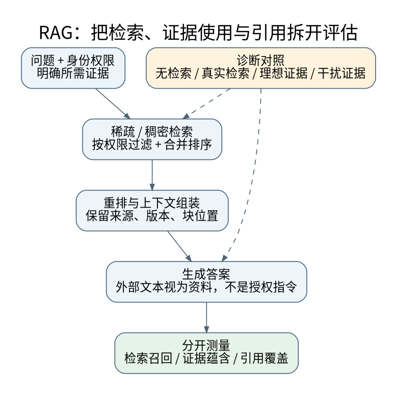

# 混合检索、重排、RAG误差分解与证据

**先修与定位：** 连接 Embedding、[[AI/10-机器学习与深度学习基础/18-嵌套验证配对实验与指标陷阱|误差分解]]、[[AI/20-LLM/10-原理/08-上下文学习机制假说与可证伪实验|上下文使用]]和权限边界。

## 先判断缺的是证据，还是使用证据的能力

RAG 将外部检索内容作为生成条件，原始研究把参数记忆与非参数记忆结合起来。[^S57] 工程中的 RAG 则常包括文档解析、切块、索引、召回、重排、上下文组装、生成与引用核验。任何一层失败都可能表现为“回答错误”，只更换生成模型无法区分原因。

一个可操作的诊断是设置四个条件：无检索、真实检索、人工提供充分证据、提供无关干扰。如果人工证据条件仍然失败，瓶颈不只在召回；人工证据成功而真实检索失败，应先检查检索和组装。这是干预式误差定位，不是一个只看最终分数的排行榜。

## 词项检索与稠密检索为什么互补

词项检索对专有名词、代码标识符、编号和罕见精确匹配有直接优势；稠密向量检索可跨不同表述寻找语义相关片段，但也可能把“有关这个话题”误当“支持这个结论”。否定、数值和时间差异尤其需要验证，向量相似不等于逻辑蕴含。

不同检索器分数尺度不一致，直接相加可能让数值范围大的系统支配结果。排名融合的一种方式为

$$
\operatorname{RRF}(d)=\sum_{j:d\in R_j}\frac1{k+\operatorname{rank}_j(d)},\qquad k>0.
$$

RRF 是已有的排名融合方法。[^S53] 它不要求原始分数可比较，但丢失分数间距；$k$ 控制前列优势的强弱，不能把某个常用值当作理论最优常数。两份高度重复的排名也不是两份独立证据。

### RRF 的一个最小排名构造

取 $R_1=[A,B]$、$R_2=[B,C]$，名次从 1 开始；未出现在某列表的文档对该列表贡献 0。令 $k=60$：

| 文档 | $R_1$ 贡献 | $R_2$ 贡献 | 总分（约） |
| --- | ---: | ---: | ---: |
| A | $1/61$ | 0 | 0.016393 |
| B | $1/62$ | $1/61$ | 0.032522 |
| C | 0 | $1/62$ | 0.016129 |

例如 B 的总分为 $1/62+1/61\approx0.032522$，最终排序为 $B>A>C$。计算只使用各列表内的名次，没有读取或相加 BM25 分数与向量距离；两路都返回 B 可以提升其融合排名，但不能据此称 B 获得了两条独立事实证据。

## 切块是信息保留和预算之间的选择

块太短会拆掉条件、定义和表头；太长会带入无关内容并挤占上下文。重叠切块缓解边界问题，但会产生重复命中。应保存文档ID、版本、段落/页码、起止偏移和父级标题，召回后按稳定来源去重，必要时扩展邻近上下文。

表格不能简单打碎为不带表头的一行数字；代码需保留函数签名与关键依赖；时间敏感材料必须保留生效日期。对扫描文档、复杂公式和图片，文本抽取失败属于上游解析问题，不能指望 Embedding 从不存在的信息里检索。

## 重排提升的不是凭空生成的召回

Cross-encoder 等重排器联合读取查询与候选，能做更细匹配，但只能在候选集合内排序。如果必要证据根本没进入候选，再强的重排也找不到。应分开报告候选召回率、重排后的证据覆盖和最终回答质量。

图结构检索适合实体关系、多跳连接和明确结构，但建图会引入抽取误差、实体消歧与更新成本。知识图谱和本库的双向链接都能帮助导航，却不能单凭边存在就证明关系真实。结构要能追溯来源。

## 引用有三个不同正确性问题

第一，链接是否存在且版本可追溯；第二，被引材料是否支持紧邻的具体主张；第三，重要主张是否都有充分证据。真实链接也可能被错误归因。应对回答拆分事实主张，检查数值、主体、时间、否定和适用条件，并允许“当前证据不足”。

例如问“某规则从何时生效”：即使找到正确的 `政策.md`，只截到“术语定义”段也无法支持日期答案；若截到旧版的日期段，仍不足以支持“当前生效日期”。文件命中、段落命中、证据充分与引用支持是不同层次，引用应保留版本与实际支撑断言的段落定位，不能只指向相关文件名。

同一段原文被词项和向量检索同时返回，仍只有一条来源链；两个网站转载同一公告也不构成相互独立的佐证。判断“多源一致”需回到原始出处与版本，不能按检索器、URL 或 chunk 数量计票。相关材料进入上下文，并不自动保证生成的每个主张都受它支持。

### 同一关系的三种材料条件

问“Cora是Ada的祖先吗”，记 $q=Anc(Cora,Ada)$。下面材料为教学构造，固定主体身份、访问权限与查询时点，不运行真实检索；判断“材料支持什么”仍须读具体主张，而非只看实体同时出现。

| 固定材料条件 | 最强可支持回答 | 仍需检查 |
| --- | --- | --- |
| 必要证据未被召回；top-k只含无关活动介绍 | 当前可访问的召回材料不足以判断$q$ | 召回范围、切块、版本；空top-k不证明全库或现实无关系 |
| 已召回材料仅写“Cora与Ada参加同一次活动” | 材料支持参加活动，未支持$q$或其否定 | 引用主张是否对应；同现不等于祖先关系 |
| 已召回材料在已声明且有效的登记范围内明确写“Cora不是Ada的祖先” | 该材料在其范围和版本内支持$\neg q$ | 来源身份、时点、登记覆盖与有无冲突；不能扩大成所有时期的现实断言 |

第三种支持否定，需要明确否定断言及适用性；前两种只缺正面支持，不能自动升级。涉及权限时，只报告当前可访问材料的证据状态；不得用回答、错误消息或trace确认不可访问记录是否存在。

带着这三种回答转到[[AI/13-搜索推理与规划/05-知识表示规则归结与查询#同一查询：未推出、表内无匹配与证据不足|两模型与SQL行结果的同题对照]]：比较全模型蕴含、闭世界结果表及SQL条件的UNKNOWN，再返回本节判断材料覆盖。也可从[[哲学与文化/20-论证知识与规范/01-论证知识与证据#论证重建：有效、支持与知识分开|前提尚无支持与结论已证伪]]进入：练习中应标明每个否定依赖模型、表、条件还是材料，不能只写一句“缺证据”。

检索材料可能过期、相互冲突或包含恶意指令。权限过滤应在召回与内容流转时执行，不是生成后删名字。材料中的“执行某命令”应保持数据身份，见[[AI/20-LLM/70-工程应用与工具链/09-Agent状态机幂等执行与提示注入边界|提示注入边界]]。

自测：召回率很高但回答不忠实，应该先扩大 top-k 吗？不一定。更多干扰可能恶化证据使用，应先比较人工充分证据条件、上下文排序、引用核验与模型遵循证据的能力。统计评估见[[AI/20-LLM/70-工程应用与工具链/10-LLM评测污染裁判偏差与统计检验|LLM评测]]。

## 来源与证据边界

相关接口与延伸方法可继续核对：[^S54]。

本页的数值例与推导用于解释机制，不代表大型模型或真实业务上的实测效果。方法与接口依据如下，来源核验日期为 2026-09-06。

[^S57]: [Lewis等：Retrieval-Augmented Generation](https://arxiv.org/abs/2005.11401)。2020；参数与非参数记忆的结合。
[^S53]: [Cormack等：Reciprocal Rank Fusion](https://research.google/pubs/reciprocal-rank-fusion-outperforms-condorcet-and-individual-rank-learning-methods/)。2009；作者机构论文入口。
[^S54]: [OWASP：LLM Prompt Injection Prevention Cheat Sheet](https://cheatsheetseries.owasp.org/cheatsheets/LLM_Prompt_Injection_Prevention_Cheat_Sheet.html)。动态官方安全指南；工程边界而非绝对保证。

**返回与迁移：** [[AI/20-LLM/70-工程应用与工具链/00-工程应用与工具链-MOC|本主题课程地图]]；[[AI/00-开始/05-问题驱动知识图谱与难点导航|按问题跨主题继续]]。
