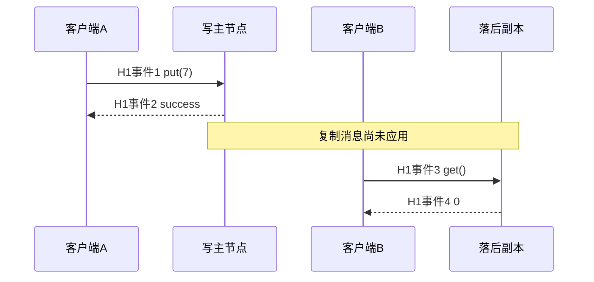

# 复制、一致性与可见性历史

A 已经回答 `put(7)` 成功，随后 B 回答 `get()=0`。这究竟是复制协议错误，还是读副本的合同允许旧值？答案要来自**调用和返回组成的历史**，不能只看某个节点最后也变成了 7。最后收敛是终态问题，一致性是整个观察过程的问题。

## 单键服务的顺序规格

初始 x=0；顺序执行 put(v) 后 x=v，get 返回当前 x。一次操作记为 `(client, kind, value, invocation, response)`，get 的 value 是观察结果，put 的 value 是写入值。put 的结果默认为成功。调用与返回是不同事件；同一客户端本课一次只发一个在途操作。真实时间先后只用于“不重叠”的约束，不要求所有服务器墙钟相同；示例编号是外部观察者给事件的先后序号。

线性一致性要求找到一个合法顺序，使每次操作可放在它的调用与返回之间，且若某操作返回早于另一操作调用，前者必须排在后者前面。顺序一致性只要求合法顺序和每客户端程序顺序，允许重排不同客户端不重叠的操作。[Herlihy 与 Wing 1990，§2.1–2.3，印刷页 467–470；§3.3，页 472–473](https://cs.brown.edu/~mph/HerlihyW90/p463-herlihy.pdf)。规格是寄存器操作，不能把事务可串行化直接替换进来；事务历史和写偏斜继续读 [[计算机知识/55-数据库/10-系统课程/10-MVCC快照写偏斜与重试协议|数据库并发历史]]。

## 四个真正可以判定的历史

| 历史 | 已完成操作（事件序号） | 结论及合法顺序/矛盾 |
| --- | --- | --- |
| H1 | A put(7):1→2；B get(0):3→4 | 顺序一致：B get→A put；非线性一致：实时顺序迫使 put→get，而 get 必须为 7 |
| H2 | A put(7):1→4；B get(0):2→3 | 线性一致：get→put，重叠调用允许如此；put 可在事件 3 与 4 之间生效 |
| H3 | A put(7):1→2；A get(0):3→4 | 两者都不满足：A 自己的程序顺序迫使 put→get |
| H4 | A put(7):1→6；B get(7):2→3；C get(0):4→5 | 非线性一致：B get→C get，但 B 的 7 又迫使 put→B get，C 的 0 迫使 C get→put，构成环；顺序一致可排 C get→put→B get |

H4 说明“两个读都与一个写重叠，所以随便返回新旧”会忽略读之间的实时约束。H1 是实际历史形状的教学反例：异步副本读确实可能产生它，但这里没有运行真实数据库。实验判定的是表中的历史，不能声称测出了生产服务的违例。



## “有多数派”和“线性一致”之间还缺什么

N 个固定副本，写确认集合大小 W、读取集合大小 R。如果 `W+R>N`，两个集合必有交集；但交集本身只证明某读节点接触过写集合中的节点。还需要版本可比较、选取正确版本、并发写仲裁、故障后保留和读过程的完整规则。如果任意节点可以给互相冲突的写打上同一个版本，或者收到一个旧应答就提前返回，集合代数不能补救。不能由 R=2、W=2、N=3 直接宣称线性一致。

领导者复制也需要读协议。少数派里的旧主可能还自以为是主，在本地返回旧读。正确读通常需确认当前领导权、保证已提交日志应用到足够位置，或遵守经证明的租约前提；“向 leader 发请求”不是证明。本实验没有实现 ReadIndex 或租约，因此不能验证线性一致读。复制接收/刷盘/应用的数据库实现边界已在 [[计算机知识/55-数据库/10-系统课程/12-WAL日志恢复与副本确认边界#副本确认要问：哪个节点，到哪一步|副本确认主解释]] 给出。

读己之写只约束同一会话看到自己的写；单调读约束会话不退回较旧的观察。它们不自动规定所有会话共享同一实时顺序。最终一致性必须包含写入停止、相关副本恢复通信及合并协议能推进等前提；它不为每一次读提供“最新”合同，也不允许把错误冲突处理当成正常滞后。

## 状态合并的收敛与业务不变量

读副本的合同刚才从调用历史判断；现在换一个对象：两份**只增长计数的状态**如何合并？共同结果要保留两侧更新，并能容忍同一状态的重复或乱序传递。先问合并值是哪一个最小上界，再单独核对它是否满足计数或预约规格。

### 两个分量为何比一个总数多保留必要信息

固定副本身份A/B，各自唯一且不复用。状态 $s=(s_A,s_B)\in\mathbb N^2$，初始(0,0)；A只递增A分量，B只递增B分量，其他分量只能通过合并增长。同一副本的递增与合并按串行或原子状态转移执行；使用数学自然数，无溢出，已确认状态不丢失，不任意重置，也不在丢失状态后复用旧身份。接收的状态需遵守该合同，不讨论恶意伪造。

查询 $value(s)=s_A+s_B$。A独立完成2次递增为 $p=(2,0)$，B独立完成3次为 $q=(0,3)$：各分量记的是对应身份已完成的递增次数，合并不会把别人的次数变成自己新完成的次数。

定义分量偏序与合并：

$$
x\le y\iff(x_A\le y_A\land x_B\le y_B),\qquad
x\sqcup y=(\max(x_A,y_A),\max(x_B,y_B)).
$$

例如p与q互不可比。令 $m=p\sqcup q=(2,3)$：p≤m且q≤m，所以m是上界。任取共同上界z，每个分量zᵢ同时≥pᵢ与qᵢ，故zᵢ≥max(pᵢ,qᵢ)，得到m≤z；这证明逐分量max是**最小上界**，而非只找到某个更大的数。数学定义回查[[数学/12-离散数学与逻辑/02-关系函数等价类与偏序#5. 最小与极小、上界与上确界|上确界及其环境]]；任意两状态都有join已经足以构成这里所用的上半格，不要求存在全局最大计数。

逐分量检查三条性质：max(a,b)=max(b,a)，故join交换；max(max(a,b),c)=max(a,max(b,c))，故结合；max(a,a)=a，故幂等。因此重排可交换、分组可重新结合、重复同一状态不增计数。所有收到的状态在同一偏序中合并，并不意味着不同业务的任意字符串或记录都可以直接套max。[Shapiro等2011，§2.3、定义4及定理1](https://www.lip6.fr/Marc.Shapiro/papers/2011/CRDTs_SSS-2011.pdf)给state-based半格收敛的充分条件；本页用明确的分量模型逐项推演。

| 表示与合并 | 收到p、q，再重复p | 保留或丢掉什么 |
| --- | --- | --- |
| 只存总数，max | max(2,3)=3，再max(3,2)=3 | 重排重复稳定，但丢失一侧并发递增 |
| 只存总数，相加 | 2+3=5，再+2=7 | 首次看似正确，重复状态制造多算 |
| 独占分量，逐分量max，sum查询 | (2,3)，再合并(2,0)仍(2,3)，查询5 | 每个身份的递增累计保留一份 |

把顺序改为q、p、p或先合并(p,p)再合并q，向量仍为(2,3)。标量max本身也交换、结合、幂等，所以“合并收敛”并未自动证明它满足累计5次的规格；独占分量保存了并发贡献来自哪个写者这一项必要信息。G-Counter的向量规格与标量失败讨论见[作者报告RR-7506，§3.1.2、Specification 6，印刷页14–16（PDF第16–18页）](https://dsf.berkeley.edu/cs286/papers/crdt-tr2011.pdf)。

### 保序、只上升与最终传播是不同条件

保序是 $x\le y\Rightarrow u(x)\le u(y)$；只上升是 $s\le u(s)$。前者比较两个输入，后者比较一次更新前后。在自然数序中u(n)=0保序却会下降；v(n)在奇数时加2、偶数时不变，每次只上升，但1≤2而v(1)=3>v(2)=2，不保序。本例A更新 $u_A(s)=s+(1,0)$、B更新 $u_B(s)=s+(0,1)$ 两项均满足；join也只上升。这里state-based收敛充分条件使用的是更新后的状态不下降与join，并假定最终传播与各次方法执行终止；不能把一般函数保序性添成原定理的必要条件。

为什么身份和状态保留不能省？若两个写者共用A分量，各从(0,0)做一次更新都发出(1,0)，合并只计1而实际有两次；若A已确认2次后丢掉状态，以同一身份从0再做一次，只产生(1,0)，与留存的(2,0)合并仍为2而实际累计3；若用固定宽度整数溢出归零，同样破坏只上升。幂等合并容忍的是**重复传递已有状态**，不是客户端重复提交递增意图自动只生效一次：意图去重需另有身份与持久记录合同。

停止更新后，固定两分量的最终值为 $s^*=(a,b)$。正确状态不超过s*；每个正确副本最终收到包含所有最终分量的状态，合并后就等于s*，再来旧状态也不变。传播可直接或经其他副本，但最终必须送达最后更新。永久隔离、最后消息永不送达或已确认状态不可恢复，代数性质不会凭空补回数据。持续更新时不承诺某个有限时刻永久静止。

### 与数据流比较：相同合并结构，不同停止条件

编译器may集合在子集序下用并集作join；有限CFG、固定方程、有限高度、从指定初值沿单向迭代及公平工作列表，给出有限步不动点。先复算[[计算机知识/70-编译原理/09-数据流分析格不动点活跃性与到达定义#收敛前的 may 集合只是暂定值|两块CFG空暂定值怎样变成{x}]]，再带着“所有依赖是否已处理”返回这里。

计数域 $\mathbb N^2$ 有无限严格上升链 $(0,0)\prec(1,0)\prec(2,0)\prec\cdots$，没有“所有计数可能性已处理”的有限高度保证，也没有统一的网络工作列表清空事件。这不反驳有限次更新、最终传播之后的收敛：那时实际更新数已经停止，而非整个状态域变有限。数据流求解器终止之后，若要将结果用于优化，还要单独证明transfer对具体语义sound；副本相同也要单独证明计数规格，见[[计算机知识/70-编译原理/09-数据流分析格不动点活跃性与到达定义#10. Soundness、precision、termination 与真值必须分开|终止与soundness的边界]]。

### 同一空时段为什么还能被接受两次

沿用预约案例的“同一资源、重叠时段只能有一项活动预约”，取同一时段[540,600)，容量1。这里另造一条**无协调并发接受规则**：副本读自己的集合，看不到冲突就承诺接受；没有在运行现有顺序预约代码。

| 步骤 | A的活动预约集合 | B的活动预约集合 | 可观察承诺 |
| --- | --- | --- | --- |
| 隔离前，两端读空时段 | ∅ | ∅ | 两边各看到容量1 |
| A本地检查并接受给甲 | {甲} | ∅ | A对甲确认接受 |
| B尚未看到A，接受给乙 | {甲} | {乙} | B对乙确认接受 |
| 恢复后用并集合并 | {甲,乙} | {甲,乙} | 状态相同，容量要求却为2≤1，失败 |

记录含不同预约身份与同一资源/区间；{甲}/{乙}是简写。并集的交换、结合、幂等保证集合合并一致，却没有让“容量≤1”的合法状态集合对join封闭。收敛后删掉一条也必须处理此前的接受承诺和受影响者，不能倒称两条确认都正确。此反例只否定这条无协调接受规则，不证明所有CRDT都无法维护任何约束，也不把终态相同等同线性一致历史。

若接受前改为有协调的原子容量提交，隔离侧可能需等待或拒绝；若指定唯一时段写者，另一侧需联系该写者；若预先分配不可重复消费的权利，局部只能接受所持权利，权利转移和恢复还需自己的协议。它们改变接受前提与可用性代价。回到[[计算机知识/75-软件工程与人机交互/80-一个预约服务的需求到维护案例#同一时段并发接受的容量反例|预约容量反例出口]]，分开规则版本、意图恢复与副本状态合并。

### 消费权威结果时另查意图

上面的集合反例用了另造的局部接受规则。当前预约实现只使用[[计算机知识/75-软件工程与人机交互/82-v2意图恢复与演进实验#唯一业务合同：移动端与流处理共用|wwl-reservation-v2/1 的唯一合同]]：单个教学Authority在SQLite写事务中复核意图、检查容量、保存决定和outbox；不是让两个独立Authority先各自接受再并集合并。容量例不复制一套预约协议，也不把这个单库事务模型当真实分布式部署。

消费端先持久保存`actor`、`intent_id`、原预约参数与`fingerprint`；唯一键是`(actor,intent_id)`，同意图重试保留原键。fingerprint涵盖`actor/end/op/policy_version/start`的规范JSON，**不含epoch或intent_id**；更换epoch是写者资格变化，不能借此把一次意图伪装成另一次。相同key、不同参数必须报`IntentConflict`，保留原决定。

| 权威查询/调用观察 | 消费端可说什么 | 不能从状态合并补出的事实 |
| --- | --- | --- |
| accepted | 该意图已有持久创建决定，沿原booking及event_id处理 | 不把另一个独立意图的容量请求自动接受 |
| rejected | 该意图已有持久业务拒绝；同key同参数重放仍是原拒绝 | 不因后续空闲或合并改变原决定；重新申请须新意图 |
| unknown / 回复丢失 / 数据库异常 | 仍待查询或同意图重放；unknown只是当前未注册结果 | 不证明请求以后不能提交，不改成容量拒绝或取消成功 |
| WriterFenced | 新意图没有当前写者资格；原已保存结果保持 | 不登记新的业务rejected，也不覆写旧accepted |

`writer_epoch`、`policy_version`、schema版本与协议版本的对象各不同；原决定重放、未知协议、构造器锁等待和sink幂等的细节返回[[计算机知识/75-软件工程与人机交互/82-v2意图恢复与演进实验#接口版本与模式迁移分别管理|版本与迁移边界]]及[[计算机知识/75-软件工程与人机交互/82-v2意图恢复与演进实验#故障历史、迁移与可检查范围|故障历史]]。state join的幂等性只解决重复运输已有状态；同一意图不重复生效、不同意图共享容量和通知一次效果必须各自有合同。

增量流消费接口也须逐项声明输入对象：增加新事件，重放同一event_id，更新已有行，删除已有行以及晚到/乱序，不能都改写成一次G-Counter递增。窗口输出还需声明事件时间、窗口边界、watermark与晚到政策；删除造成当前和减少不是本页增长向量的合法更新。恢复时offset、聚合状态、身份去重状态与待交付输出须对应同一个可恢复切面，sink副作用/ack仍独立处理。本页只说明为何这些条件不能由join三性质代替；没有验收流课程的窗口、恢复或删除实现。离线端同样要区分本地排队与权威accepted，取消和删除不得通过抹去增长分量来模拟。

### 迁移题与有限实验边界

1. A/B分别3次、4次；接收顺序q、p、q。向量、标量max、标量相加各得什么？
2. 保持逐分量max却让两写者共用同一身份，各从0增1；为什么收敛值不能证明计数正确？
3. 一端从未收到另一端最后状态，能否仅凭三条合并性质保证两端最终同值？预约容量反例要改变哪项接受前提才可阻止两条确认？

> [!success]- 参考解与返回问题
> 1：p=(3,0)、q=(0,4)，向量(3,4)，查询7；标量max为4；标量相加4+3+4=11。2：两状态均(1,0)，join仍(1,0)，实际两次更新却只计1，独占写者/身份前提已坏。3：没有最终传播保证就不能推出相同；容量安全可引入原子协调、唯一写者或正确预分配权利，必须说明谁可接受、隔离时能做什么。回查数学最小上界、数据流停止条件与预约承诺，不能只答“最终一致”。

[固定输入实验gcounter_join_examples.py](gcounter_join_examples.py)提供合并顺序、三种表示、身份复用/状态丢失/末次未送达/溢出条件失败和预约集合反例。本版固定实验尚待独立运行。它只运行有限整数/集合状态；核心证明保留在正文。未实现真实网络协议、持久层、删除、成员变更、Byzantine或文本协作，也不验证生产数据库、Obsidian导航或真人学习效果。增量流含更新/删除和源—状态—sink恢复，离线应用含业务待确认/容量协调，均须各自处理，不能把G-Counter当作撤销协议或预约提交协议。

## 怎样检查，而不把小模型当通用检查器

[[计算机知识/65-分布式系统/80-确定性消息调度与复制实验|历史判定器]] 穷举至多八个已完成单键操作的排列，先检查偏序约束，再按顺序规格解释返回值。顺序一致模式只加客户端约束，线性模式加所有不重叠操作的约束。没有合法排列返回 None；合法排列返回操作索引元组作为可复查证据。复杂度约 O(n!·n²)，适合小反例，不适合长期日志。

判定器不支持在途操作、失败/未知结果、多键事务、同客户端并发或连续时间相等端点。未完成调用在一般线性一致定义里需要考虑补全或舍弃；这里输入只限已完成调用，不把“没有收集到成功响应”当作“没有发生”。

练习：H4 中 B/C 的读改为重叠（B:2→4，C:3→5），是否仍矛盾？答案：可排 C get(0)→put(7)→B get(7)。三个操作重叠，实时边 B→C 消失，取线性化点在共同重叠区间内即可。反例的力量来自具体边，不来自三个返回值的表面排列。

返回 [[计算机知识/65-分布式系统/00-分布式系统-MOC|课程入口]]；下一页 [[计算机知识/65-分布式系统/03-共识领导者日志与多数派交集|共识与日志]] 解释怎样让成功确认有跨领导者保留依据。

## 有限合并实验的运行接口与源码

Python 3.10+，只用标准库；在本页目录运行：

```bash
python3 -B gcounter_join_examples.py
```

固定输入已写在源码中。预期：三条不同消息顺序的最终向量均(2,3)、query=5；标量max=3、相加=7；共用身份合并query=1（实际2），丢状态复用身份query=2（实际3），末次未送达same=false、送达后(2,3)，溢出inflationary=false；重复调用为(2,0)，重复状态为(1,0)。预约merged_A=merged_B但active_same_slot=2、capacity=1、capacity_holds=false。独立oracle以[0,3]²的16状态枚举256状态对的所有上界、4096三元组，事件身份集合核对计数；有限枚举补充正文证明。 本版未运行，独立执行者需保存冻结源码、环境、原始输出与观察，运行有限模型不认证真实网络、数据库部署、Obsidian或真人学习。

<!-- code-sync: ./gcounter_join_examples.py -->
```python
"""Finite state-based G-Counter illustrations; Python 3.10+, standard library.

Run: python3 -B gcounter_join_examples.py
A/B are fixed unique identities and sole writers of their own component. Local
updates/merges are serialized, natural numbers do not wrap, acknowledged state
is retained, and final updates eventually reach each correct replica. These are
assumptions, not services enforced by this pure-function teaching model.
Only already-produced states are merged. Repeated client intents are a separate
contract. Failure examples intentionally violate a stated assumption.
"""
from itertools import permutations
import json

IDENTITIES = ("A", "B")
ZERO = (0, 0)


def check(state):
    if not isinstance(state, tuple) or len(state) != len(IDENTITIES):
        raise ValueError("fixed two-component tuple required")
    if any(type(component) is not int or component < 0 for component in state):
        raise ValueError("natural-number components required")


def leq(left, right):
    check(left)
    check(right)
    return all(a <= b for a, b in zip(left, right))


def join(left, right):
    check(left)
    check(right)
    return tuple(max(a, b) for a, b in zip(left, right))


def increment(state, owner):
    check(state)
    if owner not in IDENTITIES:
        raise ValueError("unknown fixed identity")
    result = list(state)
    result[IDENTITIES.index(owner)] += 1
    return tuple(result)


def value(state):
    check(state)
    return sum(state)


def fold(messages):
    state = ZERO
    for message in messages:
        state = join(state, message)
    return state


def trace(messages):
    state = ZERO
    rows = []
    for message in messages:
        state = join(state, message)
        rows.append({"message": message, "state": state, "query": value(state)})
    return rows


def fixed_examples():
    p, q = (2, 0), (0, 3)
    sequences = sorted(set(permutations((p, q, p))))
    return {"p": p, "q": q, "message_sequences": [trace(s) for s in sequences],
            "grouped_left": join(join(p, p), q),
            "grouped_right": join(p, join(p, q)),
            "three_merges": {"scalar_max": max(2, 3, 2),
                             "scalar_sum": 2 + 3 + 2,
                             "vector_state": fold((p, q, p)),
                             "vector_query": value(fold((p, q, p)))}}


def conditions_fail():
    # Two independent writers wrongly use the same logical component.
    shared_identity = join(increment(ZERO, "A"), increment(ZERO, "A"))
    # Old acknowledged state 2 remains elsewhere; A resets and performs one more.
    after_loss = join((2, 0), increment(ZERO, "A"))
    # Without final propagation, states containing the last updates stay apart.
    undelivered_a, undelivered_b = (2, 0), (0, 3)
    # A deliberately broken four-valued integer implementation wraps 3 to 0.
    before_wrap, after_wrap = (3, 0), ((3 + 1) % 4, 0)
    return {
        "shared_identity": {"actual_increments": 2, "merged": shared_identity,
                            "query": value(shared_identity)},
        "lost_state_reused_identity": {"actual_increments": 3, "merged": after_loss,
                                       "query": value(after_loss)},
        "last_update_not_delivered": {"A": undelivered_a, "B": undelivered_b,
                                      "same": undelivered_a == undelivered_b,
                                      "after_delivery": join(undelivered_a, undelivered_b)},
        "wraparound": {"before": before_wrap, "after": after_wrap,
                       "inflationary": leq(before_wrap, after_wrap),
                       "merged_with_old": join(before_wrap, after_wrap),
                       "actual_increments": 4},
        # Transporting duplicate state and issuing another increment differ.
        "repeated_command": {"two_calls": increment(increment(ZERO, "A"), "A"),
                             "same_state_twice": join((1, 0), (1, 0))},
    }


def booking_example():
    # Distinct booking identities; one resource, same valid interval; no cancel.
    a = frozenset({("A:1", "甲", "room", 540, 600)})
    b = frozenset({("B:1", "乙", "room", 540, 600)})
    merged_a, merged_b = a | b, b | a
    return {"reads": {"A": [], "B": []}, "local_A": sorted(a), "local_B": sorted(b),
            "merged_A": sorted(merged_a), "merged_B": sorted(merged_b),
            "same": merged_a == merged_b,
            "capacity": 1, "active_same_slot": len(merged_a),
            "capacity_holds": len(merged_a) <= 1,
            "scope": "constructed no-coordination rule; not reservation_v2 execution"}


def main():
    report = {"fixed": fixed_examples(), "condition_failures": conditions_fail(),
              "booking": booking_example(), "boundary": "finite math; no real network or storage"}
    print(json.dumps(report, ensure_ascii=False, indent=2))


if __name__ == "__main__":
    main()
```
