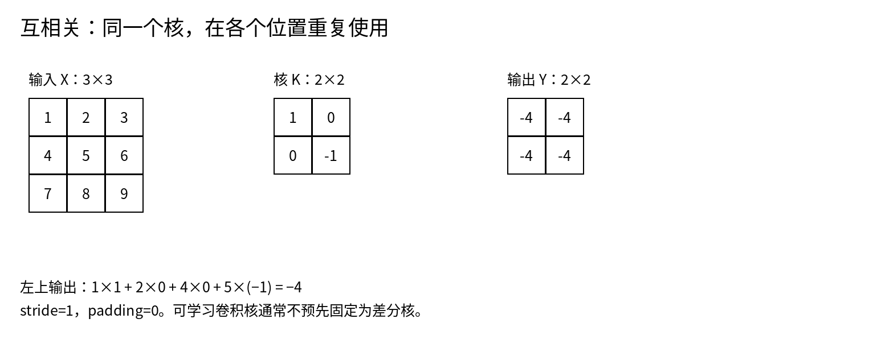

# 卷积、互相关、形状与参数共享

<!-- deep-review-02 -->
> [!tip] 本轮深化：从当前概念继续追问
> 卷积可写成具有共享参数的线性算子。它的转置描述梯度回传，不恢复已经丢失的输入；stride 还涉及采样与混叠，不只是输出变小。 深化与验证：[[AI/15-卷积神经网络/04-卷积反向传播与转置卷积|卷积反向传播与转置卷积]]；[[AI/15-卷积神经网络/05-采样混叠感受野与平移鲁棒性|采样混叠感受野与平移鲁棒性]]。

全连接层把每个输入坐标都当成不同特征。图像中的边缘却可能出现在任意位置。卷积用同一个小窗口检查各个位置，以局部性和共享权重减少参数，并形成适合空间数据的归纳偏好。

## 深度学习中的卷积通常是互相关

数学卷积会翻转核；PyTorch 的 `Conv2d` 实际计算常称为互相关的运算，不翻转核。对于可学习核，这个差别不妨碍表达同一类函数，但手算时必须固定定义。[1]

省略 batch，普通二维互相关为：

$$
Y_{o,i,j}=b_o+\sum_{c=0}^{C_{in}-1}\sum_{u=0}^{K_h-1}\sum_{v=0}^{K_w-1}
W_{o,c,u,v}X_{c,is_h+ud_h-p_h,\,js_w+vd_w-p_w}.
$$

越界输入由 padding 规则决定。$o$ 是输出通道，每个输出通道都有自己的一组核，并对所有输入通道求和。不是“一通道只卷一通道”，除非显式使用分组或深度卷积。

## 手算一个输出

图中输入为从 1 到 9 的三行矩阵，核为 $\begin{bmatrix}1&0\\0&-1\end{bmatrix}$，步长 1、无 padding。左上角输出为 $1-5=-4$，其余三个位置也都是 $-4$。这检测的是固定方向上的局部差值，不是图像的绝对亮度。

高度公式为：

$$
H_{out}=\left\lfloor\frac{H_{in}+2p_h-d_h(K_h-1)-1}{s_h}+1\right\rfloor.
$$

宽度同理。对 $H=32,K=3,p=1,s=2,d=1$，输出为 16。`same` 表示一种输出尺寸约定，不是任何框架、步长组合都同样支持的万能 padding 字符串。

## 参数和计算分开数

普通卷积含偏置时参数为 $C_{out}(C_{in}K_hK_w+1)$。输入 3 通道、输出 16 通道、3×3 核，对应 $16(27+1)=448$ 个参数，无论输入是 32×32 还是 512×512 都不变。空间分辨率改变激活和计算量，不改变这层核参数数量。

忽略偏置，单样本乘加次数约为 $H_{out}W_{out}C_{out}C_{in}K_hK_w$。报告 FLOPs 时说明一次乘加计 1 还是计 2。分组卷积把可连接输入通道减为 $C_{in}/g$，输入输出通道都需满足分组整除约定。

## 不变与等变不要混用

在理想的无限网格和步长 1 下，平移输入会导致输出同样平移，叫平移等变，不是输出不变。有限边界、padding、stride 和裁剪会破坏严格等变。池化或全局平均会减少位置信息，但也可能丢掉任务所需的空间关系。

1×1 卷积在每个空间位置混合通道，不直接扩展空间感受野。深度卷积先逐通道处理空间，再用 pointwise 卷积混合通道。这节省算术操作，但实际速度仍受算子实现、访存和设备影响。

**练习：** 把示例输入整体加 100，差分核输出不变；但给核加一个非零总和后就不成立。用这个反例区分“某个核的性质”和“所有 CNN 的保证”。

## 一手资料

1. [PyTorch：Conv2d](https://docs.pytorch.org/docs/stable/generated/torch.nn.Conv2d.html)。

**课程入口：** [[AI/15-卷积神经网络/00-卷积神经网络-MOC]]。
