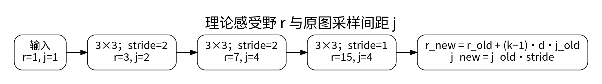
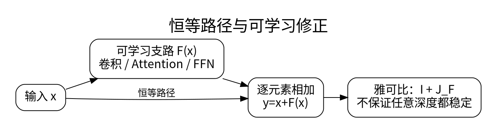

# 感受野、残差、归一化与经典架构

<!-- deep-review-02 -->
> [!tip] 本轮深化：从当前概念继续追问
> 理论感受野表示可能影响输出的范围，不代表每个位置都被同等利用。增加 stride 与改变抗混叠策略会同时影响计算、信息和鲁棒性。 深化与验证：[[AI/15-卷积神经网络/07-残差网络轻量卷积与训练配方|残差网络轻量卷积与训练配方]]；[[AI/15-卷积神经网络/05-采样混叠感受野与平移鲁棒性|采样混叠感受野与平移鲁棒性]]。

一个小卷积只看邻域，多层叠加却能聚合更大区域。模型的深度价值不只是“参数更多”，还在于逐层组合特征与控制信息流。

## 感受野不是核大小相加

令第 $l$ 层的理论感受野为 $r_l$，相邻输出在原始输入上的间距为 $j_l$。初始化 $r_0=j_0=1$，则：

$$
j_l=j_{l-1}s_l,\qquad
r_l=r_{l-1}+(k_l-1)d_lj_{l-1}.
$$

连续三层 3×3 卷积，步长依次为 2、2、1，得到 $(r,j)=(3,2),(7,4),(15,4)$。第三层虽然仍只看三个上一层位置，却跨越原图上的 15 个像素宽度。

理论感受野表示可能影响某输出的区域，实际梯度影响通常不均匀；“理论覆盖整图”不证明模型有效使用了所有像素。空洞卷积通过增大采样间隔扩大覆盖范围，也可能形成栅格化的盲区。

## 残差为何有利于优化

残差块写成 $y=x+F(x)$，于是：

$$
\frac{\partial y}{\partial x}=I+\frac{\partial F}{\partial x}.
$$

恒等路径让信息和梯度不必完全穿过复杂支路，但不保证任意深度都不会梯度爆炸或消失。若空间尺寸或通道不同，需要投影捷径 $P(x)$，不能直接相加。原始 ResNet 和现代 pre-activation/pre-norm 的排列也不同，不能只凭“有加号”判断完全同构。[1]

## 归一化的统计轴

对 CNN 的 `[B,C,H,W]`，BatchNorm 训练时通常为每个通道统计 batch 与空间轴，推理时默认用运行估计；小 batch、领域变化或错误模式切换会导致失配。LayerNorm 按所指定的特征轴归一化，GroupNorm 在单个样本内部按通道组统计，不依赖 batch 的共享统计。

不能简单说 BatchNorm 只是“消除内部协变量偏移”。它也改变优化几何和随机性。比较归一化时要固定训练设置，并说明推理采用什么统计量。

## 经典结构怎样解决不同问题

LeNet 类路线用局部卷积和降采样建立层级；VGG 类路线展示小核堆叠的结构；ResNet 改写学习目标为残差；MobileNet 类结构用深度可分离卷积降低成本。记住这些设计动机比背每一层通道数更可迁移。

U-Net 让下采样路径提取语义，上采样路径恢复空间分辨率，再用跳跃连接保留细节。分割中的细边界很容易在压缩中消失，因此跳跃连接有直接任务意义。拼接后的通道变多，仍需卷积融合；不能把所有上采样都称为“反卷积”。转置卷积是线性卷积算子的转置形式，不是通常意义的逆运算。

**练习：** 两层 3×3、步长 1 的卷积具有 5×5 理论感受野。若在中间加入非线性，它不等价于一层线性 5×5 卷积；若不加非线性，仍须考虑边界与通道条件才能讨论等效核。

## 一手资料

1. [He 等：Deep Residual Learning](https://arxiv.org/abs/1512.03385)。

**课程入口：** [[AI/15-卷积神经网络/00-卷积神经网络-MOC]]。
