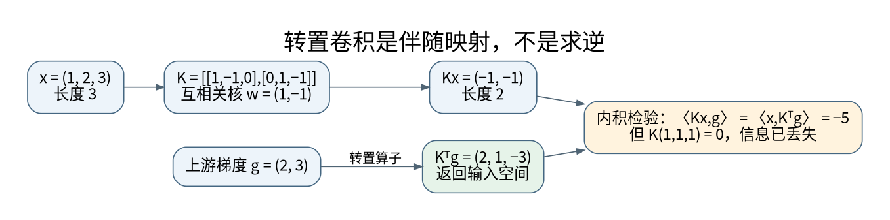

# 卷积反向传播与转置卷积

**先修与定位：** 先读卷积形状原笔记与[[AI/11-数学与统计桥梁/02-矩阵微积分VJP与反向传播|VJP]]；本页解释梯度、伴随和逆的区别。

## 从滑动窗口回到一个线性映射

固定卷积核后，卷积对输入是线性的。先忽略偏置和通道，取输入 $x=(1,2,3)^\top$、核 $w=(1,-1)$，步幅为 1，不补零。深度学习库通常计算互相关，因而

$$
y=Kx,\qquad K=\begin{bmatrix}1&-1&0\\0&1&-1\end{bmatrix},\qquad y=(-1,-1)^\top.
$$

“同一个核滑到下一格”就是矩阵中同一组系数向右移动。核不依赖于位置，因此大量矩阵元素被绑定为同一个参数。相比把输入展开后任意全连接，卷积不仅减少参数，也强迫模型用同一套局部规则解释不同位置。

## 输入梯度为什么是转置卷积

设上游梯度 $g=\partial L/\partial y=(2,3)^\top$。由微分 $dL=g^\top K\,dx$ 得

$$
\frac{\partial L}{\partial x}=K^\top g=(2,1,-3)^\top.
$$

中间的 $x_2$ 同时影响两个输出，因此梯度是 $-2+3=1$，不是从两个窗口里任选一个。这是[[AI/11-数学与统计桥梁/02-矩阵微积分VJP与反向传播|矩阵微积分与反向传播]]中“共享路径梯度相加”的空间版本。注意本例核梯度不同：$\partial L/\partial w_0=2\cdot1+3\cdot2=8$，$\partial L/\partial w_1=2\cdot2+3\cdot3=13$。**对输入求导时固定核，对核求导时固定输入；不要混为一个操作。**

转置卷积实现与原卷积对应的伴随线性映射，而不是一般意义的逆。最直接的检验是内积恒等式 $\langle Kx,g\rangle=\langle x,K^\top g\rangle$。这里两边均为 $-5$；但 $K$ 把三维压成二维，根本不能唯一恢复任意三维输入。PyTorch 官方也明确区分转置与逆。[^S06]

## 步幅、补零和 output_padding 究竟改变什么

一维卷积输出长度为

$$
L_{\rm out}=\left\lfloor\frac{L_{\rm in}+2p-d(k-1)-1}{s}+1\right\rfloor.
$$

取 $k=3,s=2,p=1,d=1$，输入长度 5 和 6 都得到长度 3。因此把长度 3 映回时，要指定目标长度是哪一个。转置卷积形状公式为

$$
L'=(L_{\rm out}-1)s-2p+d(k-1)+o+1,
$$

其中 $o$ 是 `output_padding`，本例 $o=0$ 得 5，$o=1$ 得 6。它解决**输出形状歧义**，不是给最终张量随意附加一列零，也不补回被下采样丢掉的信息。只有权重、步幅、补零、膨胀、分组和目标形状匹配时，才能把库函数当作特定卷积的输入伴随。二维只是分别对高和宽应用同样的推理。

## 上采样为什么可能产生棋盘格

转置卷积可理解为稀疏位置贡献经核覆盖后相加。某些核宽与步幅组合使不同输出位置接收的贡献数不均匀，叠加学习到的权重可能出现周期性纹理。先插值再普通卷积改变了覆盖方式，是一种可比较的替代；它也不自动保证质量更高。检查常数输入的响应、不同相位的响应和边界，而不只是总损失。

分类主要关心全局标签，分割还要关心每个位置能否精确对齐，继续读[[AI/15-卷积神经网络/06-检测分割匹配损失与评估协议|像素与集合预测的损失]]。输入平移后输出变化过大，应先排查[[AI/15-卷积神经网络/05-采样混叠感受野与平移鲁棒性|采样混叠]]，不能把所有现象归为“模型不够深”。

## 自测与参考解

设上例 $x$ 加上 $(c,c,c)$，输出如何变化？答案是不变，因为常数向量在 $K$ 的零空间。这直接给出转置卷积不能求逆的反例。将核换成任意值后，再用[[AI/80-实践/08-深层机制数值实验/00-数值实验导航与验收|数值实验]]同时检查输入梯度与伴随恒等式；只检验输出形状不足以证明实现正确。

## 来源与证据边界

相关接口与延伸方法可继续核对：[^S04]。

本页的数值例与推导用于解释机制，不代表大型模型或真实业务上的实测效果。方法与接口依据如下，来源核验日期为 2026-09-06。

[^S06]: [PyTorch 2.10：ConvTranspose2d](https://docs.pytorch.org/docs/2.10/generated/torch.nn.ConvTranspose2d.html)。固定版本；转置非逆、output_padding。
[^S04]: [PyTorch 2.10：Autograd mechanics](https://docs.pytorch.org/docs/2.10/notes/autograd.html)。固定版本官方接口。

**返回与迁移：** [[AI/15-卷积神经网络/00-卷积神经网络-MOC|本主题课程地图]]；[[AI/00-开始/05-问题驱动知识图谱与难点导航|按问题跨主题继续]]。
