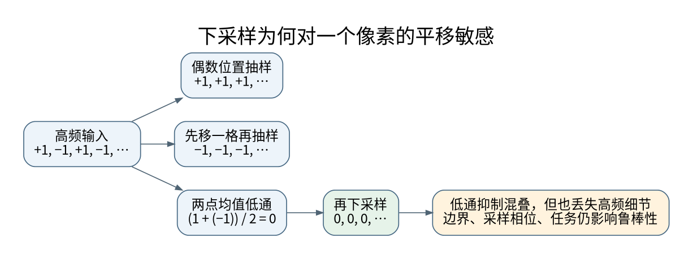

# 采样混叠、感受野与平移鲁棒性

**先修与定位：** 连接卷积、离散采样与[[AI/15-卷积神经网络/06-检测分割匹配损失与评估协议|定位任务]]。不要求先掌握完整傅里叶分析。

## 卷积的平移等变性有条件

对无限离散序列，步幅 1 的共享卷积满足先平移再卷积等于先卷积再平移。实际图像有限，补零会暴露边界；步幅大于 1 时，任意一像素平移也不再对应输出上的整格平移。**等变**是输出跟着移动，**不变**是输出保持相同。检测需要前者，某些分类需求更接近后者，不能互换。

取序列 $x[n]=(-1)^n$，每隔两格采一个点，得到全为 $+1$ 的序列。原输入向右移动一格，再从相同坐标采样，则输出全为 $-1$。原来高速正负交替的信号，下采样后看起来像两个完全不同的常量。这就是一个不需要傅里叶公式也能看到的混叠反例。

## 低通滤波解决了什么，又牺牲了什么

两点均值滤波 $z[n]=(x[n]+x[n-1])/2$ 会把上述交替分量变成零，然后再下采样，相位差异就消失了。频域上，下采样压缩可区分的频率范围，过高频率折叠到低频。先抑制超出新采样带宽的内容，可以减少这种折叠。

不过边缘、细小文字和小目标同样含高频信息。更强模糊可能提高平移稳定性，也可能损害细节；实际网络中的非线性还会重新产生高频。因此抗混叠不是一次滤波就永久解决，更不是“所有模型无条件变好”。已有研究将抗混叠操作嵌入网络并做了任务实验，外推到不同任务仍需对照。[^S43]

## 理论感受野为何不等于实际使用范围

令第 $l$ 层相邻输出在原图上相隔 $j_l$ 个像素，理论感受野宽为 $r_l$。若该层有效核宽为 $k_l^{\rm eff}=d_l(k_l-1)+1$，则

$$
j_l=j_{l-1}s_l,\qquad r_l=r_{l-1}+(k_l^{\rm eff}-1)j_{l-1},
$$

初始 $r_0=j_0=1$。连续三层 $3\times3$、步幅 1 的卷积，得到宽度 7；若第二层步幅 2，第三层读取的相邻特征隔两格，最终宽度是 9。这个递推只描述“有路径可能影响”，不说明路径权重、激活门控和训练后梯度的大小。

实际影响范围可以用某个输出对输入的梯度幅度、遮挡实验等估计。梯度为零也可能是局部饱和，遮挡则可能制造分布外输入，两者都不是无条件的因果解释。解释方法的限制见[[AI/20-LLM/80-研究拓展/01-机制可解释性Probe干预与稀疏特征|Probe与干预]]。

## 空洞卷积、池化与边界的连锁影响

空洞卷积扩展覆盖范围但跳过部分位置，多层固定模式可能形成采样栅格。最大池化选择局部极值，梯度只流向获胜位置；平均池化保留的是局部均值。二者都不是可逆压缩。跳跃连接可以带回高分辨率细节，但来自不同层的特征必须在坐标中心、尺寸和补零约定上对齐，而不是仅凭张量大小相同就相加。

在[[AI/15-卷积神经网络/06-检测分割匹配损失与评估协议|分割]]中，半像素偏移可能变成边界误差；在[[AI/30-VLM/03-视觉语言对齐信息瓶颈与反事实评测|视觉语言模型]]中，过大的 patch 会把小字压缩掉；在[[AI/40-语音与音频模型/03-CTC路径求和流式延迟与语音评测|语音]]中，时间下采样也面对相同的信息损失问题。这些不是三个孤立学科，而是相同的采样约束。

## 一个可执行的比较方案

固定训练集、数据增强、参数预算和随机种子集合，只改变下采样方案。除原始准确率，还报告一像素水平与垂直平移后的预测变化率，以及小目标、边缘区域的分层表现。对分割先把输出变换回共同坐标再比较，否则会把正常等变误判为错误。

自测：将“平移后分类标签未变”解释为网络具有严格平移不变性，哪里不成立？参考解：有限测试只观察有限样本上的输出；它不能建立对任意输入与任意平移的算子恒等式。应区分数学性质、经验鲁棒性和任务容忍范围。

## 来源与证据边界

本页的数值例与推导用于解释机制，不代表大型模型或真实业务上的实测效果。方法与接口依据如下，来源核验日期为 2026-09-06。

[^S43]: [Zhang：Making Convolutional Networks Shift-Invariant Again](https://arxiv.org/abs/1904.11486)。2019；下采样与抗混叠。

**返回与迁移：** [[AI/15-卷积神经网络/00-卷积神经网络-MOC|本主题课程地图]]；[[AI/00-开始/05-问题驱动知识图谱与难点导航|按问题跨主题继续]]。

同一实现的可核对入口：[[AI/80-实践/07-PyTorch与核心公式CPU实验/00-CPU实验与使用说明#对同一 CNN 改输入，并读清资源账|16×16横/竖线CNN]]把输入配置、1→8→16层shape、1282参数、conv2内部5×5感受野和GAP整图依赖接到同一源。运行命令与报告字段已定义，本次训练/测试notrun。
