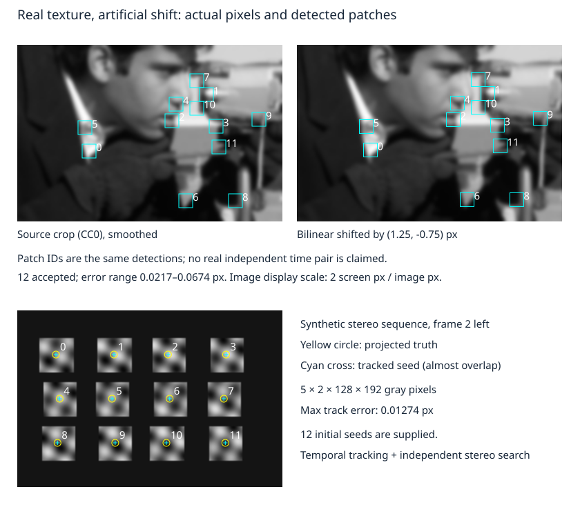

# 从灰度像素到局部光流与特征跟踪

前四课把“同一空间点在两张图里的坐标”当作输入。现在先还这笔债：程序如何从两张灰度图得到像素运动，什么条件下根本没有足够信息？本课实际处理逐像素数组，导出可交给几何估计的观测；识别点的身份仍是一项假设，低误差不是身份证。

## 对象先落到数组和时间

图像 $I_t(v,u)$ 是 `(H,W)` 灰度数组，行索引v向下、列索引u向右，强度在 `[0,1]`。数学把位置写成列向量 $p=(u,v)^T$，源码批量为 `(N,2)`；`I[v,u]` 的索引顺序不能照抄 `(u,v)`。非整数坐标用双线性插值，采样必须落在 $0\le u<W-1,0\le v<H-1$，窗口还要整体留在图内。负像素坐标在前几课连续投影中可以合法，本课拿来索引有限图像就越界了。

位移 $d(p)=(d_u,d_v)^T$ 从第t张指向第t+1张，本页报告这一帧间隔内的位移，单位px；若实际间隔为 $\Delta t$ 秒，$d/\Delta t$ 才是px/s。它还不是相机的m/s，也不自动等于物体速度：深度、相机运动和物体运动都会影响投影。静态场景的不同深度可以有不同光流，不能把12个点的运动粗暴平均成一个相机平移。

## 一条亮度约束为什么不够

假定同一可见表面点在两帧之间保持灰度，且一个小窗口中的位移可近似相同：

$$
I_{t+1}(p+d)\approx I_t(p).
$$

这把光照/曝光变化、镜面反射、运动模糊、遮挡和窗口内非平移形变排除在当前模型之外。对小位移作一阶展开，

$$
I_u d_u+I_v d_v+\Delta I\approx0,
\quad \Delta I=I_{t+1}(p)-I_t(p).
$$

$\Delta I$ 是固定位置的帧间强度差，不是沿运动点追踪后的强度差。梯度单位强度/px，乘px位移后是强度，和帧差同单位。连续时间写法是 $\nabla I^T\dot p+\partial I/\partial t=0$。

一个像素只有一个标量方程，却有二维未知运动。若只看到一条竖边，$I_v=0$，只能约束水平分量；沿竖边滑动的量任意。这是**孔径问题**，不是求逆算法不够高级。平坦区连水平方向也无法约束。多个像素只有在梯度方向有足够差别时，才提供第二个独立方向。

对窗口内m个像素，堆叠 $J\in\mathbb R^{m\times2}$，第k行为 $\nabla I_k^T$；强度差为 $r\in\mathbb R^m$，求

$$
\min_d\|Jd+r\|^2,\qquad H d=-J^Tr,\qquad H=J^TJ\in\mathbb R^{2\times2}.
$$

$z^THz=\sum_k(\nabla I_k^Tz)^2$：若存在非零方向z对所有梯度都垂直，该方向不改变一阶预测。H的两个特征值都大，表示两方向都有局部信息；一个接近零是边缘，两个都小是平坦区。把奇异H加一点epsilon可以给出一个数，却没有增加图像信息。

一个可手算的有限例子是

$$
J=\begin{bmatrix}1&2\\1&-1\\1&-2\end{bmatrix},\quad
r=\begin{bmatrix}0\\-3/8\\-1/2\end{bmatrix},\quad
H=\begin{bmatrix}3&-1\\-1&9\end{bmatrix},\quad\det H=26.
$$

代入得 $d=(1/4,-1/8)$ px。若把全部梯度改成 $(a_k,0)$，任意 $d_v$ 都同样拟合，增加这样的像素数量也无济于事。

## 从一次线性化走到实际配准

大位移不能只在原位置展开一次。固定源窗口 $p+q_k$，用

$$
E(d)=\frac12\sum_k[I_{t+1}(p+q_k+d)-I_t(p+q_k)]^2.
$$

在当前d处，令残差 $r_k(d)$ 如上，目标图的插值梯度为J的行，解 $J\delta\approx-r$，再更新d。源码用 `lstsq` 解这个小系统，避免显式形成 $H^{-1}$。双线性函数在每个像素格内的偏导由四邻域值直接计算，在整数网格边界导数可不连续；有限停止不等于证明达到平滑目标的全局极小。

[Lucas–Kanade原文 §4.2–§4.5，印刷页676–677](https://publications.ri.cmu.edu/storage/publications/pub_files/pub3/lucas_bruce_d_1981_1/lucas_bruce_d_1981_1.pdf) 用线性化和局部像素累加建立迭代配准，并讨论平滑与粗到细的收益和代价。本实现采用透明的小范围整数SSD搜索初始化，再做前向加性Gauss–Newton；它没有实现图像金字塔。搜索只扩大有限捕获范围，重复纹理、遮挡和大形变不会因此消失。

本机固定策略是11×11窗口，平均结构张量的最小特征值至少 $5\times10^{-5}$，源/目标都检查；每次最多40步，线搜索试 $1,1/2,\ldots,1/1024$。小更新小于 $10^{-5}$ px，或这11个步长都不能下降，就停止本次局部迭代；撞到40步上限则拒绝。`stopped`只记录这条停止政策。最后窗口强度RMS不得大于.035；反向再跟踪回源点，距离不得大于.15 px。阈值依赖强度缩放、窗口和数据，绝非通用相机阈值。

前后检查能发现一部分不一致，但无法验证身份。程序保存了8px周期纹理的反例：声明真实运动为 $(8,0)$，两幅有限栅格在所用区域完全相同；返回 $(0,0)$，强度残差和前后误差均为0，身份位置仍差8px。这和03课“几何一致的全错对应”属于同一个逻辑边界。

## 两种像素材料，分别能证明什么



**真实照片纹理、人工位移。** [scikit-image 0.25.2 `camera` 官方说明](https://scikit-image.org/docs/0.25.x/api/skimage.data.html#skimage.data.camera) 明确照片由Lav Varshney以CC0提供；0.18后已替换早期版权不明的旧图。这里保留的是固定0.25.2版本的新PNG，出处与字节身份见 [数据来源](inputs/motion-data-source.md)。取原图 `(v=128,u=128,H=128,W=192)` 裁片，先高斯平滑 $\sigma=1.2$ px，再人工平移 $(1.25,-.75)$ px。真实的是照片纹理，时间位移和边界延拓由程序生成，不能称为真实独立帧跟踪。

检测器实际计算局部平均梯度乘积，按最小特征值从大到小取点，点间距至少12px、边界留13px，本次得到12点。它不是语义物体检测器，也不要求这些角点就是相机支架或某个物体的角。12点全部通过跟踪政策，端点误差为.02169–.06740px。已知位移提供评价真值；两次双线性重采样不能在任意离散照片上精确互逆，平滑减少高频混叠，也损失细节。

**有真值的时间立体像素链。** 保存的 [motion-pixels.npy](results/motion-pixels.npy) 为 `(5,2,128,192)` float32，eye0左、eye1右。K为 $f=160$ px、$c=(96,64)$ px，已测基线 $B=.08$ m；世界是首帧左相机，X右Y下Z前。12个静态正对相机的平面纹理块深度1.2–2m，首帧中心按3行×4列给定；5帧相机中心X为 $(0,.03,.06,.03,0)$ m，真旋转为I。每块纹理的解析函数、逐点深度、中心和全部像素均由 [规格](inputs/motion-spec.json) 与源码固定，图中使用的正是这些数组。它是限定为侧向平移的平面块采样器，输入若含Z方向相机平移会明确拒绝；未建纹理随深度变化的缩放、遮挡排序、镜头、曝光、滚动快门或真实传感器。

该链的12个初始中心是**给定种子**，不是由检测器发现的地标。左眼逐帧跟踪，再从每帧左图向右图独立做像素搜索；时间搜索半径5px，立体14px。把一次接受的坐标与ID传给下一帧，才形成track。全部120个图像点与前四课同一投影比较，最大误差.01274px。几何投影直接调用01的 `project`，没有另造坐标体系。

实验按层归因，不把所有坏结果叫“噪声”：

| 改变条件 | 实际观察 | 推翻或保留什么 |
| --- | --- | --- |
| 平坦图、单方向边缘 | 拒绝：缺少二维纹理；平坦图检测器也无点可取 | 像素定位/跟踪信息不足，未到几何估计 |
| 源种子偏 $(1.5,-.75)$ px，目标仍是原指定中心 | 所有点仍接受，强度RMS至多.00209，偏离指定中心1.6729–1.6825px | 定位偏差可随track传播；跟踪附近纹理不会自动找到指定物理中心 |
| 时间搜索半径从5改0 | 本次12点均拒绝 | 当前迭代和捕获范围不支持该位移，不能据此说图中没有对应 |
| 目标亮度整体加.18；目标块被平坦区覆盖 | 分别因残差大、目标纹理不足拒绝 | 当前亮度/可见性模型失效 |
| 8px周期纹理平移8px | 接受零位移、零前后误差，身份位置差8px | 低残差和双向一致不是关联证明 |

回到 [[AI/15-卷积神经网络/06-检测分割匹配损失与评估协议#把错误定位到流水线而非只换模型|识别任务的错误归因]]，这里的角点定位、跨帧点身份和三维估计误差也要分层报告；它们不是对象框AP的另一个名字。

最后一类需要更多信息：独特外观、更长时间、多视几何、运动/遮挡模型或人工标注。每种补充仍有自己的反例。下一课先明确给定哪些关联，再观察错误关联如何进入地图。

## 复建、接口和带走的观测

真源 [flow_lab.py](flow_lab.py)、[固定输入](inputs/motion-spec.json)、[完整真实运行结果](results/flow-results.json)、[照片像素对](results/photo-pair.npy)，以及 [[AI/15-卷积神经网络/20-视觉几何与运动/code-sync/运动源码与测试镜像|源码测试镜像]]。`sample`/`solve_patch`/`track`处理实际灰度数组；返回逐点接受状态、坐标、强度RMS和前后误差。调用者必须保留失败掩码和ID，不能删失败点后按新行号假装旧身份还在。

本机隔离Python3.14、NumPy2.5.4、SciPy1.18.1、Pillow12.3.0；未安装scikit-image，直接读取保留PNG。换机可建新环境安装这三个版本。在库根运行，`PY`指向该环境Python；本机值为 `/private/tmp/wwl-next-160-calibration-env/bin/python`：

```sh
D='AI/15-卷积神经网络/20-视觉几何与运动'
PY=/private/tmp/wwl-next-160-calibration-env/bin/python
python3 /private/tmp/wwl-next-context/run_local.py --timeout 300 -- "$PY" "$D/flow_lab.py"
python3 /private/tmp/wwl-next-context/run_local.py --timeout 300 -- "$PY" "$D/window_ba_lab.py"
python3 /private/tmp/wwl-next-context/run_local.py --timeout 300 -- "$PY" "$D/motion_figures.py"
python3 /private/tmp/wwl-next-context/run_local.py --timeout 300 -- "$PY" -m unittest discover -s "$D" -p test_motion_labs.py
```

`run_local.py`是本机共享2槽/每项1线程的限时调度器，不是仓库依赖；换机可在相同单线程环境直接运行三个Python脚本。流程先重建像素/跟踪，再消费其JSON联合估计，最后从同份像素和结果绘图。默认保存的2个npy、2个JSON和3个SVG可逐字节复建；图镜像由结果SVG复制到assets，程序不默改正文。完整模拟链不需要网络或相机，原PNG已保留。

重要性最高的可反驳断言是：梯度采样方向和LK符号正确；平/边不能恢复二维运动；周期反例仍通过有限检查；供给06的坐标确实来自逐像素搜索。解析双线性多项式与有理最小二乘对照容差 $10^{-12}$，合成默认端点误差预设上限.03px，照片人工warp预设上限.1px，所有有限失败用例按上表拒绝或接受错解；越界、非有限图像和不合法shape必须报错。独立核查另从二维像素优化/解析几何路线复算，测试通过不扩展为真实世界承诺。

真实相机迁移接口应保存原始两帧/时间戳、强度编码与曝光、标定/去畸变和裁剪缩放、种子/ID/遮挡标注、设备与观察距离。若曝光变化导致正确位置仍有系统性亮度残差，或同一刚体内出现不符合局部平移的残差结构，便反驳当前前提；需扩展光度或形变模型。这里未采集相机、未跑真实独立时间对、未检验真人理解。

## 撤去提示后试一试

1. 用上面的J和r求二维位移，并给出一个同样有3个像素却无法求二维运动的J。为什么“像素数量大于未知数”不是充分条件？
2. 真实照片的人工位移为 $(1.25,-.75)$ px，时间间隔若是.02s，图像速度是多少？仅凭它能否计算相机的m/s？
3. 反向检查和强度RMS都为0，能否删除关联的不确定性？构造图像和两个不同身份位置说明理由；再指出增加结构张量阈值是否解决。
4. 不改源码，复制规格并把 `search_temporal` 改为0，预测程序行为；若要接受这个较大运动，应改变哪一层，付出什么代价？另解释源种子定位偏差为何不会被“跟踪收敛”自动修正。

<details><summary>参考答案与迁移边界</summary>

1. $-J^Tr=(7/8,-11/8)^T$，解得 $(1/4,-1/8)$。例如J三行为 $(1,0),(2,0),(-1,0)$，秩1，第二分量任意。计数没有保证独立约束。
2. $(62.5,-37.5)$ px/s；缺少深度、K、运动分解和时间/成像假设，不能换成唯一的相机m/s。这里照片位移本身也是人工生成的。
3. 本实验的二维8px周期纹理有两个大特征值，移动0或8px产生相同局部像素；双向可回到同一错误周期。增加纹理强度不能使重复图案独特。
4. 默认5px整数初始化找到近邻，再线性细化；半径0只能在零初值附近有限更新且有位移界，本例12点都拒绝。增大搜索或做金字塔可扩大捕获范围，增加计算和错误候选，平滑还损失细节，均不保证关联。种子决定在纹理上跟哪一个局部位置，亮度匹配目标没有“回到指定块中心”这一语义项。

</details>

下一步 [[AI/15-卷积神经网络/20-视觉几何与运动/06-从像素轨迹到窗口联合定位与建图|把这些观测放进同一轨迹—地图目标]]：先区分已知地图定位和地图也未知，再用固定基线与首帧规范解释哪些自由度确实由数据决定。
