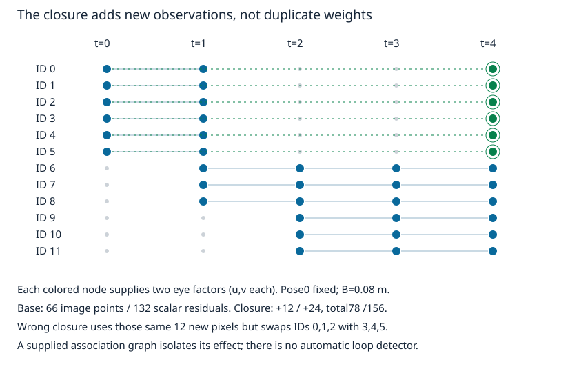
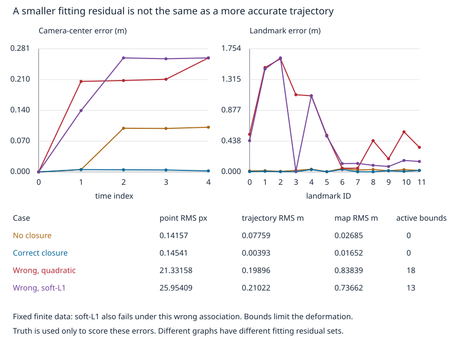

# 从像素轨迹到窗口联合定位与建图

已经得到track，不等于已经得到轨迹。像素ID把观测连成跨帧关系，几何模型才把它们与相机和地图连接起来。本课消费上一页实际逐像素跟踪的坐标，在五帧窗口里同时估计相机位姿和空间点；用已知地图定位作比较，再实际添加正确或错误的回环观测。终点是可运行、可反驳的几何SLAM桥梁：联合状态、观测因子、规范和关联如何相互制约。

这是一个给定关联图的固定窗口后端，不包含在线关键帧选择、自动回环检索、长时地图管理或部署系统。前端接受一个错误身份后，后端可能会很努力地把世界弯成它想要的样子。优化器负责目标函数，不能兼职核验身份证。

## 从已知地图定位，走到两类状态一起未知

继续使用05的灰度图、K、12个点ID和5帧。空间点 $P_j^W\in\mathbb R^3$，第t帧左相机位姿定义为**世界到相机**：

$$
P_{tj}^{L}=R_tP_j^W+t_t,\quad R_t\in SO(3),\qquad
C_t^W=-R_t^Tt_t.
$$

理论列向量，程序为 `(12,3)` 点行批量；一帧用6个参数：旋转向量 $\omega_t$（rad，长度是旋转角）与 $t_t$（m）。程序用 `Rotation.from_rotvec` 得到合法R，不能把旋转向量当成三个可互换顺序的欧拉角。真数据只有沿X的平移，**估计器仍允许全部三维旋转和平移**，没有把真值运动方向作为已知条件。

机器人页 [[AI/45-机器人与具身智能/01-坐标变换与平面运动学#SE(2)把位置与方向放在一起|机体到世界变换]] 使用相反方向；本页R/t是世界到相机，先取逆再比较，不能直接把t当机器人世界位置。[[AI/45-机器人与具身智能/02-Bayes滤波与Kalman状态估计#先预测，再用观测归一|Bayes状态估计]] 的观测核需要指定读数如何由状态生成；这里给出像素投影核的有限几何实例，但尚未做递归后验滤波。

立体装置已标定且保持刚性：右相机方向与左相同，中心沿左相机X正向相距已测 $B=.08$ m。所以

$$
P_{tj}^{e}=R_tP_j^W+t_t-e(B,0,0)^T,\quad e\in\{0,1\},\qquad
\hat z_{tej}=\pi_K(P_{tj}^{e})\in\mathbb R^2.
$$

其中 $\pi_K(X,Y,Z)=(fX/Z+c_x,fY/Z+c_y)^T$，$f=160$ px、$c=(96,64)$ px、$Z>0$。观察 $z_{tej}$ 是05的像素跟踪值，本页再加入固定seed29、每坐标标准差.12px的独立高斯模拟噪声，全部噪声实际保存，不靠读者猜随机调用顺序。该添加误差是受控数值试验，不声称真实跟踪误差服从独立高斯分布。

若地图P由外部测量给定，只估R/t，便是**已知地图定位**；若P也需要由这些图像估计，就要联合调整轨迹和地图。源码 `known_map` 用同一批噪声观测，但把真实地图当成外部已知地图，只作条件不同的对照；其轨迹RMS为.002692m，不能当成未知地图方法凭空已有的性能。

## 一个共同目标怎样连接地图和相机

观测集合 $\mathcal O$ 明确记录 `(time,eye,landmark,pixel_source_id,uv_px)`。残差预测减观测：

$$
r_{tej}(R,t,P)=\pi_K(R_tP_j+t_t-e b)-z_{tej}\in\mathbb R^2,
\qquad \min_{R,t,P}\frac12\sum_{(t,e,j)\in\mathcal O}\|r_{tej}\|^2.
$$

每个残差仅依赖一个相机位姿和一个点，所以同一track可以约束多个位姿，同一位姿又把不同点连到一起。[Triggs等原文 §1–§2](https://lear.inrialpes.fr/people/triggs/pubs/Triggs-va99.pdf) 将联合结构与相机参数的重投影优化称为bundle adjustment；本页按固定立体模型展开自己的符号与有限实现。BA是几何估计部分，不等于一整套SLAM。

线性化可以看清耦合。令 $q=RP+t-eb$，则

$$
D\pi(q)=\begin{bmatrix}f/Z&0&-fX/Z^2\\0&f/Z&-fY/Z^2\end{bmatrix}\in\mathbb R^{2\times3}.
$$

局部选择 $R'\approx(I+[\delta\theta]_\times)R$、$t'=t+\delta t$、$P'=P+\delta P$，有

$$
\delta r\approx A\begin{bmatrix}\delta\theta\\\delta t\end{bmatrix}+G\delta P,\quad
A=D\pi(q)[-[RP]_\times\ I_3]\in\mathbb R^{2\times6},\quad
G=D\pi(q)R\in\mathbb R^{2\times3}.
$$

旋转项用RP而非q，因为这里选择旋转只左乘R，t单独相加；若把整个相机点的刚体变换一起左扰动，平移更新定义也会改变。源代码选择小范围绝对旋转向量坐标，由SciPy数值差分处理该坐标的链式导数，不把上述局部增量公式直接冒充全局旋转向量导数。

堆叠后 $r(x+\delta)\approx r+J\delta$。一个阻尼最小二乘步满足 $(J^TJ+\lambda D)\delta=-J^Tr$；实际求解还需检查步长是否让非线性目标下降。把相机增量a、点增量p分组，法方程是

$$
\begin{bmatrix}U&W\\W^T&V\end{bmatrix}
\begin{bmatrix}\delta a\\\delta p\end{bmatrix}=
\begin{bmatrix}b_a\\b_p\end{bmatrix}.
$$

不同点不直接共享一个像素残差，V按点形成3×3对角块；在这些块可逆且规范已处理时消去地图增量：

$$
(U-WV^{-1}W^T)\delta a=b_a-WV^{-1}b_p,\qquad
\delta p=V^{-1}(b_p-W^T\delta a).
$$

这解释大规模BA为何利用稀疏结构。本例只有60个自由参数，用稠密有限差分TRF便可本机复建，没有为了示范再造一个求解框架；上式用于理解结构，不声称源码实现了Schur消元。若误把每个相机分别拟合再冻结，后面新观测就无法反过来校正早期地图。

## 先分清坐标规范和数据真的缺信息

任取刚体坐标变换 $Q\in SO(3),a\in\mathbb R^3$，令

$$
P'_j=QP_j+a,\quad R'_t=R_tQ^T,\quad t'_t=t_t-R_tQ^Ta.
$$

于是 $R'_tP'_j+t'_t=R_tP_j+t_t$，连右眼固定基线项也不变。所有像素相同，世界原点和方向无法由纯视觉自行指定。这6个自由度是**规范自由度**。代码将首帧 $R_0=I,t_0=0$ 从优化变量中直接移除，以首帧左相机定义世界；4×6个自由位姿加12×3个地图坐标，共60个参数。给首帧一个很大权重的软先验与直接固定的统计含义不同，这里没有混用。

单目在此之后仍有尺度：保持首帧I/0，把 $P_j,t_t$ 同乘 $s>0$，归一化像素不变。固定首位姿只去掉6维刚体规范，不能去掉这一维。两眼若只是“方向已知、基线单位任意”的相对位姿，也未得到米。

本例的B是已测长度，右眼项不能跟着任意缩放。若P/t乘s而B不变，右眼视差改变，因此公制尺度有观察依据；若B本身的尺错了，地图和轨迹可按相同比例错而仍重投影良好。此处K/B固定条件来自前几课，不估其不确定性，也不把合成标定成功当成真实硬件已经校准。[Triggs §9–§9.1](https://lear.inrialpes.fr/people/triggs/pubs/Triggs-va99.pdf) 讨论规范选择及其对估计解释的影响。

有限真值检验逐项保留在结果中：

| 改变 | 默认最大像素变化 / 其他观察 |
| --- | --- |
| 同时刚体变换世界点和全部位姿 | $2.85\times10^{-14}$ px以内 |
| 固定首位姿、单目把地图/平移乘1.7 | $2.85\times10^{-14}$ px以内 |
| 两眼B=.08m固定，但地图/平移乘1.7 | 右眼最大改变4.39216px |
| 锚定后默认立体J，156×60 | 中央差分步 $10^{-6}$；相对阈值 $\sigma>10^{-7}\sigma_{max}$ 下秩60 |
| 同一图、两眼位置重合B=0的单目模型 | 秩59；尺度方向 $\|J\delta_{scale}\|\approx7.99\times10^{-8}$ px，为差分误差量级 |

[[数学/20-线性代数与几何/14-最小二乘伪逆与正则化#非唯一性与伪逆|非唯一性与伪逆]] 说明如何在同一残差的一族解中选代表；[[数学/20-线性代数与几何/16-SVD的推导最优低秩与PCA#几何与完整算例|SVD的奇异方向]] 帮助读这个J。选最小范数、固定规范和增加物理尺度观测是三种不同操作。

奇异值的数值大小依赖m/rad参数化和差分步；这只核本次局部图的秩，不是所有场景的可观性证明。若图断成两个不相连部分、某点只有一个单目方向、纯旋转没有深度基线，或视差小到被噪声淹没，即使“观测数量大于未知数”，也不能推断可恢复。先前02/03的平行射线、平面/纯旋转线性估计退化与这里的规范分别有不同原因。

## 回来看到旧点，究竟多了什么

本实验只使用指定的观测子集，故意让地图信息接力：帧0看ID0–5；帧1看0–8；帧2/3/4先只看6–11。初始化从每个点**首次出现时的实际左右坐标**，用02已有三角化得到相机坐标；用已经建立的地图点拟合新帧位姿，再转入世界。先前位姿作为新帧初值，每次至少3个已有点；本例3点时接近前帧的初值选局部分支，不声称一般三点定位唯一。真值轨迹和地图不传入初始化或未知地图求解。

虽然像素材料中的全部块始终可见，基础图刻意不使用帧4对0–5的像素，以模拟它们尚未被关联进窗口。**正确回环**现在新增帧4的0–5左右眼观测，将返回视图连到早期地图；**错误回环**使用同样新增的像素，却把0/1/2与3/4/5的ID互换。这是给定关联的受控比较，未模拟消失/重检测，也未实现自动识别“我回来了”。

基础图有66个二维图像点/132个标量残差；新增12个图像点/24个残差后为78/156。每组 `(time,eye,landmark)` 唯一，没有复制旧因子来偷偷增加权重。一个已持续跟踪并已在目标中使用的旧点，再把同一个像素标为loop加一次，只会重复计权；不是本页的回环实验。

## 实际结果：关联错误比优化技巧更上游

定义图像点RMS为 $\sqrt{M^{-1}\sum\|r_k\|^2}$，不是每标量RMS；轨迹和地图误差在已经指定的首帧世界、公制尺度下直接与真值比较，不额外做最佳相似对齐。轨迹RMS含固定首帧的5个中心，地图RMS含12点。

| 固定输入与目标 | 图像点RMS px | 轨迹RMS m | 地图RMS m | 触界参数数 |
| --- | ---: | ---: | ---: | ---: |
| 无噪真投影、正确新增回环 | $7.30\times10^{-14}$ | $5.33\times10^{-15}$ | $4.72\times10^{-15}$ | 0 |
| 像素跟踪+.12px噪声，无回环 | .14157 | .07759 | .02685 | 0 |
| 同观测、正确回环 | .14541 | .00393 | .01652 | 0 |
| 同观测、错误回环，二次损失 | 21.33158 | .19896 | .83839 | 18 |
| 同错误回环，soft-L1 | 25.95409 | .21022 | .73662 | 13 |

正确回环的拟合RMS略高、轨迹真值误差却大幅降低：它加入了新信息，比较的残差集合已经不同，不能仅按训练RMS给图排序。也不能从这一次seed总结“回环总会改善多少”；真实系统还依赖视角、关联、校准和误差相关性。

soft-L1本次未救回轨迹。它对每个**标量**残差s使用

$$
\rho_C(s^2)=2C^2\left(\sqrt{1+(s/C)^2}-1\right),\quad C=.5\ \mathrm{px},\qquad
F=\tfrac12\sum\rho_C(s^2).
$$

这与对二维残差范数整块加权不是同一目标；原始point RMS仍按未变换的像素残差统计，不能当成soft-L1优化的cost。[SciPy官方API](https://docs.scipy.org/doc/scipy/reference/generated/scipy.optimize.least_squares.html) 给出该逐标量损失、尺度和有界TRF合同。稳健损失会减弱部分大残差，却不知道哪个ID是真的；一组强而自洽的假关联可能继续拉动状态，03已有残差几乎为0的全错关联反例。这里错误闭环应触发关联复核/拒绝，而非相信优化器的success。

为保持这个有限教学问题的相机点都在前方，求解盒规定每个旋转向量分量在±.08rad，平移分量在±.15m，点 $X\in[-1,1],Y\in[-.8,.8],Z\in[.8,3]$ m。因旋转角至多 $\sqrt3\,.08$，最坏相机Z下界超过 $.8\cos(\sqrt3\,.08)-\sqrt{1^2+.8^2}\sin(\sqrt3\,.08)-.15>.46$ m，右眼平移不改Z。它是声明过的实现子域，不是测得的真实先验或一般BA可行域；错误关联的最优解撞界，报告这些数正是承认该盒限制了变形，而非认证一个可信地图。

无噪case从观测初始化已经几乎为真值，求解只需1次计数，主要核方向/单位/初始化；它不证明大初值范围收敛。噪声case需实际联合调整，所有保存case带初值、完整观测因子、预测、残差、停止消息、nfev和触界数。nfev不计有限差分Jacobian额外调用，不能据此当总投影次数。

## 同版源码、独立复算和实际迁移

真源 [window_ba_lab.py](window_ba_lab.py)、[输入规格](inputs/motion-spec.json)、[逐像素前端输出](results/flow-results.json)、[每条观测与联合结果](results/window-ba-results.json)；[motion_figures.py](motion_figures.py)从同份结果绘制两图，[[AI/15-卷积神经网络/20-视觉几何与运动/code-sync/运动源码与测试镜像|镜像]]保留完整源码与六个相关测试。复建按05的四条命令，先前端再后端，未重跑旧48个两视用例或旧标定矩阵。

承重验证不以“success”为答案：干净输入对已知真值预设每坐标误差 $10^{-6}$ m、旋转 $10^{-6}$ rad；像素预测用独立直接投影容差 $10^{-6}$ px；规范有限变换预设像素变化不超过 $10^{-10}$ px。独立路线以解析Jacobian、旋转局部更新和阻尼Gauss–Newton对照无回环/正确回环，而非再次调用同一SciPy优化；错误回环的触界解只核实际模型、原始残差/损失和失败事实，不将有界局部解称为全局真解。若同一状态的独立预测不符、干净真值未恢复、或尺度测试错误，便推翻核心实现；不能改大容差使它过关。

真实迁移需要：同步左右原图和时间戳、K/畸变/左右外参与基线测量误差、曝光/滚动快门、每个track的ID和置信信息、可见性/动态物体标注，以及不参与优化的姿态或长度依据。若正确的独立验证点重投影持续出现结构残差，可能是标定或静态模型错误；若重投影很小但外部轨迹/长度不符，应检查关联、尺度与规范，而非只增加迭代次数。这里未运行真实独立时间序列、实体回环、长时SLAM、设备或真人学习试验；有限几何学习链已能与这些外部接口明确衔接。

## 撤去步骤后迁移

1. 首帧已固定I/0。有人说单目地图因此已经是米，并展示极小重投影误差。构造反例；再说明给B=.08m的立体模型为什么不同。
2. 把全部世界点改为 $P'=QP+a$，Q是任意合法旋转。不给提示推导新的R/t，使左右全部像素不变；为何相机中心应随世界坐标一起变化？
3. 某track在所有帧的观测已经使用。为了“增加回环约束”把帧4那个像素又加入一次，目标函数发生什么变化？本实验正确/错误回环真正改变的对象分别是什么？
4. 仅看到最后的表格，怎样判断soft-L1没有修好问题？给出下一步最有区分力的检查，并说明为什么真实关联下重投影大、错误关联下重投影小都可能发生。

参考答案与可接受替代路线

1. 任意s>0把P/t同乘s，首帧仍I/0，单目像素不变。若不知道原长度，没有米的选择依据。立体右眼项eb固定不随s缩放，默认s=1.7使右眼最大差4.39216px；若连B也乘s便像素不变，但那已修改已测物理输入。
2. $R'=RQ^T,t'=t-RQ^Ta$，直接代入相机坐标不变；$C'=-R'^Tt'=QC+a$。只移动点不变相机，会改变相对几何，不是换世界坐标。
3. 相同信息被重复计权，等价于对那个残差更信任，未提供新独立像素。这里基础图尚无frame4的0–5观测，正确闭环加入它们；错误闭环保持同一新增原始像素，但把对应地图ID互换。不得将二者写成自动检索成功。
4. soft-L1轨迹RMS .21022m仍大于无回环.07759m且有13个参数触界；map改善一点不等于轨迹可靠。先回看新增闭环的像素块/ID与独立几何预测，并把可疑闭环撤去作有针对性的比较，不盲增迭代。真实关联可因曝光、畸变、动态物体或测量误差有大残差；周期外观/自洽假对应、错误尺度规范可使错误解释残差小。可接受独立真值、额外视角或已测长度检验，只要说明其信息来源和可能反例。

回到 [[AI/15-卷积神经网络/20-视觉几何与运动/01-从相机投影到双目深度|相机与尺度入口]]，现在同一组概念已经走过投影、两视几何、对应估计、标定、逐像素运动，再进入有限的轨迹—地图联合估计。后续若做机器人或长时SLAM，应从明确的设备/实时/关联缺口继续，而不是把一个能跑的窗口无限扩写成整门系统课程。
