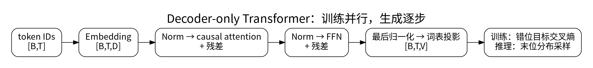

# Transformer 完整数据流

<!-- deep-review-02 -->
> [!tip] 本轮深化：从当前概念继续追问
> 每个残差块都应同时核对前向形状与反向依赖。把注意力、逐位置 FFN、归一化和残差分开分析，才能定位输出变化究竟从哪条路径产生。 深化与验证：[[AI/00-开始/06-统一符号形状与公式阅读方法|统一符号形状与公式阅读方法]]；[[AI/20-LLM/20-架构/10-注意力反向传播与Softmax竞争|注意力反向传播与Softmax竞争]]。

图中注意力与 FFN 表示一个 Pre-Norm block；完整网络将该 block 堆叠多层。位置机制与缓存细节在下文展开，图示不表示所有 Transformer 架构都采用相同归一化次序。

这一课沿着典型 **decoder-only Transformer** 做一次完整前向传播。目标不是背一张框图，而是能回答：每一步读了什么、写了什么、shape 怎样变化、哪里加入因果约束，以及训练和生成为什么能复用同一组权重。

> [!abstract] 本课目标
> 完成后你应该能：
>
> - 从 `token ids (B×T)` 追踪到 `logits (B×T×V)`；
> - 写出一个 pre-norm block 的注意力支路和前馈支路；
> - 用 `j≤i` 精确定义 causal mask，并把它与 padding mask 分开；
> - 区分整段训练、prefill 和单步 decode 的 `T_q`、`T_k` 与 cache 行为。

> [!prerequisite] 数学先修：先学会给轴命名
> 若 `B×T×D`、转置和矩阵乘法还不熟，先读 [[数学/10-数学语言与基础/01-函数符号索引维度与Shape|函数、符号、索引、维度与 Shape]] 和 [[数学/20-线性代数与几何/02-矩阵乘法线性映射与Einsum|矩阵乘法、线性映射与 Einsum]]。本页只做架构所需的 shape 推演，完整数学定义与推导留在数学域。

## 1. 先固定对象和符号

设：

| 符号 | 含义 |
| --- | --- |
| `B` | batch 中的序列数 |
| `T` | 本次输入的 token 位置数 |
| `V` | 词表大小 |
| `D` | 模型隐藏维度 |
| `L` | Transformer block 数 |
| `H` | 本节先按普通 MHA 使用的头数 |
| `D_h` | 每头维度，这里取 `D=H D_h` |
| `D_ff` | 前馈网络中间维度 |

输入 token id 张量为：

$$
I\in\{0,\ldots,V-1\}^{B\times T}.
$$

它的每一格是一个整数编号，不是含义丰富的向量。模型先查 embedding 表：

$$
E\in\mathbb{R}^{V\times D},\qquad X^{(0)}_{b,t,:}=E_{I_{b,t},:},
$$

所以初始残差流 `X^(0)` 的 shape 是 `B×T×D`。

> [!note] “残差流”是贯穿各层的主干
> 每个 block 的子层读取 `B×T×D`，计算一项同 shape 的更新，再加回主干。它不是独立于 hidden state 的另一份神秘数据；这个名字强调信息可以沿加法路径跨层保留和累积。

## 2. 一个 pre-norm block 的全程

不同模型会改变 norm、bias、激活和位置方法。先用常见 pre-norm 结构建立骨架。第 `ℓ` 层的输入为：

$$
X^{(\ell)}\in\mathbb{R}^{B\times T\times D}.
$$

### 2.1 归一化不改变 shape

$$
U=\operatorname{Norm}(X^{(\ell)})
\in\mathbb{R}^{B\times T\times D}.
$$

归一化通常沿每个 token 的特征轴工作。它改变数值尺度，不删除 batch、位置或特征轴。具体是 LayerNorm、RMSNorm 还是其他变体，必须查看当前架构，不能只凭“Transformer”三个字推定。

### 2.2 线性投影产生 Q、K、V

先用三个矩阵把每个位置的 `D` 维表示投影到多头表示：

$$
Q'=UW_Q,\quad K'=UW_K,\quad V'=UW_V,
$$

其中本节的普通 MHA 取：

$$
W_Q,W_K,W_V\in\mathbb{R}^{D\times(HD_h)}.
$$

于是 `Q'`、`K'`、`V'` 都是 `B×T×(H D_h)`。将最后一轴拆成 head 与 head feature，并调整轴顺序：

$$
Q,K,V\in\mathbb{R}^{B\times H\times T\times D_h}.
$$

reshape 不会创造新数值，只会改变这些数如何被分组和寻址；transpose 会改变轴顺序，往往也影响内存是否连续。

### 2.3 位置方法作用在 Q/K

若使用 RoPE，对每个位置的 Q、K 特征对做位置相关旋转，shape 仍是 `B×H×T×D_h`；V 通常不做 RoPE。完整解释见 [[AI/20-LLM/20-架构/04-位置编码RoPE与上下文|位置编码、RoPE 与上下文]]。

### 2.4 score 的两根位置轴

第 `b` 条序列、第 `h` 个头中，query 位置 `i` 与 key 位置 `j` 的未掩码分数是：

$$
S_{b,h,i,j}
=\frac{Q_{b,h,i,:}\cdot K_{b,h,j,:}}{\sqrt{D_h}}.
$$

因此：

$$
S\in\mathbb{R}^{B\times H\times T\times T}.
$$

倒数第二根 `T` 是“谁在查询”，最后一根 `T` 是“被查询的过去位置”。虽然长度相同，角色不同。缩放因子不改变 shape；它防止 head 维度变大时点积的典型幅度随之膨胀。更细的解释见 [[AI/20-LLM/20-架构/02-注意力MHA-MQA与GQA|注意力、MHA、MQA 与 GQA]]。

### 2.5 causal mask 必须在 softmax 前生效

数学位置从 `0` 开始编号，causal decoder 只允许位置 `i` 读取 `j≤i` 的 key。定义加法 mask：

$$
M_{i,j}=
\begin{cases}
0,&j\le i,\\
-\infty,&j>i.
\end{cases}
$$

再沿 key 位置轴做：

$$
A_{b,h,i,:}
=\operatorname{softmax}(S_{b,h,i,:}+M_{i,:}).
$$

被禁止位置的指数权重为 0，允许位置的权重之和为 1。softmax 的精确定义、减最大值等稳定实现见 [[数学/50-信息论/02-指数对数Softmax与LogSumExp|指数、对数、Softmax 与 LogSumExp]]。

实际内核可能不用字面上的 IEEE `-∞`，而使用布尔 mask 或足够小且适合当前 dtype 的值；语义必须等价。尤其要避免某一行**所有 key 都被屏蔽**，否则 softmax 可能得到 NaN 或未定义结果。

> [!important] causal mask 与 padding mask 不是一回事
> causal mask 回答“未来能否读取”；padding/document mask 回答“这个位置是否属于有效 token 或同一段文档”。训练时若把多个样本拼接进同一序列，还可能需要 block-diagonal/document mask，防止样本之间泄漏。只画一个下三角形不足以描述所有数据边界。

### 2.6 用 attention 权重混合 V

$$
O_{b,h,i,:}=\sum_{j=0}^{T-1}A_{b,h,i,j}V_{b,h,j,:},
$$

所以 `O` 仍是 `B×H×T×D_h`。将 `H` 与 `D_h` 拼回最后一轴，得到 `B×T×D`，再做输出投影：

$$
Y=\operatorname{ConcatHeads}(O)W_O
\in\mathbb{R}^{B\times T\times D},
\qquad W_O\in\mathbb{R}^{D\times D}.
$$

注意力负责跨位置读取；输出投影让各头的信息重新混合，并把结果做成可写回残差流的 shape。

### 2.7 第一条残差更新

$$
R=X^{(\ell)}+Y
\in\mathbb{R}^{B\times T\times D}.
$$

两个加数必须 shape 一致。这里的 `+` 是逐元素相加，不是把特征轴拼长。

### 2.8 前馈支路逐位置工作

再次归一化：

$$
Z=\operatorname{Norm}(R)\in\mathbb{R}^{B\times T\times D}.
$$

用最简单的两层前馈网络表示：

$$
F=\phi(ZW_1+b_1)W_2+b_2,
$$

$$
W_1\in\mathbb{R}^{D\times D_{ff}},
\qquad
W_2\in\mathbb{R}^{D_{ff}\times D}.
$$

中间 shape 是 `B×T×D_ff`，输出回到 `B×T×D`。同一个前馈参数独立应用在每个 token 位置；**它自身不在 T 轴上混合位置**。门控 FFN、SwiGLU 或 MoE 会改变内部计算，但最终仍需产生可写回残差流的 `B×T×D` 更新。

第二条残差更新给出下一层输入：

$$
X^{(\ell+1)}=R+F
\in\mathbb{R}^{B\times T\times D}.
$$

重复 `L` 次后，得到 `X^(L)`。

## 3. 从最后一层到词表 logits

最终归一化后，用输出矩阵投影到词表轴：

$$
H_{final}=\operatorname{Norm}(X^{(L)})
\in\mathbb{R}^{B\times T\times D},
$$

$$
Z_{logits}=H_{final}W_{vocab}
\in\mathbb{R}^{B\times T\times V},
\qquad W_{vocab}\in\mathbb{R}^{D\times V}.
$$

`Z_logits[b,t,v]` 是位置 `t` 对词表项 `v` 的未归一化分数。它还不是概率；若需要概率，要在 `V` 轴上做 softmax。离散分布与条件概率的严格语义见 [[数学/30-概率与统计/01-概率分布条件概率与贝叶斯关系|概率分布、条件概率与贝叶斯关系]]。embedding 表与输出矩阵有时共享权重，有时不共享，应查具体配置。

训练 next-token prediction 时，位置 `t` 的 logits 与真实的下一个 token 对齐。因为 causal mask 已禁止读取未来，所以一整段序列的所有位置可以并行计算；“自回归”描述概率依赖关系，不等于训练必须用 Python 循环逐 token 前向。

## 4. 一个可手算的 shape 例子

令：

`B=2, T=4, D=8, H=2, D_h=4, D_ff=24, V=100`。

| 阶段 | Shape | 解释 |
| --- | --- | --- |
| token ids | `2×4` | 8 个整数编号 |
| embedding / block 输入 | `2×4×8` | 每个位置 8 个隐藏特征 |
| Q/K/V（拆头后） | `2×2×4×4` | 2 个头，每头 4 维 |
| scores / weights | `2×2×4×4` | query 位置 × key 位置 |
| 每头 attention 输出 | `2×2×4×4` | 每个 query 得到 4 维结果 |
| 合头与输出投影 | `2×4×8` | 写回残差流 |
| FFN 中间 | `2×4×24` | 每个位置独立扩展特征 |
| block 输出 | `2×4×8` | 交给下一层 |
| logits | `2×4×100` | 每个位置对 100 个词表项打分 |

对 query 位置 `i=2`（从 0 开始），causal mask 允许读取 key 位置 `0,1,2`，禁止位置 `3`。它可以读取“自己”，因为生成第 `i+1` 个 token 时，第 `i` 个输入 token 已经存在。

## 5. 同一模型的三种运行形态

### 整段训练

- 通常 `T_q=T_k=T`；
- causal mask 让所有 query 位置并行而不看未来；
- 激活要为反向传播保留或重算，显存不只包括权重与 KV。

### Prefill

- 把整个已有 prompt 一次送入，通常仍有 `T_q=T_k=T_prompt`；
- 为每层建立 prompt 的 K/V cache；
- attention 的大矩阵计算可高度并行，但 prompt 越长，full attention 的位置对越多。

### 单步 decode

- 每步只为新 token 产生 query，逻辑上 `T_q=1`；
- 新 K/V 追加到每层 cache，`T_k=T_past+1`；
- 当前 query 读取全部未被窗口策略移除的过去 K/V；
- 通常只使用最后一个位置的 logits 采样下一个 token。

KV cache 避免每步重算全部历史 token 的 K/V 和隐藏路径，但不会让读取历史变成零成本；cache 容量与带宽仍随可见历史增长。头共享怎样改变这个成本，见下一课。

## 6. 公式到工程的对应关系

| 公式对象 | 工程代价或约束 |
| --- | --- |
| `B×T×D` 残差流 | 激活内存、归一化与逐元素算子 |
| Q/K/V 投影 | 大矩阵乘法；权重读取和计算吞吐 |
| `T_q×T_k` score 关系 | full attention 的长度成本；实现可分块而不物化完整矩阵 |
| mask + softmax | 需要稳定归约，并正确处理无效位置 |
| KV cache | decode 时每层持久保存历史 K/V，常受显存容量和带宽限制 |
| `D×D_ff×D` FFN | 常占大量参数与计算，但不跨 token 位置混合 |
| `D×V` 输出投影 | 词表很大时成本显著；只算最后位置可减少 decode 工作 |

“逻辑 shape 中存在 `T×T`”不代表实现一定把完整 attention 矩阵写入显存。分块、融合 kernel 可以减少中间存储，但不能凭空删除所需的数据依赖；实际后端见 [[计算机知识/40-并行与异构计算/01-CUDA/00-CUDA-MOC|CUDA MOC]]。

## 7. 常见失败模式

| 失败或误解 | 为什么错 | 排查方法 |
| --- | --- | --- |
| softmax 后才把未来权重设为 0 | 剩余权重不再自动和为 1，语义改变 | mask 在 softmax 前合入 score，或使用等价融合实现 |
| 只用 causal mask 处理 padding | padding 可能仍被当成真实 key | 分别检查 causal、padding 和 document 边界 |
| 把两个 `T` 当成同一根轴 | 一个是 query，一个是 key，允许不同长度 | 明写 `T_q×T_k`，尤其在 decode/cross-attention 中 |
| 忘记输出投影就与残差相加 | 合头结果未必已满足架构的 `D` 与头混合要求 | 从 `B×H×T×D_h` 逐步写到 `B×T×D` |
| 声称 FFN 负责跨 token 通信 | FFN 对每个位置独立应用 | 检查是否在 `T` 轴做了求和或卷积 |
| 把 logits 当概率 | logits 可为任意实数，不必非负或和为 1 | 明确 softmax 作用轴是词表 `V` |
| 用一张框图断言 norm 顺序 | pre-norm、post-norm 等会改变实际路径 | 查配置和源码，再画加法与 norm 的准确顺序 |
| 低精度下直接指数化大 score | 可能上溢、下溢或产生 NaN | 使用稳定 softmax，并参考 [[数学/60-数值计算与量化/01-二进制浮点精度与数值稳定性\|数值稳定性]] |

## 8. 练习

### 练习 A：补全全程 shape

设 `B=3, T=5, D=12, H=3, D_h=4, D_ff=32, V=200`。不看上表，写出：

1. token ids、embedding；
2. 拆头后的 Q/K/V；
3. scores、attention 输出；
4. FFN 中间与 block 输出；
5. logits。

### 练习 B：画 mask

画一个 `T=4` 的 `4×4` score 方格，行是 query `i`，列是 key `j`。标出 `j≤i` 的允许区。再假设最后一列是 padding：写出 causal mask 与 padding mask 合并后每一行允许的位置。

### 练习 C：训练与 decode

已有 6 个 prompt token，刚生成第 7 个 token，现在要计算下一个 token：

1. 若逐步 decode，本步 `T_q` 与 `T_k` 各是多少？
2. cache 中为什么要有每一层的历史 K/V，而不只保存 token ids？
3. 若丢弃 cache，结果在精确算术下是否必须改变？计算成本怎样改变？

核对要点

- 练习 A：`3×5`；`3×5×12`；Q/K/V 为 `3×3×5×4`；scores 为 `3×3×5×5`；attention 合头后 `3×5×12`；FFN 中间 `3×5×32`；block 输出 `3×5×12`；logits `3×5×200`。
- 练习 B：先保留下三角，再去掉 padding key；要确保仍需计算的 query 行至少有一个有效 key。真实 padding query 是否参与损失也要单独决定。
- 练习 C：逻辑上 `T_q=1, T_k=7`。每层 K/V 是历史 token 经过该层之前路径与投影后得到的结果，不能仅从 id 直接取出。丢弃 cache 后可重算得到等价结果，但要重复处理整个前缀。

### 成功标准

- [ ] 我能从每个矩阵的内侧维度解释投影为何成立。
- [ ] 我能明确 score 的 softmax 在 key 位置轴，而 logits 的 softmax 在词表轴。
- [ ] 我能用 `j≤i` 解释因果性，并把 padding/document mask 单列。
- [ ] 我能说明训练可并行处理位置而生成仍需逐 token 反馈。
- [ ] 我能区分逻辑 `T_q×T_k` 关系与内核是否物化完整矩阵。

---

**上一站**：[[AI/20-LLM/20-架构/00-LLM架构-MOC|LLM 架构 MOC]] · **下一站**：[[AI/20-LLM/20-架构/02-注意力MHA-MQA与GQA|注意力、MHA、MQA 与 GQA]] · **返回**：[[AI/20-LLM/00-LLM-MOC|LLM MOC]]
