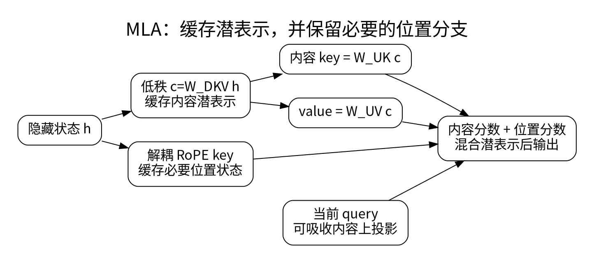

# MLA：低秩缓存与位置解耦

<!-- deep-review-02 -->
> [!tip] 本轮深化：从当前概念继续追问
> 固定潜变量模型内的线性吸收可以是精确重排；共享低维潜变量作为架构选择则限制可表示集合。这两层不能混成“任何 K/V 都可无损压缩”。 深化与验证：[[AI/20-LLM/20-架构/12-MLA线性注意力与状态空间的记忆取舍|MLA线性注意力与状态空间的记忆取舍]]；[[AI/11-数学与统计桥梁/01-向量空间投影SVD与低秩|向量空间投影SVD与低秩]]。

GQA 通过多个 query head 共享 KV head 来减小缓存；Multi-head Latent Attention（MLA）进一步问：能否只缓存生成 K/V 所需的紧凑表示，而不是缓存展开后的全部 K/V？这属于架构和训练时的参数化选择，不是对任意模型无损套用的通用压缩开关。[1]

## 从等式看省了什么

本页使用列向量。对隐藏状态 $h_t\in\mathbb R^d$，先压缩：

$$
c_t=W^{DKV}h_t\in\mathbb R^{d_c},\quad
k^C_{t,i}=W^{UK}_i c_t,\quad v_{t,i}=W^{UV}_i c_t.
$$

其中 $d_c$ 通常小于所有头展开的 K/V 总宽度。缓存 $c_t$ 后，内容分数可以写成：

$$
(q^C_{t,i})^Tk^C_{s,i}
=(q^C_{t,i})^TW^{UK}_i c_s
=((W^{UK}_i)^Tq^C_{t,i})^T c_s.
$$

也就是先变换当前 query，再与历史潜表示相乘。对 value 的加权同样有：

$$
\sum_s a_{t,s,i}W^{UV}_ic_s
=W^{UV}_i\left(\sum_s a_{t,s,i}c_s\right).
$$

若后续输出投影条件允许，可继续合并固定线性变换。这是矩阵乘法结合律，不是改变 softmax 定义。不同 kernel 可以选择展开、吸收或重算，因此同一 MLA 结构的实际速度仍可能不同。

## 为什么不能直接忽略 RoPE

RoPE 引入与位置有关的旋转。若把旋转与任意低秩上投影混在一起，就不能一般性地把它吸收到一个与位置无关的 query 投影中，因为这些矩阵通常不交换。

DeepSeek-V2 的设计把内容分支与位置分支解耦：位置分数仍由旋转后的 query/key 得到；缓存除了 $c_s$，还保留必要的位置 key。示意地，分数为内容点积加位置点积，再按组合维度缩放。因此“MLA 只缓存一个向量、绝无其他状态”是不完整的概括。

## 资源账本与可验证例子

忽略元数据，普通 MHA 每层每 token 的 KV 存储约为 $2H d_h$ 个元素；GQA 为 $2H_{kv}d_h$；上述 MLA 约为 $d_c+d_R$，其中 $d_R$ 是实际缓存的位置分支宽度。这些是结构计数，不是端到端内存比，权重、工作区和量化元数据另算。

例如假设普通 MHA 有 16 个头、每头 64 维，需 2048 个 KV 元素；教学 MLA 取 $d_c=256,d_R=32$，则需 288 个，比例为 14.06%。这组数是演示，不能冒充具体模型实测。压得更小可能损伤表示能力，也可能增加计算负担。

CPU 实验会验证内容分支在“展开 K/V”和“吸收投影”两种计算次序下的输出一致。它不实现完整 DeepSeek 层，不声称验证真实模型质量、RoPE 分支或 GPU 性能。

**自检：** QLoRA 的 NF4、GQA 的共享头与 MLA 的潜表示压缩是否同一件事？不是，分别作用于数值存储、头结构和潜空间参数化，可以组合但各有约束。

## 一手资料

1. [DeepSeek-V2 原始论文](https://arxiv.org/abs/2405.04434)。

**课程入口：** [[AI/20-LLM/20-架构/00-LLM架构-MOC]]。
