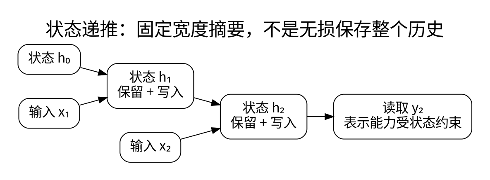

# 状态空间、线性注意力与混合架构

<!-- deep-review-02 -->
> [!tip] 本轮深化：从当前概念继续追问
> 对指定核的线性注意力递推可以精确，但不等于对普通 Softmax 注意力精确。固定状态节省历史存储，同时要检查未来查询所需信息能否被区分。 深化与验证：[[AI/20-LLM/20-架构/12-MLA线性注意力与状态空间的记忆取舍|MLA线性注意力与状态空间的记忆取舍]]；[[AI/20-LLM/20-架构/11-RoPE相对位置缓存偏移与长度外推|RoPE相对位置缓存偏移与长度外推]]。

全注意力允许当前 token 按内容访问整个历史，但历史越长，KV 和访存成本越高。另一类方案把历史压进有限状态，牺牲显式逐 token 存储来控制成本。

## 从递推理解状态空间

一个简化离散状态空间模型是：

$$
h_t=\overline A_t h_{t-1}+\overline B_t x_t,\qquad
z_t=C_t h_t+D_tx_t.
$$

这里 $h_t$ 是历史的压缩摘要，不是普通 Transformer 的同名隐藏向量。若系数固定，模型与线性递推、卷积表示有关；选择性状态空间模型让部分系数依赖当前输入，从而控制写入、保留和读取。[1]

推理每步只保存固定形状状态，可避免 KV 随上下文线性增长。但“固定状态”不意味着无损记住任意长历史，也不意味着训练没有激活开销。远距离复制、精确关联检索和状态跟踪需要单独测试。

## 线性注意力缓存什么

将相似性写成特征映射的内积，某些因果线性注意力维护：

$$
S_t=S_{t-1}+\phi(k_t)v_t^T,\qquad
u_t=u_{t-1}+\phi(k_t),\qquad
z_t=\frac{\phi(q_t)^TS_t}{\phi(q_t)^Tu_t}.
$$

分母需有非零和数值稳定条件。固定特征宽度时，状态大小不随序列长增长；代价转移到状态矩阵维度与表达能力。这通常不是原 softmax attention 的精确改写，除非另有明确的特殊条件或近似说明。

Mamba、线性注意力、门控递推和普通 RNN 共享“压缩历史”的思想，但更新参数化、训练并行方式和硬件实现并不相同。不要仅按复杂度的大 O 记号给模型排序。

## 混合为什么值得研究

部分层做状态更新，部分层做全局或滑窗注意力，可以让不同层承担局部模式、长期摘要和内容检索。评测需固定训练 token、参数预算、长度、任务和推理设备，比较短程能力、长程召回、峰值内存与真实吞吐。

本页的基本机制以原始 Mamba 为主。2026 年的 Mamba-3 论文进一步研究离散化、复值状态与多输入多输出设计；这里只登记这一进展，不把第一代公式当成后续版本的完整实现，也不复制其性能主张到未测硬件。[2]

**练习：** 为什么把历史压成固定 256 维向量可能很省内存，却未必适合逐字复述任意长文档？因为资源优势来自压缩，而压缩未保证保留任务所需的所有细节。

## 一手资料

1. [Mamba 原始论文](https://arxiv.org/abs/2312.00752)。
2. [Mamba-3，2026-03](https://arxiv.org/abs/2603.15569)。

**课程入口：** [[AI/20-LLM/20-架构/00-LLM架构-MOC]]。
