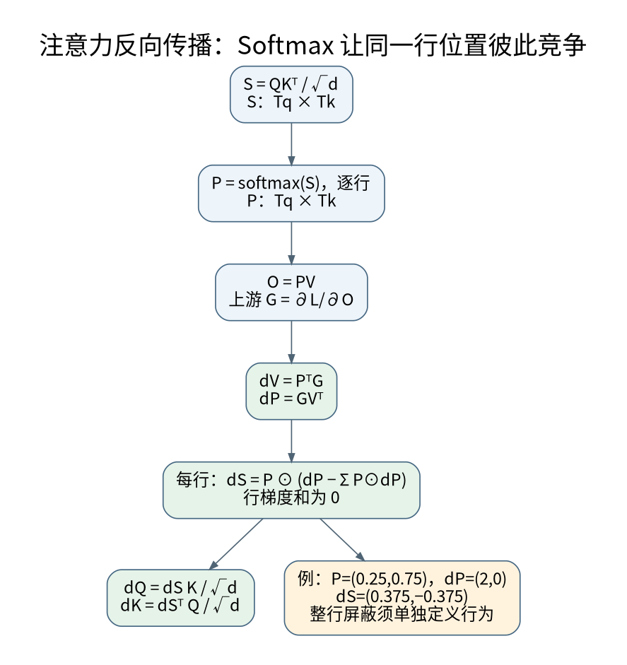

# 注意力反向传播与Softmax竞争

**先修与定位：** 需要[[AI/11-数学与统计桥梁/02-矩阵微积分VJP与反向传播|矩阵微积分]]和原有注意力前向笔记；统一使用 token 为行的矩阵约定。

## 先固定维度与符号

本页把 token 作为矩阵行，单头 $Q\in\mathbb R^{T_q\times d}$、$K\in\mathbb R^{T_k\times d}$、$V\in\mathbb R^{T_k\times d_v}$。定义

$$
S=QK^\top/\sqrt d+M,\qquad P=\operatorname{softmax}_{\rm row}(S),\qquad O=PV.
$$

$M$ 在允许位置为零，在禁止位置为负无穷；以下假设每一行至少有一个允许位置，不使用 dropout。架构起点见原始 Transformer。[^S30] 这里推导普通实数算术的梯度，融合内核可以改变计算顺序而不必改变数学目标。

## 逆着信息流逐步求导

设上游梯度 $G=\partial L/\partial O$。先对矩阵乘法求导：

$$
G_V=P^\top G,\qquad G_P=GV^\top.
$$

直觉上，一个 value 被多少输出读取，就收到多少按读取权重分配的梯度；而提高某个读取权重是否有利，取决于对应 value 与输出所需变化是否同向。

对每一行 Softmax，雅可比为 $\operatorname{diag}(p)-pp^\top$，所以不必显式建立大雅可比：

$$
(G_S)_{ij}=P_{ij}\left((G_P)_{ij}-\sum_kP_{ik}(G_P)_{ik}\right).
$$

最后

$$
G_Q=G_SK/\sqrt d,\qquad G_K=G_S^\top Q/\sqrt d.
$$

每一步都可由[[AI/11-数学与统计桥梁/02-矩阵微积分VJP与反向传播|微分与VJP]]推导，而不是背六个新公式。

## 减去加权平均为什么重要

一行 $p=(0.25,0.75)$，其上游权重梯度为 $u=(2,0)$，加权平均为 0.5，因此 score 梯度为 $(0.375,-0.375)$。增加第一项相对分数会把概率从第二项转移过来。Softmax 不是两个独立 sigmoid，而是存在归一化竞争。

由此 $\sum_j(G_S)_{ij}=0$，对应所有 logits 同加常数时概率不变。被严格掩码的位置 $P_{ij}=0$，其 score 梯度也为零。若整行都被 mask，归一化分母没有定义，不能靠任意填充数值宣称概率正确；应从批处理逻辑上处理无合法 key 的行。

## 大分数、饱和与缩放的边界

若 $q,k$ 各维独立、零均值、方差近 1，则点积方差随 $d$ 增长，除以 $\sqrt d$ 有助保持尺度。真实训练后的分布并不严格符合假设。概率接近独热时，Softmax 雅可比部分项变小，竞争方向的梯度可能弱；但整个网络的梯度还依赖 $V$、上游 $G$ 和残差路径，不能仅凭注意力“尖锐”就断言训练崩溃。

注意力权重大不意味着该 token 对最终答案的因果贡献一定大。Value、输出投影、其他头和残差可能抵消，完整解释需[[AI/20-LLM/80-研究拓展/01-机制可解释性Probe干预与稀疏特征|干预证据]]。

## 从推导到测试契约

[[AI/80-实践/08-深层机制数值实验/00-数值实验导航与验收|数值实验]]用 float64 的小矩阵，将上述解析梯度与 PyTorch autograd 比较，并检查掩码零梯度和行梯度和为零。随后再比较方向有限差分；只让两份可能共有错误的手写实现彼此一致还不够。

使用 SDPA 时还要核对布尔掩码方向、非方形因果对齐和 `dropout_p`，尤其 eval 时应显式设置为 0。[^S05] 缓存中 $T_q$ 与 $T_k$ 通常不相等，继续读[[AI/20-LLM/20-架构/11-RoPE相对位置缓存偏移与长度外推|缓存偏移]]。Attention 正确但全局损失权重错误，仍然是在优化错误目标，继续读[[AI/12-PyTorch/05-变长批处理Packing与有效Token归一化|有效token归一化]]。

## 来源与证据边界

相关接口与延伸方法可继续核对：[^S04]。

本页的数值例与推导用于解释机制，不代表大型模型或真实业务上的实测效果。方法与接口依据如下，来源核验日期为 2026-09-06。

[^S30]: [Vaswani等：Attention Is All You Need](https://arxiv.org/abs/1706.03762)。2017；Transformer原始研究。
[^S05]: [PyTorch 2.10：scaled_dot_product_attention](https://docs.pytorch.org/docs/2.10/generated/torch.nn.functional.scaled_dot_product_attention.html)。固定版本；布尔掩码、dropout、非方形因果。
[^S04]: [PyTorch 2.10：Autograd mechanics](https://docs.pytorch.org/docs/2.10/notes/autograd.html)。固定版本官方接口。

**返回与迁移：** [[AI/20-LLM/20-架构/00-LLM架构-MOC|本主题课程地图]]；[[AI/00-开始/05-问题驱动知识图谱与难点导航|按问题跨主题继续]]。
