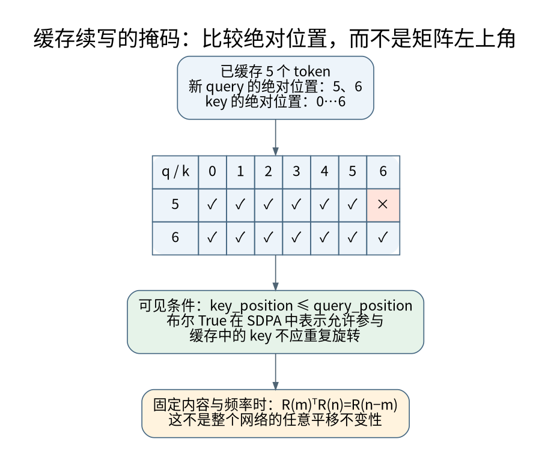

# RoPE相对位置、缓存偏移与长度外推

**先修与定位：** 需要[[AI/11-数学与统计桥梁/01-向量空间投影SVD与低秩|内积与正交变换]]及注意力；先明确数学性质，再讨论工程缓存。

## 相对位置性质来自旋转群的组合

先看二维子空间，定义 $R(\phi)=\begin{bmatrix}\cos\phi&-\sin\phi\\\sin\phi&\cos\phi\end{bmatrix}$。位置 $m,n$ 对应 $R(m\omega),R(n\omega)$，于是

$$
(R(m\omega)q)^\top R(n\omega)k=q^\top R((n-m)\omega)k.
$$

因为旋转保持内积且逆等于转置，绝对位置通过差值进入这一对向量的注意力分数。多维 RoPE 在多组二维平面上使用不同频率重复此结构。[^S31]

结论必须带条件：这里的基础内容向量 $q,k$ 固定、频率规则固定。把整段位置同加常数时，当前这对旋转向量的分数不变。若同时改变了上游隐藏状态、窗口边界、特殊 token、位置缩放策略或 attention mask，就不能由此推出**整个模型**输出完全不变。

## 相对位置不等于距离越远分数越小

取 $q=k=(1,0)^\top$，点积就是 $\cos((n-m)\omega)$。它会振荡，距离增加时可以先减小再增加。多频率与学习到的内容共同形成位置偏好，不能把 RoPE 解释成对距离的单调惩罚函数。局部行为、长距离区分力和训练外外推是不同问题。

## 缓存偏移错误为何不一定触发形状异常

假设已经缓存位置 0 到 4，新输入两个 token，它们的绝对位置应是 5、6。第一行 query 可以访问 key 0 到 5，第二行可访问 0 到 6。因此允许掩码是

$$
\begin{bmatrix}1&1&1&1&1&1&0\\1&1&1&1&1&1&1\end{bmatrix}.
$$

如果对一个 $2\times7$ 矩阵直接使用从左上角开始的普通下三角，第一行只看到 key 0，语义严重错误但形状完全合法。PyTorch 2.10 SDPA 的非方形 `is_causal=True` 对齐约定尤其需要检查；缓存场景可构造显式绝对位置掩码，并遵守接口对 `attn_mask` 和 `is_causal` 的组合限制。[^S05]

RoPE 也必须使用新 token 的真实位置，而不是每轮从零重启。如果存储的是已经旋转的 key，就只旋转新 key，不能再次旋转旧 key。若缓存表示约定不同，应在接口文档明确旋转发生在哪一步。

## 长度外推同时牵涉频率与数据分布

将位置缩放、改变基频或对频率分组处理，可以改变模型见到的相位分布。但模型能接受更大的 position id，不等于它已学会在更长材料里可靠定位信息。远距离检索、多个相似证据、跨段组合和干扰鲁棒性应分别测试。

若在同一次推理中动态改变频率，旧缓存按旧规则生成、新 query 按新规则旋转，二者可能不一致。重新计算缓存或采用经严格定义的兼容变换，才是可讨论的修复；仅改配置数字不是证明。缓存键应纳入位置配置，见[[AI/20-LLM/40-推理/09-KV缓存分页滑窗与前缀复用|KV复用]]。

## 自测与参考解

最小测试应比较同一前缀的完整前向与逐 token/分块缓存前向，覆盖非零初始位置、多块长度、不同 batch padding 和窗口边界。还应测试“故意将偏移清零”确实会让结果不同，避免测试样本因特殊零向量而失去检测力。

“所有位置平移不变”与“可以无限外推”相同吗？不相同。前者是固定向量和频率下的代数性质，后者要求对训练外相位组合、干扰长度和上游表示保持有效。连接[[AI/20-LLM/10-原理/09-Scaling推导数据配比与计算预算|数据预算]]与[[AI/20-LLM/70-工程应用与工具链/10-LLM评测污染裁判偏差与统计检验|评测]]才能判断实际能力。

## 来源与证据边界

本页的数值例与推导用于解释机制，不代表大型模型或真实业务上的实测效果。方法与接口依据如下，来源核验日期为 2026-09-06。

[^S31]: [Su等：RoFormer](https://arxiv.org/abs/2104.09864)。2021；旋转位置编码。
[^S05]: [PyTorch 2.10：scaled_dot_product_attention](https://docs.pytorch.org/docs/2.10/generated/torch.nn.functional.scaled_dot_product_attention.html)。固定版本；布尔掩码、dropout、非方形因果。

**返回与迁移：** [[AI/20-LLM/20-架构/00-LLM架构-MOC|本主题课程地图]]；[[AI/00-开始/05-问题驱动知识图谱与难点导航|按问题跨主题继续]]。
