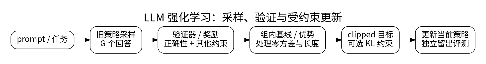

# 推理强化学习：RLVR 与 GRPO

<!-- deep-review-02 -->
> [!tip] 本轮深化：从当前概念继续追问
> 组内减均值不是无条件无偏的策略梯度基线：样本参与自身基线会引入有限组大小的缩放；再除随机标准差会进一步改变估计。需明确奖励和采样假设。 深化与验证：[[AI/20-LLM/30-训练/13-GRPO重要性比率归一化与奖励偏差|GRPO重要性比率归一化与奖励偏差]]；[[AI/10-机器学习与深度学习基础/19-强化学习MDP价值函数与策略梯度|强化学习MDP价值函数与策略梯度]]。

SFT 教模型模仿给定答案；强化学习则按生成结果的奖励改变生成概率。RLVR 指利用可验证结果作为奖励，例如数学答案检查或受隔离代码测试。它不是一个单独的优化器，也不保证验证器覆盖了任务的全部要求。

## 先理解策略梯度

提示为 $x$，回答 $y$ 由策略 $\pi_\theta(y\mid x)$ 采样，奖励为 $r(x,y)$。忽略奖励对参数的直接依赖时：

$$
\nabla_\theta\mathbb E_{y\sim\pi_\theta}[r(x,y)]
=\mathbb E[r(x,y)\nabla_\theta\log\pi_\theta(y\mid x)].
$$

提高正向奖励回答的对数概率，降低相对较差回答的概率。减去不依赖当前动作的基线，在合适条件下不改变期望梯度，却能降低方差。实际训练使用有限样本、旧策略生成的数据和各种归一化，因此估计误差与偏差都要检查。

## GRPO 的组内比较

对同一提示采样 $G$ 个回答，得到奖励 $r_i$。常见的组相对优势近似为：

$$
A_i=\frac{r_i-\overline r}{s_r+\epsilon},\qquad
\overline r=\frac1G\sum_{i=1}^G r_i.
$$

例如奖励为 `[0,0,1,1]`，按总体标准差约定得到优势约 `[-1,-1,1,1]`。若全组奖励相同，中心化后信号为零；没有必要把微小数值噪声当成学习发现。采样多少回答、如何处理零方差组、是否跨题归一化，都改变了训练行为。

用旧策略计算采样概率，定义 token 比率：

$$
\rho_{i,t}=\frac{\pi_\theta(y_{i,t}\mid x,y_{i,<t})}
{\pi_{old}(y_{i,t}\mid x,y_{i,<t})}.
$$

PPO 类 clipped surrogate 取 $\min(\rho A,\operatorname{clip}(\rho,1-\delta,1+\delta)A)$，限制旧样本被更新得过猛。它不是硬性保证实际 KL 不超过某值。原始 GRPO 不需要独立的价值网络；参考模型、旧策略和当前策略也不是同一个角色。[1]

## 四个容易悄悄改变目标的地方

按每回答平均 token 损失再平均回答，和把所有 token 一起平均，对长短回答的权重不同。组标准差归一化也可能按题目奖励分布重新加权。奖励长度相关、输出被截断、完成失败未记分，都可能制造伪进步。没有一种“大家都写了 GRPO”的配置可以省去这些定义。

KL 惩罚用于约束相对参考分布的偏移；熵用于观察或鼓励探索。它们不直接等于事实性、安全性或推理能力。奖励提高但回答多样性塌缩、通用能力下降时，要分别诊断。

## 验证器比名称更重要

代码奖励需隔离执行、限制网络/时间/内存，并防止读取隐藏测试。数学等价判断需处理格式、单位和表达式等价，不能只做容易被欺骗的字符串匹配。把评测答案泄漏进提示或奖励模型，得到的不是训练进步。

DeepSeek-R1 是将强化学习用于推理能力的代表性研究，但不说明“只要加 RL 就能从任意基座产生同样能力”。基础模型、任务覆盖、采样、奖励和数据配方均影响结论。[1]

**最小验收：** 用未参与奖励设计的留出题、多个种子和固定总生成 token 预算比较 SFT 与 RL；报告正确率、无效答案、长度、成本和失效题型。零奖励或全相同奖励的组必须单独记录，不能从日志中消失。

## 一手资料

1. [DeepSeek-R1 原始研究](https://arxiv.org/abs/2501.12948)。

**课程入口：** [[AI/20-LLM/30-训练/00-LLM训练-MOC]]。
